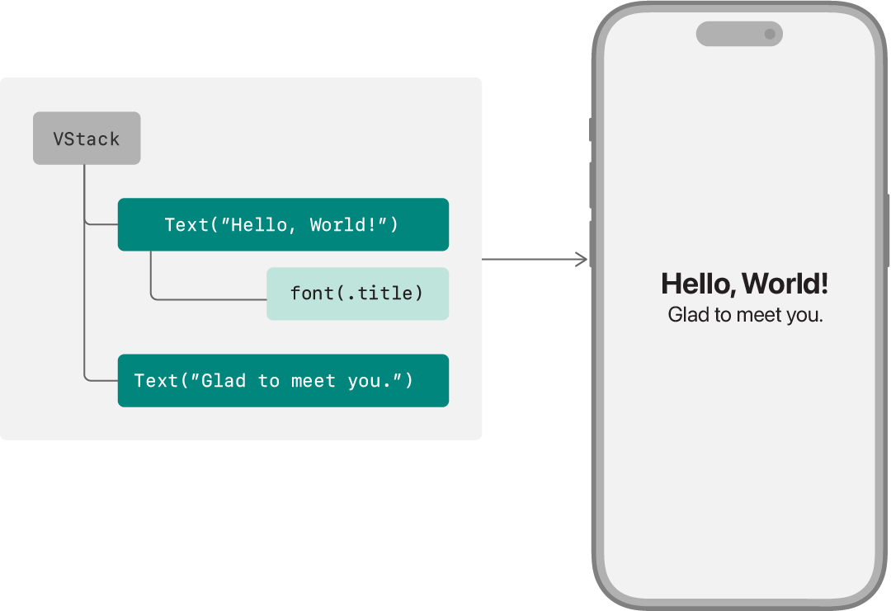
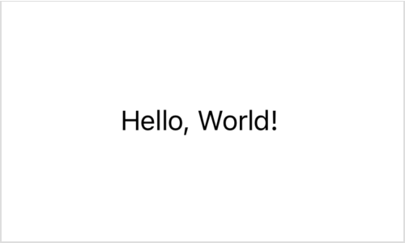

> 导航： [Technologies](../technologies.md) · [SwiftUI](../swiftui.md) · [View fundamentals](view-fundamentals.md)

# 声明自定视图

<sub>文章</sub>

定义视图并把它们组装成视图层级结构。

## 概述

SwiftUI 为用户界面设计提供了一种声明式的方法。在传统的命令式方法中，你的控制器代码不仅要负责实例化、布局和配置视图，还要在条件变化时持续进行更新。与之相对，在声明式方法中，你通过在镜像界面预期布局的层级结构中声明视图，来创建一份轻量的用户界面描述。随后，SwiftUI 会管理这些视图的绘制和更新，以响应用户输入或状态变化等事件。



<sub>一张并排插图：左侧是某个视图层级结构的框图，右侧是 iPhone 上该层级结构对应的渲染结果。该层级结构由一个纵向叠放组成，其中包含两个文本视图，第一个文本视图带有应用标题字体的字体修饰符。在渲染输出中，第一个文本视图比第二个大，因为它使用了标题字体而非默认的正文字体。</sub>

SwiftUI 提供了定义和配置用户界面中视图的工具。你使用 SwiftUI 提供的内置视图，加上你已定义的其他组合视图，来组装出自定视图。你使用视图修饰符配置这些视图，并把它们连接到你的数据模型。然后，你把自定视图放入 App 的视图层级结构中。

### 遵循 View 协议

通过定义一个遵循 [View](view.md) 协议的结构体来声明自定视图类型：

```swift
struct MyView: View {
}
```

与其他 [Swift 协议](https://docs.swift.org/swift-book/LanguageGuide/Protocols.html)一样，[View](view.md) 协议提供了一个功能蓝图——在这里，指的是 SwiftUI 在屏幕上绘制的某个元素的行为。遵循该协议既意味着视图必须满足的要求，也意味着协议提供的功能。在你满足这些要求之后，就可以把自定视图插入视图层级结构，使其成为 App 用户界面的一部分。

### 声明 body

[View](view.md) 协议的主要要求是：遵循该协议的类型必须定义一个 [body](view/body-8kl5o.md) [计算属性](https://docs.swift.org/swift-book/LanguageGuide/Properties.html#ID259)：

```swift
struct MyView: View {
    var body: some View {
    }
}
```

SwiftUI 在任何需要更新视图的时候都会读取这个属性的值，这在视图的生命周期中可能反复发生，通常是为了响应用户输入或系统事件。视图返回的值就是 SwiftUI 在屏幕上绘制的元素。

[View](view.md) 协议的次要要求是：遵循该协议的类型必须为 body 属性指明一个[关联类型](https://docs.swift.org/swift-book/LanguageGuide/Generics.html#ID189)。不过，你不需要显式声明它。相反，你使用 `some View` 语法把 body 属性声明为一个[不透明类型](https://docs.swift.org/swift-book/LanguageGuide/OpaqueTypes.html)，只表明 body 的类型遵循 [View](view.md)。确切类型取决于 body 的内容，而内容会随着你在开发过程中编辑 body 而变化。Swift 会自动推断出确切类型。

### 组装视图的内容

通过向视图的 body 属性添加内容来描述视图的外观。你可以用 SwiftUI 提供的内置视图，以及你在别处定义的自定视图来组合 body。例如，你可以创建一个使用内置 [Text](text.md) 视图绘制“Hello, World!”字符串的 body：

```swift
struct MyView: View {
    var body: some View {
        Text("Hello, World!")
    }
}
```



除了用于特定内容类型、控制和指示符的视图（例如 [Text](text.md)、[Toggle](toggle.md) 和 [ProgressView](progressview.md)）之外，SwiftUI 还提供了可用于排布其他视图的内置视图。例如，你可以使用 [VStack](vstack.md) 纵向叠放两个 [Text](text.md) 视图：

```swift
struct MyView: View {
    var body: some View {
        VStack {
            Text("Hello, World!")
            Text("Glad to meet you.")
        }
    }
}
```


<sub>一张渲染后的两个文本视图的截图，一上一下，上方文本为 Hello World，下方文本为 Glad to meet you，两者都以正文字体渲染。</sub>

接受多个输入子视图的视图（例如上例中的叠放）通常使用标记了 [ViewBuilder](viewbuilder.md) 特性的闭包来做到这一点。这使得调用位置无需额外语法即可使用多条语句的闭包，你只需依次列出输入视图。

有关包含其他视图的视图的示例，参见[布局基础](layout-fundamentals.md)。

### 使用修饰符配置视图

要配置视图 body 中的各个视图，你需要应用视图修饰符。修饰符不过是在某个特定视图上调用的方法。该方法返回一个新的、经过修改的视图，并在视图层级结构中有效地取代原来的视图。

SwiftUI 为 [View](view.md) 协议扩展了大量用于此目的的方法。所有 [View](view.md) 协议的实现者——无论是内置视图还是自定视图——都可以使用这些以某种方式改变视图行为的方法。例如，你可以应用 [font(_:)](<view/font(__).md>) 修饰符来改变文本视图的字体：

```swift
struct MyView: View {
    var body: some View {
        VStack {
            Text("Hello, World!")
                .font(.title)
            Text("Glad to meet you.")
        }
    }
}
```


<sub>一张渲染后的两个文本视图的截图，一上一下，上方文本为 Hello World，下方文本为 Glad to meet you。上方文本以较大的标题字体显示，下方文本使用较小的正文字体。</sub>

有关视图修饰符的工作原理以及如何在视图上使用它们的更多信息，参见[配置视图](configuring-views.md)。

### 管理数据

要为视图提供输入，添加属性即可。例如，你可以让“Hello, World!”字符串的字体可配置：

```swift
struct MyView: View {
    let helloFont: Font
    
    var body: some View {
        VStack {
            Text("Hello, World!")
                .font(helloFont)
            Text("Glad to meet you.")
        }
    }
}
```

如果某个输入值发生了变化，SwiftUI 会注意到这个变化，并只重绘界面中受影响的部分。这可能涉及重新初始化你的整个视图，但 SwiftUI 会替你管理好这一切。

由于系统可能随时重新初始化某个视图，因此务必避免在视图的初始化代码中执行任何重要的工作。通常最好的做法是省略显式初始化方法（如上例所示），让 Swift 合成一个 _逐一成员初始化方法_（member-wise initializer）。

SwiftUI 提供了许多工具来帮助你在这些约束下管理 App 的数据，详见[为 App 建模数据](model-data.md)。有关 Swift 初始化方法的信息，参见《The Swift Programming Language》中的 [Initialization](https://docs.swift.org/swift-book/LanguageGuide/Initialization.html)。

### 把你的视图加入视图层级结构

定义好视图之后，你可以把它并入其他视图，就像使用内置视图一样。添加视图的方式是在层级结构中你希望它出现的位置声明它。例如，你可以把 `MyView` 放进 App 的 `ContentView`——Xcode 会自动把它创建为新 App 的根视图：

```swift
struct ContentView: View {
    var body: some View {
        MyView(helloFont: .title)
    }
}
```

或者，你也可以把视图添加为 App 中新场景的根视图，例如为 macOS 偏好设置窗口声明内容的 [Settings](settings.md) 场景，或为 watchOS 通知声明内容的 [WKNotificationScene](wknotificationscene.md) 场景。有关使用 SwiftUI 定义 App 结构的更多信息，参见 [App 组织](app-organization.md)。

## 另请参阅

### 创建视图

- [Wishlist：在 SwiftUI App 中规划旅行](wishlist-planning-travel-in-a-swiftui-app.md) — 构建一款旅行规划 App，把行程整理成集合并跟踪活动的完成情况。
- [View](view.md) — 一种表示你的 App 用户界面一部分的类型，并提供用于配置视图的修饰符。
- [ContentBuilder](contentbuilder.md) — 一种自定参数特性，用于从闭包构建视图和其他内容类型。
- [ViewBuilder](viewbuilder.md) — 一种自定参数特性，用于从闭包构建视图。
