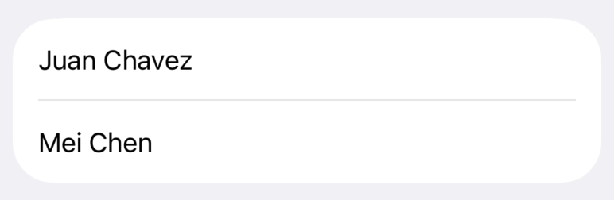

> 导航：[技术](../technologies.md) · [SwiftUI](../swiftui.md) · [列表](lists.md)

# 在列表中显示数据

<sub>文章</sub>

以适合平台的外观将数据集合可视化。

## 概述

在垂直列表中显示数据集合是许多 App 的常见需求。无论是联系人列表、活动日程、类别索引还是购物清单，你经常会发现 [List](list.md) 的用武之地。

列表视图垂直显示条目集合，按需加载行，并在行无法全部显示在屏幕上时添加滚动功能，因此适合显示大量数据集合。

默认情况下，列表视图还会为其元素应用适合平台的样式。例如，在 iOS 上，列表的默认配置会在每行之间显示一条分隔线，并在触发导览操作的条目旁添加显示指示符。

> [!note] 注意
> 如果你想要从列表中移除适合平台的样式——例如行分隔符或自动显示指示符——请考虑改用 [LazyVStack](lazyvstack.md)。有关使用惰性叠放的更多信息，请参阅[创建高性能的可滚动叠放](creating-performant-scrollable-stacks.md)。

本文中的代码展示了如何使用列表视图显示公司的员工名录。每一节都会通过添加自定义单元格、把列表划分为分区，以及使用列表选择来导览到详情视图，增强列表的实用性。

### 准备好你的数据以便迭代

[List](list.md) 最常见的用途是表示数据模型中的信息集合。下面的示例把 `Person` 定义为一个带有 `name` 和 `phoneNumber` 属性的 [Identifiable](../swift/identifiable.md) 类型。一个名为 `staff` 的数组包含该类型的两个实例。

```swift
struct Person: Identifiable {
     let id = UUID()
     var name: String
     var phoneNumber: String
 }

var staff = [
    Person(name: "Juan Chavez", phoneNumber: "(408) 555-4301"),
    Person(name: "Mei Chen", phoneNumber: "(919) 555-2481")
]
```

为了把数组的内容呈现为列表，该示例创建了一个 `List` 实例。列表的内容构建器使用 [ForEach](foreach.md) 遍历 `staff` 数组。对于数组中的每个成员，代码通过实例化一个新的 [Text](text.md)（包含 `Person` 的姓名）来创建一个行视图。

```swift
struct StaffList: View {
    var body: some View {
        List {
            ForEach(staff) { person in
                Text(person.name)
            }
        }
    }
}
```



列表的成员之间必须能够被唯一地识别。唯一标识符让 SwiftUI 能够为底层数据的更改（例如插入、删除和移动）自动生成动画。你可以通过使用符合 [Identifiable](../swift/identifiable.md) 的类型（如 `Person`）来标识列表成员，或者提供 `id` 参数并传入该类型某个唯一属性的键路径。上面填充列表的 `ForEach` 依赖于这一行为，那些接受 [RandomAccessCollection](../swift/randomaccesscollection.md) 成员集合进行遍历的 `List` 初始化方法也是如此。

> [!important] 重要
> 你用于 [Identifiable](../swift/identifiable.md) 数据的值必须唯一。使用 [UUID](../foundation/uuid.md) 或数据库行标识符都是不错的选择，而使用人名或电话号码之类的数据则可能包含重复项。

### 在行内显示数据

[List](list.md) 中的每一行都必须是一个 SwiftUI [View](view.md)。你可以用单个视图（例如 [Image](image.md) 或 [Text](text.md) 视图）来表示你的数据，也可以定义一个自定义视图，把几个视图组合成更复杂的内容。

随着行视图变得越来越复杂，请把这些视图重构为独立的视图结构体，并传入该行渲染所需的数据。下面的示例定义了一个 `PersonRowView`，为 `Person` 创建一个两行视图，使用字体、颜色和系统的"phone"图标图像来为数据设置视觉样式。

```swift
struct PersonRowView: View {
    var person: Person

    var body: some View {
        VStack(alignment: .leading, spacing: 3) {
            Text(person.name)
                .foregroundColor(.primary)
                .font(.headline)
            HStack(spacing: 3) {
                Label(person.phoneNumber, systemImage: "phone")
            }
            .foregroundColor(.secondary)
            .font(.subheadline)
        }
    }
}

struct StaffList: View {
    var body: some View {
        List {
            ForEach(staff) { person in
                PersonRowView(person: person)
            }
        }
    }
}
```


<sub>一个包含两个条目的列表，每个条目显示一个姓名和一个电话号码。每个列表条目都有一个两行的单元格。第一行以粗体显示姓名。第二行显示一个电话图标，后跟使用普通字体和较浅颜色的电话号码。</sub>

有关组合列表行中常用的视图类型的更多信息，请参阅[用叠放视图构建布局](building-layouts-with-stack-views.md)。

### 用分区表示数据层级

[List](list.md) 视图还可以显示带有层级结构的数据，把相关数据分组为分区。

考虑一个代表整个公司（包括多个部门）的扩展数据模型。每个 `Department` 都有一个名称和一个 `Person` 实例数组，而公司则有一个 `Department` 类型的数组。

```swift
struct Department: Identifiable {
    let id = UUID()
    var name: String
    var staff: [Person]
}

struct Company {
    var departments: [Department]
}

var company = Company(departments: [
    Department(name: "Sales", staff: [
        Person(name: "Juan Chavez", phoneNumber: "(408) 555-4301"),
        Person(name: "Mei Chen", phoneNumber: "(919) 555-2481"),
        // ...
    ]),
    Department(name: "Engineering", staff: [
        Person(name: "Bill James", phoneNumber: "(408) 555-4450"),
        Person(name: "Anne Johnson", phoneNumber: "(417) 555-9311"),
        // ...
    ]),
    // ...
])
```

使用 [Section](section.md) 视图为 `List` 内的数据赋予层级。先创建 `List`，使用一个 [ForEach](foreach.md) 遍历 `company.departments` 数组，然后为每个部门创建 `Section` 视图。在分区的视图构建器中，使用 `ForEach` 遍历该部门的 `staff`，并为每个 `Person` 返回一个自定义视图。

```swift
List {
    ForEach(company.departments) { department in
        Section {
            ForEach(department.staff) { person in
                PersonRowView(person: person)
            }
        } header: {
            Text(department.name)
        }
    }
 }
```


<sub>一个带有分区的列表。第一个分区的分区标头为 Sales，其后是该分区中的四个人员条目（各占一行）。下一个分区 Engineering 包含四个条目，随后的 Customer Service 包含两个条目。</sub>

> [!note] 注意
> 如果你的数据层级太深，无法用单一层级的分区和行来表示，那么 [OutlineGroup](outlinegroup.md) 和 [DisclosureGroup](disclosuregroup.md) 可能更合适。这些视图使用展开比喻，允许人们深入层级结构的任意深度。

### 使用列表进行导览

在 [NavigationStack](navigationstack.md) 所包含的 [List](list.md) 内使用 [NavigationLink](navigationlink.md)，可以为导览添加适合平台的视觉样式。当有人选择一个列表条目时，SwiftUI 会导览到你提供的目的地视图。

下面的示例通过用导览叠放包裹列表来搭建基于导览的界面。`NavigationLink` 的实例包裹列表的行，以提供一个人点按该行时导览前往的 `destination` 视图。

```swift
NavigationStack {
    List {
        ForEach(company.departments) { department in
            Section {
                ForEach(department.staff) { person in
                    NavigationLink {
                        PersonDetailView(person: person)
                    } label: {
                        PersonRowView(person: person)
                    }
                }
            } header: {
                Text(department.name)
            }
        }
    }
    .navigationTitle("Staff Directory")
}
```

在这个示例中，作为 `destination` 传入的视图是一个 `PersonDetailView`，它重复列表中的信息。在更复杂的 App 中，这个详情视图可以显示关于某个 `Person` 的更多信息，而不局限于列表行能放下的内容。

```swift
struct PersonDetailView: View {
    var person: Person

    var body: some View {
        VStack {
            Text(person.name)
                .foregroundColor(.primary)
                .font(.title)
                .padding()
            HStack {
                Label(person.phoneNumber, systemImage: "phone")
            }
            .foregroundColor(.secondary)
        }
    }
}
```

有关导览叠放的更多信息，请参阅[了解导览叠放](understanding-the-navigation-stack.md)。

## 另请参阅

### 创建列表

- [List](list.md) — 一个以单列形式呈现数据行的容器，可选择提供选择一个或多个成员的能力。
- [listStyle(_:)](<view/liststyle(__).md>) — 设置此视图内列表的样式。
