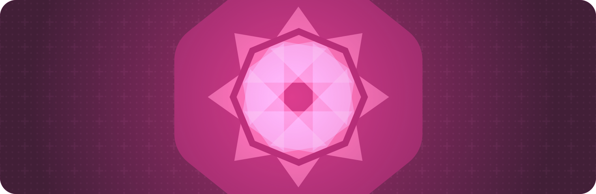

> 导航： [Technologies](../technologies.md) · [SwiftUI](../swiftui.md)

# 绘图与图形

API 集合

用图形效果和自定绘图增强你的视图。

## 概述

你可以使用 SwiftUI 提供的内置视图和 [Shapes](shapes.md) 创建丰富、动态的用户界面。要增强任何视图，你都可以应用通常与图形上下文相关的许多图形效果，例如设置颜色、添加遮罩和创建合成。

当你需要图形上下文中立即模式绘制的灵活性时，请使用 [Canvas](canvas.md) 视图。当你想要绘制数量极其庞大的动态形状（例如创建粒子效果）时，这尤其有用。

如需设计指导，参见《人机界面指南》中的[材质](../design/human-interface-guidelines/materials.md)和[颜色](../design/human-interface-guidelines/color.md)。

## 主题

### 组合图形效果

- [使用 SwiftUI 组合高级图形效果](composing-advanced-graphics-effects-with-swiftui.md) — 通过组合图形效果，在你的 App 中创建引人注目的视觉效果。

### 立即模式绘制

- [为你的 SwiftUI App 添加丰富图形](add-rich-graphics-to-your-swiftui-app.md) — 通过添加背景材质、虚化、自定图形和动画，让你的 App 脱颖而出。
- [Canvas](canvas.md) — 一种支持立即模式绘制的视图类型。
- [GraphicsContext](graphicscontext.md) — 一个立即模式绘制的目标，以及它的当前状态。

### 设置颜色

- [tint(_:)](<view/tint(__).md>) — 设置此视图内的着色颜色。
- [Color](color.md) — 对颜色的一种表示，可适应给定的上下文。

### 设置内容样式

- [border(_:width:)](<view/border(__width_).md>) — 以指定的样式和宽度为视图添加边框。
- [foregroundStyle(_:)](<view/foregroundstyle(__).md>) — 设置视图的前景元素使用给定的样式。
- [foregroundStyle(_:_:)](<view/foregroundstyle(____).md>) — 设置子视图中前景样式的主层级和次层级。
- [foregroundStyle(_:_:_:)](<view/foregroundstyle(______).md>) — 设置前景样式的主层级、次层级和第三层级。
- [backgroundStyle(_:)](<view/backgroundstyle(__).md>) — 设置用于渲染视图内背景的指定样式。
- [backgroundStyle](environmentvalues/backgroundstyle.md) — 一种可选样式，设置后会覆盖默认的系统背景样式。
- [ShapeStyle](shapestyle.md) — 渲染形状时使用的颜色或图案。
- [AnyShapeStyle](anyshapestyle.md) — 一种类型擦除的 ShapeStyle 值。
- [Gradient](gradient.md) — 一种颜色渐变，表示为一个色标数组，每个色标都有一个参数化的位置值。
- [MeshGradient](meshgradient.md) — 一种由二维定位颜色网格定义的二维渐变。
- [AnyGradient](anygradient.md) — 一种颜色渐变。
- [ShadowStyle](shadowstyle.md) — 渲染阴影时使用的样式。
- [Glass](glass.md) — 定义 Liquid Glass 材质配置的结构体。

### 变换颜色

- [brightness(_:)](<view/brightness(__).md>) — 按指定的量调亮此视图。
- [contrast(_:)](<view/contrast(__).md>) — 设置此视图中相近颜色之间的对比度和区分度。
- [colorInvert()](<view/colorinvert().md>) — 反转此视图中的颜色。
- [colorMultiply(_:)](<view/colormultiply(__).md>) — 为此视图添加颜色相乘效果。
- [saturation(_:)](<view/saturation(__).md>) — 调整此视图的颜色饱和度。
- [grayscale(_:)](<view/grayscale(__).md>) — 为此视图添加灰度效果。
- [hueRotation(_:)](<view/huerotation(__).md>) — 为此视图应用色相旋转效果。
- [luminanceToAlpha()](<view/luminancetoalpha().md>) — 为此视图添加亮度转 Alpha 效果。
- [materialActiveAppearance(_:)](<view/materialactiveappearance(__).md>) — 为此视图中的材质设置显式的活跃外观。
- [materialActiveAppearance](environmentvalues/materialactiveappearance.md) — 材质在活跃状态下应采用的行为，默认为 `automatic`。
- [MaterialActiveAppearance](materialactiveappearance.md) — 材质在活跃与不活跃状态下的表现行为。

### 缩放、旋转或变换视图

- [scaledToFill()](<view/scaledtofill().md>) — 缩放此视图以填满其父视图。
- [scaledToFit()](<view/scaledtofit().md>) — 缩放此视图以适配其父视图。
- [scaleEffect(_:anchor:)](<view/scaleeffect(__anchor_).md>) — 相对于锚点，按指定系数均匀缩放此视图。
- [scaleEffect(x:y:anchor:)](<view/scaleeffect(x_y_anchor_).md>) — 相对于锚点，按给定的水平量和垂直量缩放此视图的渲染输出。
- [scaleEffect(x:y:z:anchor:)](<view/scaleeffect(x_y_z_anchor_).md>) — 相对于锚点，按指定的水平、垂直和深度系数缩放此视图。
- [aspectRatio(_:contentMode:)](<view/aspectratio(__contentmode_).md>) — 将此视图的尺寸约束为指定的宽高比。
- [rotationEffect(_:anchor:)](<view/rotationeffect(__anchor_).md>) — 围绕指定点在二维空间中旋转视图的渲染输出。
- [rotation3DEffect(_:axis:anchor:anchorZ:perspective:)](<view/rotation3deffect(__axis_anchor_anchorz_perspective_).md>) — 渲染视图内容，就好像它围绕指定的轴在三维空间中旋转。
- [perspectiveRotationEffect(_:axis:anchor:anchorZ:perspective:)](<view/perspectiverotationeffect(__axis_anchor_anchorz_perspective_).md>) — 渲染视图内容，就好像它围绕指定的轴在三维空间中旋转。
- [rotation3DEffect(_:anchor:)](<view/rotation3deffect(__anchor_).md>) — 按指定的 3D 旋转值旋转视图的内容。
- [rotation3DEffect(_:axis:anchor:)](<view/rotation3deffect(__axis_anchor_).md>) — 围绕一条以元素元组形式指定的轴，按某个角度旋转视图的内容。
- [transformEffect(_:)](<view/transformeffect(__).md>) — 对此视图的渲染输出应用一个仿射变换。
- [transform3DEffect(_:)](<view/transform3deffect(__).md>) — 对此视图的渲染输出应用一个 3D 变换。
- [projectionEffect(_:)](<view/projectioneffect(__).md>) — 对此视图的渲染输出应用一个投影变换。
- [ProjectionTransform](projectiontransform.md)
- [ContentMode](contentmode.md) — 定义视图内容如何填满可用空间的一组常量。

### 遮罩与裁剪

- [mask(alignment:_:)](<view/mask(alignment___).md>) — 使用给定视图的 Alpha 通道为视图添加遮罩。
- [clipped(antialiased:)](<view/clipped(antialiased_).md>) — 将视图裁剪到它的边界矩形框架内。
- [clipShape(_:style:)](<view/clipshape(__style_).md>) — 为此视图设置一个裁剪形状。

### 应用模糊与阴影

- [blur(radius:opaque:)](<view/blur(radius_opaque_).md>) — 为此视图应用高斯模糊。
- [shadow(color:radius:x:y:)](<view/shadow(color_radius_x_y_).md>) — 为此视图添加阴影。
- [ColorMatrix](colormatrix.md) — 在 RGBA 颜色变换中使用的矩阵。

### 基于几何形状应用效果

- [visualEffect(_:)](<view/visualeffect(__).md>) — 为此视图应用效果，同时通过几何代理提供对布局信息的访问。
- [visualEffect3D(_:)](<view/visualeffect3d(__).md>) — 为此视图应用效果，同时通过 3D 几何代理提供对布局信息的访问。
- [VisualEffect](visualeffect.md) — 视觉效果在不改变视图祖先或后代的情况下改变视图的视觉外观。
- [EmptyVisualEffect](emptyvisualeffect.md) — 基础视觉效果，你可以再向它应用其他效果。

### 合成视图

- [blendMode(_:)](<view/blendmode(__).md>) — 设置此视图与重叠视图合成时使用的融合模式。
- [compositingGroup()](<view/compositinggroup().md>) — 将视图包装在一个合成组中。
- [drawingGroup(opaque:colorMode:)](<view/drawinggroup(opaque_colormode_).md>) — 在最终显示前，将视图内容合成为一幅离屏图像。
- [BlendMode](blendmode.md) — 将视图与重叠内容合成时的各种模式。
- [ColorRenderingMode](colorrenderingmode.md) — 颜色合成操作可选的工作色彩空间集合。
- [CompositorContent](compositorcontent.md)
- [CompositorContentBuilder](compositorcontentbuilder.md) — 用于组合一组 [CompositorContent](compositorcontent.md) 元素的结果构建器。
- [AnyCompositorContent](anycompositorcontent.md) — 类型擦除的合成器内容。

### 测量视图

- [GeometryReader](geometryreader.md) — 一种容器视图，把其内容定义为其自身大小和坐标空间的函数。
- [GeometryReader3D](geometryreader3d.md) — 一种容器视图，把其内容定义为其自身大小和坐标空间的函数。
- [GeometryProxy](geometryproxy.md) — 一个代理，用于访问容器视图的大小和坐标空间（用于锚点解析）。
- [GeometryProxy3D](geometryproxy3d.md) — 一个代理，用于访问容器视图的大小和坐标空间。
- [coordinateSpace(_:)](<view/coordinatespace(__).md>) — 为视图的坐标空间指定一个名称，让其他代码能够以这个命名空间为参照来操作点、尺寸等维度。
- [CoordinateSpace](coordinatespace.md) — 由坐标空间协议创建的已解析坐标空间。
- [CoordinateSpaceProtocol](coordinatespaceprotocol.md) — 布局系统中的一个参照系。
- [PhysicalMetric](physicalmetric.md) — 提供对某个值的访问，该值以点为单位，对应于指定的物理测量值。
- [PhysicalMetricsConverter](physicalmetricsconverter.md) — 物理度量转换器，提供点值与其在 3D 空间中的范围（以物理长度测量表示）之间的转换。

### 响应几何变化

- [onGeometryChange(for:of:action:)](<view/ongeometrychange(for_of_action_).md>) — 添加一个操作，在由几何代理创建的某个值变化时执行。

### 访问 Metal 着色器

- [colorEffect(_:isEnabled:)](<view/coloreffect(__isenabled_).md>) — 返回一个新视图，把 `shader` 作为滤镜效果应用于 `self` 的每个像素的颜色。
- [distortionEffect(_:maxSampleOffset:isEnabled:)](<view/distortioneffect(__maxsampleoffset_isenabled_).md>) — 返回一个新视图，把 `shader` 作为几何扭曲效果应用于 `self` 的每个像素的位置。
- [layerEffect(_:maxSampleOffset:isEnabled:)](<view/layereffect(__maxsampleoffset_isenabled_).md>) — 返回一个新视图，把 `shader` 作为滤镜应用于由 `self` 创建的光栅图层。
- [Shader](shader.md) — 对 Metal 着色器库中某个函数的引用，连同其绑定的 uniform 参数值。
- [ShaderFunction](shaderfunction.md) — 对 Metal 着色器库中某个函数的引用。
- [ShaderLibrary](shaderlibrary.md) — 一个 Metal 着色器库。

### 访问几何构造

- [Axis](axis.md) — 二维坐标系中的水平或垂直维度。
- [Angle](angle.md) — 一种几何角度，其值可以用弧度或度来访问。
- [UnitPoint](unitpoint.md) — 视图坐标空间中的一个归一化二维点。
- [UnitPoint3D](unitpoint3d.md) — 视图坐标空间中的一个归一化三维点。
- [Anchor](anchor.md) — 由锚点源和特定视图派生出的一个不透明值。
- [DepthAlignmentID](depthalignmentid.md)
- [Alignment3D](alignment3d.md) — 全部三个轴上的对齐方式。
- [GeometryProxyCoordinateSpace3D](geometryproxycoordinatespace3d.md) — `GeometryProxy3D` 的一种表示，可用于基于 `CoordinateSpace3D` 的转换。

## 另请参阅

### 视图

- [View fundamentals](view-fundamentals.md) — 使用视图层级结构定义 App 的视觉元素。
- [View configuration](view-configuration.md) — 调整层级结构中视图的特性。
- [View styles](view-styles.md) — 为不同类型的视图应用内置和自定的外观与行为。
- [Animations](animations.md) — 创建平滑的视觉更新，以响应状态的变化。
- [Text input and output](text-input-and-output.md) — 显示格式化的文本并获取用户的文本输入。
- [Images](images.md) — 向 App 的用户界面添加图像和符号。
- [Controls and indicators](controls-and-indicators.md) — 显示值并获取用户的选择。
- [Menus and commands](menus-and-commands.md) — 以节省空间、依赖上下文的方式提供对命令和控制的访问。
- [Shapes](shapes.md) — 用颜色、渐变或其他图案描边和填充内置及自定形状。
