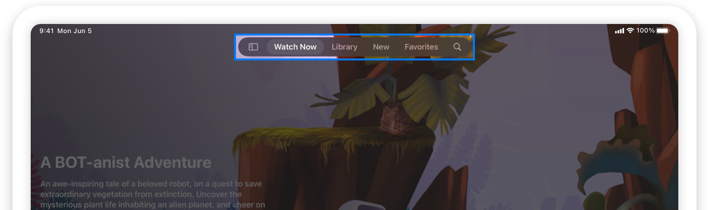
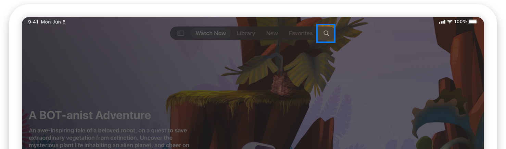
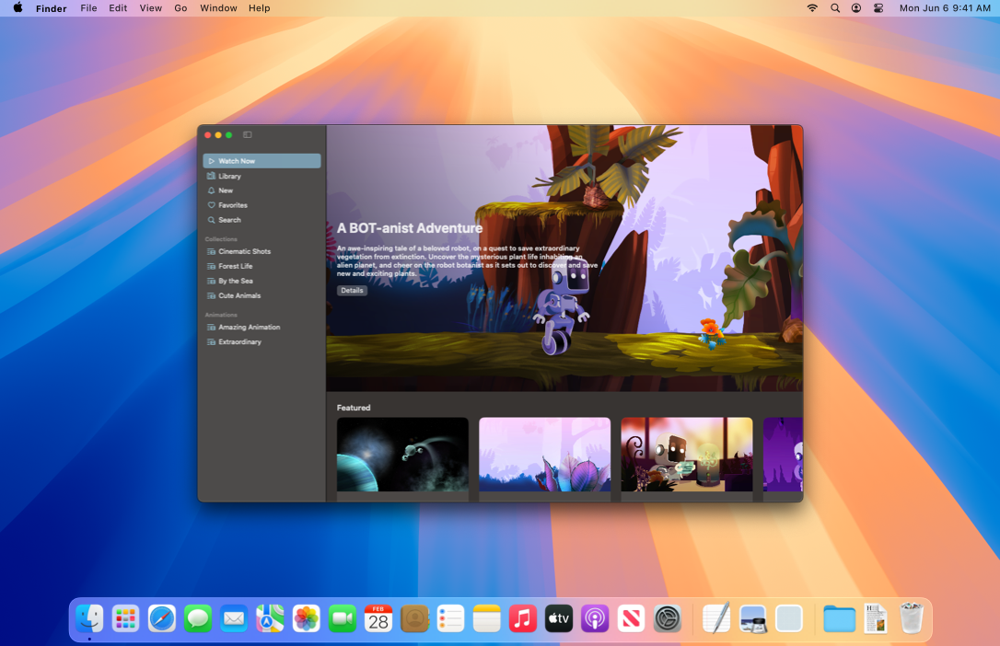
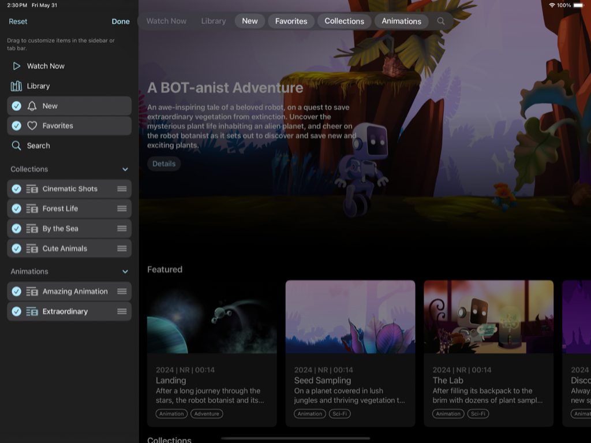
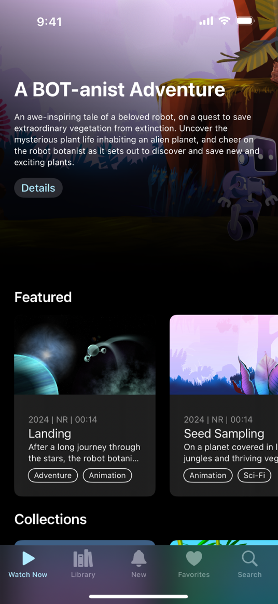
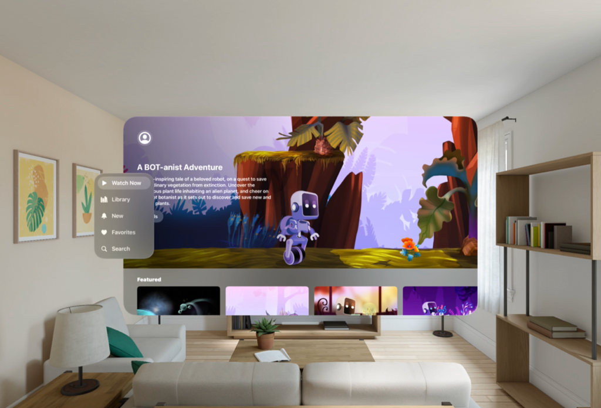

> 导航：[技术](../technologies.md) · [SwiftUI](../swiftui.md) · [导览](navigation.md)

# 用标签页导览增强 App 内容

<sub>示例代码</sub>

让 App 内容保持核心地位，同时通过标签页栏提供快捷的导览访问。

## 概述

[Destination Video](../visionos/destination-video.md) 采用了 [sidebarAdaptable](tabviewstyle/sidebaradaptable.md) 标签页视图样式，为每个平台优化内容浏览体验。

从 iPadOS 18 开始，标签页栏出现在屏幕顶部，悬浮在内容上方，而不是显示在屏幕底部。这种外观带来了沉浸式的全屏浏览体验。标签页栏为用户提供 App 顶层导览的访问入口。然而，过多的标签页会让用户难以找到内容。实现边栏可以让用户更轻松地导览详细的信息层级结构。

[一段 Destination Video 在 iPad 上的屏幕录制，显示标签页栏变成边栏，然后进入可编辑状态。](https://docs-assets.developer.apple.com/published/5874b00c5c2b7ad74c1d96d5e24a0585/Enhancing-your-app-content-with-tab-navigation-hero-video.mp4)

### 创建标签页栏

你可以使用 [init(selection:content:)](<tabview/init(selection_content_).md>) 初始化方法创建带有显式选择绑定的 [TabView](tabview.md)。要在 `TabView` 中添加标签页，请初始化一个 [Tab](tab.md)。Destination Video 使用 [init(_:systemImage:value:content:)](<tab/init(__systemimage_value_content_).md>) 初始化方法创建每个标签页：

```swift
@State private var selectedTab: Tabs = .watchNow

var body: some View {
    TabView(selection: $selectedTab) {
        Tab("Watch Now", systemImage: "play", value: .watchNow) {
            WatchNowView()
        }
        // 更多标签页...
    }
}
```

`TabView` 的选择值类型与它包含的标签页的值类型相匹配。在这里，每个 `Tab` 的值都是 `Tabs` 类型，本示例定义了以下枚举：

```swift
enum Tabs: Equatable, Hashable, Identifiable {
    case watchNow
    case library
    case new
    case favorites
    case search
}
```

> [!note] 注意
> 为标签页使用符号图像时，请使用轮廓变体。当符号出现在标签页栏中时，系统会自动选择填充变体。



<sub>模拟器中 iPadOS 标签页栏的截屏。标签页栏被高亮显示，左侧有一个将其变为边栏的图标，随后是以下标签页：Watch Now、Library、New、Favorites 和 Search，其中 Search 显示为放大镜。</sub>

此外，本示例将 [search](tabrole/search.md) 角色与 [init(value:role:content:)](<tab/init(value_role_content_).md>) 初始化方法配合使用。将标签页角色设置为 `search` 会让系统对 `Tab` 应用一些默认的自定设置。搜索标签页会获得：

- 搜索的默认标题「search」
- 搜索的默认系统符号，即放大镜
- 搜索的默认固定行为，系统会自动将其固定在标签页栏中

```swift
Tab(value: .search, role: .search) {
    // ...
}
```

固定的标签页出现在标签页栏的尾端，具体取决于 App 的首选语言。当语言是从左到右书写的语言时，它们出现在右侧；当语言是从右到左书写的语言时，它们出现在左侧。



<sub>标签页栏的截屏，其中搜索标签页被高亮显示。标签页栏左侧有一个将其变为边栏的图标，随后是以下标签页：Watch Now、Library、New、Favorites 和 Search，其中 Search 显示为放大镜。</sub>

### 在标签页视图中构建层级结构

你可以使用 [TabSection](tabsection.md) 在 `TabView` 中声明二级标签页层级结构。例如，Destination Video 使用 [init(content:header:)](<tabsection/init(content_header_).md>) 初始化方法来创建标签页分区。

```swift
TabView(selection: $selectedTab) {
    Tab("Watch Now", systemImage: "play", value: .watchNow) {
        WatchNowView()
    }

    // 更多标签页...
    
    TabSection {
        Tab("Cinematic Shots", systemImage: "list.and.film", value: .collections(.cinematic)) {
            // ...
        }
    } header: {
        Label("Collections", systemImage: "folder")
    }
}
```

然后，它扩展了 `Tabs` 枚举以涵盖二级标签页：

```swift
enum Tabs: Equatable, Hashable, Identifiable {
    case watchNow
    // ..
    case search
    case collections(Category)
    case animations(Category)
}

enum Category: Equatable, Hashable, Identifiable, CaseIterable {
    case cinematic
    case forest
    case sea
    // ...
}
```

本示例使用 [ForEach](foreach.md) 循环为每个标签页值迭代并初始化一个新的 `Tab`。

```swift
TabSection {
    ForEach(Category.collectionsList) { collection in
        Tab(collection.name, systemImage: collection.icon, value: Tabs.collections(collection)) {
            // ..
        }
    }
} header: {
    Label("Collections", systemImage: "folder")
}
```

### 让标签页栏可自适应

带有 [sidebarAdaptable](tabviewstyle/sidebaradaptable.md) 样式的标签页栏允许用户在边栏和标签页栏之间切换。这让你的 App 既能利用紧凑标签页栏快速导览到顶层目的地的便利，又能在边栏中提供丰富的导览层级结构和目的地选项。

为了创建可自适应的标签页栏，Destination Video 向其 `TabView` 添加了 [tabViewStyle(_:)](<view/tabviewstyle(__).md>) 修饰符并传入 [sidebarAdaptable](tabviewstyle/sidebaradaptable.md) 值。

```swift
TabView(selection: $selectedTab) {
    // Tabs
    // ..
}
.tabViewStyle(.sidebarAdaptable)

```

具有 `sidebarAdaptable` 样式的 `TabView` 在不同平台上呈现方式不同，如下图所示。

**iPadOS**

[一段视频，展示 iPad 上标签页栏形变为边栏。](https://docs-assets.developer.apple.com/published/4bb23bd79fe4bb5fae1c2561bc85ea5b/Enhancing-your-app-content-with-tab-navigation-section-video.mp4)

**iOS**

[一张 iOS 上标签页视图的截屏。](https://docs-assets.developer.apple.com/published/b5bb5ee47439678d99d64d5f69e073f3/Enhancing-your-app-content-with-tab-navigation-iOS-section-video.mp4)

**macOS**



**tvOS**

[一段视频，展示 tvOS 上的标签页视图。](https://docs-assets.developer.apple.com/published/9c378579774fcddd0ccc8677f34e90e6/Enhancing-your-app-content-with-tab-navigation-tvOS-video.mp4)

**visionOS**

[一张显示 visionOS 上标签页视图的图像。](https://docs-assets.developer.apple.com/published/d6016b880f35b5a13af378a550abc2a6/Enhancing-your-app-content-with-tab-navigation-visionOS-section-video.mp4)

> [!note] 注意
> 默认情况下，在 iPadOS 中使用 `sidebarAdaptable` 标签页视图样式时，`ScrollView(.horizontal)` 中的内容会从边栏下方滚过。你可以通过向 `ScrollView` 添加 [clipped(antialiased:)](<view/clipped(antialiased_).md>) 或 [clipShape(_:style:)](<view/clipshape(__style_).md>) 修饰符来防止内容从边栏下方滚过。

### 启用自定

标签页视图自定允许用户进入编辑模式并个性化标签页栏。Destination Video 中的自定允许用户：

- 拖放标签页以从标签页栏中移除和添加标签页
- 隐藏非必要的标签页
- 在边栏中对标签页分区内的标签页重新排序
- 在标签页栏中对标签页重新排序

为了启用自定，本示例定义了一个 [TabViewCustomization](tabviewcustomization.md)，并使用 [tabViewCustomization(_:)](<view/tabviewcustomization(__).md>) 修饰符将它附加到 `TabView`。为了持久化自定设置，本示例为 `TabViewCustomization` 变量添加了带标识符的 [AppStorage](appstorage.md)。最后，它为每个标签页添加了 [customizationID(_:)](<tabcontent/customizationid(__).md>) 修饰符。

```swift
@AppStorage("sidebarCustomizations") var tabViewCustomization: TabViewCustomization
@State private var selectedTab: Tabs = .watchNow

var body: some View {
    TabView(selection: $selectedTab) {
        Tab("Watch Now", systemImage: "play", value: .watchNow) {
            WatchNowView()
        }
        .customizationID(Tabs.watchNow.customizationID)

        // 更多标签页...

    }
    .tabViewCustomization($tabViewCustomization)
}
```

要让最重要的标签页保持可见并处于固定位置，请使用 [customizationBehavior(_:for:)](<tabcontent/customizationbehavior(__for_).md>) 修饰符为这些标签页关闭自定行为。

```swift
Tab("Watch Now", systemImage: "play", value: .watchNow) {
    WatchNowView()
}
.customizationBehavior(.disabled, for: .sidebar, .tabBar)
```



### 设置标签页的默认可见性

在 iPadOS 中，如果标签页过多而无法容纳在屏幕内，系统会折叠放不下的标签页并启用滚动。但是，标签页过多会让用户更难找到想要的标签页并导览你的 App。请考虑限制标签页的数量，使它们都能容纳在标签页栏中。[defaultVisibility(_:for:)](<tabcontent/defaultvisibility(__for_).md>) 修饰符用于设置 `Tab` 或 `TabSection` 的默认可见性。

Destination Video 包含五个标签页和两个标签页分区，每个标签页分区包含多个二级标签页，但标签页栏中只出现七个标签页。为了将标签页栏限制为最重要的标签页，`TabSection` 内的所有标签页默认在标签页栏中隐藏。

```swift
TabSection {
    // Tabs
} header {
    // Section header
}
.defaultVisibility(.hidden, for: .tabBar)
```

**iPadOS**

[一段视频，展示 iPad 上标签页栏形变为边栏。](https://docs-assets.developer.apple.com/published/7802644fe3253c3078b0b1171922f267/Enhancing-your-app-content-with-tab-navigation-iPadOS-video.mp4)

**iOS**



**macOS**


**tvOS**

[一段视频，展示 tvOS 上的标签页视图。](https://docs-assets.developer.apple.com/published/9c378579774fcddd0ccc8677f34e90e6/Enhancing-your-app-content-with-tab-navigation-tvOS-video.mp4)

**visionOS**



如果启用了自定，[defaultVisibility(_:for:)](<tabcontent/defaultvisibility(__for_).md>) 修饰符仍然允许用户把标签页从边栏拖入标签页栏。如果你想把标签页限制为只出现在边栏中，请使用 [sidebarOnly](tabplacement/sidebaronly.md) 而不是设置默认可见性。

有关设计指引，请参阅《人机界面指南》 > [标签页栏](../design/human-interface-guidelines/tab-bars.md)。

## 另请参阅

#### 相关示例

- [Destination Video](../visionos/destination-video.md)

#### 相关文章

- [用标签页栏和边栏提升你的 iPad App](../uikit/elevating-your-ipad-app-with-a-tab-bar-and-sidebar.md)

#### 相关视频

- [在 iPadOS 中提升标签页和边栏体验](../https_/developer.apple.com/videos/play/wwdc2024/10147.md)

## 下载

- [DestinationVideo.zip](https://docs-assets.developer.apple.com/published/3248dcf174b4/DestinationVideo.zip)
