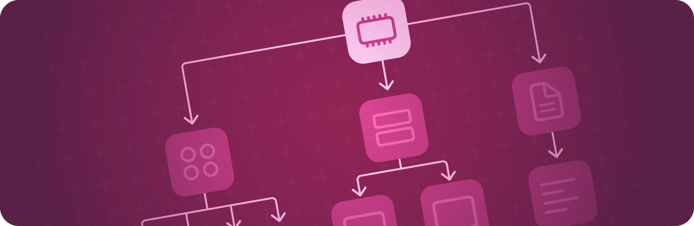

> 导航：[技术](../technologies.md) · [SwiftUI](../swiftui.md)

# 环境值

API 集合

使用环境在整个视图层级结构中共享数据。

## 概述

SwiftUI 中的视图可以使用 [Environment](environment.md) 属性包装器，对从环境中读取的配置信息作出反应。

视图会从其容器视图继承环境，但可通过 [environment(_:_:)](<view/environment(____).md>) 视图修饰符进行显式更改，或由作用于环境值的众多修饰符之一进行隐式更改。因此，你可以通过修改分组容器上的环境来配置整个视图层级结构。

你可以在 [EnvironmentValues](environmentvalues.md) 结构体中找到许多内置环境值。你还可以创建自定的 [EnvironmentValues](environmentvalues.md) 属性，方法是在环境值结构体的扩展中定义一个新属性，并对该变量声明应用 [Entry()](<entry().md>) 宏。

## 主题

### 访问环境值

- [Environment](environment.md) — 一种从视图环境中读取值的属性包装器。
- [EnvironmentValues](environmentvalues.md) — 通过视图层级结构传播的环境值集合。

### 创建自定环境值

- [Entry()](<entry().md>) — 创建环境值、事务、容器值或焦点值条目。
- [EnvironmentKey](environmentkey.md) — 用于访问环境中的值的键。

### 修改视图的环境

- [environment(_:)](<view/environment(__).md>) — 将可观察对象放入视图中。
- [environment(_:_:)](<view/environment(____).md>) — 将指定键路径的环境值设置为给定值。
- [transformEnvironment(_:transform:)](<view/transformenvironment(__transform_).md>) — 用给定的函数变换指定键路径的环境值。

### 修改场景的环境

- [environment(_:)](<scene/environment(__).md>) — 将可观察对象放入场景的环境中。
- [environment(_:_:)](<scene/environment(____).md>) — 将指定键路径的环境值设置为给定值。
- [transformEnvironment(_:transform:)](<scene/transformenvironment(__transform_).md>) — 用给定的函数变换指定键路径的环境值。

## 另请参阅

### 数据与存储

- [Model data](model-data.md) — 管理 App 用来驱动其界面的数据。
- [Preferences](preferences.md) — 从视图向其容器视图指示配置偏好。
- [Persistent storage](persistent-storage.md) — 存储数据，供 App 的多次会话使用。
