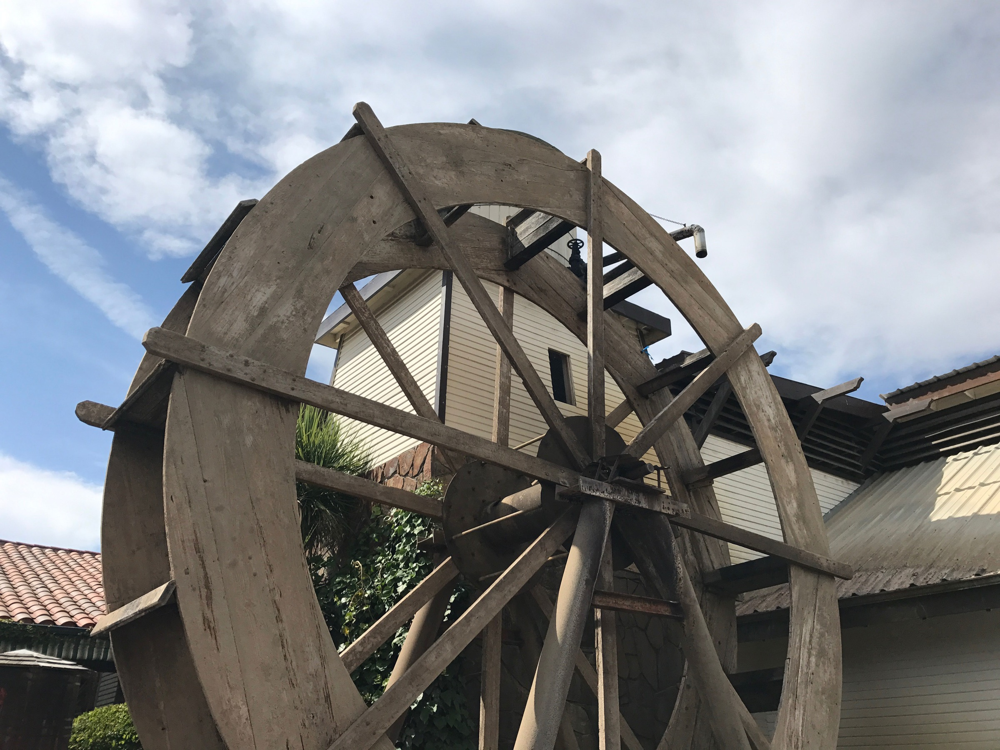
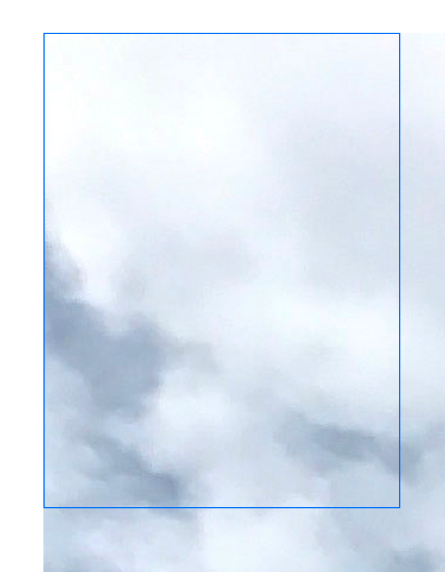
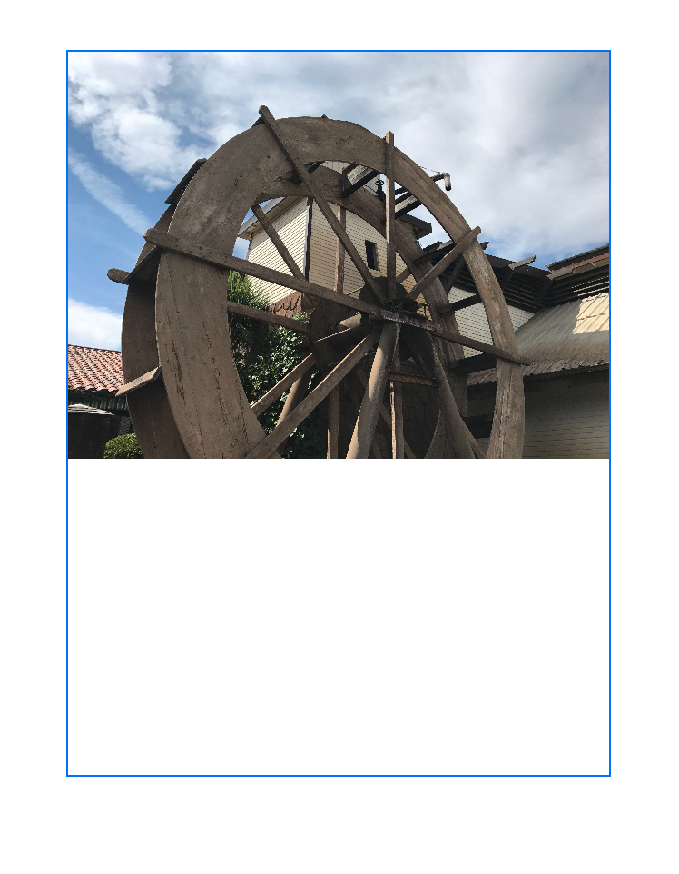
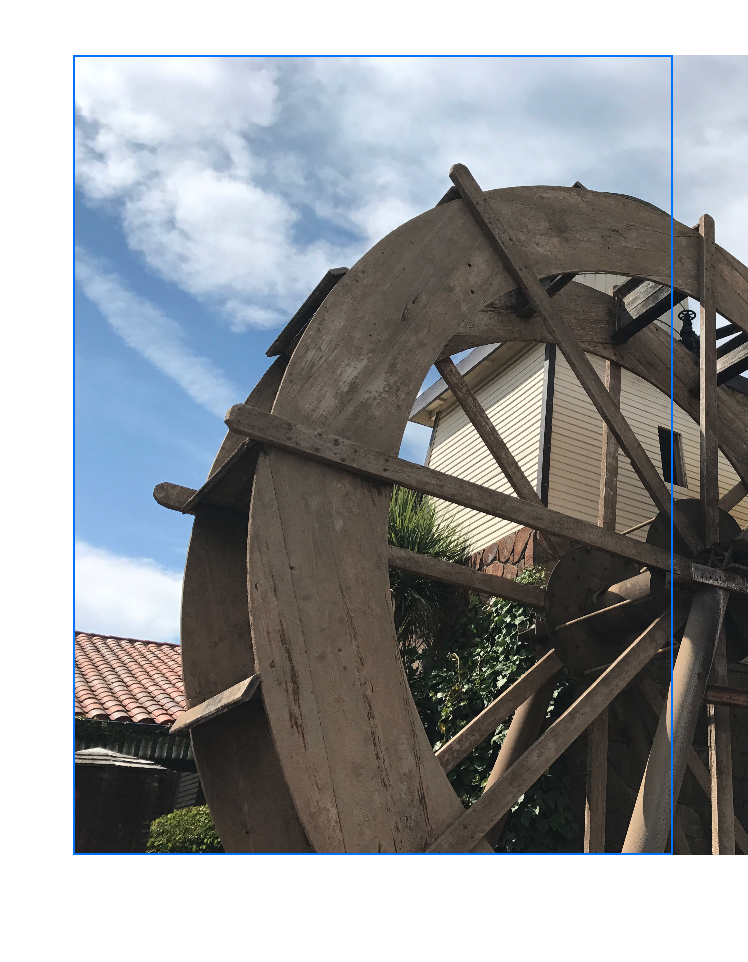
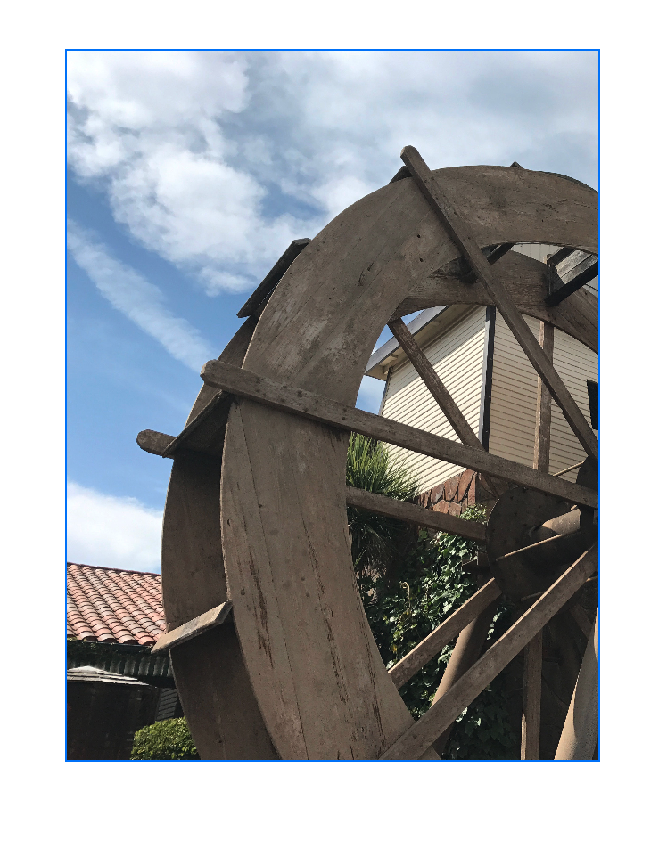
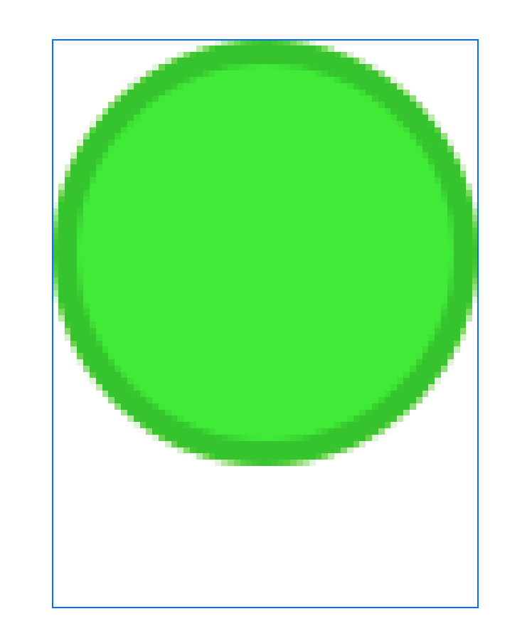
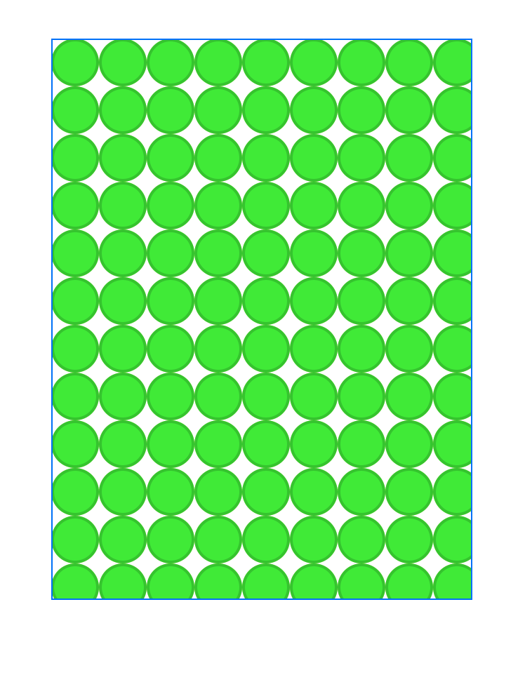

> 导航： [Technologies](../technologies.md) · [SwiftUI](../swiftui.md) · [Images](images.md)

# 让图像适配可用空间

<sub>文章</sub>

通过应用视图修饰符，调整 App 用户界面中图像的大小和形状。

## 概述

图像的大小差异巨大，从单像素的 PNG 文件到拥有数百万像素的数字照片都有。由于设备的尺寸也各不相同，App 通常需要在运行时调整图像大小，使它们适配可见的用户界面。SwiftUI 提供了用于缩放、裁剪和变换图像的修饰符，让图像完美适配你的界面。

### 使用调整大小把大图像缩放到适配其容器

来看图像 `Landscape_4.jpg`，一张尺寸为 4032 x 3024 的照片，画面中有水轮、周边的建筑和上方的天空。



下面的示例把图像直接载入 [Image](image.md) 视图，然后把它放入一个 300 x 400 点的框架中，并加上蓝色边框：

```swift
    Image("Landscape_4")
        .frame(width: 300, height: 400, alignment: .topLeading)
        .border(.blue)
```

正如下面的截图所示，图像数据以原始大小载入视图，因此只能看到原图左上角的云朵。由于图像按原始大小渲染，而蓝色框架比原图小，图像超出了框架的边界。



<sub>一张图像：蓝色边框的框架叠加在水轮图像上。图像比可用空间大得多，以至于只能看到原图左上角的天空和云朵的一部分。图像超出了轮廓的边框。</sub>

要解决这个问题，需要给 `Image` 应用两个修饰符：

- [resizable(capInsets:resizingMode:)](<image/resizable(capinsets_resizingmode_).md>) 告诉图像视图调整图像表示以匹配视图的大小。默认情况下，这个修饰符会缩小较大的图像，并放大小于视图的图像。就其本身而言，这个修饰符会独立缩放图像的每个轴。
- [aspectRatio(_:contentMode:)](<view/aspectratio(__contentmode_).md>) 修正图像在每个轴上缩放比例不同的行为。它使用 [ContentMode](contentmode.md) 枚举定义的两种策略之一，保留图像的原始宽高比。[ContentMode.fit](contentmode/fit.md) 沿一个轴缩放图像以适配视图大小，可能在另一个轴上留下空白。[ContentMode.fill](contentmode/fill.md) 缩放图像以填满整个视图。

  ```swift
    Image("Landscape_4")
        .resizable()
        .aspectRatio(contentMode: .fit)
        .frame(width: 300, height: 400, alignment: .topLeading)
        .border(.blue)
  ```



<sub>一张图像：蓝色边框的框架叠加在水轮图像上。水轮图像被缩放以适配包含矩形的宽度。空白区域从图像底部延伸到矩形的底部。</sub>

### 使用裁剪把图像数据保留在视图边界内

如果在缩放图像时使用 [ContentMode.fill](contentmode/fill.md)，图像的一部分可能会超出视图的边界，除非视图与图像的宽高比完全一致。下面的示例展示了这个问题：

```swift
    Image("Landscape_4")
        .resizable()
        .aspectRatio(contentMode: .fill)
        .frame(width: 300, height: 400, alignment: .topLeading)
        .border(.blue)
```



<sub>一张图像：蓝色边框的框架叠加在水轮图像上。水轮图像在垂直方向上填满了全部空间，并在水平方向上超出了框架的右边缘。</sub>

要避免这个问题，添加 [clipped(antialiased:)](<view/clipped(antialiased_).md>) 修饰符即可。这个修饰符只是在视图的边界框架处切掉多余的图像渲染。你也可以选择添加抗锯齿行为，对裁剪矩形的边缘进行平滑处理；该参数默认为 `false`。下面的示例展示了在前一个填充模式示例的基础上添加裁剪后的效果：

```swift
    Image("Landscape_4")
        .resizable()
        .aspectRatio(contentMode: .fill)
        .frame(width: 300, height: 400, alignment: .topLeading)
        .border(.blue)
        .clipped()
```



<sub>一张图像：蓝色边框的框架叠加在水轮图像上。水轮图像在垂直和水平方向上都填满了整个框架。图像的右侧在矩形的右边缘处被切掉。</sub>

### 使用插值标志调整渲染图像的质量

以非原始尺寸渲染图像需要进行 _插值_（interpolation）：利用现有的图像数据来近似出另一种尺寸下的表示。执行插值的不同方式在计算复杂度和渲染图像的视觉质量之间有不同的权衡。你可以使用 [interpolation(_:)](<image/interpolation(__).md>) 修饰符为 SwiftUI 的渲染行为提供提示。

把较小的图像放大到更大的空间时，更容易看出插值的效果，因为渲染后的图像需要比现有数据更多的图像数据。看下面的示例，它把一张名为 `dot_green` 的 34 x 34 图像渲染到与之前相同的 300 x 400 容器框架中：

```swift
    Image("dot_green")
        .resizable()
        .interpolation(.none)
        .aspectRatio(contentMode: .fit)
        .frame(width: 300, height: 400, alignment: .topLeading)
        .border(.blue)
```

向 [interpolation(_:)](<image/interpolation(__).md>) 传入 [Image.Interpolation.none](image/interpolation/none.md) 值会得到像素化非常明显的渲染图像。



如果把插值值改为 [Image.Interpolation.medium](image/interpolation/medium.md)，SwiftUI 会平滑像素数据，生成像素化不那么明显的图像：


> [!tip] 提示
> 缩小图像时也可以指定插值行为，以确保尽可能高的图像质量、尽可能快的渲染时间，或介于两者之间的某种行为。

### 使用平铺用重复图像填满空间

当你的图像远小于要渲染它的空间时，填满空间的另一种选择是 _平铺_（tiling）：一遍又一遍地重复同一张图像。要平铺图像，把 [Image.ResizingMode.tile](image/resizingmode/tile.md) 参数传给 [resizable(capInsets:resizingMode:)](<image/resizable(capinsets_resizingmode_).md>) 修饰符：

```swift
    Image("dot_green")
        .resizable(resizingMode: .tile)
        .frame(width: 300, height: 400, alignment: .topLeading)
        .border(.blue)
```



当一张图像与其自身的副本首尾相接后能形成没有视觉断点的更大图案时，平铺会特别有用。

## 另请参阅

### 配置图像

- [imageScale(_:)](<view/imagescale(__).md>) — 根据可用的相对尺寸（包括小、中、大图像尺寸）缩放视图内的图像。
- [imageScale](environmentvalues/imagescale.md) — 此环境的图像缩放比例。
- [Scale](image/scale.md) — 相对于文本应用于矢量图像的缩放比例。
- [Orientation](image/orientation.md) — 图像的方向。
- [ResizingMode](image/resizingmode.md) — SwiftUI 用来调整图像大小以适配其包含视图的各种模式。
