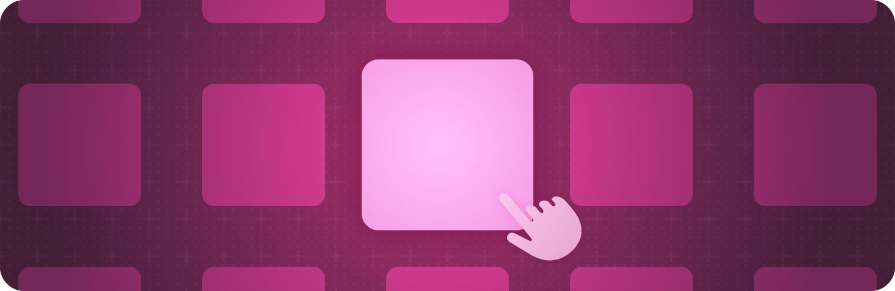

> 导航：[技术](../technologies.md) · [SwiftUI](../swiftui.md)

# 焦点

API 集合

标识并控制哪个可见对象响应用户交互。

## 概述

焦点指示显示器中的哪个元素接收下一个输入。使用视图修饰符来指示哪些视图可以接收焦点、检测哪个视图拥有焦点，并以编程方式控制焦点状态。

有关设计指引，请参阅《人机界面指南》中的[聚焦和选择](../design/human-interface-guidelines/focus-and-selection.md)。

## 主题

### 基础

- [Focus Cookbook：在 SwiftUI App 中支持并增强焦点驱动的交互](focus-cookbook-sample.md) — 创建带有按键处理器的自定义可聚焦视图，加速键盘输入并支持移动，同时以编程方式控制焦点。

### 指示视图可以接收焦点

- [focusable(_:)](<view/focusable(__).md>) — 指定视图是否可聚焦。
- [focusable(_:interactions:)](<view/focusable(__interactions_).md>) — 指定视图是否可聚焦；如果可以，它支持哪些焦点驱动的交互。
- [FocusInteractions](focusinteractions.md) — 描述视图可以支持的不同焦点交互的值。

### 管理焦点状态

- [focused(_:equals:)](<view/focused(__equals_).md>) — 通过把此视图的焦点状态绑定到给定的状态值来修改此视图。
- [focused(_:)](<view/focused(__).md>) — 通过把此视图的焦点状态绑定到给定的布尔状态值来修改此视图。
- [isFocused](environmentvalues/isfocused.md) — 返回最近的可聚焦祖先是否拥有焦点。
- [FocusState](focusstate.md) — 一种属性包装器类型，可读取和写入一个值，该值由 SwiftUI 随场景内焦点位置的变化而更新。
- [FocusedValue](focusedvalue.md) — 一个属性包装器，用于观察来自焦点视图或其某个祖先的值。
- [Entry()](<entry().md>) — 创建一个环境值、事务、容器值或焦点值条目。
- [FocusedValueKey](focusedvaluekey.md) — 一个用于标识符类型的协议，在发布和观察焦点值时使用。
- [FocusedBinding](focusedbinding.md) — 一个便捷属性包装器，用于观察并自动解包来自焦点视图或其某个祖先的状态绑定。
- [searchFocused(_:)](<view/searchfocused(__).md>) — 通过把与最近 searchable 修饰符关联的搜索栏的焦点状态绑定到给定的布尔值来修改此视图。
- [searchFocused(_:equals:)](<view/searchfocused(__equals_).md>) — 通过把与最近 searchable 修饰符关联的搜索栏的焦点状态绑定到给定值来修改此视图。

### 向焦点视图暴露值类型

- [focusedValue(_:)](<view/focusedvalue(__).md>) — 为给定的对象类型设置焦点值。
- [focusedValue(_:_:)](<view/focusedvalue(____).md>) — 修改此视图，注入一个你提供的值，供状态依赖于焦点视图层级结构的其他视图使用。
- [focusedSceneValue(_:)](<view/focusedscenevalue(__).md>) — 在整个场景的范围内为给定的对象类型设置焦点值。
- [focusedSceneValue(_:_:)](<view/focusedscenevalue(____).md>) — 修改此视图，注入一个你提供的值，供状态依赖于焦点场景的其他视图使用。
- [FocusedValues](focusedvalues.md) — 由焦点场景或视图及其祖先导出的一组状态。

### 向焦点视图暴露引用类型

- [focusedObject(_:)](<view/focusedobject(__).md>) — 创建一个新视图，把提供的对象暴露给状态依赖于焦点视图层级结构的其他视图。
- [focusedSceneObject(_:)](<view/focusedsceneobject(__).md>) — 创建一个新视图，把提供的对象暴露给状态依赖于活跃场景的其他视图。
- [FocusedObject](focusedobject.md) — 一个属性包装器类型，用于由焦点视图或其某个祖先提供的可观察对象。

### 设置焦点范围

- [focusScope(_:)](<view/focusscope(__).md>) — 创建一个焦点范围，SwiftUI 用它来限制默认焦点偏好。
- [focusSection()](<view/focussection().md>) — 指示应使用该视图的 frame 及其可聚焦后代群体来引导焦点移动。

### 控制默认焦点

- [prefersDefaultFocus(_:in:)](<view/prefersdefaultfocus(__in_).md>) — 指示该视图应在给定的命名空间中默认接收焦点。
- [defaultFocus(_:_:priority:)](<view/defaultfocus(____priority_).md>) — 通过给给定的焦点状态绑定赋值，定义窗口中评估默认焦点的区域。
- [DefaultFocusEvaluationPriority](defaultfocusevaluationpriority.md) — 在不同情况下评估焦点移动位置时，默认焦点偏好的优先级。

### 重置焦点

- [resetFocus](environmentvalues/resetfocus.md) — 一个请求焦点系统重新评估默认焦点的操作。
- [ResetFocusAction](resetfocusaction.md) — 一个提供重新评估默认焦点能力的环境值。

### 配置效果

- [focusEffectDisabled(_:)](<view/focuseffectdisabled(__).md>) — 添加一个条件，控制此视图能否显示焦点效果，例如默认的焦点环或悬停效果。
- [isFocusEffectEnabled](environmentvalues/isfocuseffectenabled.md) — 一个布尔值，指示与此环境关联的视图是否允许显示焦点效果。

## 另请参阅

### 事件处理

- [手势](gestures.md) — 定义从点按、点击和轻扫到精细手势的各类交互。
- [输入事件](input-events.md) — 响应来自硬件设备（例如键盘或 Touch Bar）的输入。
- [剪贴板](clipboard.md) — 让人们能够通过发出拷贝和粘贴命令来移动或复制条目。
- [拖放](drag-and-drop.md) — 让人们能够通过把条目从一个位置拖到另一个位置来移动或复制它们。
- [系统事件](system-events.md) — 对系统事件（例如打开 URL）作出响应。
