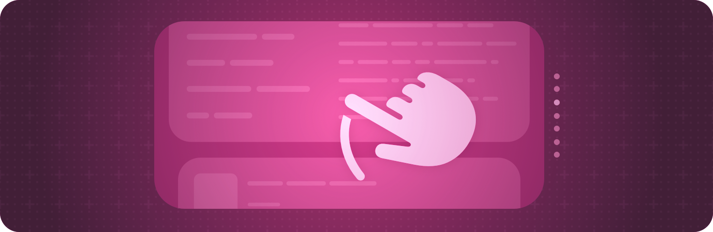

> 导航：[技术](../technologies.md) · [SwiftUI](../swiftui.md)

# 手势

API 集合

定义从轻点、点按、轻扫到精细手势的各种交互。

## 概述

通过向视图添加手势修饰符来响应手势。你可以监听轻点、拖动、捏合和其他标准手势。

你还可以使用 [simultaneously(with:)](<gesture/simultaneously(with_).md>)、[sequenced(before:)](<gesture/sequenced(before_).md>) 或 [exclusively(before:)](<gesture/exclusively(before_).md>) 修饰符，从单个手势组合出自定手势，或者使用 [modifiers(_:)](<gesture/modifiers(__).md>) 修饰符将手势与键盘修饰键组合。

> [!important] 重要
> 当你需要按钮时，请使用 [Button](button.md) 实例而不是轻点手势。你可以使用任何视图作为按钮的标签，并且按钮类型会自动提供用户期望按钮具备的许多标准行为，例如辅助功能标签和提示。

有关设计指引，请参阅《人机界面指南》中的 [Gestures](../design/human-interface-guidelines/gestures.md)。

## 主题

### 基础

- [使用手势添加交互性](adding-interactivity-with-gestures.md) — 使用手势修饰符为你的 App 添加交互性。

### 识别轻点手势

- [onTapGesture(count:perform:)](<view/ontapgesture(count_perform_).md>) — 添加一个操作，在此视图识别出轻点手势时执行。
- [onTapGesture(count:coordinateSpace:perform:)](<view/ontapgesture(count_coordinatespace_perform_).md>) — 添加一个操作，在此视图识别出轻点手势时执行，并向该操作提供交互的位置。
- [onTapGesture(count:coordinateSpace:inputKinds:perform:)](<view/ontapgesture(count_coordinatespace_inputkinds_perform_).md>) — 添加一个操作，在此视图识别出轻点手势时执行，并向该操作提供交互的位置。_(beta)_
- [TapGesture](tapgesture.md) — 识别一次或多次轻点的手势。
- [SpatialTapGesture](spatialtapgesture.md) — 识别一次或多次轻点并报告其位置的手势。

### 识别长按手势

- [onLongPressGesture(minimumDuration:maximumDistance:perform:onPressingChanged:)](<view/onlongpressgesture(minimumduration_maximumdistance_perform_onpressingchanged_).md>) — 添加一个操作，在此视图识别出长按手势时执行。
- [onLongPressGesture(minimumDuration:maximumDistance:inputKinds:perform:onPressingChanged:)](<view/onlongpressgesture(minimumduration_maximumdistance_inputkinds_perform_onpressingchanged_).md>) — 添加一个操作，在此视图识别出长按手势时执行。_(beta)_
- [onLongPressGesture(minimumDuration:perform:onPressingChanged:)](<view/onlongpressgesture(minimumduration_perform_onpressingchanged_).md>) — 添加一个操作，在此视图识别出长按手势时执行。
- [onLongTouchGesture(minimumDuration:perform:onTouchingChanged:)](<view/onlongtouchgesture(minimumduration_perform_ontouchingchanged_).md>) — 添加一个操作，在此视图识别出遥控器长触手势时执行。长触手势是指手指放在遥控器触控表面上但并未实际按压。
- [LongPressGesture](longpressgesture.md) — 当用户执行长按时成功的手势。

### 识别空间事件

- [SpatialEventGesture](spatialeventgesture.md) — 提供诸如点按和触控等正在进行的空间事件信息的手势。
- [SpatialEventCollection](spatialeventcollection.md) — 以特定视图为目标的空间输入事件的集合。
- [Chirality](chirality.md) — 姿态的手性，即左右手属性。

### 识别随时间变化的手势

- [gesture(_:)](<view/gesture(__).md>) — 将 [NSGestureRecognizerRepresentable](nsgesturerecognizerrepresentable.md) 附加到视图。
- [gesture(_:isEnabled:)](<view/gesture(__isenabled_).md>) — 将手势附加到视图，其优先级低于视图定义的手势。
- [gesture(_:name:isEnabled:)](<view/gesture(__name_isenabled_).md>) — 将手势附加到视图，其优先级低于视图定义的手势。
- [gesture(_:including:)](<view/gesture(__including_).md>) — 将手势附加到视图，其优先级低于视图定义的手势。
- [DragGesture](draggesture.md) — 一种拖动动作，在拖动事件序列变化时调用操作。
- [WindowDragGesture](windowdraggesture.md) — 一种识别窗口移动并处理窗口拖动的手势。
- [MagnifyGesture](magnifygesture.md) — 识别放大动作并跟踪放大倍数的手势。
- [RotateGesture](rotategesture.md) — 识别旋转动作并跟踪旋转角度的手势。
- [RotateGesture3D](rotategesture3d.md) — 识别 3D 旋转动作并跟踪旋转角度和轴的手势。
- [GestureMask](gesturemask.md) — 控制向视图添加手势如何影响该视图及其子视图所识别的其他手势的选项。

### 识别 Apple Pencil 手势

- [onPencilDoubleTap(perform:)](<view/onpencildoubletap(perform_).md>) — 添加一个操作，在用户双击 Apple Pencil 后执行。
- [onPencilSqueeze(perform:)](<view/onpencilsqueeze(perform_).md>) — 添加一个操作，在用户挤压 Apple Pencil 时执行。
- [preferredPencilDoubleTapAction](environmentvalues/preferredpencildoubletapaction.md) — 用户在「设置」App 中选择的、双击 Apple Pencil 后偏好执行的操作。
- [preferredPencilSqueezeAction](environmentvalues/preferredpencilsqueezeaction.md) — 用户在「设置」App 中选择的、挤压 Apple Pencil 时偏好执行的操作。
- [PencilPreferredAction](pencilpreferredaction.md) — 用户双击 Apple Pencil 后偏好执行的操作。
- [PencilDoubleTapGestureValue](pencildoubletapgesturevalue.md) — 描述 Apple Pencil 双击手势的值。
- [PencilSqueezeGestureValue](pencilsqueezegesturevalue.md) — 描述 Apple Pencil 挤压手势的值。
- [PencilSqueezeGesturePhase](pencilsqueezegesturephase.md) — 描述 Apple Pencil 挤压手势的阶段和值。
- [PencilHoverPose](pencilhoverpose.md) — 一个描述 Apple Pencil 悬停在视图边界上方区域时的位置和距离的值。

### 组合手势

- [组合 SwiftUI 手势](composing-swiftui-gestures.md) — 组合手势以创建复杂的交互。
- [simultaneousGesture(_:including:)](<view/simultaneousgesture(__including_).md>) — 将手势附加到视图，与视图定义的手势同时处理。
- [simultaneousGesture(_:isEnabled:)](<view/simultaneousgesture(__isenabled_).md>) — 将手势附加到视图，与视图定义的手势同时处理。
- [simultaneousGesture(_:name:isEnabled:)](<view/simultaneousgesture(__name_isenabled_).md>) — 将手势附加到视图，与视图定义的手势同时处理。
- [SequenceGesture](sequencegesture.md) — 由两个手势组成的序列手势。
- [SimultaneousGesture](simultaneousgesture.md) — 一个包含两个手势的手势，两者可以同时发生，没有先后之分。
- [ExclusiveGesture](exclusivegesture.md) — 由两个手势组成的手势，其中只有一个能够成功。

### 自定手势

- [GestureInputKinds](gestureinputkinds.md) — 一个选项集，指定手势应识别哪些输入类型。_(beta)_

### 定义自定手势

- [highPriorityGesture(_:including:)](<view/highprioritygesture(__including_).md>) — 将手势附加到视图，其优先级高于视图定义的手势。
- [highPriorityGesture(_:isEnabled:)](<view/highprioritygesture(__isenabled_).md>) — 将手势附加到视图，其优先级高于视图定义的手势。
- [highPriorityGesture(_:name:isEnabled:)](<view/highprioritygesture(__name_isenabled_).md>) — 将手势附加到视图，其优先级高于视图定义的手势。
- [handGestureShortcut(_:isEnabled:)](<view/handgestureshortcut(__isenabled_).md>) — 为被修饰的控制指定一个手部手势快捷键。
- [defersSystemGestures(on:)](<view/deferssystemgestures(on_).md>) — 设置屏幕边缘，使你的手势在该边缘优先于系统手势。
- [Gesture](gesture.md) — 一个将事件序列与手势匹配的实例，并为手势的每个状态返回一个值流。
- [AnyGesture](anygesture.md) — 一个类型擦除的手势。
- [HandActivationBehavior](handactivationbehavior.md) — 一种特定于手部驱动输入的激活行为。
- [HandGestureShortcut](handgestureshortcut.md) — 手部手势快捷键描述用户为激活按钮或开关而可以执行的手指和手腕动作。

### 管理手势状态

- [GestureState](gesturestate.md) — 一种属性包装器类型，在用户执行手势期间更新属性，并在手势结束时将属性重置回其初始状态。
- [GestureStateGesture](gesturestategesture.md) — 一种更新由手势的 updating 回调所提供状态的手势。

### 处理激活事件

- [allowsWindowActivationEvents(_:)](<view/allowswindowactivationevents(__).md>) — 配置此视图层级结构中的手势能否处理激活所属窗口的事件。

### 已废弃手势

- [MagnificationGesture](magnificationgesture.md) — 识别放大动作并跟踪放大倍数的手势。_(已废弃)_
- [RotationGesture](rotationgesture.md) — 识别旋转动作并跟踪旋转角度的手势。_(已废弃)_

## 另请参阅

### 事件处理

- [输入事件](input-events.md) — 响应来自硬件设备（如键盘或 Touch Bar）的输入。
- [剪贴板](clipboard.md) — 让用户能够通过发出「拷贝」和「粘贴」命令来移动或复制项目。
- [拖放](drag-and-drop.md) — 让用户能够通过将项目从一个位置拖到另一个位置来移动或复制项目。
- [焦点](focus.md) — 识别并控制哪个可见对象响应用户交互。
- [系统事件](system-events.md) — 对系统事件作出反应，例如打开 URL。
