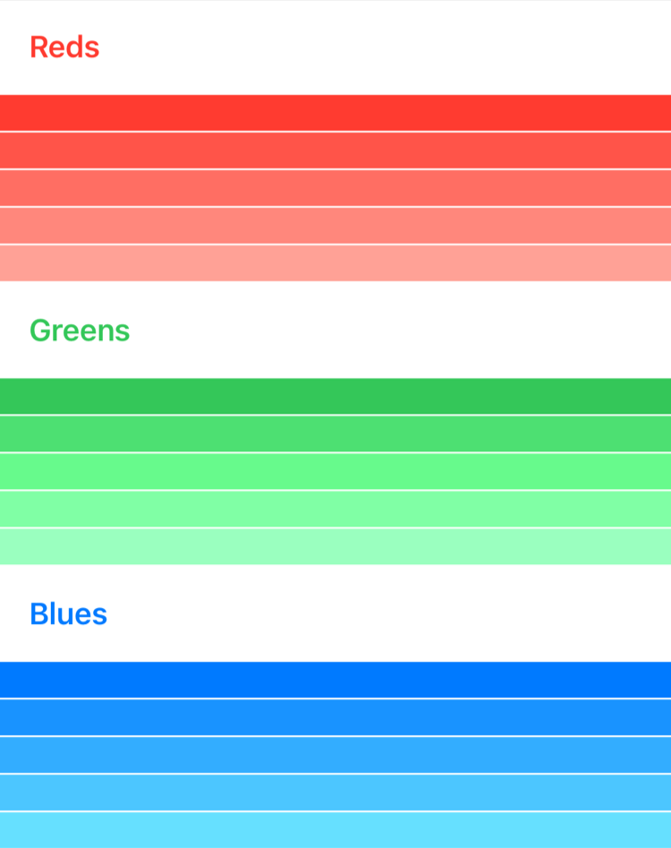
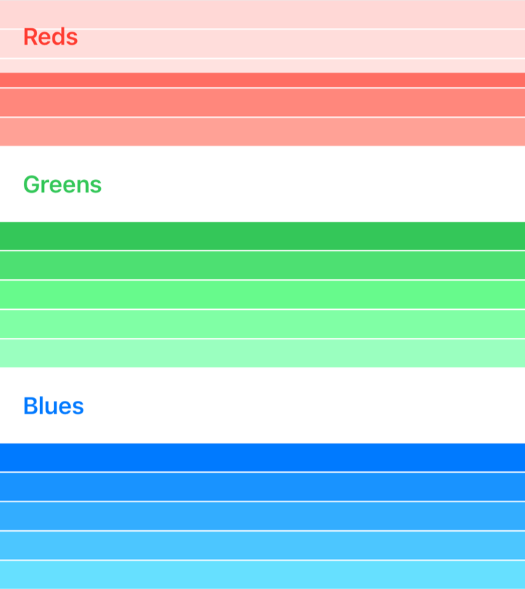

> 导航：[技术](../technologies.md) · [SwiftUI](../swiftui.md) · [布局基础](layout-fundamentals.md)

# 用惰性叠放视图为数据分组

<sub>文章</sub>

在惰性叠放视图内把内容划分为多个逻辑分区。

## 概述

[LazyHStack](lazyhstack.md) 和 [LazyVStack](lazyvstack.md) 视图都能够显示组织成逻辑分区的视图组，分别把子视图排列在水平和垂直方向增长的行列中。这些叠放之所以“惰性”，是因为叠放视图在条目需要渲染到屏幕上之前不会创建它们。与叠放视图一样，惰性叠放本身不带任何滚动支持，你应当把惰性叠放视图包在 [ScrollView](scrollview.md) 容器中。

要在惰性叠放视图内为内容或数据分组，请使用 [Section](section.md) 实例作为分组视图集合的容器。[Section](section.md) 视图本身没有任何视觉呈现，但可以包含标头和页脚视图——它们既可以随叠放的内容一起滚动，也可以由你固定在 [ScrollView](scrollview.md) 的顶部或底部。

> [!note] 注意
> 使用 [Section](section.md) 视图可在叠放视图或惰性叠放、惰性网格、[List](list.md)、[CommandMenu](commandmenu.md)、[Form](form.md) 以及其他多种容器类型内获得适合平台的分组效果。

本文中的代码示例构建了一个用于展示原色色阶的用户界面。叠放中的每个分区代表一种原色，包含五个子视图，每个子视图显示该颜色的一种不同变化。



<sub>一张截图，显示一个带有多个分区的惰性叠放视图。每个分区标头包含颜色的名称，后跟一组显示该颜色不同深浅的视图。</sub>

### 准备好你的数据

与叠放内包含的视图一样，每个 [Section](section.md) 在被 [ForEach](foreach.md) 遍历时都必须能够被唯一地识别。在这个示例中，`ColorData` 实例表示分区，`ShadeData` 实例表示分区内每种颜色的深浅变化。`ColorData` 和 `ShadeData` 都符合 [Identifiable](../swift/identifiable.md) 协议。

```swift
struct ColorData: Identifiable {
    let id = UUID()
    let name: String
    let color: Color
    let variations: [ShadeData]

    struct ShadeData: Identifiable {
        let id = UUID()
        var brightness: Double
    }

    init(color: Color, name: String) {
        self.name = name
        self.color = color
        self.variations = stride(from: 0.0, to: 0.5, by: 0.1)
            .map { ShadeData(brightness: $0) }
    }
}
```

### 显示带有标头和页脚的分区

下面的 `ColorSelectionView` 建立了一个数组，其中包含每种原色的 `ColorData` 实例。[LazyVStack](lazyvstack.md) 遍历颜色数据数组来创建分区，然后遍历 `variations`，根据深浅变化创建视图。

```swift
struct ColorSelectionView: View {
    let sections = [
        ColorData(color: .red, name: "Reds"),
        ColorData(color: .green, name: "Greens"),
        ColorData(color: .blue, name: "Blues")
    ]

    var body: some View {
        ScrollView {
            LazyVStack(spacing: 1) {
                ForEach(sections) { section in
                    Section(header: SectionHeaderView(colorData: section)) {
                        ForEach(section.variations) { variation in
                            section.color
                                .brightness(variation.brightness)
                                .frame(height: 20)
                        }
                    }
                }
            }
        }
    }
}
```

使用 [Section](section.md) 视图为数据分组，并通过 `header` 和 `footer` 属性传入标头或页脚视图。本示例实现了一个 `SectionHeaderView` 作为标头视图，其中包含一个半透明的叠放视图，以及一个显示分区颜色名称的 [Text](text.md) 标签。

```swift
struct SectionHeaderView: View {
    var colorData: ColorData

    var body: some View {
        HStack {
            Text(colorData.name)
                .font(.headline)
                .foregroundColor(colorData.color)
            Spacer()
        }
        .padding()
        .background(Color.primary
                        .colorInvert()
                        .opacity(0.75))
    }
}
```

有关使用 [ForEach](foreach.md) 在叠放内重复视图的更多信息，请参阅[创建高性能的可滚动叠放](creating-performant-scrollable-stacks.md)。

### 让重要信息保持可见

默认情况下，分区标头和页脚视图会随分区内容一起滚动。如果你希望标头和页脚视图始终保持可见——无论分区的顶部或底部是否可见——请为惰性叠放视图的 `pinnedViews` 属性指定一组 [PinnedScrollableViews](pinnedscrollableviews.md)。

```swift
LazyVStack(spacing: 1, pinnedViews: [.sectionHeaders]) {
    // ...
}
```

在 [LazyVStack](lazyvstack.md) 容器中，标头固定在顶部，页脚固定在底部。在 [LazyHStack](lazyhstack.md) 容器中，标头固定在前导边缘，页脚固定在尾随边缘。

有了这一更改，当用户开始滚动时，分区标头就会被固定在视图顶部。



<sub>一张截图，显示一个带有多个分区的惰性叠放视图，配置方式与第一张截图相同。在这张截图中，用户已向下滚动，彩色的视图显示在分区标头后面，标头被固定在容器视图的顶部。</sub>

## 另请参阅

### 在一个维度中动态排列视图

- [创建高性能的可滚动叠放](creating-performant-scrollable-stacks.md) — 使用滚动视图、叠放视图和惰性叠放高效显示大量重复视图。
- [LazyHStack](lazyhstack.md) — 一个把子视图排列在水平方向增长的行中的视图，仅在需要时才创建条目。
- [LazyVStack](lazyvstack.md) — 一个把子视图排列在垂直方向增长的列中的视图，仅在需要时才创建条目。
- [PinnedScrollableViews](pinnedscrollableviews.md) — 一组可以被固定到滚动视图边界的视图类型。
