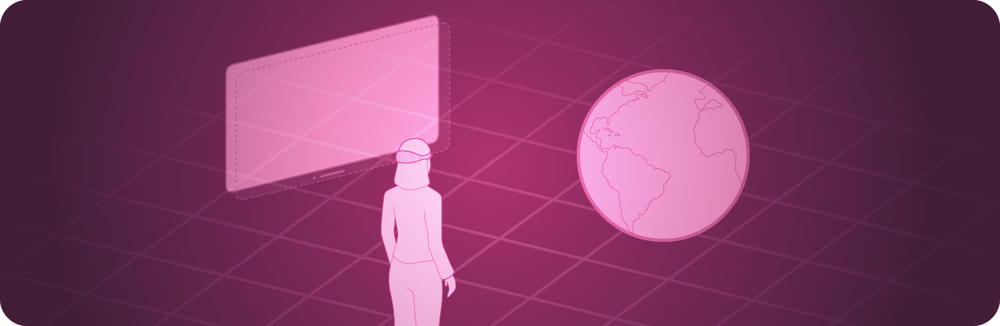

> 导航：[技术](../technologies.md) · [SwiftUI](../swiftui.md)

# 沉浸式空间

API 集合

在用户的周围环境中显示无边界内容。

## 概述

在 visionOS 中使用沉浸式空间，在任何容器之外呈现 SwiftUI 视图。你可以在空间中包含任何视图，不过你通常会使用 [RealityView](../realitykit/realityview.md) 来呈现 RealityKit 内容。

你可以使用 [immersionStyle(selection:in:)](<scene/immersionstyle(selection_in_).md>) 场景修饰符请求三种空间样式之一：

- [mixed](immersionstyle/mixed.md) 样式将你的内容与透视穿透融合。这让你可以把虚拟对象放置在用户的周围环境中。
- [full](immersionstyle/full.md) 样式只显示你的内容，并关闭透视穿透。这让你可以完全掌控视觉体验，例如当你想把人们传送到一个新世界时。
- [progressive](immersionstyle/progressive.md) 样式在显示屏的一部分中完全替换透视穿透。你可以用这种样式在显示通往另一个世界的视野的同时，让人们保持与真实世界的联结。

当你打开一个沉浸式空间时，系统会继续显示你 App 的所有窗口，但会隐藏来自其他 App 的窗口。系统在所有 App 之间同一时间只支持显示一个空间，因此只有在没有空间打开的情况下，你的 App 才能打开一个空间。

## 主题

### 创建沉浸式空间

- [ImmersiveSpace](immersivespace.md) — 一个在无边界空间中呈现其内容的场景。
- [ImmersiveSpaceContentBuilder](immersivespacecontentbuilder.md) — 一个结果构建器，用于组合一组沉浸式空间元素。
- [immersionStyle(selection:in:)](<scene/immersionstyle(selection_in_).md>) — 设置沉浸式空间的样式。
- [ImmersionStyle](immersionstyle.md) — 沉浸式空间可以具有的样式。
- [immersiveSpaceDisplacement](environmentvalues/immersivespacedisplacement.md) — 当系统把沉浸式空间移离其默认位置时对该空间施加的位移，以米为单位。
- [ImmersiveEnvironmentBehavior](immersiveenvironmentbehavior.md) — 当你的 App 打开某个场景时，系统提供的沉浸式环境的行为。
- [ProgressiveImmersionAspectRatio](progressiveimmersionaspectratio.md)

### 打开沉浸式空间

- [openImmersiveSpace](environmentvalues/openimmersivespace.md) — 一个呈现沉浸式空间的操作。
- [OpenImmersiveSpaceAction](openimmersivespaceaction.md) — 一个呈现沉浸式空间的操作。

### 关闭沉浸式空间

- [dismissImmersiveSpace](environmentvalues/dismissimmersivespace.md) — 一个存储在视图环境中的沉浸式空间关闭操作。
- [DismissImmersiveSpaceAction](dismissimmersivespaceaction.md) — 一个关闭沉浸式空间的操作。

### 在沉浸期间隐藏上肢

- [upperLimbVisibility(_:)](<scene/upperlimbvisibility(__).md>) — 在呈现 [ImmersiveSpace](immersivespace.md) 场景时，设置用户上肢的首选可见性。
- [upperLimbVisibility(_:)](<view/upperlimbvisibility(__).md>) — 在呈现 [ImmersiveSpace](immersivespace.md) 场景时，设置用户上肢的首选可见性。

### 调整内容亮度

- [immersiveContentBrightness(_:)](<scene/immersivecontentbrightness(__).md>) — 设置沉浸式空间的内容亮度。
- [ImmersiveContentBrightness](immersivecontentbrightness.md) — 沉浸式空间的内容亮度。

### 响应沉浸状态变化

- [onImmersionChange(initial:_:)](<view/onimmersionchange(initial___).md>) — 当你 App 的沉浸状态发生变化时执行一个操作。
- [ImmersionChangeContext](immersionchangecontext.md) — 一个表示你 App 沉浸状态的结构体。

### 向沉浸式空间添加菜单条目

- [immersiveEnvironmentPicker(content:)](<view/immersiveenvironmentpicker(content_).md>) — 添加菜单条目，以便从媒体播放器的环境选择器中打开沉浸式空间。

### 处理远程沉浸式空间

- [RemoteImmersiveSpace](remoteimmersivespace.md) — 一个在远程设备上的无边界空间中呈现其内容的场景。
- [RemoteDeviceIdentifier](remotedeviceidentifier.md) — 一个不透明类型，用于标识在 [RemoteImmersiveSpace](remoteimmersivespace.md) 中显示场景内容的远程设备。

## 另请参阅

### App 结构

- [App 组织](app-organization.md) — 定义 App 的入口点和顶层结构。
- [场景](scenes.md) — 声明构成 App 各部分的用户界面分组。
- [窗口](windows.md) — 在一个窗口或一组窗口中显示用户界面内容。
- [文稿](documents.md) — 让人们能够打开和管理文稿。
- [导览](navigation.md) — 让人们能够在场景内移动到你 App 视图层级结构的不同部分。
- [模态呈现方式](modal-presentations.md) — 在提供专注交互的独立视图中呈现内容。
- [工具栏](toolbars.md) — 提供对常用命令和控制的即时访问。
- [搜索](search.md) — 让人们能够在你的 App 中搜索文本或其他内容。
- [App 扩展](app-extensions.md) — 把你 App 的基础功能扩展到系统的其他部分，例如添加小组件。
