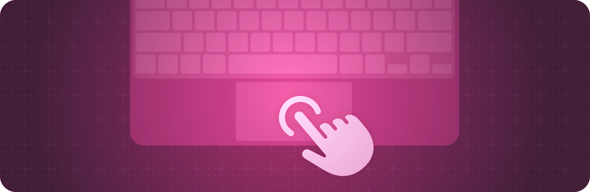

> 导航： [Technologies](../technologies.md) · [SwiftUI](../swiftui.md)

# 输入事件

API 集合

响应来自硬件设备的输入，例如键盘或 Touch Bar。

## 概述

SwiftUI 提供的视图修饰符让你的 App 能够监听各种用户输入并作出响应。例如，你可以创建键盘快捷键、响应表单提交，或者接收来自 Apple Watch 数码旋钮的输入。

如需设计指导，参见《人机界面指南》中的[输入](../design/human-interface-guidelines/inputs.md)。

## 主题

### 响应键盘输入

- [onKeyPress(_:action:)](<view/onkeypress(__action_).md>) — 当视图拥有焦点时，如果用户在实体键盘上按下某个按键，则执行一个操作。
- [onKeyPress(phases:action:)](<view/onkeypress(phases_action_).md>) — 当视图拥有焦点时，如果用户在实体键盘上按下任意按键，则执行一个操作。
- [onKeyPress(_:phases:action:)](<view/onkeypress(__phases_action_).md>) — 当视图拥有焦点时，如果用户在实体键盘上按下某个按键，则执行一个操作。
- [onKeyPress(characters:phases:action:)](<view/onkeypress(characters_phases_action_).md>) — 当视图拥有焦点时，如果用户在实体键盘上按下一个或多个按键，则执行一个操作。
- [onKeyPress(keys:phases:action:)](<view/onkeypress(keys_phases_action_).md>) — 当视图拥有焦点时，如果用户在实体键盘上按下一个或多个按键，则执行一个操作。
- [KeyPress](keypress.md)

### 创建键盘快捷键

- [keyboardShortcut(_:)](<view/keyboardshortcut(__).md>) — 为被修饰的控制指定一个键盘快捷键。
- [keyboardShortcut(_:modifiers:)](<view/keyboardshortcut(__modifiers_).md>) — 定义一个键盘快捷键，并将其指定给被修饰的控制。
- [keyboardShortcut(_:modifiers:localization:)](<view/keyboardshortcut(__modifiers_localization_).md>) — 定义一个键盘快捷键，并将其指定给被修饰的控制。
- [keyboardShortcut](environmentvalues/keyboardshortcut.md) — 此环境中的按钮将被触发的键盘快捷键。
- [KeyboardShortcut](keyboardshortcut.md) — 键盘快捷键描述用户可以按下的按键组合，用以激活按钮或切换开关。
- [KeyEquivalent](keyequivalent.md) — 按键等价物由字母、标点或功能键组成，可与一组可选的修饰键组合，用来指定键盘快捷键。
- [EventModifiers](eventmodifiers.md) — 可以添加到手势上的一组按键修饰符。

### 响应修饰键

- [onModifierKeysChanged(mask:initial:_:)](<view/onmodifierkeyschanged(mask_initial___).md>) — 只要用户按下或松开实体修饰键，就执行一个操作。
- [modifierKeyAlternate(_:_:)](<view/modifierkeyalternate(____).md>) — 当用户按下给定集合所指示的修饰键时，构建一个视图来代替被修饰的视图。

### 响应悬停事件

- [onHover(perform:)](<view/onhover(perform_).md>) — 添加一个操作，在用户的指针移入或移出视图的框架矩形时执行。
- [onContinuousHover(coordinateSpace:perform:)](<view/oncontinuoushover(coordinatespace_perform_).md>) — 添加一个操作，在指针进入、在内部移动和离开视图边界时执行。
- [hoverEffect(_:isEnabled:)](<view/hovereffect(__isenabled_).md>) — 为此视图应用悬停效果。
- [hoverEffectDisabled(_:)](<view/hovereffectdisabled(__).md>) — 添加一个条件，控制此视图能否显示悬停效果。
- [defaultHoverEffect(_:)](<view/defaulthovereffect(__).md>) — 设置此视图内的视图所使用的默认悬停效果。
- [isHoverEffectEnabled](environmentvalues/ishovereffectenabled.md) — 一个布尔值，指示与此环境关联的视图是否允许显示悬停效果。
- [HoverPhase](hoverphase.md) — 指针当前的悬停状态和值。
- [HoverEffectPhaseOverride](hovereffectphaseoverride.md) — 用于覆盖悬停效果当前阶段的选项。
- [OrnamentHoverContentEffect](ornamenthovercontenteffect.md) — 悬停时使用自定效果呈现挂饰。
- [OrnamentHoverEffect](ornamenthovereffect.md) — 悬停时呈现挂饰。

### 修改指针外观

- [pointerStyle(_:)](<view/pointerstyle(__).md>) — 设置指针位于视图上方时显示的指针样式。
- [PointerStyle](pointerstyle.md) — 一种样式，描述指针（也称为光标）悬停在视图上时的外观。
- [pointerVisibility(_:)](<view/pointervisibility(__).md>) — 设置指针位于视图上方时的可见性。

### 为悬停事件改变视图外观

- [hoverEffect(_:)](<view/hovereffect(__).md>) — 为此视图应用悬停效果。
- [HoverEffect](hovereffect.md) — 指针悬停在视图上时应用的效果。
- [hoverEffect(_:in:isEnabled:)](<view/hovereffect(__in_isenabled_).md>) — 为此视图应用悬停效果，并可选地把它加入 [HoverEffectGroup](hovereffectgroup.md)。
- [hoverEffect(in:isEnabled:body:)](<view/hovereffect(in_isenabled_body_).md>) — 应用由给定闭包描述的悬停效果到此视图。
- [CustomHoverEffect](customhovereffect.md) — 一种类型，表示当指针悬停在视图上或有人注视视图时，视图应如何变化。
- [ContentHoverEffect](contenthovereffect.md) — 一种 `CustomHoverEffect`，悬停时使用闭包对视图应用效果。
- [HoverEffectGroup](hovereffectgroup.md) — 描述一组会一起激活的效果。
- [hoverEffectGroup()](<view/hovereffectgroup().md>) — 向后代视图上定义的所有效果添加一个隐式 [HoverEffectGroup](hovereffectgroup.md)，使得当此视图或任何后代视图被悬停时，添加到子视图的所有效果作为一个组一起激活。
- [hoverEffectGroup(_:)](<view/hovereffectgroup(__).md>) — 向后代视图上定义的所有效果添加一个 [HoverEffectGroup](hovereffectgroup.md)，并且当此视图或任何后代视图被悬停时激活该组。
- [hoverEffectGroup(id:in:behavior:)](<view/hovereffectgroup(id_in_behavior_).md>) — 向后代视图上定义的所有效果添加一个 [HoverEffectGroup](hovereffectgroup.md)，并且当此视图或任何后代视图被悬停时激活该组。
- [GroupHoverEffect](grouphovereffect.md) — 一种 `CustomHoverEffect`，激活一组命名的效果。
- [HoverEffectContent](hovereffectcontent.md) — 一种类型，描述视图在特定悬停效果阶段下的效果。
- [EmptyHoverEffectContent](emptyhovereffectcontent.md) — 一个空的基础效果，你可以用它来构建其他效果。
- [handPointerBehavior(_:)](<view/handpointerbehavior(__).md>) — 设置用户与视图交互时手形指针的行为。
- [HandPointerBehavior](handpointerbehavior.md) — 一种可以在用户与视图交互时应用于手形指针的行为。

### 响应提交事件

- [onSubmit(of:_:)](<view/onsubmit(of___).md>) — 添加一个操作，在用户向此视图提交值时执行。
- [submitScope(_:)](<view/submitscope(__).md>) — 阻止源自此视图的提交触发器去调用视图层级结构中更高处的提交修饰符所配置的提交操作。
- [SubmitTriggers](submittriggers.md) — 一种类型，定义导致提交操作触发的各种触发器。

### 标注提交事件

- [submitLabel(_:)](<view/submitlabel(__).md>) — 为此视图设置提交标签。
- [SubmitLabel](submitlabel.md) — 一种语义标签，描述视图层级结构内的提交标签。

### 响应命令

- [onMoveCommand(perform:)](<view/onmovecommand(perform_).md>) — 添加一个操作来响应移动命令，例如用户在 Mac 键盘上按下箭头键，或在控制 Apple TV 时轻点 Siri Remote 的边缘。
- [onDeleteCommand(perform:)](<view/ondeletecommand(perform_).md>) — 添加一个操作来响应系统的“删除”命令，或在视图拥有焦点时按下 ⌫（退格）或 ⌦（前向删除）按键。
- [pageCommand(value:in:step:)](<view/pagecommand(value_in_step_).md>) — 响应翻页上翻或下翻命令，让一个值在一个范围内步进。
- [onExitCommand(perform:)](<view/onexitcommand(perform_).md>) — 设置一个操作，在视图拥有焦点时收到退出命令便触发。
- [onPlayPauseCommand(perform:)](<view/onplaypausecommand(perform_).md>) — 添加一个操作来响应系统的“播放/暂停”命令。
- [onCommand(_:perform:)](<view/oncommand(__perform_).md>) — 添加一个操作来响应给定的选择器。
- [MoveCommandDirection](movecommanddirection.md) — 指定箭头键移动的方向。

### 控制命中测试

- [allowsTightening(_:)](<view/allowstightening(__).md>) — 设置此视图中的文本在必要时是否可以压缩字符间距，以将文本排入一行。
- [contentShape(_:eoFill:)](<view/contentshape(__eofill_).md>) — 定义用于命中测试的内容形状。
- [contentShape(_:_:eoFill:)](<view/contentshape(____eofill_).md>) — 设置此视图的内容形状。
- [ContentShapeKinds](contentshapekinds.md) — 视图内容形状的一种类别。

### 与数码旋钮交互

- [digitalCrownAccessory(_:)](<view/digitalcrownaccessory(__).md>) — 指定 Apple Watch 上数码旋钮附件视图的可见性。
- [digitalCrownAccessory(content:)](<view/digitalcrownaccessory(content_).md>) — 在 Apple Watch 上数码旋钮旁边放置一个附件视图。
- [digitalCrownRotation(_:from:through:sensitivity:isContinuous:isHapticFeedbackEnabled:onChange:onIdle:)](<view/digitalcrownrotation(__from_through_sensitivity_iscontinuous_ishapticfeedbackenabled_onchange_onidle_).md>) — 通过更新指定的绑定来跟踪数码旋钮的旋转。
- [digitalCrownRotation(_:onChange:onIdle:)](<view/digitalcrownrotation(__onchange_onidle_).md>) — 通过更新指定的绑定来跟踪数码旋钮的旋转。
- [digitalCrownRotation(detent:from:through:by:sensitivity:isContinuous:isHapticFeedbackEnabled:onChange:onIdle:)](<view/digitalcrownrotation(detent_from_through_by_sensitivity_iscontinuous_ishapticfeedbackenabled_onchange_onidle_).md>) — 通过更新指定的绑定来跟踪数码旋钮的旋转。
- [digitalCrownRotation(_:)](<view/digitalcrownrotation(__).md>) — 通过更新指定的绑定来跟踪数码旋钮的旋转。
- [digitalCrownRotation(_:from:through:by:sensitivity:isContinuous:isHapticFeedbackEnabled:)](<view/digitalcrownrotation(__from_through_by_sensitivity_iscontinuous_ishapticfeedbackenabled_).md>) — 通过更新指定的绑定来跟踪数码旋钮的旋转。
- [DigitalCrownEvent](digitalcrownevent.md) — 用户旋转数码旋钮时发出的事件。
- [DigitalCrownRotationalSensitivity](digitalcrownrotationalsensitivity.md) — 在两个整数之间移动所需的数码旋钮旋转量。

### 管理 Touch Bar 输入

- [touchBar(content:)](<view/touchbar(content_).md>) — 设置 Touch Bar 显示的内容。
- [touchBar(_:)](<view/touchbar(__).md>) — 设置在适用时显示在 Touch Bar 中的 Touch Bar 内容。
- [touchBarItemPrincipal(_:)](<view/touchbaritemprincipal(__).md>) — 设置对此 Touch Bar 具有特殊意义的主要视图。
- [touchBarCustomizationLabel(_:)](<view/touchbarcustomizationlabel(__).md>) — 设置一个用户可见的字符串，用于标识该视图的功能。
- [touchBarItemPresence(_:)](<view/touchbaritempresence(__).md>) — 设置用户自定视图的行为。
- [TouchBar](touchbar.md) — 一种视图容器，你可以在 Touch Bar 中显示它。
- [TouchBarItemPresence](touchbaritempresence.md) — 影响用户对 Touch Bar 进行自定的一组选项。

### 响应拍摄事件

- [onCameraCaptureEvent(isEnabled:action:)](<view/oncameracaptureevent(isenabled_action_).md>) — 用于注册由系统拍摄事件触发的操作。
- [onCameraCaptureEvent(isEnabled:primaryAction:secondaryAction:)](<view/oncameracaptureevent(isenabled_primaryaction_secondaryaction_).md>) — 用于注册由系统拍摄事件触发的多个操作。

## 另请参阅

### 事件处理

- [Gestures](gestures.md) — 定义从轻点、点按、轻扫到精细手势的各种交互。
- [Clipboard](clipboard.md) — 让人们通过发出“拷贝”和“粘贴”命令来移动或复制项目。
- [Drag and drop](drag-and-drop.md) — 让人们通过把项目从一个位置拖到另一个位置来移动或复制项目。
- [Focus](focus.md) — 识别并控制哪个可见对象响应用户交互。
- [System events](system-events.md) — 对系统事件作出响应，例如打开 URL。
