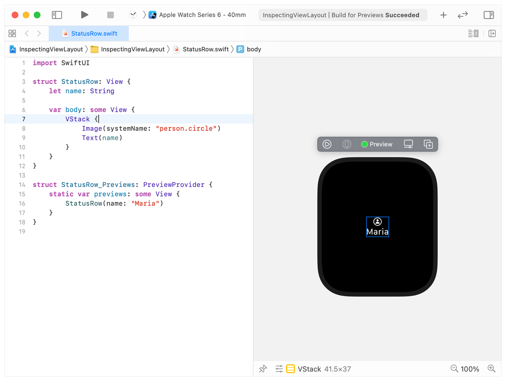
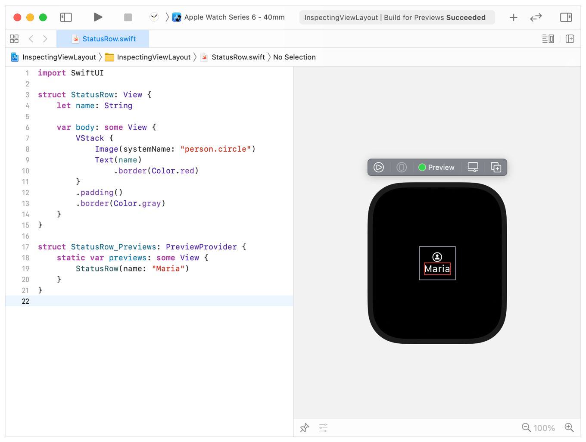

> 导航：[技术](../technologies.md) · [SwiftUI](../swiftui.md) · [Layout adjustments](layout-adjustments.md)

# 检查视图布局

<sub>文章</sub>

使用 Xcode 预览或添加临时边框来确定视图的位置和范围。

## 概述

要了解 SwiftUI 如何确定视图的大小和位置，可以利用 Xcode 预览来检查单个视图的边界。你也可以添加临时边框，查看 SwiftUI 如何一起定位多个视图并确定它们的大小。

### 使用 Xcode 预览高亮视图

借助 Xcode 预览，你可以通过在编辑器中选中视图或子视图，快速查看特定视图元素的大小。为了说明这一点，下面的示例使用 [VStack](vstack.md) 将一个由 [SF Symbols](../design/human-interface-guidelines/sf-symbols.md) 提供的图像垂直组合在名称上方：

```swift
struct StatusRow: View {
    let name: String

    var body: some View {
        VStack {
            Image(systemName: "person.circle")
            Text(name)
        }            
    }
}

struct StatusRow_Previews: PreviewProvider {
    static var previews: some View {
        StatusRow(name: "Maria")
    }
}
```

选中 [VStack](vstack.md) 后，你会在 Xcode 预览中看到该视图周围出现蓝色边框：



<sub>Xcode 的分屏视图，左侧为代码编辑器，右侧为对应的 Xcode 预览，显示 watchOS 模拟器表盘。代码编辑器中是示例代码，编辑光标位于 VStack 所在行并选中它。watchOS 模拟器表盘内有一个矩形，标示 VStack 的边界，其中是来自 SF Symbols 的圆圈内人像符号，位于文本 Maria 上方，两者均水平居中。</sub>

### 使用临时边框探索复杂布局

要查看多个视图的边框，或在视图未被选中时查看边框，请使用视图修饰符 [border(_:width:)](<view/border(__width_).md>) 临时添加一个边框。将边框颜色设置为 [blue](shapestyle/blue.md) 以外的颜色，以便与 Xcode 添加的边框轻松区分：

```swift
struct StatusRow: View {
    let name: String

    var body: some View {
        VStack {
            Image(systemName: "person.circle")
            Text(name)
                .border(Color.red)
        }
        .padding()
        .border(Color.gray)
    }
}
```



<sub>Xcode 的分屏视图，左侧为代码编辑器，右侧为对应的 Xcode 预览，显示 watchOS 模拟器表盘。代码编辑器中是示例代码，多个视图应用了不同颜色的边框。编辑器中的光标位于代码底部，未选中任何代码。watchOS 模拟器表盘内有一个矩形，标示 VStack 的边界。VStack 内是来自 SF Symbols 的圆圈内人像符号，位于文本 Christina 上方，其中一个不同颜色的边框标示该视图在 VStack 中的边界。视图中的图像和文本水平居中。</sub>

## 另请参阅

### 微调布局

- [Laying out a simple view](laying-out-a-simple-view.md) — 通过调整视图的大小来创建视图布局。
