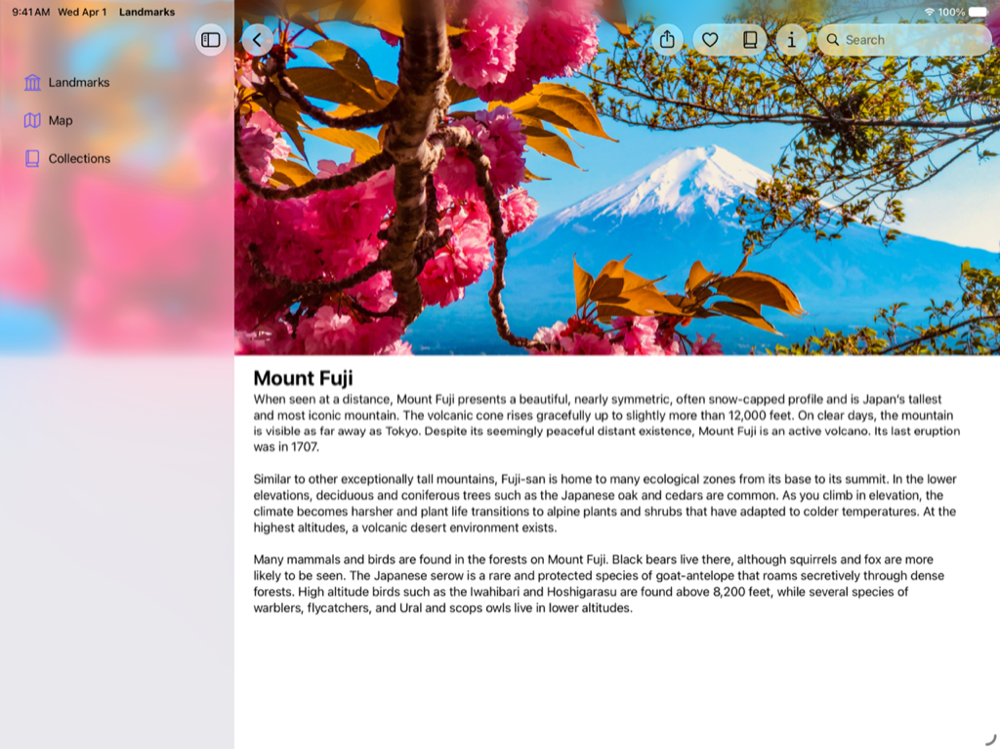
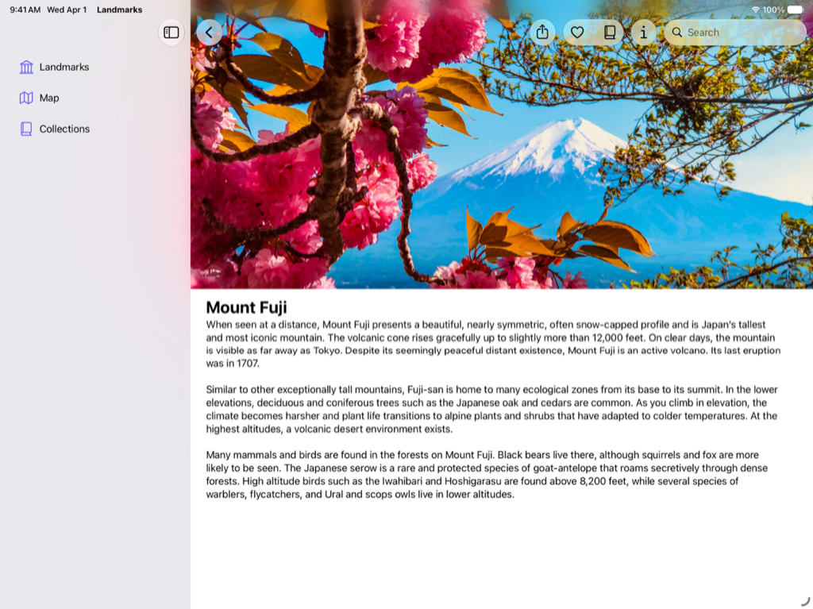

> 导航：[技术](../technologies.md) · [SwiftUI](../swiftui.md) · [Landmarks：使用 Liquid Glass 构建 App](landmarks-building-an-app-with-liquid-glass.md)

# Landmarks：应用背景延伸效果

<sub>示例代码</sub>

配置图像使其在边栏或检查器面板下方模糊并延伸。

## 概述

Landmarks App 让人们探索世界各地的有趣景点。无论是家附近的国家公园，还是另一个大洲上的遥远去处，这个 App 都能让人们组织和标记自己的旅程，并在途中获得自定义活动徽章。

本示例演示如何应用背景延伸效果。在顶层的 Landmarks 视图中，示例对 `LandmarksView` 中的精选图像以及 `LandmarkDetailView` 中的主图像应用了背景延伸效果。背景延伸效果会在边栏或检查器面板打开时，使图像在其下方模糊并延伸。下面的图像分别展示了 `LandmarkDetailView` 中主图像应用与未应用背景延伸效果的样子。

**应用后**



**应用前**



为应用背景延伸效果，本示例：

1. 将视图与所包含视图的前导边缘和尾随边缘对齐。
2. 对该视图应用 [backgroundExtensionEffect()](<view/backgroundextensioneffect().md>) 修饰符。
3. 只对背景延伸中的图像进行配置，避免把该效果应用到覆盖层中的标题和按钮。

### 将视图与前导边缘和尾随边缘对齐

要为视图应用 [backgroundExtensionEffect()](<view/backgroundextensioneffect().md>)，请将视图的前导边缘与边栏相邻对齐，并将视图的尾随边缘与所包含视图的尾随边缘对齐。

在 `LandmarksView` 中，`LandmarkFeaturedItemView` 以及包含它的 [LazyVStack](lazyvstack.md) 和 [ScrollView](scrollview.md) 都没有内边距。这使得 `LandmarkFeaturedItemView` 能够与紧邻边栏的视图前导边缘对齐。

```swift
ScrollView(showsIndicators: false) {
    LazyVStack(alignment: .leading, spacing: Constants.standardPadding) {
        LandmarkFeaturedItemView(landmark: modelData.featuredLandmark!)
            .flexibleHeaderContent()
        //...
    }
}
```

在 `LandmarkDetailView` 中，包含主图像的 [ScrollView](scrollview.md) 和 [VStack](vstack.md) 同样没有任何内边距。这使得主图像能够与所包含视图的前导边缘对齐。

### 对图像应用背景延伸效果

在 `LandmarkDetailView` 中，本示例通过添加 [backgroundExtensionEffect()](<view/backgroundextensioneffect().md>) 修饰符，对主图像应用了背景延伸效果：

```swift
Image(landmark.backgroundImageName)
    //...
    .backgroundExtensionEffect()
```

当边栏打开时，系统按如下方式在前导方向上延伸图像：

- 系统截取图像前导端的一段，宽度与边栏一致。
- 系统把这一段图像朝前导边缘水平翻转，并对翻转后的部分应用模糊。
- 系统将修改后的图像段放在边栏下方，紧贴图像的前导边缘之前。

当检查器打开时，系统按如下方式在尾随方向上延伸图像：

- 系统截取图像尾随端的一段，宽度与边栏一致。
- 系统把这一段图像朝尾随边缘水平翻转，并对翻转后的部分应用模糊。
- 系统将修改后的图像段放在检查器下方，紧贴图像的尾随边缘之后。

### 只对图像进行配置

在 `LandmarksView` 中，`LandmarkFeaturedItemView` 包含一张来自精选景点的图像，并带有该景点的标题，以及一个可点击或点按以进一步了解该地点的按钮。

为了避免景点的标题和按钮在 macOS 上出现在边栏下方，本示例在添加包含标题和按钮的覆盖层之前，先对图像应用 [backgroundExtensionEffect()](<view/backgroundextensioneffect().md>) 修饰符：

```swift
Image(decorative: landmark.backgroundImageName)
    //...
    .backgroundExtensionEffect()
    .overlay(alignment: .bottom) {
        VStack {
            Text("Featured Landmark", comment: "Big headline in the main image of featured landmarks.")
                //...
            Text(landmark.name)
                //...
            Button("Learn More") {
                modelData.path.append(landmark)
            }
            //...
        }
        .padding([.bottom], Constants.learnMoreBottomPadding)
    }

```

## 另请参阅

### App 功能

- [Landmarks：在边栏或检查器下方延伸水平滚动](landmarks-extending-horizontal-scrolling-under-a-sidebar-or-inspector.md) — 通过把水平滚动条延伸到边栏或检查器下方来改进其外观。
- [Landmarks：在工具栏中优化系统提供的 Liquid Glass 效果](landmarks-refining-the-system-provided-glass-effect-in-toolbars.md) — 把工具栏整理成相关的分组，以改进其外观和实用性。
- [Landmarks：显示自定义活动徽章](landmarks-displaying-custom-activity-badges.md) — 通过显示带动画的自定义活动徽章，为人们提供一种标记旅程的方式。

## 下载

- [LandmarksBuildingAnAppWithLiquidGlass.zip](https://docs-assets.developer.apple.com/published/a88428e6793e/LandmarksBuildingAnAppWithLiquidGlass.zip)
