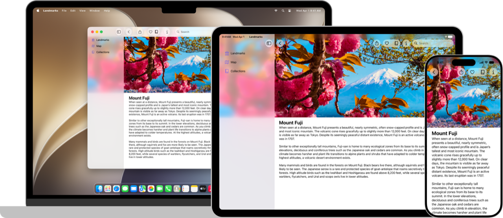
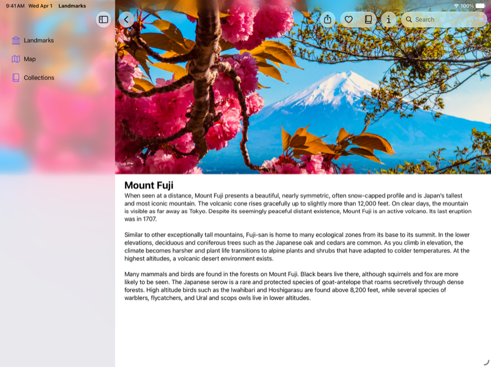
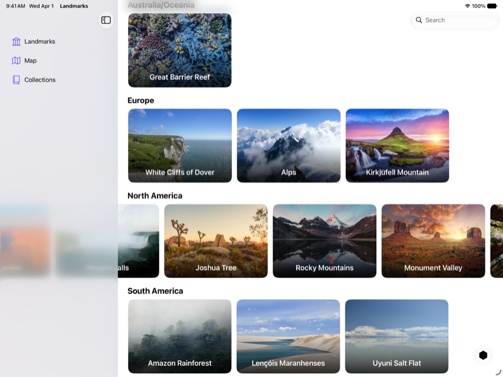
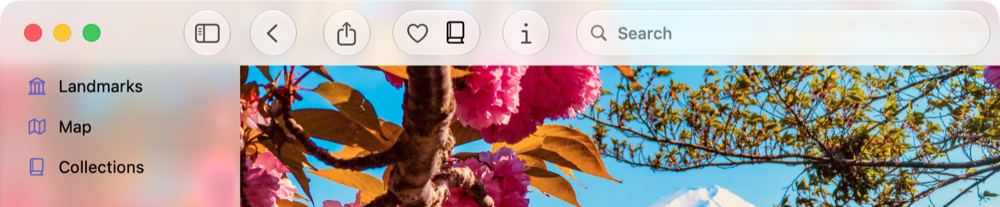
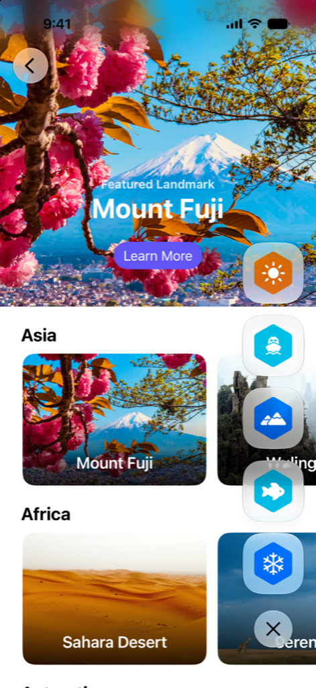

> 导航： [Technologies](../technologies.md) · [SwiftUI](../swiftui.md)

# Landmarks：使用 Liquid Glass 构建 App

示例代码

用系统提供的和自定的 Liquid Glass 增强你的 App 体验。

## 概述

Landmarks 是一款 SwiftUI App，演示了如何使用新的动态且富有表现力的设计特性 Liquid Glass。Landmarks App 让人们探索世界各地的有趣地点。无论是家附近的国家公园，还是另一大洲上的遥远去处，这款 App 都让人们能够整理并标记自己的冒险，并在旅途中获得自定活动徽章。Landmarks 可在 iPad、iPhone 和 Mac 上运行。

Landmarks 使用 [NavigationSplitView](navigationsplitview.md) 来组织 App 中的内容并导览到各处，并演示了几个优化 Liquid Glass 使用的关键概念：

- 利用背景延伸效果，让内容在边栏和检查器背后伸展。
- 让水平滚动视图延伸到边栏或检查器之下。
- 利用系统在工具栏中提供的玻璃效果。
- 将 Liquid Glass 效果应用于自定界面元素和动画。
- 使用 Icon Composer 构建新的 App 图标。

这个示例还演示了在改变窗口大小时可以采用的几种技巧，以及添加全局搜索的方法。

## 应用背景延伸效果

这个示例把背景延伸效果应用于顶部视图的精选地标页眉，以及地标详情视图中的主图。当边栏和检查器打开时，这个效果会伸展并模糊它们下方的图像，营造完整的边到边体验。

为了实现这个效果，示例创建并配置了一个延伸到包含视图前缘和后缘的 [Image](image.md)，并对该图像应用 [backgroundExtensionEffect()](<view/backgroundextensioneffect().md>) 修饰符。对于精选图像，示例在修饰符之后添加了一个带标题和按钮的叠放层，这样只有图像本身会延伸到边栏和检查器下方。

> [!note] 注意
> 这个示例还把图像延伸到顶部安全区之外，并添加了在你向下滚动超出视图边界时交互式伸展图像的逻辑。虽然这改善了 App 中图像的体验，但它并不是实现背景延伸效果的必要条件。

更多信息参见 [Landmarks: Applying a background extension effect](landmarks-applying-a-background-extension-effect.md)。

## 让水平滚动延伸到边栏之下

在 `LandmarksView` 的每个大洲分节中，`LandmarkHorizontalListView` 的实例会显示一个水平滚动的地标视图列表。打开边栏时，地标视图可以滚动到边栏或检查器下方。

为了实现这个效果，App 把滚动视图对齐到包含视图的前缘和后缘旁边。

更多信息参见 [Landmarks: Extending horizontal scrolling under a sidebar or inspector](landmarks-extending-horizontal-scrolling-under-a-sidebar-or-inspector.md)。

## 打磨工具栏中的 Liquid Glass

在 `LandmarkDetailView` 中，这个示例添加了以下工具栏项：

- 分享地标
- 把地标加入或移出“个人收藏”列表
- 把地标加入或移出“集合”
- 显示或隐藏检查器

系统会自动为工具栏项应用 Liquid Glass：

iPad 上富士山地标详情视图的图像，工具栏和部分边栏可见。工具栏项显示了 Liquid Glass 效果。从前缘到后缘依次是：返回按钮、分享按钮、收藏按钮、集合按钮、信息按钮和一个搜索栏。

这个示例还把工具栏按相关性分组，而不是把所有按钮放在一个组里。更多信息参见 [Landmarks: Refining the system provided Liquid Glass effect in toolbars](landmarks-refining-the-system-provided-glass-effect-in-toolbars.md)。

## 用 Liquid Glass 显示徽章

徽章为人们提供一个直观的指示，显示他们在 Landmarks App 中记录的活动。当一个人完成某个地标的全部四项活动时，就会赢得该地标的徽章。这个示例把自定 Liquid Glass 元素与徽章结合使用，并展示如何让动画与 Liquid Glass 协调配合。

为了创建自定的 Liquid Glass 徽章，Landmarks 使用一个带 `Image` 的视图来显示徽章的系统符号图像。徽章的背景是一个填充了自定颜色的六边形 `Image`。徽章视图使用 [glassEffect(_:in:)](<view/glasseffect(__in_).md>) 修饰符把 Liquid Glass 应用到徽章上。

为了展示系统在 Liquid Glass 动画中提供的变形效果，这个示例把徽章和切换按钮组织进一个 [GlassEffectContainer](glasseffectcontainer.md)，并为每个徽章分配一个唯一的 [glassEffectID(_:in:)](<view/glasseffectid(__in_).md>)。

更多信息参见 [Landmarks: Displaying custom activity badges](landmarks-displaying-custom-activity-badges.md)。有关用 Liquid Glass 构建自定视图的信息，参见[将 Liquid Glass 应用于自定视图](applying-liquid-glass-to-custom-views.md)。

## 用 Icon Composer 创建 App 图标

Landmarks 包含一个在 Icon Composer 中创作的、动态且富有表现力的 App 图标。构建 App 图标时你使用四个图层，当人们移动设备时，系统会用这些图层产生镜面高光，使图标像有光线从玻璃上反射一样作出响应。“设置”App 还允许人们通过选择你的 App 图标的浅色、深色、透明或着色变体来个性化图标。

有关创建新 App 图标的更多信息，参见[使用 Icon Composer 创建你的 App 图标](../xcode/creating-your-app-icon-using-icon-composer.md)。

如需设计指导，参见《人机界面指南》 \> [App 图标](../design/human-interface-guidelines/app-icons.md)。

## 主题

### App 特性

- [Landmarks: Applying a background extension effect](landmarks-applying-a-background-extension-effect.md) — 配置图像使其模糊并延伸到边栏或检查器面板下方。
- [Landmarks: Extending horizontal scrolling under a sidebar or inspector](landmarks-extending-horizontal-scrolling-under-a-sidebar-or-inspector.md) — 通过让水平滚动条延伸到边栏或检查器下方来改善其外观。
- [Landmarks: Refining the system provided Liquid Glass effect in toolbars](landmarks-refining-the-system-provided-glass-effect-in-toolbars.md) — 把工具栏组织成相关的分组，以改善其外观和实用性。
- [Landmarks: Displaying custom activity badges](landmarks-displaying-custom-activity-badges.md) — 通过显示带动画的自定活动徽章，让人们能够标记自己的冒险。

## 另请参阅

### 基础

- [采用 Liquid Glass](../technologyoverviews/adopting-liquid-glass.md) — 了解如何把这种新材质引入你的 App。
- [使用 Swift 开发](../tutorials/develop-in-swift.md#explore-xcode) — 「使用 Swift 开发」教程向所有学习为 Apple 平台构建 App 的人介绍使用 Swift 和 Xcode 的 App 开发。
- [SwiftUI 更新](../updates/swiftui.md) — 了解 SwiftUI 的重要变化。

## 下载

- [LandmarksBuildingAnAppWithLiquidGlass.zip](https://docs-assets.developer.apple.com/published/a88428e6793e/LandmarksBuildingAnAppWithLiquidGlass.zip)
