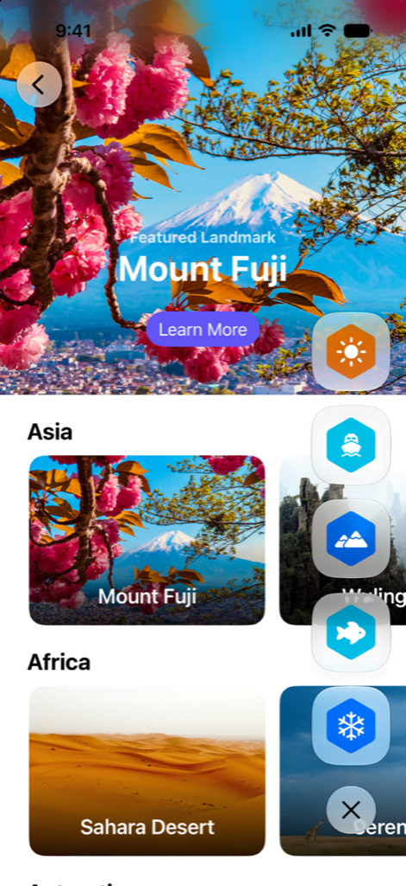

> 导航：[技术](../technologies.md) · [SwiftUI](../swiftui.md) · [Landmarks：使用 Liquid Glass 构建 App](landmarks-building-an-app-with-liquid-glass.md)

# Landmarks：显示自定义活动徽章

<sub>示例代码</sub>

通过显示带动画的自定义活动徽章，为人们提供一种标记旅程的方式。

## 概述

Landmarks App 让人们在探索世界各地的景点时跟踪自己的旅程。无论是家附近的国家公园，还是另一个大洲上的遥远去处，这个 App 都能让人们标记自己的旅程，并在途中获得自定义活动徽章。



本示例把徽章显示在一个垂直视图中，其中包含一个用于显示或隐藏徽章的切换按钮。Landmarks App 包含一个自定义修饰符，让其他视图更容易采用徽章视图。通过把徽章配置为使用 Liquid Glass，徽章在显示或隐藏时可以获得形变动画的优势。

## 添加修饰符以在其他视图中显示徽章

为了让徽章在其他视图（例如 `CollectionsView`）中可用，本示例使用一个自定义修饰符 `ShowBadgesViewModifier` 作为 [ViewModifier](viewmodifier.md)。示例使用 [ZStack](zstack.md) 把徽章层叠在另一个视图上，并将徽章视图放置在尾随下角：

```swift
private struct ShowsBadgesViewModifier: ViewModifier {
    func body(content: Content) -> some View {
        ZStack {
            content
            HStack {
                Spacer()
                VStack {
                    Spacer()
                    BadgesView()
                        .padding()
                }
            }
        }
    }
}
```

本示例通过添加 `showBadges` 修饰符来扩展 [View](view.md)：

```swift
extension View {
    func showsBadges() -> some View {
        modifier(ShowsBadgesViewModifier())
    }
}
```

## 为切换按钮应用 Liquid Glass

为了创建切换按钮，本示例使用 `ToggleBadgesLabel` 配置了一个 [Button](button.md)，它为显示和隐藏两种切换状态使用不同的系统图像。要应用 Liquid Glass，请使用 [glass](primitivebuttonstyle/glass.md) 修饰符为按钮设置样式：

```swift
Button {
    //...
} label: {
    //...
}
.buttonStyle(.glass)

```

## 为徽章添加 Liquid Glass

要为每个徽章添加 Liquid Glass，本示例使用 [glassEffect(_:in:)](<view/glasseffect(__in_).md>) 修饰符。为了定制玻璃视图的外观，示例指定了一个带圆角半径的矩形选项：

```swift
BadgeLabel(badge: $0)
    .glassEffect(.regular, in: .rect(cornerRadius: Constants.badgeCornerRadius))
```

## 使用形变效果为徽章添加动画

形变效果是针对 Liquid Glass 视图的一种动画。在这个动画期间，切换按钮和每个徽章起初是一个合并在一起的视图。随后，按钮和徽章在分离并从一处移动到另一处时像液体一样改变形状。反向播放时，切换按钮和徽章改变形状并重新合并为一个视图。

为实现 Liquid Glass 形变效果，这个 App：

- 把徽章和切换按钮组织到一个 [GlassEffectContainer](glasseffectcontainer.md) 中
- 为每个徽章添加 [glassEffectID(_:in:)](<view/glasseffectid(__in_).md>)
- 为切换按钮添加 [glassEffectID(_:in:)](<view/glasseffectid(__in_).md>)
- 把切换 `isExpanded` 属性的命令包裹在 [withAnimation(_:_:)](<withanimation(____).md>) 中

```swift
// 把徽章和切换按钮组织到一起以产生动画。
GlassEffectContainer(spacing: Constants.badgeGlassSpacing) {
    VStack(alignment: .center, spacing: Constants.badgeButtonTopSpacing) {
        if isExpanded {
            VStack(spacing: Constants.badgeSpacing) {
                ForEach(modelData.earnedBadges) {
                    BadgeLabel(badge: $0)
                        // 为徽章添加 Liquid Glass。
                        .glassEffect(.regular, in: .rect(cornerRadius: Constants.badgeCornerRadius))
                        // 为徽章添加用于动画的标识符。
                        .glassEffectID($0.id, in: namespace)
                }
            }
        }

        Button {
            // 当 `isExpanded` 的值变化时，为该按钮和徽章添加动画。
            withAnimation {
                isExpanded.toggle()
            }
        } label: {
            ToggleBadgesLabel(isExpanded: isExpanded)
                .frame(width: Constants.badgeShowHideButtonWidth,
                       height: Constants.badgeShowHideButtonHeight)
        }
        // 为按钮添加 Liquid Glass。
        .buttonStyle(.glass)
        #if os(macOS)
        .tint(.clear)
        #endif
        // 为按钮添加用于动画的标识符。
        .glassEffectID("togglebutton", in: namespace)
    }
    .frame(width: Constants.badgeFrameWidth)
}
```

## 另请参阅

### App 功能

- [Landmarks：应用背景延伸效果](landmarks-applying-a-background-extension-effect.md) — 配置图像使其在边栏或检查器面板下方模糊并延伸。
- [Landmarks：在边栏或检查器下方延伸水平滚动](landmarks-extending-horizontal-scrolling-under-a-sidebar-or-inspector.md) — 通过把水平滚动条延伸到边栏或检查器下方来改进其外观。
- [Landmarks：在工具栏中优化系统提供的 Liquid Glass 效果](landmarks-refining-the-system-provided-glass-effect-in-toolbars.md) — 把工具栏整理成相关的分组，以改进其外观和实用性。

## 下载

- [LandmarksBuildingAnAppWithLiquidGlass.zip](https://docs-assets.developer.apple.com/published/a88428e6793e/LandmarksBuildingAnAppWithLiquidGlass.zip)
