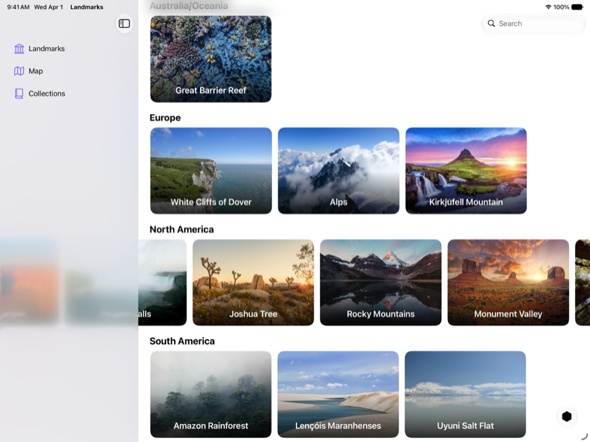

> 导航：[技术](../technologies.md) · [SwiftUI](../swiftui.md) · [Landmarks: Building an app with Liquid Glass](landmarks-building-an-app-with-liquid-glass.md)

# Landmarks：在边栏或检查器下方扩展水平滚动

<sub>示例代码</sub>

通过让水平滚动条延伸到边栏或检查器下方，改善其外观。

## 概述

Landmarks App 让人们探索世界各地的有趣景点。无论是家乡附近的国家公园，还是远在另一大洲的偏远地点，该 App 都为人们提供了整理和标记旅途经历的方式，并在此过程中获得自定的活动徽章。

本示例演示如何让水平滚动延伸到边栏或检查器下方。在 `LandmarksView` 的每个大洲分区内，`LandmarkHorizontalListView` 的实例显示一个水平滚动的地标视图列表。展开时，地标视图可以滚动到边栏或检查器下方。



## 配置滚动视图

为实现这种效果，示例将 `LandmarkHorizontalListView` 配置为触及前缘和后缘。当滚动视图触及边栏或检查器时，系统会自动调整它，使其滚动到边栏或检查器下方，然后移出屏幕边缘。

示例在 [ScrollView](scrollview.md) 的开头添加了一个 [Spacer](spacer.md)，让内容内缩从而与标题内边距对齐：

```swift
ScrollView(.horizontal, showsIndicators: false) {
    LazyHStack(spacing: Constants.standardPadding) {
        Spacer()
            .frame(width: Constants.standardPadding)
        ForEach(landmarkList) { landmark in
            //...
        }
    }
}
```

## 另请参阅

### App 功能

- [Landmarks: Applying a background extension effect](landmarks-applying-a-background-extension-effect.md) — 配置图像使其模糊并延伸到边栏或检查器面板下方。
- [Landmarks: Refining the system provided Liquid Glass effect in toolbars](landmarks-refining-the-system-provided-glass-effect-in-toolbars.md) — 把工具栏整理成相关的分组，以改进其外观和实用性。
- [Landmarks: Displaying custom activity badges](landmarks-displaying-custom-activity-badges.md) — 通过显示带动画的自定活动徽章，让人们能够标记自己的冒险。

## 下载

- [LandmarksBuildingAnAppWithLiquidGlass.zip](https://docs-assets.developer.apple.com/published/a88428e6793e/LandmarksBuildingAnAppWithLiquidGlass.zip)
