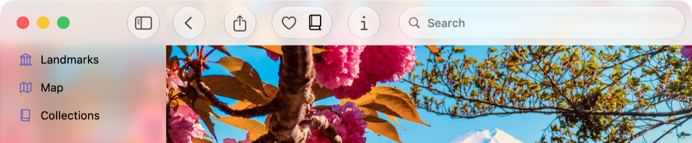

> 导航：[技术](../technologies.md) · [SwiftUI](../swiftui.md) · [Landmarks: Building an app with Liquid Glass](landmarks-building-an-app-with-liquid-glass.md)

# Landmarks：优化工具栏中系统提供的 Liquid Glass 效果

<sub>示例代码</sub>

把工具栏组织成相关的分组，以改善其外观和实用性。

## 概述

Landmarks App 让人们探索世界各地的有趣景点。无论是家乡附近的国家公园，还是远在另一大洲的偏远地点，该 App 都为人们提供了整理和标记旅途经历的方式，并在此过程中获得自定的活动徽章。

本示例演示如何优化工具栏中系统提供的玻璃效果。在 `LandmarkDetailView` 中，示例为以下功能添加了工具栏项目：

- 分享地标
- 从「个人收藏」列表添加或移除地标
- 从「收藏集」添加或移除地标
- 显示或隐藏检查器

系统会自动将 Liquid Glass 应用到工具栏项目上。



<sub>一张 iPad 上富士山地标详情视图的图像，工具栏和部分边栏可见。工具栏项目呈现 Liquid Glass 效果。从前缘到后缘依次为：返回按钮、分享按钮、个人收藏按钮、收藏集按钮、信息按钮和一个搜索栏。</sub>

## 将工具栏项目组织成逻辑分组

为了将工具栏项目组织成逻辑分组，示例添加了 [ToolbarSpacer](toolbarspacer.md) 项目，并将 [fixed](spacersizing/fixed.md) 作为 `sizing` 参数传入，以把工具栏划分为几个部分：

```swift
.toolbar {
    ToolbarSpacer(.flexible)

    ToolbarItem {
        ShareLink(item: landmark, preview: landmark.sharePreview)
    }

    ToolbarSpacer(.fixed)
    
    ToolbarItemGroup {
        LandmarkFavoriteButton(landmark: landmark)
        LandmarkCollectionsMenu(landmark: landmark)
    }
    
    ToolbarSpacer(.fixed)

    ToolbarItem {
        Button("Info", systemImage: "info") {
            modelData.selectedLandmark = landmark
            modelData.isLandmarkInspectorPresented.toggle()
        }
    }
}
```

## 另请参阅

### App 功能

- [Landmarks: Applying a background extension effect](landmarks-applying-a-background-extension-effect.md) — 配置图像使其模糊并延伸到边栏或检查器面板下方。
- [Landmarks: Extending horizontal scrolling under a sidebar or inspector](landmarks-extending-horizontal-scrolling-under-a-sidebar-or-inspector.md) — 通过把水平滚动条延伸到边栏或检查器下方来改进其外观。
- [Landmarks: Displaying custom activity badges](landmarks-displaying-custom-activity-badges.md) — 通过显示带动画的自定活动徽章，让人们能够标记自己的冒险。

## 下载

- [LandmarksBuildingAnAppWithLiquidGlass.zip](https://docs-assets.developer.apple.com/published/a88428e6793e/LandmarksBuildingAnAppWithLiquidGlass.zip)
