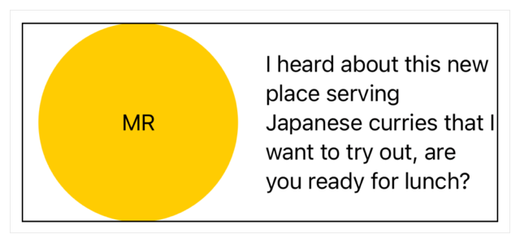
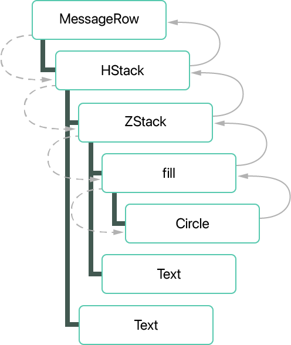
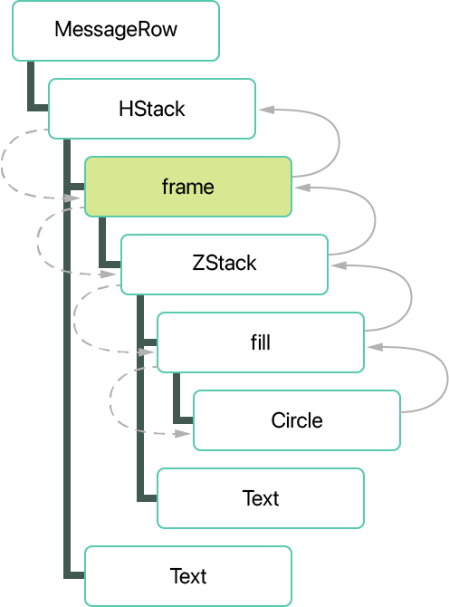
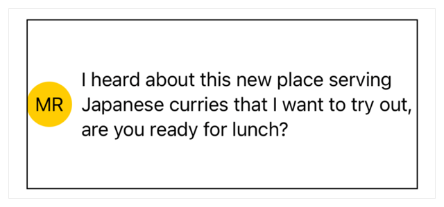
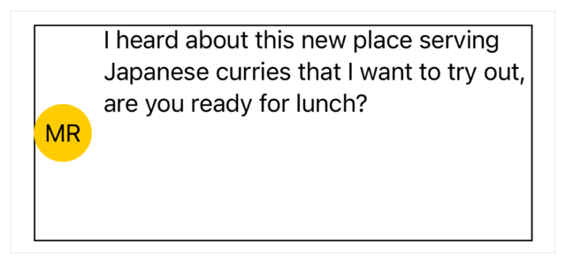
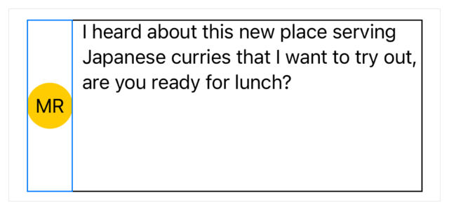
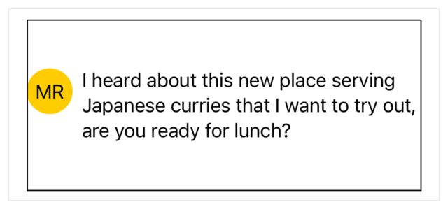
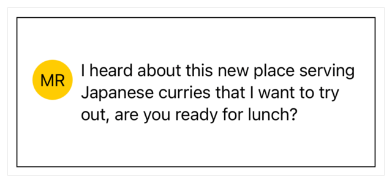

> 导航：[技术](../technologies.md) · [SwiftUI](../swiftui.md) · [布局调整](layout-adjustments.md)

# 布局一个简单的视图

<sub>文章</sub>

通过调整视图的大小来创建视图布局。

## 概述

要为视图创建布局，首先要组合一个子视图层级结构。然后，通过配置参数以及添加视图修饰符（例如影响视图框架（frame）和内边距的修饰符）来调整子视图的大小和间距。要回顾如何组合布局，请参阅[使用叠放视图构建布局](building-layouts-with-stack-views.md)。

### 建立视图层级结构

以下示例创建一个视图，用于显示来自消息服务的一条收到的消息。该视图使用 [HStack](hstack.md) 来收集一个标识发送者的视图和另一个提供消息内容的视图：

```swift
struct MessageRow: View {
    let message: Message

    var body: some View {
        HStack {
            ZStack {
                Circle()
                    .fill(Color.yellow)
                Text(message.initials)
            }

            Text(message.content)
        }
    }
}
```

下面 `MessageRow` 视图的截屏包含一个显示其边界的边框。注意圆形的巨大尺寸，它填满了可用的空间：



<sub>一张截屏，显示一个黑色矩形作为视图的边框，其中左侧是一个大黄色圆形，圆形中央有字母「MR」。视图右侧有五行文本。文本和圆形在视图中垂直居中。</sub>

当 SwiftUI 渲染视图层级结构时，它会递归地评估每个子视图：父视图向它包含的子视图提议一个大小，子视图则以计算出的大小作为回应。



<sub>以方框表示的垂直堆叠的视图层级结构，每个方框列出视图名称。顶部的方框标记为 MessageRow，用直线连接到其正下方的 HStack 方框。HStack 用直线连接到其下方的三个视图，分别标记为 ZStack、Spacer 和 Text。ZStack 下方用直线连接两个视图，标记为 Circle 和 Text。Circle 下方连接单个视图，标记为 fill。层级结构左侧的虚线箭头表示对圆形的大小请求的流动，从 MessageRow 开始，依次向下经过 HStack、ZStack 和 Circle。层级结构右侧的实线箭头表示返回的应答，从 Circle 开始，向上依次经过 ZStack、HStack 和 MessageRow。</sub>

`MessageRow` 视图向它唯一的子视图 [HStack](hstack.md) 提议一个大小，即它自己的父视图向它提议的完整大小。该叠放按比例在它的子视图之间划分这个空间，每个子视图之间使用系统默认间距。这个过程递归地继续下去：

- [ZStack](zstack.md) 向它的子视图 [Circle](circle.md) 和 [Text](text.md) 提议大小。
- [Circle](circle.md) 会扩展到提供的尺寸，而 [Text](text.md) 只占用其包含的字符串所需的空间。
- [ZStack](zstack.md) 返回其最大子视图的大小，在这里就是 [Circle](circle.md)。

当所有子视图都报告了它们的大小后，父视图就会渲染它们。

### 限制视图大小

在上面的示例中，SwiftUI 内置的视图以不同的方式管理大小，包括这些视图：

- 扩展以填满父视图提供的空间，例如 [Color](color.md)、[LinearGradient](lineargradient.md) 和 [Circle](circle.md)。
- 具有随内容变化的理想大小，例如 [Text](text.md) 和各个容器视图。
- 具有永不变化的理想大小，例如 [Toggle](toggle.md) 或 [DatePicker](datepicker.md)。

你可以通过添加框架修饰符将视图约束为固定大小。例如，使用 [frame(width:height:alignment:)](<view/frame(width_height_alignment_).md>) 修饰符将圆形的宽度限制为 `40` 点：

```swift
struct MessageRow: View {
    let message: Message

    var body: some View {
        HStack {
            ZStack {
                Circle()
                    .fill(Color.yellow)
                Text(message.initials)
            }
            .frame(width: 40)

            Text(message.content)
        }
    }
}
```

当你添加框架修饰符时，SwiftUI 会将受影响的视图包裹起来，实际上是在视图层级结构中添加了一个新视图。



<sub>以方框表示的视图层级结构，其中是视图名称。最顶部的方框标记为 MessageRow，用一条线连接到其正下方的 HStack。HStack 连接到其下方的三个视图，方框分别标记为 frame、Spacer 和 Text。Frame 连接到其下方的一个视图：ZStack。ZStack 下方连接两个视图：标记为 Circle 的方框和另一个标记为 Text 的方框。Circle 下方连接单个视图，标记为 fill。标记为 frame 的视图被高亮显示，以表明它是相比之前的视图层级结构示例新添加的。层级结构左侧的虚线箭头表示对圆形的大小请求的流动，从 HStack 开始，依次向下经过 frame、ZStack，再到 Circle。层级结构右侧的实线箭头表示返回的应答，从 Circle 开始，依次经过 ZStack、frame 和 HStack。</sub>

当 SwiftUI 评估这个新的层级结构时，框架修饰符会通过传递你指定为其参数的值，来固定它所包裹的 [ZStack](zstack.md) 的宽度。其余的大小评估照常进行，[Circle](circle.md) 现在会扩展以填满一个更小的空间，受框架 40 点宽度的约束。这使 [HStack](hstack.md) 能够为其另一个子视图（显示消息文本的视图）提供更多空间。



<sub>一张图，显示一个黑色矩形作为视图的边框，其中左侧是一个直径被限制为 40 点的小黄色圆形，圆形中央有字母「MR」。右侧是三行文本。文本和圆形垂直居中。</sub>

### 使用对齐方式定位内容

如果你想让圆形的顶部与消息内容文本的顶部对齐，可以通过为 [HStack](hstack.md) 应用对齐方式来调整视图。要在叠放内垂直定位内容，请将 `alignment` 参数指定为 [top](verticalalignment/top.md)：

```swift
struct MessageRow: View {
    let message: Message

    var body: some View {
        HStack(alignment: .top) {
            ZStack {
                Circle()
                    .fill(Color.yellow)
                Text(message.initials)
            }
            .frame(width: 40)

            Text(message.content)
        }
    }
}
```

应用对齐方式后，你得到一个出乎意料的结果。两个视图的顶部看起来并没有对齐：



<sub>一张图，显示一个黑色矩形作为视图的边框，其中左侧是一个直径被限制为 40 点的小黄色圆形，圆形中央有字母「MR」。右侧是三行文本。圆形垂直居中，而文本在视图顶部对齐。</sub>

但是，如果你在 Xcode 中选中圆形，或者临时为圆形添加一个边框，就会发现两个视图的顶部实际上是切实对齐的。有关检查视图大小的更多信息，请参阅[检查视图布局](inspecting-view-layout.md)。



<sub>一张图，显示一个黑色矩形作为视图的边框，其中左侧是一个直径被限制为 40 点的小黄色圆形，圆形中央有字母「MR」。右侧是三行文本。圆形看起来垂直居中，而文本在视图顶部对齐。一个蓝色方框图形显示了包围圆形的视图边框，该边框占满了其父视图的完整高度。</sub>

在上一节中，你应用了一个只有宽度约束的框架。SwiftUI 绘制了一个受该宽度限制的圆形。但由于高度未指定，圆形的框架单独扩展以填满可用高度，即使这些多余的空间对渲染出来的圆形没有任何可见影响。你可以通过添加显式的 `height` 参数来解决这个问题：

```swift
struct MessageRow: View {
    let message: Message

    var body: some View {
        HStack(alignment: .top) {
            ZStack {
                Circle()
                    .fill(Color.yellow)
                Text(message.initials)
            }
            .frame(width: 40, height: 40)

            Text(message.content)
        }
    }
}
```

现在 [HStack](hstack.md) 的内容顶部对齐了，不过叠放本身在 `MessageRow` 视图中仍然是居中的，这一点由显示该行边界的边框所示。



<sub>一个黑色矩形显示视图的边框，其中左侧是一个直径被限制为 40 点的小黄色圆形，圆形中央有字母「MR」。右侧是三行文本。圆形的顶部与文本行的顶部对齐。视图在圆形和文本的上方和下方显示出多余空间，但左右没有。圆形和文本紧贴着视图边框的左右边缘。</sub>

### 为视图添加内边距

为了避免在视觉上让视图的外边缘显得拥挤，可以添加内边距（padding）。这会沿着指定边缘引入固定数量的空间，从而相应地减少视图内容可用的空间。例如，你可以使用 [padding(_:_:)](<view/padding(____).md>) 在 [HStack](hstack.md) 的[水平](edge/set/horizontal.md)边缘添加额外的空间：

```swift
struct MessageRow: View {
    let message: Message

    var body: some View {
        HStack(alignment: .top) {
            ZStack {
                Circle()
                    .fill(Color.yellow)
                Text(message.initials)
            }
            .frame(width: 40, height: 40)

            Text(message.content)
        }
        .padding([.horizontal])
    }
}
```

内边距修饰符默认使用系统标准间距，不过你也可以为内边距修饰符选择不同的值。 

<sub>一个黑色矩形显示视图的边框，其中左侧是一个直径被限制为 40 点的小黄色圆形，圆形中央有字母「MR」。右侧是三行文本。圆形的顶部与文本行的顶部对齐。视图在圆形和文本的上方和下方显示出多余空间，并且圆形和文本的左侧和右侧分别有内边距。</sub>

## 另请参阅

### 微调布局

- [检查视图布局](inspecting-view-layout.md) — 使用 Xcode 预览或添加临时边框来确定视图的位置和范围。
