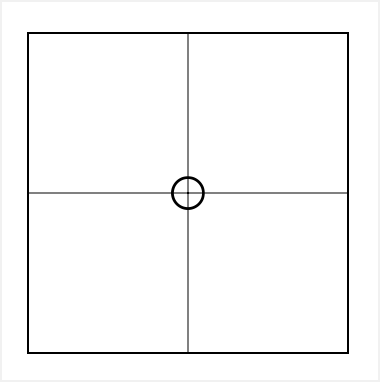
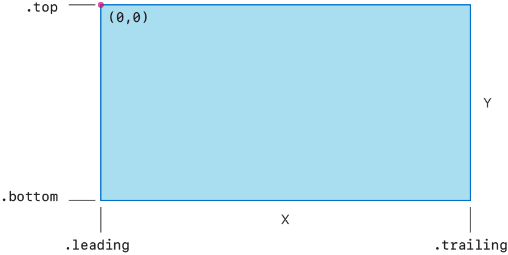
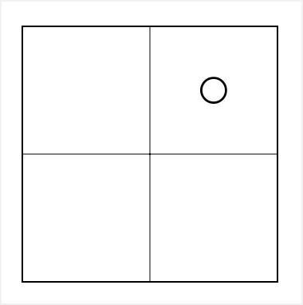
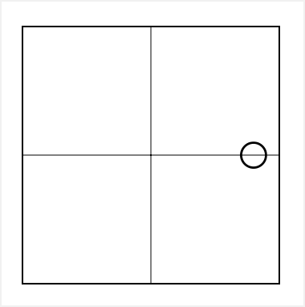

> 导航：[技术](../technologies.md) · [SwiftUI](../swiftui.md) · [布局调整](layout-adjustments.md)

# 对视图的位置进行精细调整

<sub>文章</sub>

通过应用 offset 或 position 修饰符来移动视图的位置。

## 概述

使用 SwiftUI 自适应地布局和定位你的视图。如果仅靠组合无法实现你的设计，可以用视图修饰符对布局进行微调。添加 offset 修饰符可以把视图的渲染内容从当前位置移开，或者添加 position 修饰符在其父视图内设置一个显式位置。

### 创建视图布局

下面的示例提供了一个视图来说明如何定位视图，给出一个在 [ZStack](zstack.md) 内组合而成的粗略视图布局。叠放中包含一个带覆盖圆形图像的象限：

```swift
struct Crosshairs: View { ... } // 绘制十字准线。

struct Quadrant: View {
    var body: some View {
        ZStack {
            Crosshairs()
            Rectangle()
                .stroke(Color.primary)
            Image(systemName: "circle")
        }
        .frame(width: 160, height: 160)
    }
}
```



<sub>一个正方形的图示，细线十字准线把方框分为四个相等的区域。一个小圆位于十字准线的交点处。</sub>

有关使用叠放组合视图的更多细节，请参阅[用叠放视图构建布局](building-layouts-with-stack-views.md)。

### 移动视图内容的位置

使用 offset 修饰符移动父视图放置圆形的位置，从而微调圆形象限内的位置。offset 修饰符会把图像从其默认的居中位置移开。例如，[offset(x:y:)](<view/offset(x_y_).md>) 修饰符使用 `x` 和 `y` 参数表示视图坐标空间内的相对位置。

在 SwiftUI 中，视图的坐标空间用 `x` 表示水平方向，用 `y` 表示垂直方向。`x` 的值从视图前导边缘的 `0` 开始，随着位置向视图的尾随边缘移动而增大。`y` 的值从视图顶边的 `0` 开始，随着位置向视图底边移动而增大。不要想当然地认为前导边缘总在左侧，因为它会随布局方向而变化。当布局方向设置为从右到左时，`0` 水平值位于视图的右侧。

下面的示意图在从左到右的布局方向下，以一个矩形为参照展示了坐标系，原点位于顶部的前导角：



<sub>一个不透明方框的图示，代表一个坐标矩形。矩形的左下角标为 leading，右下角标为 trailing。矩形底部标为 x，表示 x 坐标。矩形的左上角标为 top，左下角标为 bottom。矩形的右侧标为 y，表示 y 坐标。</sub>

下面的示例把圆形从中心向上并向尾随边缘移动了 `40` 点：

```swift
struct Quadrant: View {
    var body: some View {
        ZStack {
            Crosshairs()
            Rectangle()
                .stroke(Color.primary)
            Image(systemName: "circle")
                .offset(x: 40.0, y: -40.0)
        }
        .frame(width: 160, height: 160)
    }
}
```



<sub>一个正方形的图示，细线十字准线把方框分为四个相等的区域。一个小圆偏离十字准线的交点，向上移动 40 点、向方框的尾随边缘移动 40 点。</sub>

### 显式定位视图内容

要在视图内显式定位元素，请使用 [position(x:y:)](<view/position(x_y_).md>) 视图修饰符。position 修饰符会覆盖父视图放置其内容的位置。该修饰符在偏离父视图原点的某个位置渲染视图，这与 offset 修饰符从父视图选定的位置移开视图不同。position 修饰符使用与 offset 修饰符相同的 `x`、`y` 坐标系，同样不会影响视图的大小。在这个示例中，圆形的位置被显式地设为象限右侧向下一半的位置：

```swift
struct Quadrant: View {
    var body: some View {
        ZStack {
            Crosshairs()
            Rectangle()
                .stroke(Color.primary)
            Image(systemName: "circle")
                .position(x: 144, y: 80)
        }
        .frame(width: 160, height: 160)
    }
}
```



<sub>一个正方形的图示，细线十字准线把方框分为四个相等的区域。一个小圆位于十字准线交点的右侧，从方框顶部向下 80 点、从正方形视图的原点坐标起向尾随边缘 144 点。</sub>

## 另请参阅

### 调整视图的位置

- [position(_:)](<view/position(__).md>) — 将此视图的中心放置在其父坐标空间中的指定点上。
- [position(x:y:)](<view/position(x_y_).md>) — 将此视图的中心放置在其父坐标空间中的指定坐标上。
- [offset(_:)](<view/offset(__).md>) — 按 offset 参数中指定的水平和垂直量偏移此视图。
- [offset(x:y:)](<view/offset(x_y_).md>) — 按指定的水平和垂直距离偏移此视图。
- [offset(z:)](<view/offset(z_).md>) — 将视图沿 Z 轴向前移动指定的点数距离。
