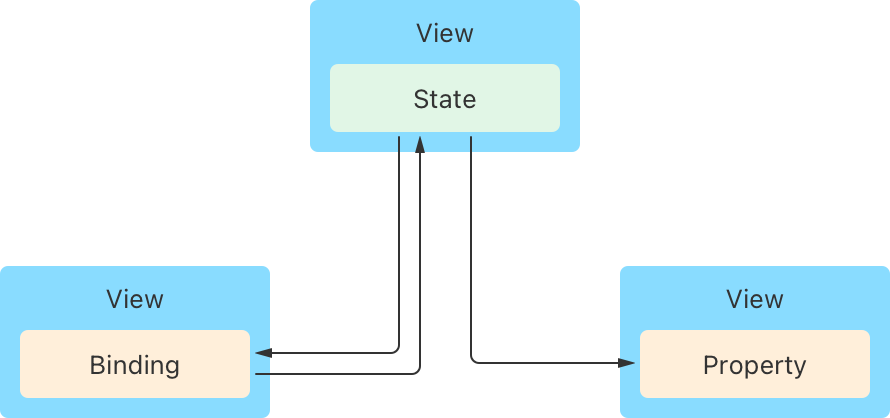

> 导航： [Technologies](../technologies.md) · [SwiftUI](../swiftui.md) · [Model data](model-data.md)

# 管理用户界面状态

<sub>文章</sub>

把视图特定的数据封装在 App 的视图层级结构内，让你的视图可以复用。

## 概述

把数据作为状态存储在需要该数据的视图的最小公共祖先中，从而建立一个跨视图共享的单一 _事实来源_。你可以通过 Swift 属性以只读方式提供数据，也可以用绑定建立与状态的双向连接。SwiftUI 会监视数据的变化，并按需更新所有受影响的视图。



<sub>一张示意图：状态存储在一个视图中，通过提供双向连接的绑定与另一个视图共享，并以提供单向连接的属性形式与又一个视图共享。</sub>

不要把状态属性用作持久化存储，因为状态变量的生命周期与视图生命周期是一致的。你应该用它们来管理只影响用户界面的瞬态状态，例如按钮的高亮状态、筛选设置，或当前选中的列表项。在你还没有准备好修改 App 数据模型的原型阶段，这种存储方式也会很方便。

### 把可变值作为状态管理

如果某个视图需要存储它可以修改的数据，用 [State()](<state().md>) 声明一个变量。例如，你可以在一个播客播放器视图内创建一个 `isPlaying` 布尔值，用来跟踪播客是否正在播放：

```swift
struct PlayerView: View {
    @State private var isPlaying: Bool = false
    
    var body: some View {
        // ...
    }
}
```

把属性标记为状态，就是告诉框架去管理底层存储。你的视图使用属性名来读写数据。当你改变这个值时，SwiftUI 会更新视图中受影响的部分。例如，你可以给 `PlayerView` 添加一个按钮，在轻点时切换存储的值，并根据存储的值显示不同的图像：

```swift
Button(action: {
    self.isPlaying.toggle()
}) {
    Image(systemName: isPlaying ? "pause.circle" : "play.circle")
}
```

把状态变量声明为 private，以限制它们的作用范围。这能确保这些变量被封装在声明它们的视图层级结构中，并防止在初始化方法中设置变量的初始值——那会干扰 SwiftUI 对变量的管理。

### 声明 Swift 属性来存储不可变值

要为视图提供它不会修改的数据，声明一个标准的 Swift 属性。例如，你可以扩展播客播放器，让它拥有一个输入结构体，其中包含单集标题和节目名称的字符串：

```swift
struct PlayerView: View {
    let episode: Episode // The queued episode.
    @State private var isPlaying: Bool = false
    
    var body: some View {
        VStack {
            // Display information about the episode.
            Text(episode.title)
            Text(episode.showTitle)

            Button(action: {
                self.isPlaying.toggle()
            }) {
                Image(systemName: isPlaying ? "pause.circle" : "play.circle")
            }
        }
    }
}
```

虽然 episode 属性的值对 `PlayerView` 来说是常量，但在这个视图的父视图中它不必是常量。当用户在父视图中选择了另一集时，SwiftUI 会检测到状态变化，并用新的输入重新创建 `PlayerView`。

### 用绑定共享对状态的访问

如果某个视图需要与子视图共享对状态的控制，在子视图中用 [Binding](binding.md) 属性包装器声明一个属性。绑定表示对现有存储的引用，为底层数据保留单一的事实来源。例如，如果你把播客播放器视图的按钮重构成一个名为 `PlayButton` 的子视图，可以给它一个指向 `isPlaying` 属性的绑定：

```swift
struct PlayButton: View {
    @Binding var isPlaying: Bool
    
    var body: some View {
        Button(action: {
            self.isPlaying.toggle()
        }) {
            Image(systemName: isPlaying ? "pause.circle" : "play.circle")
        }
    }
}
```

如上所示，你直接通过属性名来读写绑定的包装值，就像状态一样。但与状态属性不同，绑定没有自己的存储。它引用的是存储在其他地方的状态属性，并提供一条与该存储的双向连接。

在实例化 `PlayButton` 时，通过在父视图中声明的对应状态变量前加上美元符号（`$`）前缀，提供指向它的绑定：

```swift
struct PlayerView: View {
    var episode: Episode
    @State private var isPlaying: Bool = false
    
    var body: some View {
        VStack {
            Text(episode.title)
            Text(episode.showTitle)
            PlayButton(isPlaying: $isPlaying) // Pass a binding.
        }
    }
}
```

`$` 前缀向属性请求它的 `projectedValue`，对于状态而言，这就是指向底层存储的绑定。类似地，你可以用 `$` 前缀从一个绑定获得另一个绑定，从而把绑定穿过任意多层视图层级结构传递。

你还可以获得指向状态变量内部某个作用域值的绑定。例如，如果你在播放器的父视图中把 `episode` 声明为状态变量，而 episode 结构体还包含一个你想用切换开关控制的 `isFavorite` 布尔值，那么你可以引用 `$episode.isFavorite` 来获得指向该单集收藏状态的绑定：

```swift
struct Podcaster: View {
    @State private var episode = Episode(title: "Some Episode",
                                         showTitle: "Great Show",
                                         isFavorite: false)
    var body: some View {
        VStack {
            Toggle("Favorite", isOn: $episode.isFavorite) // Bind to the Boolean.
            PlayerView(episode: episode)
        }
    }
}
```

### 为状态转换添加动画

当视图状态变化时，SwiftUI 会立即更新受影响的视图。如果你想让视觉过渡更平滑，可以把触发它们的状态变化包在 [withAnimation(_:_:)](<withanimation(____).md>) 函数的调用里，告诉 SwiftUI 为其添加动画。例如，你可以为由 `isPlaying` 布尔值控制的变化添加动画：

```swift
withAnimation(.easeInOut(duration: 1)) {
    self.isPlaying.toggle()
}
```

通过在动画函数的尾随闭包内改变 `isPlaying`，你告诉 SwiftUI 为任何依赖该包装值的内容添加动画，例如按钮图像上的缩放效果：

```swift
Image(systemName: isPlaying ? "pause.circle" : "play.circle")
    .scaleEffect(isPlaying ? 1 : 1.5)
```

SwiftUI 使用你指定的曲线和时长（未提供时则使用合理的默认值），让缩放效果的输入随时间在给定的 `1` 和 `1.5` 两个值之间过渡。另一方面，图像内容不受动画影响，即使同一个布尔值决定了要显示哪个系统图像。这是因为 SwiftUI 无法在 `pause.circle` 和 `play.circle` 这两个字符串之间以有意义的方式进行增量过渡。

你可以为状态属性添加动画，也可以像上面的示例那样为绑定添加动画。无论哪种方式，只要底层存储的值发生变化，SwiftUI 都会为随之发生的任何视图变化添加动画。例如，如果你给 `PlayerView` 添加背景颜色——在视图层级结构中位于动画块所在位置之上的层级——SwiftUI 同样会为它添加动画：

```swift
VStack {
    Text(episode.title)
    Text(episode.showTitle)
    PlayButton(isPlaying: $isPlaying)
}
.background(isPlaying ? Color.green : Color.red) // Transitions with animation.
```

当你只想为特定视图应用动画，而不是为由状态变化触发的所有视图应用动画时，请改用 [animation(_:value:)](<view/animation(__value_).md>) 视图修饰符。

## 另请参阅

### 创建和共享视图状态

- [State()](<state().md>) — 创建一个可读写由 SwiftUI 管理的值的属性。
- [State(initialValue:)](<state(initialvalue_).md>) — 创建一个带初始值、可读写由 SwiftUI 管理的值的属性。
- [State(wrappedValue:)](<state(wrappedvalue_).md>) — 创建一个带包装值、可读写由 SwiftUI 管理的值的属性。
- [State](state.md) — 一种可读写由 SwiftUI 管理的值的属性包装器类型。
- [Bindable](bindable.md) — 一种支持为可观察对象的可变属性创建绑定的属性包装器类型。
- [Binding](binding.md) — 一种可读写由事实来源所拥有的值的属性包装器类型。
