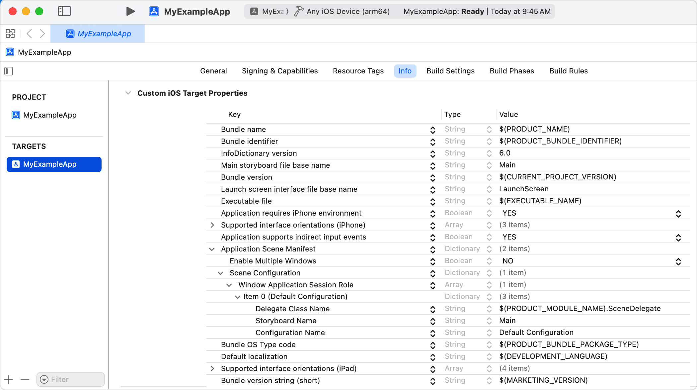

> 导航：[技术](../technologies.md) · [SwiftUI](../swiftui.md) · [App 组织](app-organization.md)

# 迁移到 SwiftUI 生命周期

<sub>文章</sub>

在保留现有代码库的同时，使用 SwiftUI 中基于场景的生命周期。

## 概述

通过把你的 App 迁移到 SwiftUI 生命周期，来利用 SwiftUI 的声明式语法及其与空间框架的兼容性。

迁移到 SwiftUI 生命周期需要几个步骤，包括更改 App 的入口点、配置 App 的启动，以及使用 SwiftUI 提供的方法监控生命周期变化。

### 更改 App 的入口点

[UIKit](../uikit.md) 框架将 `AppDelegate` 文件定义为你的 App 的入口点，并带有 `@main` 标注。有关 `@main` 的更多信息，请参阅《The Swift Programming Language》中的 [Attributes](https://docs.swift.org/swift-book/documentation/the-swift-programming-language/attributes/#main) 部分。要指明 SwiftUI App 的入口，你需要创建一个新文件来定义你的 App 的结构。

1. 在 Xcode 中打开你的项目。
2. 选取 File \> New \> File \> Swift file。
3. 将文件命名为 `<YourAppName>App.swift`。
4. 在文件顶部添加 `import SwiftUI`。
5. 为 App 结构添加 `@main` 属性标注，以指明 SwiftUI App 的入口点，如下面的代码片段所示。

> [!important] 重要
> 请移除你的 App 委托中的 `@main` 或 `@UIApplicationMain` 属性。

使用以下代码创建 SwiftUI App 结构。要进一步了解这种结构，请参阅 [App](app.md)。

```swift
import SwiftUI

@main
struct MyExampleApp: App {
    var body: some Scene {
        WindowGroup {
            ContentView()
        }
    }
}
```

### 支持 App 委托方法

要继续使用 App 委托中的方法，请使用 [UIApplicationDelegateAdaptor](uiapplicationdelegateadaptor.md) 属性包装器。要让 SwiftUI 知道一个遵循 [UIApplicationDelegate](../uikit/uiapplicationdelegate.md) 协议的委托，请把这个属性包装器放在你的 [App](app.md) 声明内：

```swift
@main
struct MyExampleApp: App {
    @UIApplicationDelegateAdaptor private var appDelegate: MyAppDelegate
    var body: some Scene { ... }
}
```

这个示例将一个名为 `MyAppDelegate` 的自定义 App 委托标记为委托适配器。请务必在该类型中实现所有必要的委托方法。

> [!note] 注意
> 如需 AppKit 支持，请使用 [NSApplicationDelegateAdaptor](nsapplicationdelegateadaptor.md)。如需 WatchKit 支持，请使用 [WKApplicationDelegateAdaptor](wkapplicationdelegateadaptor.md)。

### 配置 App 的启动

如果你要迁移一个包含 Storyboard 的 App 到 SwiftUI，请确保在不再需要它们时将其移除。

1. 在 Xcode 中打开你的项目。
2. 从项目导航器中移除 `Main.storyboard`。
3. 选择你的 App 的 target。
4. 打开 `Info.plist` 文件。
5. 移除 [`Main storyboard file base name`](../bundleresources/information-property-list/uimainstoryboardfile.md) 键。
6. 移除 [`Application Scene Manifest`](../bundleresources/information-property-list/uiapplicationscenemanifest.md) \> [`Scene Configuration`](../bundleresources/information-property-list/uiapplicationscenemanifest/uisceneconfigurations.md) \> [`WindowApplicationSessionRole`](../bundleresources/information-property-list/uiapplicationscenemanifest/uisceneconfigurations/uiwindowscenesessionroleapplication.md) \> `Item 0 (Default Configuration)` 字典中的 [`Storyboard Name`](../bundleresources/information-property-list/uiapplicationscenemanifest/uisceneconfigurations/uiwindowscenesessionroleapplication/uiscenestoryboardfile.md) 键。

下图显示了移除这些键之前 `Info.plist` 文件的结构。



从 `Info.plist` 文件中移除这些键之后，场景委托仍会被调用，因此你仍然可以在该文件中处理其他基于场景的生命周期变化。如果你之前是在场景委托中启动 App 的，请从场景委托中移除 [scene(_:willConnectTo:options:)](<../uikit/uiscenedelegate/scene(__willconnectto_options_).md>) 方法。

如果你的 App 之前不支持场景，而是依靠 App 委托来响应 App 的启动，请确保你不再在 [application(_:didFinishLaunchingWithOptions:)](<../uikit/uiapplicationdelegate/application(__didfinishlaunchingwithoptions_).md>) 中设置根视图控制器，而是返回 `true`。

### 监控生命周期变化

由于 SwiftUI 基于场景的特性（参见 [Scene](scene.md)），你将无法再在 App 委托中监控生命周期变化。请改为在 [ScenePhase](scenephase.md)（SwiftUI 提供的用于监控场景阶段的生命周期枚举）中处理这些变化。观察 [Environment](environment.md) 值，以便在阶段变化时发起操作。

```swift
@Environment(\.scenePhase) private var scenePhase
```

根据读取位置的不同，对该值的解读也不同。如果你从 [View](view.md) 实例内部读取阶段，该值反映的是包含该视图的场景的阶段。如果你从 `App` 实例内部读取阶段，该值反映的是你的 App 中所有场景的阶段的聚合结果。

要通过场景委托处理基于场景的事件，请在你的 App 委托内将场景委托提供给你的 SwiftUI App。更多信息请参阅 [UIApplicationDelegateAdaptor](uiapplicationdelegateadaptor.md) 的「Scene delegates」部分。

有关处理基于场景的生命周期事件的更多信息，请参阅[管理你的 App 的生命周期](../uikit/managing-your-app-s-life-cycle.md)。

## 另请参阅

### 创建 App

- [Destination Video](../visionos/destination-video.md) — 利用 SwiftUI 在多平台 App 中构建沉浸式媒体体验。
- [Hello World](../visionos/world.md) — 使用窗口、volume 和沉浸式空间向人们介绍地球。
- [Backyard Birds：使用 SwiftData 和小组件构建 App](backyard-birds-sample.md) — 创建一个具有持久化数据、可交互小组件和全新 App 内购买体验的 App。
- [Food Truck：构建 SwiftUI 多平台 App](food-truck-building-a-swiftui-multiplatform-app.md) — 为 Mac、iPad 和 iPhone 创建单一的代码库和 App target。
- [Fruta：使用 SwiftUI 构建功能丰富的 App](../appclip/fruta-building-a-feature-rich-app-with-swiftui.md) — 创建共享代码库，构建一个提供小组件和轻 App 的多平台 App。
- [App](app.md) — 表示 App 的结构和行为的类型。
