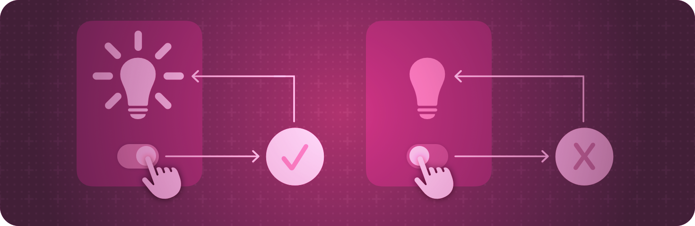

> 导航：[技术](../technologies.md) · [SwiftUI](../swiftui.md)

# 模型数据

API 集合

管理你 App 用来驱动其界面的数据。

## 概述

SwiftUI 为用户界面设计提供了一种声明式方法。在组合视图层级结构时，你同时也在声明这些视图的数据依赖。当数据发生变化时——无论是由外部事件引起，还是因为用户执行的某个操作——SwiftUI 会自动更新界面中受影响的部分。因此，该框架会自动完成传统上由视图控制器完成的大部分工作。

该框架提供了状态变量和绑定等工具，用于把 App 的数据连接到用户界面。这些工具帮助你在 App 中为每份数据维护单一事实来源，部分方式是减少你需要编写的胶水逻辑。选择最适合你要执行的任务的工具：

- 通过把值类型包装为 [State()](<state().md>) 属性，在视图内本地管理瞬态 UI 状态。
- 使用 [Binding](binding.md) 属性包装器共享对某个事实来源（例如本地状态）的引用。
- 通过对模型数据类型应用 [Observable()](<../observation/observable().md>) 宏，在视图中连接并观察引用类型的模型数据。使用 [State()](<state().md>) 属性直接在视图中实例化可观察的模型数据类型。使用 [Environment](environment.md) 属性包装器，把可观察的模型数据共享给层级结构中的其他视图，而无需传递引用。

## 主题

### 创建和共享视图状态

- [管理用户界面状态](managing-user-interface-state.md) — 把视图特定的数据封装在 App 的视图层级结构中，使你的视图可复用。
- [State()](<state().md>) — 创建一个属性，可读取和写入由 SwiftUI 管理的值。
- [State(initialValue:)](<state(initialvalue_).md>) — 创建一个带有初始值的属性，可读取和写入由 SwiftUI 管理的值。
- [State(wrappedValue:)](<state(wrappedvalue_).md>) — 创建一个带有包装值的属性，可读取和写入由 SwiftUI 管理的值。
- [State](state.md) — 一个可读取和写入由 SwiftUI 管理的值的属性包装器类型。
- [Bindable](bindable.md) — 一个属性包装器类型，支持为可观察对象的可变属性创建绑定。
- [Binding](binding.md) — 一个可读取和写入由某个事实来源所拥有的值的属性包装器类型。

### 创建模型数据

- [在 App 中管理模型数据](managing-model-data-in-your-app.md) — 在你 App 的数据模型和视图之间创建连接。
- [从 ObservableObject 协议迁移到 Observable 宏](migrating-from-the-observable-object-protocol-to-the-observable-macro.md) — 更新你现有的 App，以利用 Swift 中 Observation 的优势。
- [Observable()](<../observation/observable().md>) — 定义并实现对 Observable 协议的一致性。
- [监控你 App 中的数据变化](monitoring-model-data-changes-in-your-app.md) — 使用可观察对象在 App 的用户界面中显示数据的变化。
- [StateObject](stateobject.md) — 一个实例化可观察对象的属性包装器类型。
- [ObservedObject](observedobject.md) — 一个订阅可观察对象的属性包装器类型，每当可观察对象变化时就使视图失效。
- [ObservableObject](../combine/observableobject.md) — 一种对象类型，带有一个在对象发生变化之前发布的发布者。

### 响应数据变化

- [onChange(of:initial:_:)](<view/onchange(of_initial___).md>) — 为此视图添加一个修饰符，在特定值发生变化时触发一个操作。
- [onReceive(_:perform:)](<view/onreceive(__perform_).md>) — 添加一个操作，在此视图检测到给定发布者发出的数据时执行。

### 在整个 App 中分发模型数据

- [environmentObject(_:)](<view/environmentobject(__).md>) — 向视图的层级结构提供一个可观察对象。
- [environmentObject(_:)](<scene/environmentobject(__).md>) — 向视图子层级结构提供一个 `ObservableObject`。
- [EnvironmentObject](environmentobject.md) — 一个针对可观察对象的属性包装器类型，该对象由父视图或祖先视图提供。

### 管理动态数据

- [DynamicProperty](dynamicproperty.md) — 一个针对存储变量的接口，该变量会更新视图的某个外部属性。

## 另请参阅

### 数据与存储

- [环境值](environment-values.md) — 使用环境在整个视图层级结构中共享数据。
- [偏好设置](preferences.md) — 从视图向其容器视图指示配置偏好。
- [持久化存储](persistent-storage.md) — 存储数据，供你 App 的多个会话使用。
