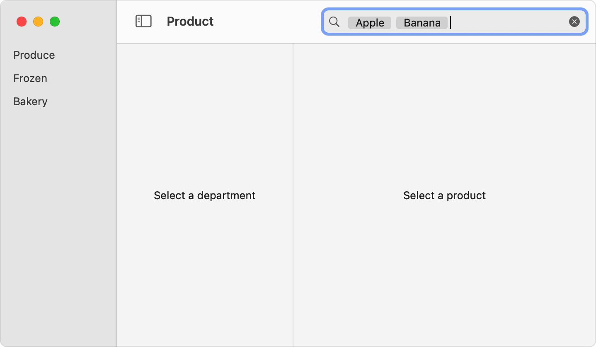

> 导航：[技术](../technologies.md) · [SwiftUI](../swiftui.md) · [搜索](search.md)

# 执行搜索操作

<sub>文章</sub>

根据你存储的搜索文本和可选的令牌（token）来更新搜索结果。

## 概述

要在你 App 的数据模型中进行搜索，请为查询文本创建存储，并用 searchable 视图修饰符呈现它。由于存储由你管理，你可以检测它何时发生变化，并相应地更新搜索操作。随着人们输入而更新搜索结果，可以确保你 App 的搜索界面具有良好的响应性。

你还可以选择为令牌提供存储。令牌是你的 App 可识别的离散搜索词。令牌提供了一种组合多个搜索词的方式，并让你更容易表明某个搜索词在你的 App 中是常见或预期的。


<sub>一个宽的圆角矩形，左侧包含一个放大镜，后面跟着 Apple、Banana 和 Pear 三个词，每个词各自位于一个深灰色矩形中。边界矩形的最右侧出现一个深灰色圆圈中的 X。</sub>

有关如何控制在 App 界面中搜索栏位置的信息，请参阅[为你的 App 添加搜索界面](adding-a-search-interface-to-your-app.md)。

### 为字符串提供存储

searchable 修饰符的 `text` 输入接受一个绑定到字符串值的 [Binding](binding.md)。该字符串充当 SwiftUI 显示的搜索查询栏的存储。你可以在视图内使用 [State](state.md) 属性创建这个存储，并将其初始化为空字符串：

```swift
@State private var searchText: String = ""
```

为了更容易在不同视图之间共享搜索查询，你可以在作为 App 模型一部分的可观察对象内创建一个已发布的值：

```swift
class Model: ObservableObject {
    @Published var searchText: String = ""
}
```

无论哪种情况，都可以通过在值前面加上美元符号（`$`）前缀，把指向该字符串的 [Binding](binding.md) 传入 searchable 视图修饰符：

```swift
struct ContentView: View {
    @EnvironmentObject private var model: Model
    @State private var departmentId: Department.ID?
    @State private var productId: Product.ID?

    var body: some View {
        NavigationSplitView {
            DepartmentList(departmentId: $departmentId)
        } content: {
            ProductList(departmentId: departmentId, productId: $productId)
                .searchable(text: $model.searchText)
        } detail: {
            ProductDetails(productId: productId)
        }
    }
}
```

### 为令牌提供存储

除了搜索字符串之外，当你使用带有 `tokens` 参数的 searchable 修饰符之一（例如 [searchable(text:tokens:placement:prompt:token:)](<view/searchable(text_tokens_placement_prompt_token_).md>)）时，搜索栏还可以显示令牌。

创建令牌的方法是：定义一组符合 [Identifiable](../swift/identifiable.md) 协议的值，然后实例化这些值的集合。例如，你可以创建一个水果令牌的枚举：

```swift
enum FruitToken: String, Identifiable, Hashable, CaseIterable {
    case apple
    case pear
    case banana
    var id: Self { self }
}
```

然后向你的模型添加一个新的已发布属性，用于存储令牌的集合：

```swift
@Published var tokens: [FruitToken] = []
```

要显示令牌，请把指向 `tokens` 数组的 [Binding](binding.md) 作为 searchable 修饰符的 `tokens` 输入参数提供，并使用 `token` 闭包描述如何绘制每个令牌。在该闭包中，返回表示作为输入传入的令牌的 [View](view.md)。例如，你可以使用 [Text](text.md) 视图来表示每个令牌：

```swift
ProductList(departmentId: departmentId, productId: $productId)
    .searchable(text: $model.searchText, tokens: $model.tokens) { token in
        switch token {
        case .apple: Text("Apple")
        case .pear: Text("Pear")
        case .banana: Text("Banana")
        }
    }
```

如上例所示，你可以用 [Text](text.md) 视图表示令牌。在 iOS 和 iPadOS 上，你可以改用 [Label](label.md)。确保该视图清楚地表示相应的搜索查询；如果使用标签，还要确保令牌的高度适合搜索查询栏。令牌显示在搜索栏的开头，位于任何纯文本之前。下面展示了当 `tokens` 数组包含 `apple` 和 `banana` 令牌时搜索栏的外观：



<sub>一个带有三个导览窗格的 macOS 窗口。左侧窗格列出 Produce、Frozen 和 Bakery 等条目。中间窗格带有占位文本 Select a Department。右侧窗格带有占位文本 Select a Product。工具栏在窗口右上方有一个搜索栏，其中包含 Apple 和 Banana 两个词，各自位于一个灰色矩形中。</sub>

### 支持带有可变组成部分的令牌

你可以在 `token` 闭包中使用 [Picker](picker.md)，让人们能够修改表示令牌的部分数据。例如，假设你的水果令牌数据同时包含 kind 和 hydration 两个属性：

```swift
struct FruitToken: String, Identifiable, Hashable, CaseIterable {
    enum Kind {
        case apple
        case pear
        case banana
        var id: Self { self }
    }

    enum Hydration: String, Identifiable, Hashable, CaseIterable {
        case hydrated
        case dehydrated
    }

    var kind: Kind
    var hydration: Hydration = .hydrated
}
```

使用你的新模型时，在 `token` 闭包中通过添加美元符号（`$`）指定指向令牌的 [Binding](binding.md)。使用该绑定创建一个针对 `hydration` 属性的选择器，以及一个使用 `kind` 属性的标签：

```swift
ProductList(departmentId: departmentId, productId: $productId)
    .searchable(text: $model.searchText, tokens: $model.tokens) { $token in
        Picker(selection: $token.hydration) {
            ForEach(FruitToken.Hydration.allCases) { hydration in
                switch hydration {
                case .hydrated: Text("Hydrated")
                case .dehydrated: Text("Dehydrated")
                }
            }
        } label: {
            switch token.kind {
            case .apple: Text("Apple")
            case .pear: Text("Pear")
            case .banana: Text("Banana")
            }
        }
    }
```

### 向搜索添加令牌

提供一种让人们向搜索栏添加令牌的方式。可以通过多种方式实现，例如：

- 使用带有 `suggestedTokens` 输入参数的 searchable 视图修饰符之一（例如 [searchable(text:tokens:suggestedTokens:placement:prompt:token:)](<view/searchable(text_tokens_suggestedtokens_placement_prompt_token_).md>)）建议要添加到数组的令牌。人们从搜索栏下方出现的列表中选择建议。有关为令牌以及搜索文本提供建议的更多信息，请参阅[建议搜索词](suggesting-search-terms.md)。
- 在人们编辑搜索字符串时进行监视。当你检测到与某个令牌匹配的子字符串时，通过从字符串中移除相关字符把文本转换为令牌，并将相应的令牌添加到 `tokens` 数组。
- 等待在搜索字符串中出现分隔字符（例如逗号或空格），然后尝试把之前的字符转换为令牌。
- 等待有人提交搜索，然后尝试把整个搜索字符串转换为令牌。有关提交搜索的信息，请参阅[管理搜索界面的激活](managing-search-interface-activation.md)。

### 执行搜索

当你检测到搜索查询的变化时，你的 App 就可以开始搜索。执行搜索操作的方式取决于你的 App 如何存储和呈现数据。一种方法是根据 [List](list.md) 中条目的某个字段是否与搜索查询匹配来过滤列表中出现的元素。例如，你可以创建一个方法，只返回产品数组中名称与搜索文本或搜索栏中当前某个令牌匹配的条目：

```swift
func filteredProducts(
    products: [Product],
    searchText: String,
    tokens: [FruitToken]
) -> [Product] {
    guard !searchText.isEmpty || !tokens.isEmpty else { return products }
    return products.filter { product in
        product.name.lowercased().contains(searchText.lowercased()) ||
        tokens.map({ $0.rawValue }).contains(product.name.lowercased())
    }
}
```

请考虑搜索的复杂程度以及更改搜索词的代价。如果代价很高——例如更新需要网络访问，或者过滤逻辑复杂——可以考虑预取和缓存数据，或降低更新频率。或者，你可以等待有人提交查询之后再执行搜索。有关检测查询提交的信息，请参阅[管理搜索界面的激活](managing-search-interface-activation.md)。

如果搜索空间可以划分为几个大类，你可以通过提供搜索范围帮助人们更快地缩小搜索范围。请参阅[为搜索操作划分范围](scoping-a-search-operation.md)。

## 另请参阅

### 搜索 App 的数据模型

- [为你的 App 添加搜索界面](adding-a-search-interface-to-your-app.md) — 呈现一个人们可以用来搜索你 App 内容的界面。
- [searchable(text:placement:prompt:)](<view/searchable(text_placement_prompt_).md>) — 将此视图标记为可搜索，这会配置一个搜索栏的显示。
- [searchable(text:tokens:placement:prompt:token:)](<view/searchable(text_tokens_placement_prompt_token_).md>) — 将此视图标记为支持文本和令牌的可搜索视图。
- [searchable(text:editableTokens:placement:prompt:token:)](<view/searchable(text_editabletokens_placement_prompt_token_).md>) — 将此视图标记为可搜索，这会配置一个搜索栏的显示。
- [SearchFieldPlacement](searchfieldplacement.md) — 搜索栏在视图层级结构中的位置。
