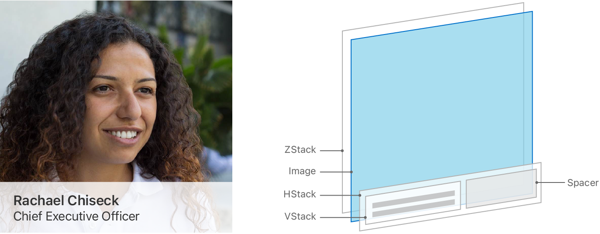
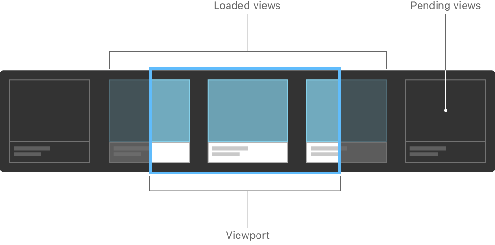
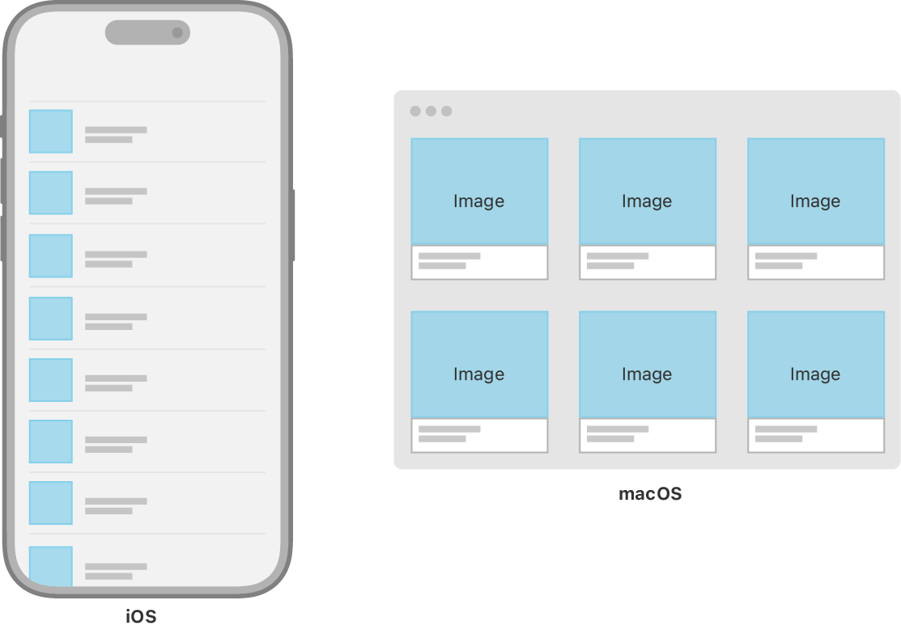
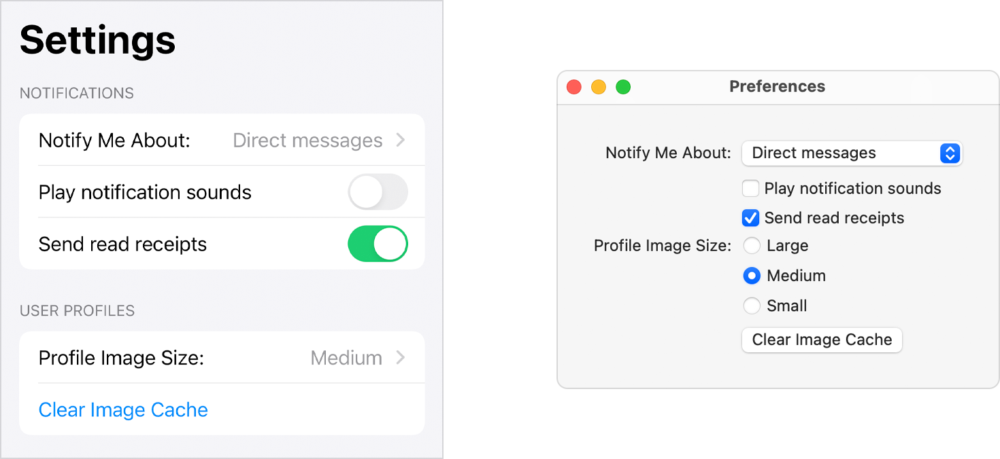

> 导航：[技术](../technologies.md) · [SwiftUI](../swiftui.md) · [布局基础](layout-fundamentals.md)

# 为你的内容选择容器视图

文章

使用叠放、网格、列表和表单构建灵活的用户界面。

## 概述

SwiftUI 提供了一系列用于分组和重复视图的容器视图。有些容器纯粹用于结构和布局，例如叠放视图、惰性叠放视图和网格视图；另一些容器（例如列表和表单）还能采用系统标准的视觉外观和交互方式。

为 App 用户界面的每个部分选择最合适的容器视图是一项值得学习的重要技能；无论是把两个视图并排放置，还是创建包含数百个元素的复杂布局，它都能帮到你。

### 为视图集合分组

叠放视图是 SwiftUI 中最基础的布局容器。使用叠放把视图集合分组为水平或垂直的行列，或者把它们彼此层叠。

使用 [HStack](hstack.md) 把视图排成一行，使用 [VStack](vstack.md) 把视图排成一列，使用 [ZStack](zstack.md) 把视图彼此层叠。然后，组合多种叠放视图来构建更复杂的布局。这三种叠放，连同它们的对齐和间距属性、视图修饰符以及 [Spacer](spacer.md) 视图，共同提供了极大的布局灵活性。

示意图展示一个通用的用户资料布局如何使用叠放视图。图中在渲染出的布局旁边，配有一幅分解的 3D 插图，展示视图层级结构中彼此层叠的四层视图。层级的最底层是一个 ZStack；其上是一个 Image 视图，然后是一个 HStack，最顶层则是一个 VStack 和一个 Spacer 视图。

你经常把叠放视图用作其他容器视图内部的构建块。例如，[List](list.md) 通常包含叠放视图，你用它们来布置每一行内的视图。

有关使用叠放视图布置视图的更多信息，请参阅[用叠放视图构建布局](building-layouts-with-stack-views.md)。

### 重复视图或视图组

你还可以使用 [HStack](hstack.md)、[VStack](vstack.md)、[LazyHStack](lazyhstack.md) 和 [LazyVStack](lazyvstack.md) 来重复视图或视图组。把叠放视图放入 [ScrollView](scrollview.md) 中，让你的内容可以超出容器的边界扩展。用户可以同时水平滚动、垂直滚动，或双向滚动。

叠放视图和惰性叠放功能相似，感觉上似乎可以互换，但它们在不同情况下各有优势。叠放视图会一次性加载其全部子视图，使布局快速而可靠，因为系统在加载每个子视图时就知道它们的大小和形状。惰性叠放则以一定程度的布局正确性换取性能，因为系统只在子视图变得可见时才计算其几何属性。

在选择要使用的叠放视图类型时，始终从标准叠放视图开始，只有当对你的代码进行性能分析显示出值得的性能提升时，才切换到惰性叠放。有关惰性叠放视图以及如何测量 App 视图加载性能的更多信息，请参阅[创建高性能的可滚动叠放](creating-performant-scrollable-stacks.md)。

### 在二维布局中定位视图

要同时水平和垂直地布置视图，请使用 [LazyVGrid](lazyvgrid.md) 或 [LazyHGrid](lazyhgrid.md)。对于自然呈现在方形容器中的内容（例如图片图库），网格是很好的容器选择。要把用户界面布局放大以在更大的设备上显示，网格也是很好的选择。例如，联系人信息名录在 iPhone 上可能适合列表或垂直叠放，但当放大到 iPad 或 Mac 这类较大的设备时，网格布局可能更自然。

示意图展示一个用户界面如何从屏幕较小的设备（如 iPhone）放大到屏幕较大的设备（如 Mac）。

与叠放视图一样，SwiftUI 的网格视图本身不带滚动视口；如果内容可能大于可用空间，请把它们放入 [ScrollView](scrollview.md) 中。

### 显示数据集合并与之交互

SwiftUI 中的 [List](list.md) 视图在概念上类似于 [LazyVStack](lazyvstack.md) 与 [ScrollView](scrollview.md) 的组合，但默认会在其包含的条目周围和之间添加适合平台的视觉样式。例如，在 iOS 上运行时，[List](list.md) 的默认配置会在行之间添加分隔线，并为具有导览行为、且列表被包含在 [NavigationView](navigationview.md) 中的条目绘制显示指示符。

[List](list.md) 视图还针对插入、重新排序和移除条目等常见任务提供适合平台的交互方式。例如，把 [onDelete(perform:)](<dynamicviewcontent/ondelete(perform_).md>) 修饰符添加到 [List](list.md) 内的 [ForEach](foreach.md) 上，即可启用系统标准的滑动删除交互。

与 [LazyHStack](lazyhstack.md) 和 [LazyVStack](lazyvstack.md) 一样，SwiftUI [List](list.md) 中的行也是惰性加载的，并且没有非惰性的等价物。列表本身会在必要时滚动，你不需要把它们包在 [ScrollView](scrollview.md) 里。

### 为数据输入分组视图和控制

使用 [Form](form.md) 来构建使用系统标准控制的数据输入界面、设置或偏好设置屏幕。

示意图并排展示一个 macOS 偏好设置窗口和一个 iOS 设置屏幕。两个屏幕包含相同的设置项，但使用了不同的、适合平台的控制。

与所有 SwiftUI 视图一样，表单会以适合平台的方式显示其内容。请注意，[Form](form.md) 内控制的布局可能因平台而显著不同。例如，iOS 上 [Form](form.md) 中的 [Picker](picker.md) 控制会添加导览，在单独的屏幕上显示选择器的选项；而 macOS 上相同的 [Picker](picker.md) 则显示为弹出式按钮或一组单选按钮。
