> 导航：[技术](../technologies.md) · [SwiftUI](../swiftui.md) · [菜单与命令](menus-and-commands.md)

# 使用自适应控制填充 SwiftUI 菜单

<sub>文章</sub>

通过在菜单中填充控制并直观地组织内容，来改进你的 App。

## 概述

菜单是用途多样的组件，你可以自适应地填充它们，并用它们来组织 App 中的命令、操作或条目。

在紧凑的布局或较小的设备上，菜单通过按需显示选项来优化空间。当操作可以在逻辑上分组时，使用菜单来隐藏复杂的界面选项。你可以选择多种方式来配置菜单，使用 [Button](button.md)、[Toggle](toggle.md)、[Slider](slider.md)、[Divider](divider.md) 等各种控制。这种适应性确保你的菜单在支持复杂用例的同时保持灵活和简洁。

> [!note] 注意
> 虽然在 SwiftUI 中创建菜单的代码在各平台上大体相同，但系统可能会因设备不同而以不同方式显示菜单。

### 规划菜单的结构

让你的菜单简单而灵活，能够适应各种界面，例如 iOS 和 iPadOS 上的常规与紧凑尺寸类别，以及 macOS、tvOS 和 visionOS。

一个菜单由三个部分组成：

- 标签：一个描述菜单用途的视图。
- 内容：一个使用 [ViewBuilder](viewbuilder.md) 定义菜单内条目的闭包。
- 主要操作：一个可选的闭包，当有人点击或点按菜单时执行某个操作，而不是执行打开菜单这一默认主要操作。提供该闭包后，打开菜单就变成了次级操作，例如通过长按手势而非点按来打开。

有关设计指引，请参阅《人机界面指南》> [Menus](https://developer.apple.com/design/human-interface-guidelines/menus)。

### 填充你的菜单

一个声明得当的 SwiftUI [Menu](menu.md) 与其最终的渲染外观十分相似：菜单的内容会根据每个元素的用途在视觉上自适应。例如，在菜单的闭包中插入一个 `Button` 会渲染出一个可操作的菜单条目，而插入一个 `Menu` 则会创建一个子菜单条目。

要渲染一个执行给定操作闭包的菜单条目，请使用 `Button` 控制：

```swift
Menu("Actions") {
    Button("Duplicate") {
        // Duplicate action.
    }
    Button("Rename") {
        // Rename action.
    }
    Button("Delete…") {
        // Delete action.
    }
}
```

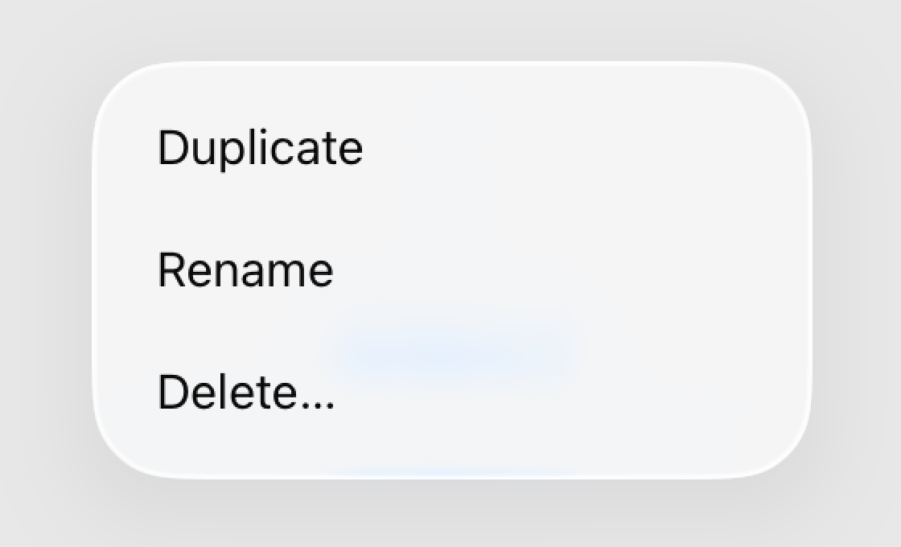

> [!note] 注意
> SwiftUI 的控制和视图是自适应的，它们既代表功能和含义，也代表视觉表现。当你打开一个菜单时，菜单条目会根据平台以适合上下文的顺序出现。更多信息请参阅 [menuOrder(_:)](<view/menuorder(__).md>)。

要在菜单条目标题旁边显示一个符号，请使用 [init(_:systemImage:action:)](<button/init(__systemimage_action_).md>) 初始化方法：

```swift
Menu("Actions") {
    Button("Duplicate", systemImage: "doc.on.doc") {
        // Duplicate action.
    }
    Button("Rename", systemImage: "pencil") {
        // Rename action.
    }
    Button("Delete…", systemImage: "trash") {
        // Delete action.
    }
}
```

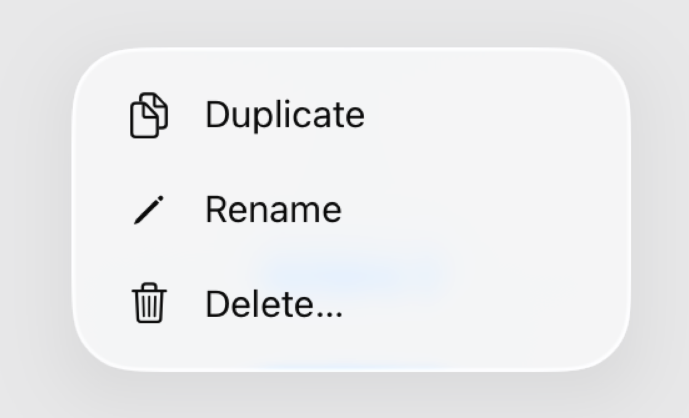

<sub>一个显示 Duplicate、Rename 和 Delete 操作的菜单，标签左侧带有系统图像。Duplicate 菜单条目由两个叠放的文稿表示。Rename 菜单条目由一支铅笔表示。Delete 菜单条目由一个垃圾桶表示。</sub>

你也可以通过在 `Button` 上添加标签闭包初始化方法来构建菜单操作。这种方法为你的副标题提供了更多灵活性。

要为菜单条目添加标题和副标题，在该控制的标签闭包中填入两个 [Text](text.md) 视图，其中第一个文本表示标题，第二个表示副标题。下面的示例展示了应用于这些视图的这种层级样式：

```swift
Menu("Actions") {
    Button {
        // Duplicate action.
    } label: {
        Text("Duplicate")
        Text("Duplicate the component")
    }
    Button {
        // Rename action.
    } label: {
        Text("Rename")
        Text("Rename the component")
    }
    Button {
        // Delete action.
    } label: {
        Text("Delete…")
        Text("Delete the component")
    }
}
```

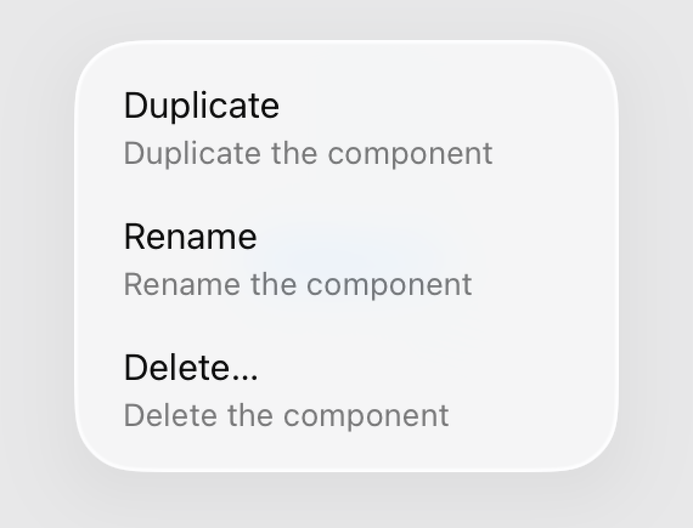

<sub>一个显示 Duplicate、Rename 和 Delete 操作的菜单，标签下方带有文本描述。Duplicate 菜单条目的文本描述为 Duplicate the component。Rename 菜单条目的文本描述为 Rename the component。Delete 菜单条目的文本描述为 Delete the component。</sub>

你可以通过把第一个 `Text` 替换为 [Label](label.md) 来插入一个图标：

```swift
Menu("Actions") {
    Button {
        // Duplicate action.
    } label: {
        Label("Duplicate", systemImage: "doc.on.doc")
        Text("Duplicate the component")
    }
    Button {
        // Rename action.
    } label: {
        Label("Rename", systemImage: "pencil")
        Text("Rename the component")
    }
    Button {
        // Delete action.
    } label: {
        Label("Delete…", systemImage: "trash")
        Text("Delete the component")
    }
}
```

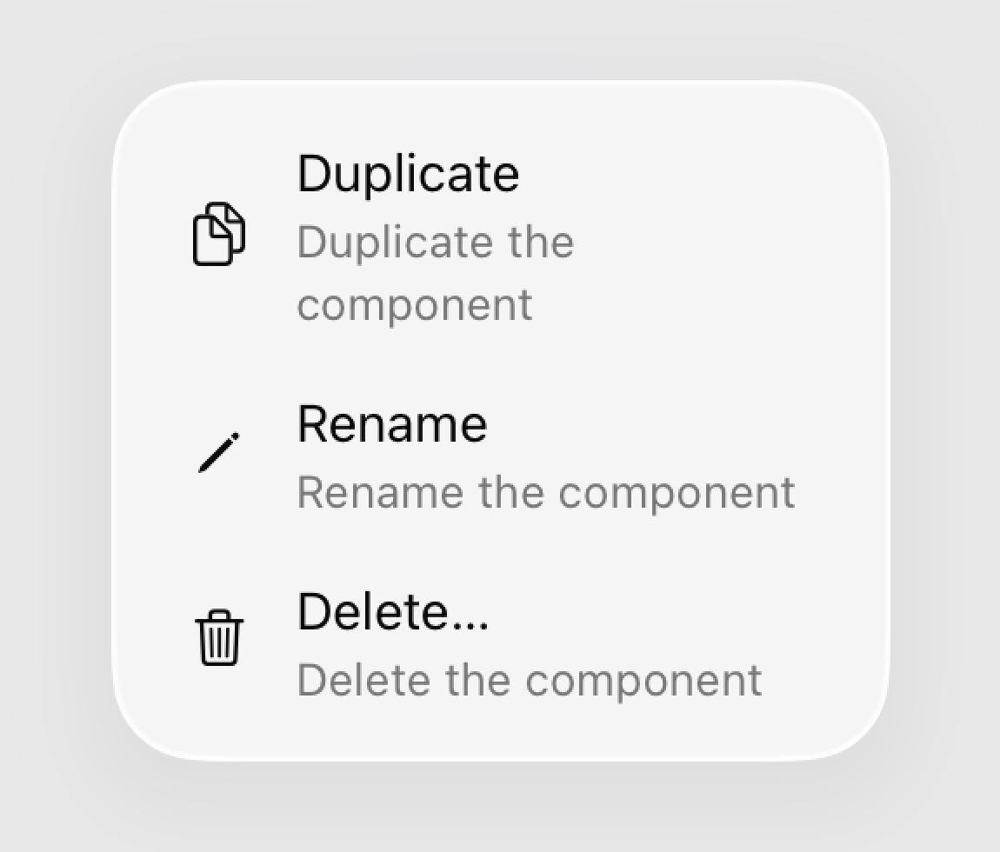

<sub>一个显示 Duplicate、Rename 和 Delete 操作的菜单，标签下方带有文本描述，且每个标签和描述的左侧带有图标。Duplicate 菜单条目由两个叠放的文稿图标表示，文本描述为 Duplicate the component。Rename 菜单条目由一个铅笔图标表示，文本描述为 Rename the component。Delete 菜单条目由一个垃圾桶图标表示，文本描述为 Delete the component。</sub>

为本质上具有破坏性的菜单条目添加视觉警示。为 `Button` 添加 [destructive](buttonrole/destructive.md) 角色，使菜单条目呈现红色。只对需要谨慎执行的操作使用 `destructive`。

```swift
Menu("Actions") {
    // ...

    Button("Delete…", systemImage: "trash", role: .destructive) {
        // Delete action.
    }
}
```

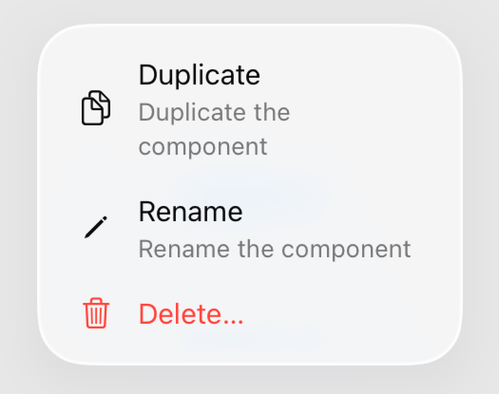

<sub>一个显示 Duplicate、Rename 和 Delete 操作的菜单，标签下方带有文本描述，且每个标签和描述的左侧带有图标。Duplicate 菜单条目由两个叠放的文稿图标表示，文本描述为 Duplicate the component。Rename 菜单条目由一个铅笔图标表示，文本描述为 Rename the component。Delete 标签带有红色色调，表明这是一个破坏性操作。Delete 菜单条目由一个垃圾桶图标表示，不含文本描述。</sub>

在 macOS 上，用 `Label` 构建的菜单条目默认渲染时不带图标。使用 [titleAndIcon](labelstyle/titleandicon.md) 样式来覆盖系统行为，为菜单条目显式渲染图标。

```swift
Menu("Actions") {
    // ...
}
.labelStyle(.titleAndIcon)
```

菜单也非常适合表示可切换的条目。要渲染一个可切换的菜单条目，你可以向菜单的内容中添加一个 `Toggle`。

由于 SwiftUI 的控制会适应其上下文，菜单中的 `Toggle` 会自动带有一个勾选标记来显示其开或关的状态。

```swift
Menu("Actions") {
    // ...

    Toggle(
        "Favorite",
        systemImage: "suit.heart",
        isOn: $isFavorite)
}
```

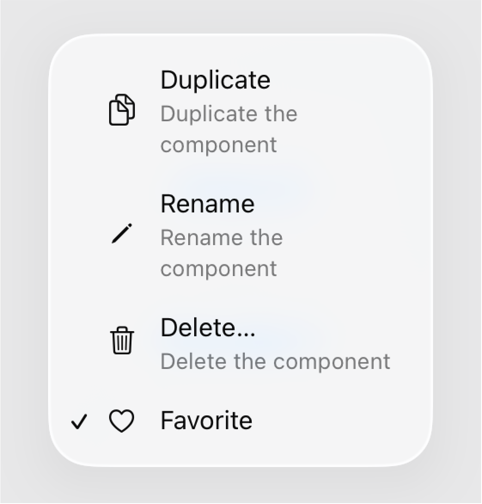

<sub>一个显示 Duplicate、Rename、Delete 和 Favorite 操作的菜单，标签下方带有文本描述，且每个标签和描述的左侧带有图标。Duplicate 菜单条目由两个叠放的文稿图标表示，文本描述为 Duplicate the component。Rename 菜单条目由一个铅笔图标表示，文本描述为 Rename the component。Delete 菜单条目由一个垃圾桶图标表示，文本描述为 Delete the component。Favorite 菜单条目使用一个切换开关来收藏该菜单所作用的对象。Favorite 菜单条目由一个心形图标表示，不含文本描述。Favorite 菜单条目的标签左侧带有一个勾选标记。</sub>

就像 `Button` 一样，你也可以用标签闭包来初始化 `Toggle`，以获得更多灵活性。

```swift
Menu("Actions") {
    // ...

    Toggle(isOn: $isFavorite) {
        Label("Favorite", systemImage: "suit.heart")
        Text("Adds the component to the favorites list")
    }
}
```

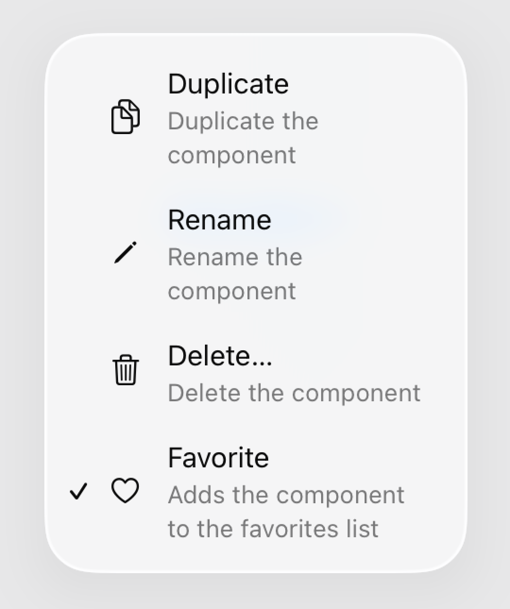

<sub>一个显示 Duplicate、Rename、Delete 和 Favorite 操作的菜单，标签下方带有文本描述，且每个标签和描述的左侧带有图标。Duplicate 菜单条目由两个叠放的文稿图标表示，文本描述为 Duplicate the component。Rename 菜单条目由一个铅笔图标表示，文本描述为 Rename the component。Delete 菜单条目由一个垃圾桶图标表示，文本描述为 Delete the component。Favorite 菜单条目使用一个切换开关来收藏该菜单所作用的对象。Favorite 菜单条目由一个心形图标表示，文本描述为 Adds the component to the favorites list。Favorite 菜单条目的标签左侧带有一个勾选标记。</sub>

在菜单中使用 [Picker](picker.md)，让人们可以从一组选项中进行选择：

```swift
enum Flavor: String, CaseIterable, Identifiable {
    case chocolate, vanilla, strawberry
    var id: Self { self }
}

@State private var selectedFlavor: Flavor = .chocolate

var body: some View {
    Picker("Flavor", selection: $selectedFlavor) {
        ForEach(Flavor.allCases) { flavor in
            Text(flavor.rawValue.capitalized)
                .tag(flavor)
        }
    }
}
```

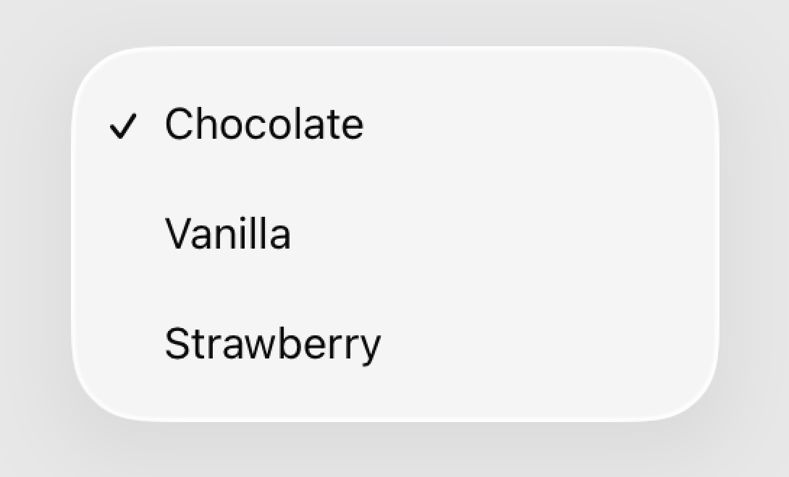

<sub>一个菜单，显示冰淇淋口味的选择器，包括 Chocolate、Vanilla 和 Strawberry，其中 Chocolate 选项已被勾选。</sub>

这个示例在菜单中嵌入了一个选择器，显示多个可选项。虽然你可以选择多个选项，但在任一时刻只有一个条目处于激活状态。被勾选标记标识的选中条目表示当前的选择。

在菜单中添加选择器，比多个独立的切换开关更便捷、更可定制。选择器提供了一个管理多个选项的单一界面，确保一个人一次只能选择一个条目。当你的内容不要求互斥时，多个切换开关可能更合适。

```swift
enum Flavor: String, CaseIterable, Identifiable {
    case chocolate, vanilla, strawberry
    var id: Self { self }
}

@State private var selectedFlavor: Flavor = .chocolate
@State private var includesToppings: Bool = false

var body: some View {
    Menu("Ice Cream Order") {
        Button("Special request") {
            // Create a special request.
        }

        Toggle("Include toppings", isOn: $includesToppings)

        Picker("Flavor", selection: $selectedFlavor) {
            ForEach(Flavor.allCases) { flavor in
                Text(flavor.rawValue.capitalized)
                    .tag(flavor)
            }
        }
    }
}
```

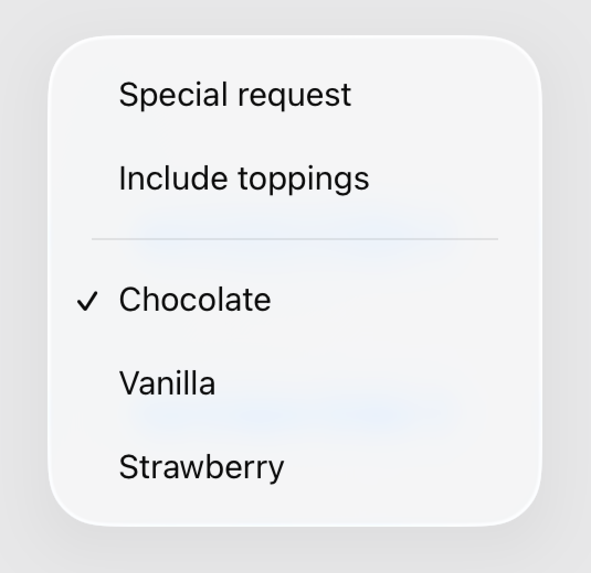

<sub>一个菜单，显示冰淇淋口味的选择器和不同的选择器样式。选项包括 Special request、Include toppings、Chocolate、Vanilla 和 Strawberry，其中 Chocolate 选项已被勾选。</sub>

你可以选择多种选择器样式，例如 [inline](pickerstyle/inline.md)、[menu](pickerstyle/menu.md) 和 [palette](pickerstyle/palette.md)。

### 为菜单中的选择器应用样式

默认情况下，菜单中的选择器选项以内联方式出现。SwiftUI 隐式应用 `inline` 样式，让你无需离开当前视图即可选择选项。内联样式适用于需要即时上下文的设置或配置。

当你对菜单中的选择器应用 `menu` 样式时，它会转变为一个子菜单，以层级方式呈现选项。这种样式有助于组织带有分类选项的复杂菜单。

```swift
enum Flavor: String, CaseIterable, Identifiable {
    case chocolate, vanilla, strawberry
    var id: Self { self }
}

@State private var selectedFlavor: Flavor = .chocolate
@State private var includesToppings: Bool = false

var body: some View {
    Menu("Ice Cream Order") {
        Button("Special request") {
            // Create a special request.
        }

        Toggle("Include toppings", isOn: $includesToppings)

        Picker("Flavor", selection: $selectedFlavor) {
            ForEach(Flavor.allCases) { flavor in
                Text(flavor.rawValue.capitalized)
                    .tag(flavor)
            }
        }
        .pickerStyle(.menu)
    }
}
```

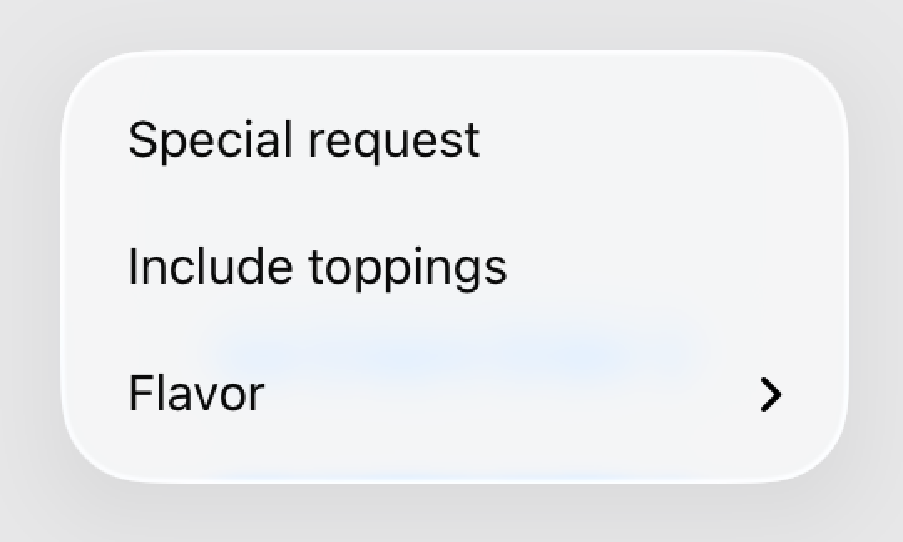

<sub>一个菜单，显示一个带有冰淇淋口味调色板选择器的选择器。菜单条目包括 Special request、Include toppings 和 Flavor。Flavor 条目处于收起状态，由菜单右边缘的右向尖括号指示。</sub>

调色板选择器最适合紧凑场景，即人们从一组符号中进行选择的场景。调色板选择器将图标最小化，如果空间有限则变为水平滚动。

```swift
enum Flavor: String, CaseIterable, Identifiable {
    case chocolate, vanilla, strawberry
    var id: Self { self }
}

@State private var selectedFlavor: Flavor = .chocolate
@State private var includesToppings: Bool = false

var body: some View {
    Menu("Ice Cream Order 3") {
        Button("Special request") {
            // Create a special request.
        }
        Toggle("Include toppings", isOn: $includesToppings)
        Picker("Flavor", selection: $selectedFlavor) {
            Text("🟤")
                .tag(Flavor.chocolate)
            Text("⚪️")
                .tag(Flavor.vanilla)
            Text("🔴")
                .tag(Flavor.strawberry)
        }
        .pickerStyle(.palette)
    }
}
```

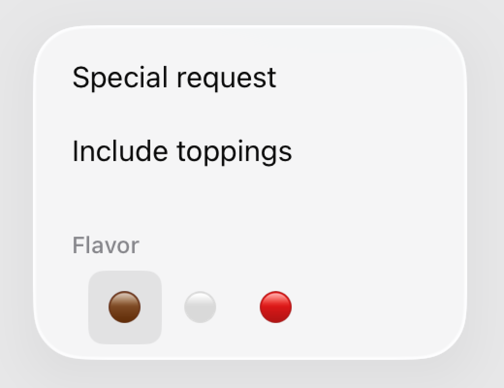

<sub>一个菜单，显示一个为条目使用水平空间的调色板选择器。菜单条目包括 Special request 和 Include toppings。Flavor 下方是一排水平的三个彩色圆圈，用于表示冰淇淋口味。左边的圆圈是棕色的，代表 Chocolate。棕色圆圈带有灰色高亮，表明 Chocolate 已被选中。中间的圆圈是白色的，代表 Vanilla。右边的圆圈是红色的，代表 Strawberry。</sub>

菜单还可以通过滑块和步进器处理数值。

```swift
@State private var quantity: Int = 1

Menu("Actions") {
    // ...

    Stepper(value: $quantity) {
        Text("Quantity: \(quantity)")
    }
}
```

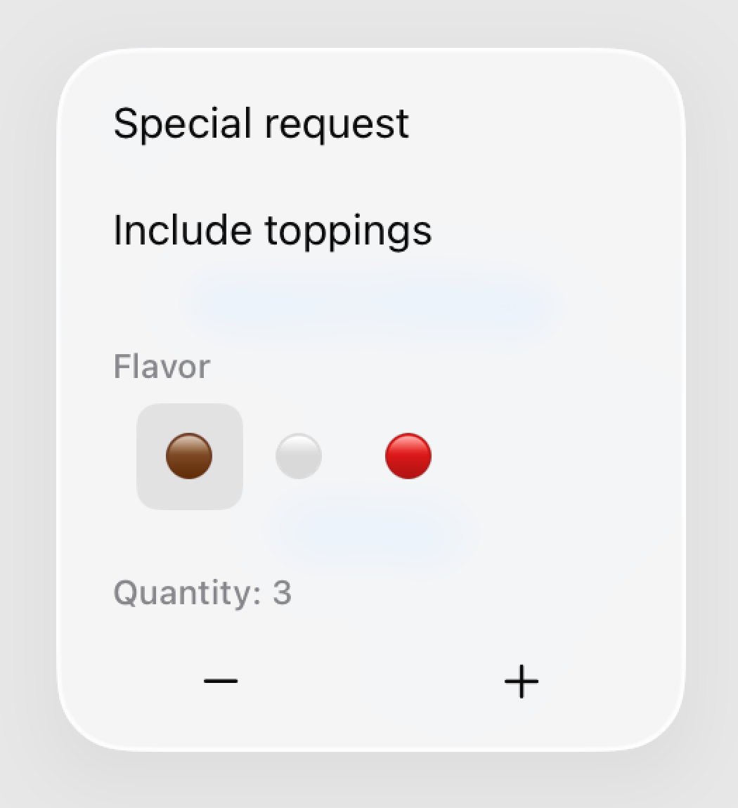

<sub>一个菜单，显示一个使用步进器的选择器。菜单条目包括 Special request 和 Include toppings。Flavor 下方是一排水平的三个彩色圆圈，用于表示冰淇淋口味。左边的圆圈是棕色的，代表 Chocolate。棕色圆圈带有灰色高亮，表明 Chocolate 已被选中。中间的圆圈是白色的，代表 Vanilla。右边的圆圈是红色的，代表 Strawberry。彩色圆圈下方是一行灰色文本，显示所选的数量，表明已选择三个条目。数量行下方是一个用于从数量中减去条目的减号按钮，以及一个用于向数量中添加条目的加号按钮。</sub>

### 为菜单条目分组

SwiftUI 提供了多种在菜单内为条目分组的方式，包括子菜单、分区和分隔符。

子菜单以层级方式为条目分组，在需要之前隐藏内容。子菜单让主菜单保持整洁，同时在必要时提供对更多选项的访问：

```swift
Menu("General Settings") {
    // The General Settings submenu.
    Button("Wi-Fi") { openWiFiSettings() }
    Button("Bluetooth") { openBluetoothSettings() }
    Button("Notifications") { openNotificationSettings() }
    
    // The Account Settings submenu.
    Menu("Account Settings") {
        Button("Profile") { openProfileSettings() }
        Button("Security") { openSecuritySettings() }
        Button("Privacy") { openPrivacySettings() }
    }
    
    // The Advanced Settings submenu.
    Menu("Advanced Settings") {
        Button("Developer Options") { openDeveloperOptions() }
        Button("System Update") { openSystemUpdate() }
        Button("Backup & Restore") { openBackupRestore() }
    }
}
```

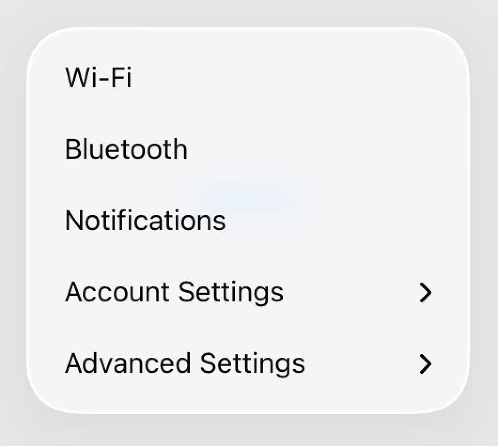

<sub>一个菜单，显示各种设置选项的子菜单。菜单条目包括 Wi-Fi、Bluetooth、Notifications、Account Settings 和 Advanced Settings。Account Settings 和 Advanced Settings 菜单条目带有子菜单，由菜单右边缘的右向尖括号指示。</sub>

在上面的示例中，Settings 菜单填充了两个子菜单，把相关的、较不常用的设置操作归为一组。

你还可以用分区来组织条目。[Section](section.md) 视图在保持所有元素可见的同时为条目分组，通常带有分区标头以增强清晰度。这种样式适用于在根级菜单内组织相关条目，为每个组提供清晰的分隔和上下文。

```swift
Menu("Settings") {
    // The General Settings submenu.
    Section("General Settings") {
        Button("Wi-Fi") { openWiFiSettings() }
        Button("Bluetooth") { openBluetoothSettings() }
        Button("Notifications") { openNotificationSettings() }
    }
    
    // The Account Settings submenu.
    Section("Account Settings") {
        Button("Profile") { openProfileSettings() }
        Button("Security") { openSecuritySettings() }
        Button("Privacy") { openPrivacySettings() }
    }
    
    // The Advanced Settings submenu.
    Section("Advanced Settings") {
        Button("Developer Options") { openDeveloperOptions() }
        Button("System Update") { openSystemUpdate() }
        Button("Backup & Restore") { openBackupRestore() }
    }
}
```

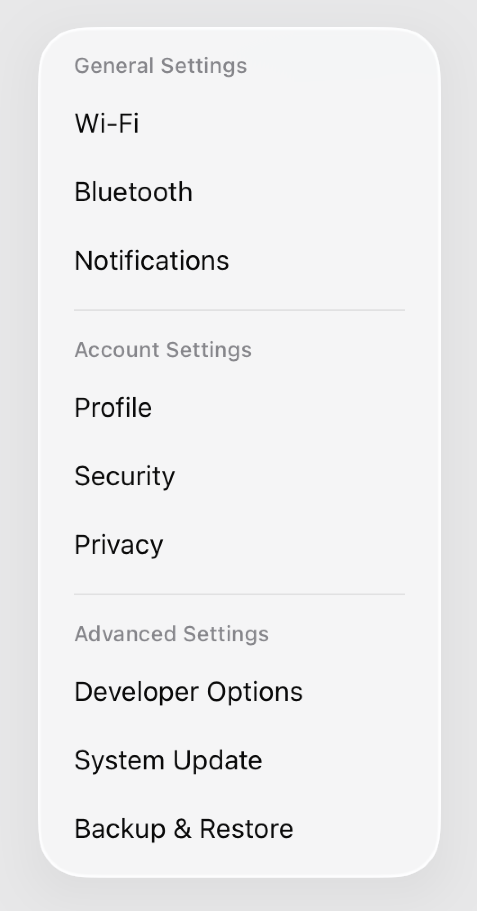

<sub>一个菜单，显示带有分隔符的子菜单。菜单顶部是一个标为 General Settings 的分区，包含 Wi-Fi、Bluetooth 和 Notifications 选项。菜单中部是一个标为 Account Settings 的分区，包含 Profile、Security 和 Privacy 选项。菜单底部是一个标为 Advanced Settings 的分区，包含 Developer Options、System Update 和 Backup and Restore 选项。</sub>

### 显示紧凑的菜单条目

当你想在菜单内的单行中显示几个相关操作时，可以考虑使用 [ControlGroup](controlgroup.md)。这种方法提供最多四个条目的紧凑水平分组布局。

```swift
Menu("Edit") {
    ControlGroup {
        Button {
            // Undo action
        } label: {
            Label("Undo", systemImage: "arrow.uturn.backward")
        }
        
        Button {
            // Redo action
        } label: {
            Label("Redo", systemImage: "arrow.uturn.forward")
        }
        
        Button {
            // Copy action
        } label: {
            Label("Copy", systemImage: "doc.on.doc")
        }
    }
    
    Divider()
    
    // Additional menu items here...
}
```

虽然子菜单和分区是为条目分组的容器，但 `Divider` 视图提供了一种在菜单内直观分隔条目的简单方式。与 `Section` 不同，`Divider` 不是容器，而是作为一个视觉断点来划分条目组，从而整理并归组同类命令，提升可用性和跨 App 的一致性。

### 修改内容行为

除了填充菜单内容之外，SwiftUI 还提供了一组用于修改菜单条目默认行为的 API。

SwiftUI 提供了一组用于修改菜单条目默认行为的 API。在 iOS 和 iPadOS 上，系统默认会重新排列菜单条目，使菜单中靠前的条目出现在最接近用户交互点的位置。要覆盖这一行为并让条目保持你定义的顺序，请使用 [menuOrder(_:)](<view/menuorder(__).md>) 修饰符：

```swift
Menu("Settings", systemImage: "ellipsis.circle") {
    Button("Select") {
        // Select folders
    }
    Button("New Folder") {
        // Create folder
    }
    Picker("Appearance", selection: $appearance) {
        Label("Icons", systemImage: "square.grid.2x2").tag(Appearance.icons)
        Label("List", systemImage: "list.bullet").tag(Appearance.list)
    }
}
.menuOrder(.fixed)
```

> [!note] 注意
> 在 macOS 上，菜单条目通常遵循标准的 macOS 排序规则，不会为了靠近交互点而重新排序。

默认情况下，只要有人点击或点按某个条目，菜单就会关闭。如果你希望这个人进行多项选择，或者在不重新打开菜单的情况下重复执行某个操作，请对特定条目使用 [menuActionDismissBehavior(_:)](<view/menuactiondismissbehavior(__).md>) 修饰符来覆盖这一行为。

下面的代码演示了：

- 增大和减小操作会停用菜单关闭行为，让人们可以反复点击或点按它们来调整字体大小，而无需每次都重新打开菜单。
- 一个把字体恢复为默认大小的重置操作。由于该操作不停用关闭行为，菜单会在重置后关闭。

```swift
Menu("Font size") {
    Button(action: increase) {
        Label("Increase", systemImage: "plus.magnifyingglass")
    }
    .menuActionDismissBehavior(.disabled)
    Button("Reset", action: reset)
    Button(action: decrease) {
        Label("Decrease", systemImage: "minus.magnifyingglass")
    }
    .menuActionDismissBehavior(.disabled)
}
```

## 另请参阅

### 创建菜单

- [Menu](menu.md) — 一个用于呈现操作菜单的控制。
- [menuStyle(_:)](<view/menustyle(__).md>) — 设置此视图内菜单的样式。
