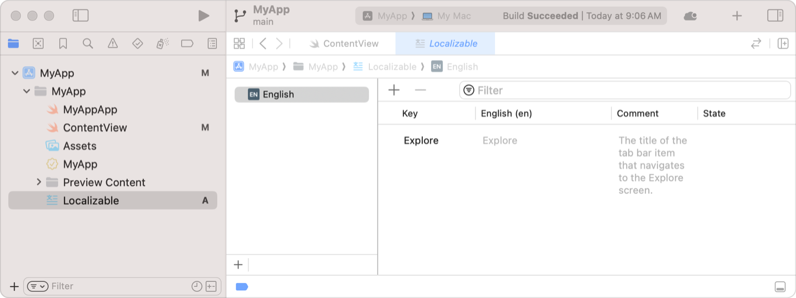

> 导航：[技术](../technologies.md) · [SwiftUI](../swiftui.md) · [Text input and output](text-input-and-output.md)

# 为本地化准备视图

<sub>文章</sub>

指定提示并添加字符串，以本地化你的 SwiftUI 视图。

## 概述

对 SwiftUI 视图进行本地化，让用户能够以自己的母语、地区和文化体验你的 App。在导出本地化目录时，Xcode 会解析 SwiftUI 视图以找出需要本地化的字符串。你可以添加提示，让 Xcode 为你的 App 生成正确且带有提示的待本地化字符串。

有关字符串目录的信息，请参阅[使用字符串目录本地化和变换文本](../xcode/localizing-and-varying-text-with-a-string-catalog.md)。

### 为文本视图添加注释

为了简化翻译过程，请向翻译人员提供提示，说明你的 App 在何处以及如何显示 [Text](text.md) 视图的字符串。要添加提示，请使用文本视图初始化方法 [init(_:tableName:bundle:comment:)](<text/init(__tablename_bundle_comment_).md>) 的可选 `comment` 参数。当你使用 Xcode 本地化 App 时，Xcode 会把注释字符串连同字符串一起包含进来。例如，下面的文本视图包含一条注释：

```swift
Text("Explore",
     comment: "The title of the tab bar item that navigates to the Explore screen.")
```

Xcode 会在你的字符串目录文件中为该视图创建以下条目：



<sub>一张截屏，显示 Xcode 中一个简单 App 的字符串目录。目录中有一个名为 Explore 的键，其英文值同样是单词 Explore。该键还有一条注释：「导览到 Explore 屏幕的标签页栏项目标题」。</sub>

### 通过文本视图提供额外信息

对于许多带有字符串标签的 SwiftUI 视图，你可以通过提供一个被 SwiftUI 解释为 [LocalizedStringKey](localizedstringkey.md) 的字符串来进行本地化。系统会在运行时使用该键从你的字符串目录中检索本地化的值；如果在目录中找不到该键，则直接使用该字符串。例如，SwiftUI 将以下 [Label](label.md) 初始化方法的字符串输入用作本地化字符串键：

```swift
Label("Message", image: "msgSymbol")
```

如果你还想提供用于本地化的注释，可以改用显式的 [Text](text.md) 视图：

```swift
Label {
    Text("Message",
         comment: "A label that displays 'Message' and a corresponding image.")
} icon: {
    Image("msgSymbol")
}
```

许多 SwiftUI 控制都有内容构建器初始化方法，让你能够采用这种模式。有关如何让你的 App 文本可翻译的更多信息，请参阅[为翻译准备 App 的文本](../xcode/preparing-your-apps-text-for-translation.md)。

## 另请参阅

### 本地化文本

- [LocalizedStringKey](localizedstringkey.md) — 用于在字符串文件或字符串字典文件中查找条目的键。
- [locale](environmentvalues/locale.md) — 视图应使用的当前区域设置。
- [typesettingLanguage(_:isEnabled:)](<view/typesettinglanguage(__isenabled_).md>) — 指定排版语言。
- [TypesettingLanguage](typesettinglanguage.md) — 定义如何确定文本的排版语言。
