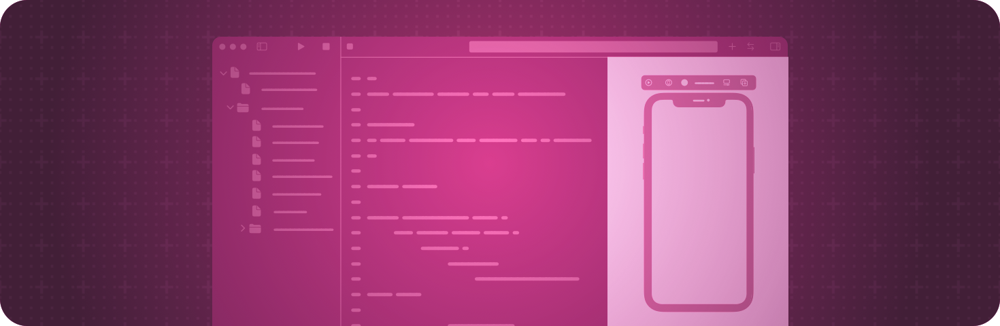

> 导航：[技术](../technologies.md) · [SwiftUI](../swiftui.md)

# Xcode 中的预览

API 集合

为你的自定视图生成动态的交互式预览。

## 概述

当你使用 SwiftUI 创建自定 [View](view.md) 时，Xcode 可以显示该视图内容的预览，并随你修改视图代码而保持最新。你使用某个预览宏（例如 [Preview(_:body:)](<preview(__body_).md>)）来告诉 Xcode 要显示什么。Xcode 会在代码旁边的画布中显示预览。

不同的预览宏支持不同类型的配置。例如，你可以使用 [Preview(_:traits:_:body:)](<preview(__traits___body_).md>) 宏添加影响预览外观的特征，或使用 [Preview(_:traits:body:cameras:)](<preview(__traits_body_cameras_).md>) 宏为预览添加自定视点。你还可以检查视图在特定场景类型中的表现。例如，在 visionOS 中，你可以使用 [Preview(_:immersionStyle:traits:body:)](<preview(__immersionstyle_traits_body_).md>) 宏在 [ImmersiveSpace](immersivespace.md) 内预览你的视图。

## 主题

### 基础

- [Previewing your app’s interface in Xcode](../xcode/previewing-your-apps-interface-in-xcode.md) — 快速迭代设计，并在不同 Apple 设备上预览 App 的显示效果。

### 创建预览

- [Preview(_:body:)](<preview(__body_).md>) — 创建 SwiftUI 视图的预览。
- [Preview(_:traits:_:body:)](<preview(__traits___body_).md>) — 使用指定的特征创建 SwiftUI 视图的预览。
- [Preview(_:traits:body:cameras:)](<preview(__traits_body_cameras_).md>) — 使用指定的特征和自定视点创建 SwiftUI 视图的预览。
- [Preview(_:traits:arguments:body:)](<preview(__traits_arguments_body_).md>) — 为参数化的 SwiftUI 视图创建一组预览，使其输入在提供的各实参之间变化。

### 自定预览

- [Previewable()](<previewable().md>) — 允许动态属性在预览中内联显示的标签。
- [PreviewModifier](previewmodifier.md) — 一种类型，定义预览可以出现的环境。
- [PreviewModifierContent](previewmodifiercontent.md) — 预览的类型擦除内容。

### 在场景上下文中创建预览

- [Preview(_:immersionStyle:traits:body:)](<preview(__immersionstyle_traits_body_).md>) — 在沉浸式空间中创建 SwiftUI 视图的预览。
- [Preview(_:immersionStyle:traits:body:cameras:)](<preview(__immersionstyle_traits_body_cameras_).md>) — 在具有自定视点的沉浸式空间中创建 SwiftUI 视图的预览。
- [Preview(_:windowStyle:traits:body:)](<preview(__windowstyle_traits_body_).md>) — 在窗口中创建 SwiftUI 视图的预览。
- [Preview(_:windowStyle:traits:body:cameras:)](<preview(__windowstyle_traits_body_cameras_).md>) — 在具有自定视点的窗口中创建 SwiftUI 视图的预览。

### 在调试模式下构建

- [DebugReplaceableView](debugreplaceableview.md) — 在调试构建中擦除视图的不透明结果类型。

### 已废弃

- [Deprecated](previews-deprecated.md) — 查看已废弃的预览符号及其替代品。

## 另请参阅

### 工具支持

- [Xcode library customization](xcode-library-customization.md) — 在 Xcode 资源库中公开自定视图和修饰符。
- [Performance analysis](performance-analysis.md) — 测量并改进你的 App 的响应能力。
