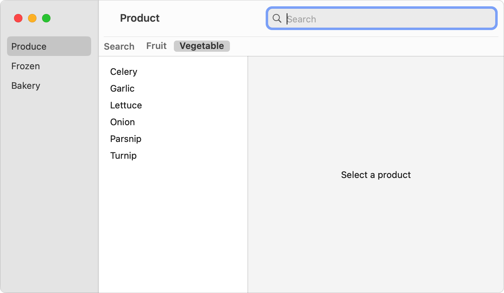
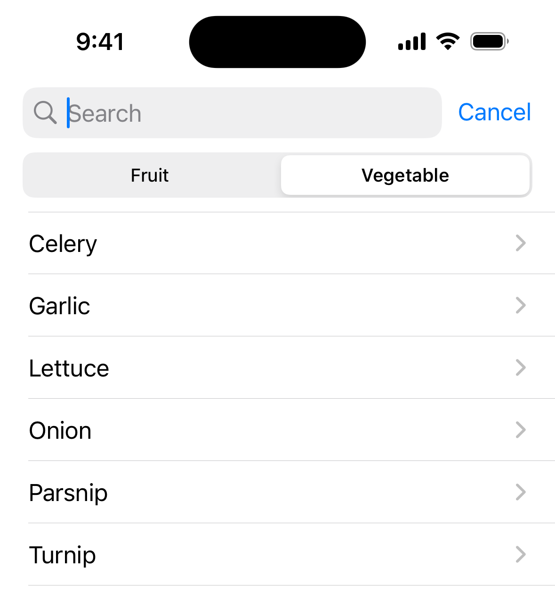

> 导航：[技术](../technologies.md) · [SwiftUI](../swiftui.md) · [Search](search.md)

# 为搜索操作划分范围

<sub>文章</sub>

把搜索空间划分为几个大类。

## 概述

如果你要搜索的数据可归入几个类别，你可以定义不同的范围来帮助人们缩小搜索范围。定义范围后，SwiftUI 会呈现一个选择器，供人们选择其中一个范围。然后，你把当前选择的范围作为搜索操作的输入之一。

### 定义可能的范围

首先创建一个符合 [Hashable](../swift/hashable.md) 协议的类型来表示可能的范围。例如，你可以使用枚举把商品搜索限定为仅水果或仅蔬菜：

```swift
enum ProductScope {
    case fruit
    case vegetable
}
```

然后创建一个属性来存储当前选择的范围，可以作为视图中的状态变量，也可以作为模型中的发布属性：

```swift
@Published var scope: ProductScope = .fruit
```

### 应用范围

要使用范围信息，请将当前范围绑定到 [searchScopes(_:scopes:)](<view/searchscopes(__scopes_).md>) 修饰符。你还需要提供一组与不同范围相对应的视图。与 [searchSuggestions(_:)](<view/searchsuggestions(__).md>) 修饰符一样，范围修饰符作用于离被修饰视图更近的 searchable 修饰符，因此它需要放在 searchable 修饰符之后：

```swift
ProductList(departmentId: departmentId, productId: $productId)
    .searchable(text: $model.searchText, tokens: $model.tokens) { token in
        switch token {
        case .apple: Text("Apple")
        case .pear: Text("Pear")
        case .banana: Text("Banana")
        }
    }
    .searchScopes($model.scope) {
        Text("Fruit").tag(ProductScope.fruit)
        Text("Vegetable").tag(ProductScope.vegetable)
    }
```

SwiftUI 使用该绑定和视图向搜索栏添加一个 [Picker](picker.md)。默认情况下，在 macOS 上当搜索处于活跃状态时，或在 iOS 上当有人开始在搜索栏中输入文本时，该选择器会显示在搜索栏下方：

**macOS**



<sub>一个带有三个导览窗格的 macOS 窗口。左侧窗格列出农产品、冷冻食品和烘焙食品等项目。中间窗格顶部有一个选择器，选项为水果和蔬菜，当前选中蔬菜。中间窗格列出商品，全部为蔬菜。右侧窗格显示占位文本「选择商品」。窗口右上角的工具栏中有一个搜索栏，占位文本为「搜索」。</sub>

**iOS**



<sub>iOS 屏幕的一部分，显示一个占位文本为「搜索」的搜索栏。搜索栏下方出现一个选择器，有两个选项：水果和蔬菜，当前选中蔬菜。选择器下方显示一个蔬菜列表。</sub>

你可以改用 [searchScopes(_:activation:_:)](<view/searchscopes(__activation___).md>) 修饰符并提供 [SearchScopeActivation](searchscopeactivation.md) 值之一（例如 [onTextEntry](searchscopeactivation/ontextentry.md) 或 [onSearchPresentation](searchscopeactivation/onsearchpresentation.md)），来更改编选器出现的时间。

为确保选择器正常工作，请让范围绑定的类型与每个视图标签的类型相匹配。在上面的示例中，`scope` 输入和每个视图的标签的类型都是 `ProductScope`。

### 在搜索中使用范围

调整你的搜索，将 `scope` 属性的当前值（如果你提供的话）连同查询中的文本和令牌一并考虑。例如，你可以把范围作为为 Core Data 获取请求定义的谓词中的一个要素。有关执行搜索的更多信息，请参阅[执行搜索操作](performing-a-search-operation.md)。

## 另请参阅

### 限制搜索范围

- [searchScopes(_:scopes:)](<view/searchscopes(__scopes_).md>) — 为此视图配置搜索范围。
- [searchScopes(_:activation:_:)](<view/searchscopes(__activation___).md>) — 使用指定的激活策略为此视图配置搜索范围。
- [SearchScopeActivation](searchscopeactivation.md) — searchable 修饰符显示或隐藏搜索范围的方式。
