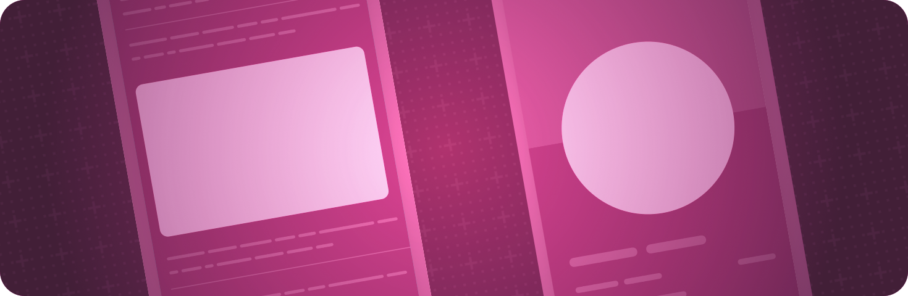

> 导航：[技术](../technologies.md) · [SwiftUI](../swiftui.md)

# 形状

API 集合

用颜色、渐变或其他图案描摹并填充内置和自定义形状。

## 概述

绘制圆形和矩形等形状，以及定义你自己设计的形状的自定义路径。为形状的前景、背景和轮廓应用包括环境感知颜色、丰富渐变和材质效果在内的样式。

如果你需要即时模式绘制的效率或灵活性——例如创建粒子效果——请改用 [Canvas](canvas.md) 视图。

## 主题

### 创建矩形形状

- [Rectangle](rectangle.md) — 一个在其所包含视图的 frame 内对齐的矩形形状。
- [RoundedRectangle](roundedrectangle.md) — 一个带有圆角、在其所包含视图的 frame 内对齐的矩形形状。
- [RoundedCornerStyle](roundedcornerstyle.md) — 定义圆角矩形角落的形状。
- [RoundedRectangularShape](roundedrectangularshape.md) — 一个 [InsettableShape](insettableshape.md) 协议，描述圆角矩形形状。
- [RoundedRectangularShapeCorners](roundedrectangularshapecorners.md) — 一个描述 [RoundedRectangularShape](roundedrectangularshape.md) 角落样式的类型。
- [UnevenRoundedRectangle](unevenroundedrectangle.md) — 一个各角圆角半径不同、在其所包含视图的 frame 内对齐的矩形形状。
- [RectangleCornerRadii](rectanglecornerradii.md) — 描述各角半径不同的圆角矩形的圆角半径值。
- [RectangleCornerInsets](rectanglecornerinsets.md) — 矩形各角的嵌入尺寸。
- [ConcentricRectangle](concentricrectangle.md) — 一种形状，你可以单独或统一将其角落配置为方形、圆角，或相对于容器形状的角落呈同心。

### 创建圆形形状

- [Circle](circle.md) — 一个以其所包含视图的 frame 为中心圆心的圆。
- [Ellipse](ellipse.md) — 一个在其所包含视图的 frame 内对齐的椭圆。
- [Capsule](capsule.md) — 一个在其所包含视图的 frame 内对齐的胶囊形状。

### 绘制自定义形状

- [Path](path.md) — 一个 2D 形状的轮廓。

### 定义形状行为

- [ShapeView](shapeview.md) — 一个提供形状的视图，该形状可用于绘图操作。
- [Shape](shape.md) — 一个 2D 形状，可在绘制视图时使用。
- [AnyShape](anyshape.md) — 一个类型擦除的形状值。
- [ShapeRole](shaperole.md) — 为形状设置样式的几种方式。
- [StrokeStyle](strokestyle.md) — 描摹路径的描边的各项特征。
- [StrokeShapeView](strokeshapeview.md) — 一个为其形状描边的形状提供者。
- [StrokeBorderShapeView](strokebordershapeview.md) — 一个为其形状边界描边的形状提供者。
- [FillStyle](fillstyle.md) — 一种用于光栅化矢量形状的样式。
- [FillShapeView](fillshapeview.md) — 一个填充其形状的形状提供者。

### 变换形状

- [ScaledShape](scaledshape.md) — 一个应用了缩放变换的形状。
- [RotatedShape](rotatedshape.md) — 一个应用了旋转变换的形状。
- [OffsetShape](offsetshape.md) — 一个应用了平移偏移变换的形状。
- [TransformedShape](transformedshape.md) — 一个应用了仿射变换的形状。

### 设置容器形状

- [containerShape(_:)](<view/containershape(__).md>) — 设置此视图内任何容器相对形状或同心矩形所使用的容器形状。
- [InsettableShape](insettableshape.md) — 一种能够对自身进行嵌入以生成另一个形状的形状类型。
- [ContainerRelativeShape](containerrelativeshape.md) — 一种形状，其尺寸由系统根据当前容器形状的嵌入版本计算得出。

## 另请参阅

### 视图

- [视图基础](view-fundamentals.md) — 使用视图的层级结构定义 App 的视觉元素。
- [视图配置](view-configuration.md) — 调整层级结构中视图的特性。
- [视图样式](view-styles.md) — 为不同类型的视图应用内置和自定义的外观与行为。
- [动画](animations.md) — 创建流畅的视觉更新，以响应状态变化。
- [文本输入与输出](text-input-and-output.md) — 显示带格式的文本，并获取用户的文本输入。
- [图像](images.md) — 向 App 的用户界面添加图像和符号。
- [控制与指示符](controls-and-indicators.md) — 显示值并获取用户的选择。
- [菜单与命令](menus-and-commands.md) — 以节省空间、依赖上下文的方式提供对命令和控制的访问。
- [绘图与图形](drawing-and-graphics.md) — 用图形效果和自定义绘图增强你的视图。
