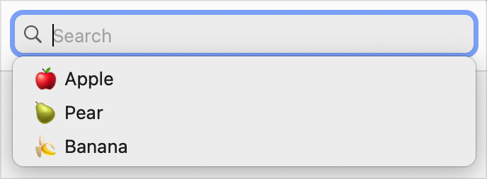
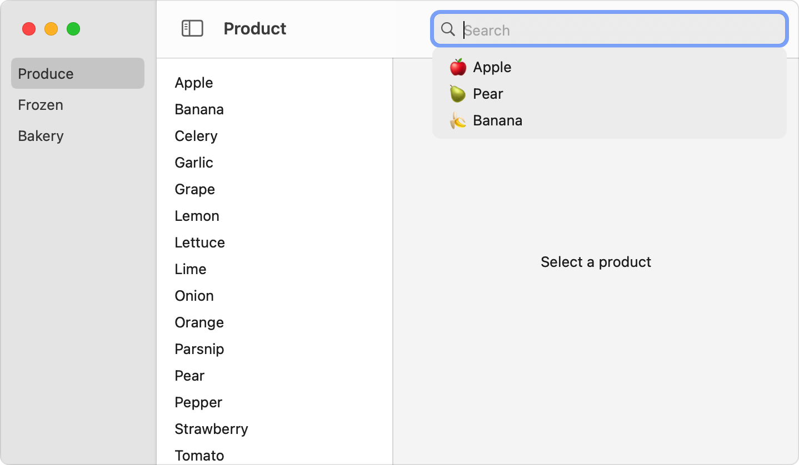

> 导航：[技术](../technologies.md) · [SwiftUI](../swiftui.md) · [搜索](search.md)

# 建议搜索词

<sub>文章</sub>

为在你的 App 中搜索内容的人们提供建议。

## 概述

你可以在搜索操作期间通过提供一组搜索建议视图来建议查询文本。由于建议视图不限于纯文本，你还必须提供每个建议视图所表示的搜索字符串。如果你的搜索界面包含令牌（token），你还可以为令牌提供建议。SwiftUI 会在搜索栏下方的列表中呈现这些建议。



<sub>一个宽的圆角矩形，以蓝色描边，左侧包含一个放大镜，后跟灰色的文字 Search。矩形下方的另一个带投影的矩形中出现一个列表。列表包含三个条目，每个条目由一个单词和一个表情符号组成，表情符号显示与该单词匹配的图像。这些条目分别是 Apple、Pear 和 Banana。</sub>

对于文本和令牌，建议列表由你来管理，因此你在决定建议什么方面拥有完全的灵活性。例如，你可以：

- 提供一个静态的建议列表。
- 记住之前的搜索，并提供最近或最常使用的搜索。
- 根据当前搜索文本实时更新建议列表。
- 综合运用这些或其他策略，并可能随时间而改变。

### 建议搜索文本

通过向 [searchSuggestions(_:)](<view/searchsuggestions(__).md>) 视图修饰符提供一组视图来建议搜索文本。该修饰符作用于出现在它之前的 [searchable(text:placement:prompt:)](<view/searchable(text_placement_prompt_).md>) 修饰符。

当有人激活搜索界面时，它会将建议视图作为一列选项呈现在查询字符串下方。通过在搜索建议闭包内的视图上添加 [searchCompletion(_:)](<view/searchcompletion(__).md>) 修饰符，将一个字符串与每个建议视图关联起来。例如，你可以在建议的可搜索产品中包含带有水果类型的表情符号，并在每种情况下提供相应的搜索字符串作为搜索补全：

```swift
ProductList(departmentId: departmentId, productId: $productId)
    .searchable(text: $model.searchText)
    .searchSuggestions {
        Text("🍎 Apple").searchCompletion("apple")
        Text("🍐 Pear").searchCompletion("pear")
        Text("🍌 Banana").searchCompletion("banana")
    }
```

当有人选择一个建议时，SwiftUI 会用搜索补全字符串替换搜索栏中的文本。在上面的示例中，选择「🍐 Pear」会把文本「pear」放入搜索查询中。



<sub>一个带有三个导航面板的 macOS 窗口。左侧面板列出了 Produce、Frozen 和 Bakery 条目。中间面板有一个很长的水果和蔬菜列表。右侧面板显示占位文字 Select a Product。工具栏在窗口右上角有一个搜索栏，其中显示占位文字 Search。一个列表附着在搜索栏上，悬浮在窗口上方。列表包含 Apple、Pear 和 Banana 条目，每个条目由一个表情符号和相应的文字表示。</sub>

如果你省略了某个特定建议视图的搜索补全修饰符，SwiftUI 会显示该视图，但该视图不会响应点按或点击。不过，你可以使用带有标头的 [Section](section.md) 容器将这些视图分组，从而区分不同类型的建议，例如最近的搜索和常用的搜索词。

> [!important] 重要
> 在 tvOS 上，searchable 修饰符仅支持 [Text](text.md) 类型的建议视图，如上面的示例所示。其他平台可以使用任意视图作为建议，包括自定义视图。

某些事件或操作（例如有人移动 macOS 窗口时）可能会关闭建议列表。

### 建议令牌

你还可以为搜索栏建议令牌。在这种情况下，使用接受令牌作为输入的 [searchCompletion(_:)](<view/searchcompletion(__).md>) 修饰符版本，将建议视图与令牌关联起来：

```swift
ProductList(departmentId: departmentId, productId: $productId)
    .searchable(text: $model.searchText, tokens: $model.tokens) { token in
        switch token {
        case .apple: Text("Apple")
        case .pear: Text("Pear")
        case .banana: Text("Banana")
        }
    }
    .searchSuggestions {
        Text("Apple").searchCompletion(FruitToken.apple)
        Text("Pear").searchCompletion(FruitToken.pear)
        Text("Banana").searchCompletion(FruitToken.banana)
    }
```

你可以使用任何符合 [Identifiable](../swift/identifiable.md) 协议的类型作为令牌。有关在搜索查询中使用令牌的更多信息，请参阅[执行搜索操作](performing-a-search-operation.md)。

### 简化令牌建议

当你的建议集合与令牌列表完全匹配时，为了方便起见，你可以创建一个可能建议的令牌集合。例如，你可以在模型中添加一个已发布的 `suggestions` 属性，其中包含所有可能的令牌：

```swift
@Published var suggestions: [FruitToken] = FruitToken.allCases
```

然后，你可以将这个数组提供给接受 `suggestedTokens` 输入参数的某个 searchable 修饰符，例如 [searchable(text:tokens:suggestedTokens:placement:prompt:token:)](<view/searchable(text_tokens_suggestedtokens_placement_prompt_token_).md>)。SwiftUI 会用它自动生成建议：

```swift
ProductList(departmentId: departmentId, productId: $productId)
    .searchable(
        text: $model.searchText,
        tokens: $model.tokens,
        suggestedTokens: $model.suggestions
    ) { token in
        switch token {
        case .apple: Text("Apple")
        case .pear: Text("Pear")
        case .banana: Text("Banana")
        }
    }
```

在这个版本的 searchable 修饰符中，SwiftUI 使用一个内容构建器来同时描述搜索栏和建议容器中令牌的外观。

### 动态更新建议

你可以随着条件的变化更新所提供建议。例如，你可以指定一个存储在 App 模型中的 `suggestedSearches` 数组：

```swift
ProductList(departmentId: departmentId, productId: $productId)
    .searchable(text: $model.searchText)
    .searchSuggestions {
        ForEach(model.suggestedSearches) { suggestion in
            Label(suggestion.title,  image: suggestion.image)
                .searchCompletion(suggestion.text)
        }
    }
```

如果 `suggestedSearches` 一开始是一个空数组，界面最初不会显示任何建议。然后你可以随着条件的变化更新该数组，例如当你想要包含之前的搜索时。

## 另请参阅

### 提出搜索建议

- [searchSuggestions(_:)](<view/searchsuggestions(__).md>) — 为此视图配置搜索建议。
- [searchSuggestions(_:for:)](<view/searchsuggestions(__for_).md>) — 配置如何在此视图内显示搜索建议。
- [searchCompletion(_:)](<view/searchcompletion(__).md>) — 当此视图用作搜索建议时，将一个完整的字符串与该视图的值关联起来。
- [searchable(text:tokens:suggestedTokens:placement:prompt:token:)](<view/searchable(text_tokens_suggestedtokens_placement_prompt_token_).md>) — 将此视图标记为可搜索，支持文本、令牌和建议。
- [SearchSuggestionsPlacement](searchsuggestionsplacement.md) — SwiftUI 显示搜索建议的各种方式。
