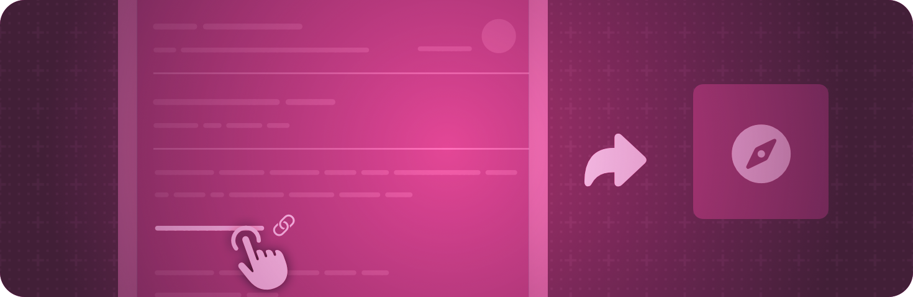

> 导航：[技术](../technologies.md) · [SwiftUI](../swiftui.md)

# 系统事件

API 集合

对系统事件作出反应，例如打开 URL。

## 概述

指定视图和场景修饰符，以表明你的 App 如何响应某些系统事件。例如，你可以使用 [onOpenURL(perform:)](<view/onopenurl(perform_).md>) 视图修饰符定义在 App 收到通用链接时要执行的操作，或使用 [backgroundTask(_:action:)](<scene/backgroundtask(__action_).md>) 场景修饰符指定为响应后台任务事件（如后台 URL 会话完成）而执行的异步任务。

## 主题

### 发送和接收用户活动

- [Restoring your app’s state with SwiftUI](restoring-your-app-s-state-with-swiftui.md) — 通过保留用户当前的活动，为用户提供 App 连续性体验。
- [userActivity(_:element:_:)](<view/useractivity(__element___).md>) — 发布一种用户活动类型。
- [userActivity(_:isActive:_:)](<view/useractivity(__isactive___).md>) — 发布一种用户活动类型。
- [onContinueUserActivity(_:perform:)](<view/oncontinueuseractivity(__perform_).md>) — 注册一个处理程序，以响应你 App 收到的用户活动。

### 发送和接收 URL

- [openURL](environmentvalues/openurl.md) — 打开 URL 的一种操作。
- [OpenURLAction](openurlaction.md) — 打开 URL 的一种操作。
- [onOpenURL(perform:)](<view/onopenurl(perform_).md>) — 注册一个处理程序，以响应你 App 收到的 URL。

### 处理外部事件

- [handlesExternalEvents(matching:)](<scene/handlesexternalevents(matching_).md>) — 指定 SwiftUI 为其打开被修饰场景新实例的外部事件。
- [handlesExternalEvents(preferring:allowing:)](<view/handlesexternalevents(preferring_allowing_).md>) — 指定当场景已打开时该视图的场景要处理的外部事件。

### 处理后台任务

- [backgroundTask(_:action:)](<scene/backgroundtask(__action_).md>) — 在系统提供后台任务时执行指定的操作。
- [BackgroundTask](backgroundtask.md) — 你的 App 或扩展可以处理的后台任务种类。
- [SnapshotData](snapshotdata.md) — 快照后台任务的关联数据。
- [SnapshotResponse](snapshotresponse.md) — 你的应用程序对快照后台任务的响应。

### 导入和导出可传输项目

- [importableFromServices(for:action:)](<view/importablefromservices(for_action_).md>) — 允许从服务导入项目，例如 macOS 上的连续互通相机。
- [exportableToServices(_:)](<view/exportabletoservices(__).md>) — 导出项目，供快捷指令、快速操作和服务使用。
- [exportableToServices(_:onEdit:)](<view/exportabletoservices(__onedit_).md>) — 导出可读写项目，供快捷指令、快速操作和服务使用。

### 使用条目提供器导入和导出

- [importsItemProviders(_:onImport:)](<view/importsitemproviders(__onimport_).md>) — 允许从服务导入条目提供器，例如 macOS 上的连续互通相机。
- [exportsItemProviders(_:onExport:)](<view/exportsitemproviders(__onexport_).md>) — 导出一个只读条目提供器，供快捷指令、快速操作和服务使用。
- [exportsItemProviders(_:onExport:onEdit:)](<view/exportsitemproviders(__onexport_onedit_).md>) — 导出一个可读写条目提供器，供快捷指令、快速操作和服务使用。

## 另请参阅

### Event handling

- [Gestures](gestures.md) — 定义从轻点、点按、轻扫到精细手势的各种交互。
- [Input events](input-events.md) — 响应来自硬件设备（如键盘或 Touch Bar）的输入。
- [Clipboard](clipboard.md) — 让人们通过发出“拷贝”和“粘贴”命令来移动或复制项目。
- [Drag and drop](drag-and-drop.md) — 让用户能够通过将项目从一个位置拖到另一个位置来移动或复制项目。
- [Focus](focus.md) — 识别并控制哪个可见对象响应用户交互。
