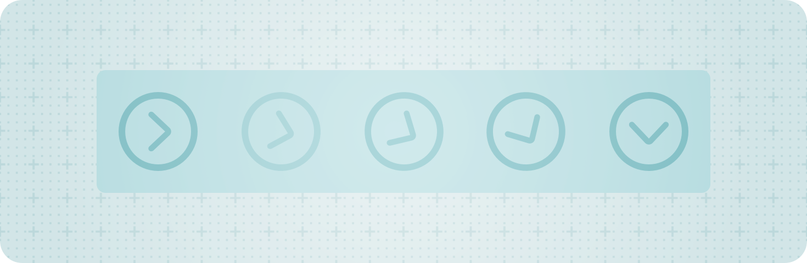

> 导航： [Technologies](../technologies.md) · [SwiftUI](../swiftui.md) · [AppKit integration](appkit-integration.md)

# 统一 App 的动画

<sub>文章</sub>

在 SwiftUI、UIKit 和 AppKit 之间创建一致的 UI 动画体验。

## 概述

许多 App 组合使用 SwiftUI、UIKit 和 AppKit 来构建其界面并为其添加动画。在 iOS 18 及更高版本中，你可以在 UIKit 和 AppKit 中使用 SwiftUI 动画。SwiftUI 提供了丰富的标准动画类型以及自定动画类型。



<sub>一个展开指示器的概念插图，逐帧显示它从收起位置到展开位置的动画过程。</sub>

SwiftUI、UIKit 和 AppKit 为动画使用不同的底层实现。使用多个框架做动画的 App 可能会遇到某些问题，例如动画时序难以同步或其他不一致的情况，这些问题难以排查，并会导致欠佳的用户体验。使用 SwiftUI 动画为所有这些框架中的 UI 添加动画，可以在每个平台上创造更一致、更无缝的体验。

### 创建 SwiftUI 动画

要在 UIKit 或 AppKit 中创建 SwiftUI 动画，请导入 SwiftUI 并创建一个 SwiftUI [Animation](animation.md)。然后，把该动画作为参数传入 `UIView` 上的 [animate(_:changes:completion:)](<../uikit/uiview/animate(__changes_completion_).md>) 类方法，或 `NSAnimationContext` 上的 [animate(_:changes:completion:)](<../appkit/nsanimationcontext/animate(__changes_completion_).md>) 类方法。以下示例对比了如何使用 SwiftUI 的 [Animation](animation.md) 类型，在 SwiftUI、UIKit 和 AppKit 中创建一个基本的弹簧动画。

**SwiftUI**

```swift
struct ContentView: View {
    @State private var position = CGPoint(x: 200, y: 200)
    @State private var frame = CGSize(width: 100, height: 100)
    
    var body: some View {
        Rectangle()
            .fill(Color.blue)
            .frame(width: frame.width, height: frame.height)
            .position(position)
        Button("Animate") {
            // 使用弹簧动画把视图移动到新位置。
            let animation = Animation.spring(duration: 0.8)
            withAnimation(animation) {
                position = CGPoint(x: 100, y: 100)
            }
        }
    }
}
```

**UIKit**

```swift
import SwiftUI

let position = CGPoint(x: 200, y: 200)
let frame = CGSize(width: 100, height: 100)
let buttonPosition = CGPoint(x: 200, y: 400)
let buttonFrame = CGSize(width: 100, height: 100)

override func viewDidLoad() {
    super.viewDidLoad()
            
    let myView = UIView(frame: CGRect(origin: position, size: frame))
    myView.backgroundColor = .systemBlue
    
    let myButton = UIButton(primaryAction: UIAction(title: "Animate") { _ in
        // 使用弹簧动画把视图移动到新位置。
        let animation = SwiftUI.Animation.spring(duration: 0.8)
        UIView.animate(animation) {
            myView.center = CGPoint(x: 100, y: 100)
        }
    })
    myButton.frame = CGRect(origin: buttonPosition, size: buttonFrame)
    
    view.addSubview(myView)
    view.addSubview(myButton)
}
```

**AppKit**

```swift
import SwiftUI

let myView = NSView(frame: CGRect(origin: CGPoint(x: 50, y: 50), 
                                  size: CGSize(width: 50, height: 50)))

override func viewDidLoad() {
    super.viewDidLoad()
    
    let myButton = NSButton(title: "Animate", target: self, action: #selector(animateView))
    view.addSubview(myButton)

    myView.wantsLayer = true
    myView.layer?.backgroundColor = NSColor.blue.cgColor
    view.addSubview(myView)
}

@objc
func animateView() {
    // 使用弹簧动画改变视图的大小。
    let animation = SwiftUI.Animation.spring(duration: 0.8)
    NSAnimationContext.animate(animation) {
        myView.frame.size = CGSize(width: 100, height: 100)
    }
}
```

### 在 SwiftUI 动画中使用完成处理程序

你可以为这些动画方法提供一个可选的完成处理程序，系统会在动画结束后自动调用它。以下示例展示了一个完成处理程序，它在动画结束时改变视图的背景颜色以作出指示。

**SwiftUI**

```swift
struct ContentView: View {
    @State private var color = Color.blue
    @State private var position = CGPoint(x: 200, y: 200)
    @State private var frame = CGSize(width: 100, height: 100)
    
    var body: some View {
        Rectangle()
            .fill(color)
            .frame(width: frame.width, height: frame.height)
            .position(position)
        Button("Animate") {
            // 使用平滑的弹簧动画把视图移动到新位置。
            withAnimation(.smooth) {
                position = CGPoint(x: 100, y: 100)
            } completion: {
                // 动画完成时，改变视图的颜色。
                color = Color.red
            }
        }
    }
}
```

**UIKit**

```swift
import SwiftUI

let position = CGPoint(x: 200, y: 200)
let frame = CGSize(width: 100, height: 100)
let buttonPosition = CGPoint(x: 200, y: 400)
let buttonFrame = CGSize(width: 100, height: 100)

override func viewDidLoad() {
    super.viewDidLoad()
        
    let myView = UIView(frame: CGRect(origin: position, size: frame))
    myView.backgroundColor = .systemBlue

    let myButton = UIButton(primaryAction: UIAction(title: "Animate") { _ in
        // 使用平滑的弹簧动画把视图移动到新位置。
        UIView.animate(.smooth) {
            myView.center = CGPoint(x: 100, y: 100)
        } completion: {
            // 动画完成时，改变视图的颜色。
            myView.backgroundColor = .systemRed
        }
    })
    myButton.frame = CGRect(origin: buttonPosition, size: buttonFrame)

    view.addSubview(myView)
    view.addSubview(myButton)
}
```

**AppKit**

```swift
import SwiftUI

let myView = NSView(frame: CGRect(origin: CGPoint(x: 50, y: 50), 
                                  size: CGSize(width: 50, height: 50)))

override func viewDidLoad() {
    super.viewDidLoad()
    
    let myButton = NSButton(title: "Animate", target: self, action: #selector(animateView))
    view.addSubview(myButton)

    myView.wantsLayer = true
    myView.layer?.backgroundColor = NSColor.blue.cgColor
    view.addSubview(myView)
}

@objc
func animateView() {
    // 使用平滑的弹簧动画改变视图的大小。
    NSAnimationContext.animate(.smooth) {
        self.myView.frame.size = CGSize(width: 100, height: 100)
    } completion: {
        // 动画完成时，改变视图的颜色。
        self.myView.layer?.backgroundColor = NSColor.red.cgColor
    }
}
```

### 重定 SwiftUI 动画的目标

与 SwiftUI 视图中的动画类似，你可以使用 `UIView` 上的 [animate(_:changes:completion:)](<../uikit/uiview/animate(__changes_completion_).md>) 类方法或 `NSAnimationContext` 上的 [animate(_:changes:completion:)](<../appkit/nsanimationcontext/animate(__changes_completion_).md>) 类方法，平滑地重定你所执行的动画的目标。重定 SwiftUI 动画的目标时，会利用先前动画的速度以连续的速度把动画继续推进，从而创建流畅的动画体验。以下示例展示了对一个进行中的动画重定目标。

**SwiftUI**

```swift
struct ContentView: View {
    @State private var position = CGPoint(x: 200, y: 200)
    @State private var frame = CGSize(width: 100, height: 100)
    
    var body: some View {
        Rectangle()
            .fill(Color.blue)
            .frame(width: frame.width, height: frame.height)
            .position(position)
        Button("Animate") {
            Task {
                // 开始一个动画，把视图移到新位置。
                withAnimation(.spring(duration: 1.0)) {
                    position = .zero
                }
                
                try await Task.sleep(for: .seconds(0.5))

                // 重定进行中动画的目标，把视图移到另一个位置。
                withAnimation(.spring) {
                    position = CGPoint(x: 100, y: 400)
                }
            }
        }
    }
}
```

**UIKit**

```swift
import SwiftUI

let position = CGPoint(x: 200, y: 200)
let frame = CGSize(width: 100, height: 100)
let buttonPosition = CGPoint(x: 200, y: 400)
let buttonFrame = CGSize(width: 100, height: 100)

override func viewDidLoad() {
    super.viewDidLoad()
    
    let myView = UIView(frame: CGRect(origin: position, size: frame))
    myView.backgroundColor = .systemBlue
    
    let myButton = UIButton(primaryAction: UIAction(title: "Animate") { _ in
        Task { 
            // 开始一个动画，把视图移到新位置。
            UIView.animate(.spring(duration: 1.0)) {
                myView.center = CGPoint(x: 200, y: 200)
            }
            
            try await Task.sleep(for: .seconds(0.5))
            
            // 重定进行中动画的目标，把视图移到另一个位置。
            UIView.animate(.spring) {
                myView.center = CGPoint(x: 100, y: 400)
            }
        }
    })
    myButton.frame = CGRect(origin: buttonPosition, size: buttonFrame)
    
    view.addSubview(myView)
    view.addSubview(myButton)
}
```

**AppKit**

```swift
import SwiftUI

let myView = NSView(frame: CGRect(origin: CGPoint(x: 50, y: 50), 
                                  size: CGSize(width: 50, height: 50)))

override func viewDidLoad() {
    super.viewDidLoad()
    
    let myButton = NSButton(title: "Animate", target: self, action: #selector(animateView))
    view.addSubview(myButton)

    myView.wantsLayer = true
    myView.layer?.backgroundColor = NSColor.blue.cgColor
    view.addSubview(myView)
}

@objc
func animateView() {
    Task {
        // 开始一个动画，改变视图的大小。
        NSAnimationContext.animate(.spring(duration: 1)) {
            myView.frame.size = CGSize(width: 100, height: 100)
        }

        try await Task.sleep(for: .seconds(0.5))

        // 重定进行中动画的目标，把视图改为另一个大小。
        NSAnimationContext.animate(.spring) {
            myView.frame.size = CGSize(width: 75, height: 75)
        }
    }
}
```

### 排查动画问题

跨框架同步动画可能会暴露出不同实现之间的行为差异。在排查 App 中的动画问题时，请牢记以下提示：

- SwiftUI 动画在你的 App 进程的后台线程上运行。
- SwiftUI 动画没有底层支撑的 [CAAnimation](../quartzcore/caanimation.md)，这是它与 [UIView](../uikit/uiview.md) 动画的不同之处。
- SwiftUI 动画与 [UIViewPropertyAnimator](../uikit/uiviewpropertyanimator.md) 或 `UIView` 关键帧动画不兼容。

有关在你的 App 中提供出色动画体验的更多信息，参见 [Enhance your UI animations and transitions](https://developer.apple.com/wwdc24/10145/)。

## 另请参阅

### 相关文档

- [Animation](animation.md) — 视图随时间变化的方式，用于创建从一个状态到另一个状态的平滑视觉过渡。
- [withAnimation(_:_:)](<withanimation(____).md>) — 使用提供的动画重新计算视图的 `body`，并返回结果。
- [animate(_:changes:completion:)](<../uikit/uiview/animate(__changes_completion_).md>)
- [animate(_:changes:completion:)](<../appkit/nsanimationcontext/animate(__changes_completion_).md>) — 使用指定的 SwiftUI 动画为一个或多个视图的变化添加动画。

### 在 AppKit 中显示 SwiftUI 视图

- [NSHostingController](nshostingcontroller.md) — 一种 AppKit 视图控制器，用于承载 SwiftUI 视图层级结构。
- [NSHostingView](nshostingview.md) — 一种 AppKit 视图，用于承载 SwiftUI 视图层级结构。
- [NSHostingMenu](nshostingmenu.md) — 一种 AppKit 菜单，其菜单项由 SwiftUI View 定义。
- [NSHostingSizingOptions](nshostingsizingoptions.md) — 控制承载视图和控制器如何把其内容的大小反映到 Auto Layout 约束中的选项。
- [NSHostingSceneRepresentation](nshostingscenerepresentation.md) — 一种承载并能够呈现 SwiftUI 场景的 AppKit 类型
- [NSHostingSceneBridgingOptions](nshostingscenebridgingoptions.md) — 控制承载视图和控制器如何管理相关窗口各方面事务的选项。
