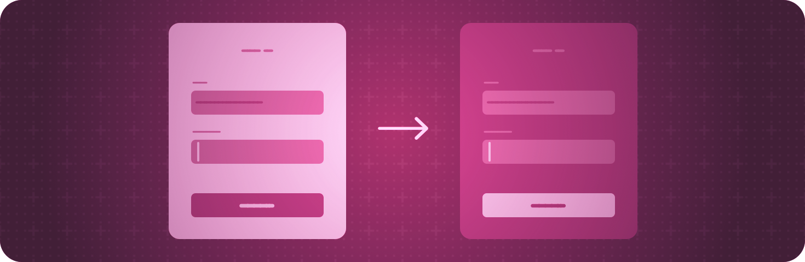

> 导航：[技术](../technologies.md) · [SwiftUI](../swiftui.md)

# 视图配置

API 集合

调整层级结构中视图的特性。

## 概述

SwiftUI 让你可以使用视图修饰符调整视图的外观和行为。

许多修饰符应用于特定种类的视图或行为，但也有一些更为通用。例如，你可以通过动态设置不透明度来有条件地隐藏任何视图、在人们悬停在某个视图上时显示上下文帮助，或者为视图请求浅色或深色外观。

## 主题

### 隐藏视图

- [opacity(_:)](<view/opacity(__).md>) — 设置此视图的不透明度。
- [hidden()](<view/hidden().md>) — 无条件隐藏此视图。

### 隐藏系统元素

- [labelsHidden()](<view/labelshidden().md>) — 隐藏此视图内包含的任何控制的标签。
- [labelsVisibility(_:)](<view/labelsvisibility(__).md>) — 控制此视图内包含的任何控制的标签的可见性。
- [labelsVisibility](environmentvalues/labelsvisibility.md) — 由 [labelsVisibility(_:)](<view/labelsvisibility(__).md>) 设置的标签可见性。
- [menuIndicator(_:)](<view/menuindicator(__).md>) — 设置此视图内控制的菜单指示符可见性。
- [statusBarHidden(_:)](<view/statusbarhidden(__).md>) — 设置状态栏的可见性。 _(已废弃)_
- [persistentSystemOverlays(_:)](<view/persistentsystemoverlays(__).md>) — 设置覆盖在 App 上的非瞬态系统视图的首选可见性。
- [Visibility](visibility.md) — UI 元素的可见性，根据平台、当前上下文和其他因素自动选择。

### 管理视图交互

- [disabled(_:)](<view/disabled(__).md>) — 添加一个条件，控制用户能否与此视图交互。
- [isEnabled](environmentvalues/isenabled.md) — 一个布尔值，指示与此环境关联的视图是否允许用户交互。
- [interactionActivityTrackingTag(_:)](<view/interactionactivitytrackingtag(__).md>) — 设置一个用于跟踪交互活动的标签。
- [invalidatableContent(_:)](<view/invalidatablecontent(__).md>) — 将接收者标记为其内容可能已失效。

### 提供上下文帮助

- [help(_:)](<view/help(__).md>) — 使用你提供的本地化字符串资源为视图添加帮助文本。

### 检测并请求浅色或深色外观

- [preferredColorScheme(_:)](<view/preferredcolorscheme(__).md>) — 为此次呈现设置首选颜色方案。
- [colorScheme](environmentvalues/colorscheme.md) — 此环境的颜色方案。
- [ColorScheme](colorscheme.md) — 可能的颜色方案，对应于浅色和深色外观。

### 获取颜色方案对比度

- [colorSchemeContrast](environmentvalues/colorschemecontrast.md) — 与此环境的颜色方案关联的对比度。
- [ColorSchemeContrast](colorschemecontrast.md) — App 前景色与背景色之间的对比度。

### 配置透视穿透

- [preferredSurroundingsEffect(_:)](<view/preferredsurroundingseffect(__).md>) — 对透视穿透视频应用一种效果。
- [SurroundingsEffect](surroundingseffect.md) — 系统可应用于透视穿透视频的效果。
- [breakthroughEffect(_:)](<view/breakthrougheffect(__).md>) — 确保视图始终对用户可见，即使有其他内容（例如 3D 模型）遮挡它。
- [BreakthroughEffect](breakthrougheffect.md)

### 屏蔽私密内容

- [针对全天候显示状态设计你的 App](../watchos-apps/designing-your-app-for-the-always-on-state.md) — 为持续显示定制你 watchOS App 的用户界面。
- [在屏幕共享和远程控制处于活跃状态时保护敏感内容](protecting-sensitive-content-when-screen-sharing.md) — 检测活跃的屏幕捕捉会话并作出适当响应，以保护你 App 中的敏感内容。
- [privacySensitive(_:)](<view/privacysensitive(__).md>) — 将视图标记为包含敏感的私密用户数据。
- [redacted(reason:)](<view/redacted(reason_).md>) — 添加一个对此视图层级结构应用屏蔽的理由。
- [unredacted()](<view/unredacted().md>) — 移除对此视图层级结构应用屏蔽的任何理由。
- [redactionReasons](environmentvalues/redactionreasons.md) — 当前应用到视图层级结构的屏蔽理由。
- [isSceneCaptured](environmentvalues/isscenecaptured.md) — 当前的捕捉状态。
- [RedactionReasons](redactionreasons.md) — 对屏幕上显示的数据应用屏蔽的理由。

## 另请参阅

### 视图

- [视图基础](view-fundamentals.md) — 使用视图的层级结构定义 App 的视觉元素。
- [视图样式](view-styles.md) — 为不同类型的视图应用内置和自定义的外观与行为。
- [动画](animations.md) — 创建流畅的视觉更新，以响应状态变化。
- [文本输入与输出](text-input-and-output.md) — 显示带格式的文本，并获取用户的文本输入。
- [图像](images.md) — 向 App 的用户界面添加图像和符号。
- [控制与指示符](controls-and-indicators.md) — 显示值并获取用户的选择。
- [菜单与命令](menus-and-commands.md) — 以节省空间、依赖上下文的方式提供对命令和控制的访问。
- [形状](shapes.md) — 用颜色、渐变或其他图案描摹并填充内置和自定义形状。
- [绘图与图形](drawing-and-graphics.md) — 用图形效果和自定义绘图增强你的视图。
