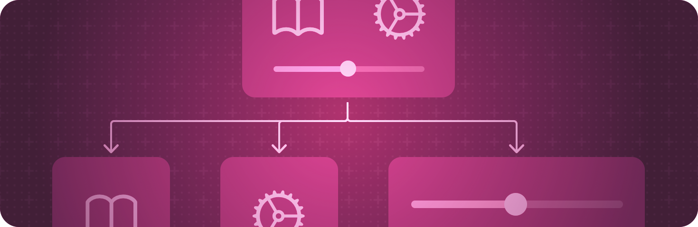

> 导航：[技术](../technologies.md) · [SwiftUI](../swiftui.md)

# 视图基础

API 集合

使用视图的层级结构定义 App 的视觉元素。

## 概述

视图是你用来声明 App 用户界面的构建块。每个视图都包含一份描述，说明在给定状态下要显示什么。App 中用户可见的每一部分都源自某个视图中的描述，任何符合 [View](view.md) 协议的类型都可以充当 App 中的视图。

在视图的 [body](view/body-8kl5o.md) 计算属性中，把 SwiftUI 提供的内置视图与你创建的其他自定义视图组合起来，构成自定义视图。使用 SwiftUI 提供的视图修饰符配置视图，或者通过 [ViewModifier](viewmodifier.md) 协议和 [modifier(_:)](<view/modifier(__).md>) 方法定义你自己的视图修饰符。

## 主题

### 创建视图

- [声明自定义视图](declaring-a-custom-view.md) — 定义视图，并把它们组装成视图层级结构。
- [Wishlist：在 SwiftUI App 中规划旅行](wishlist-planning-travel-in-a-swiftui-app.md) — 构建一个旅行规划 App，把行程整理成集合并跟踪活动的完成情况。
- [View](view.md) — 一个类型，表示 App 用户界面的一部分，并提供用于配置视图的修饰符。
- [ContentBuilder](contentbuilder.md) — 一个自定义参数特性，用于从闭包构建视图和其他内容类型。
- [ViewBuilder](viewbuilder.md) — 一个自定义参数特性，用于从闭包构建视图。

### 修改视图

- [配置视图](configuring-views.md) — 通过应用视图修饰符调整视图的特性。
- [减少视图修饰符的维护工作](reducing-view-modifier-maintenance.md) — 把你经常复用的视图修饰符打包成一个自定义视图修饰符。
- [modifier(_:)](<view/modifier(__).md>) — 对视图应用一个修饰符并返回新视图。
- [ViewModifier](viewmodifier.md) — 一个应用于视图或另一个视图修饰符的修饰符，产生原始值的一个不同版本。
- [EmptyModifier](emptymodifier.md) — 一个空的（即恒等的）修饰符，在开发期间用于在编译期切换修饰符。
- [ModifiedContent](modifiedcontent.md) — 应用了修饰符的值。
- [EnvironmentalModifier](environmentalmodifier.md) — 一个必须先在环境中解析为具体修饰符才能使用的修饰符。
- [ManipulableModifier](manipulablemodifier.md)
- [ManipulableResponderModifier](manipulablerespondermodifier.md)
- [ManipulableTransformBindingModifier](manipulabletransformbindingmodifier.md)
- [ManipulationGeometryModifier](manipulationgeometrymodifier.md)
- [ManipulationGestureModifier](manipulationgesturemodifier.md)
- [ManipulationUsingGestureStateModifier](manipulationusinggesturestatemodifier.md)
- [Manipulable](manipulable.md) — 一个命名空间，包含各种与可操作相关的类型。

### 响应视图生命周期更新

- [onAppear(perform:)](<view/onappear(perform_).md>) — 添加一个在此视图出现之前执行的操作。
- [onDisappear(perform:)](<view/ondisappear(perform_).md>) — 添加一个在此视图消失之后执行的操作。

### 分派任务

- [task(id:name:executorPreference:priority:file:line:_:)](<view/task(id_name_executorpreference_priority_file_line___).md>) — 添加一个任务，在此视图出现之前或指定值发生变化时执行。
- [task(id:name:priority:file:line:_:)](<view/task(id_name_priority_file_line___).md>) — 添加一个任务，在此视图出现之前或指定值发生变化时执行。
- [task(name:executorPreference:priority:file:line:action:)](<view/task(name_executorpreference_priority_file_line_action_).md>) — 添加一个异步任务，在此视图出现之前执行。
- [task(name:priority:file:line:_:)](<view/task(name_priority_file_line___).md>) — 添加一个异步任务，在此视图出现之前执行。

### 管理视图层级结构

- [id(_:)](<view/id(__).md>) — 将视图的身份绑定到给定的代理值。
- [tag(_:includeOptional:)](<view/tag(__includeoptional_).md>) — 设置此视图的唯一标签值。
- [equatable()](<view/equatable().md>) — 当视图的新值与旧值相同时，阻止其更新子视图。

### 支持的内容类型

- [EmptyContent](emptycontent.md) — 不包含任何内容的内容。
- [TupleContent](tuplecontent.md) — 由一组被视为兄弟关系的内容组成的元组创建的内容。

### 支持的视图类型

- [AnyView](anyview.md) — 一个类型擦除的视图。
- [EmptyView](emptyview.md) — 一个不包含任何内容的视图。
- [EquatableView](equatableview.md) — 一个会将自身与先前值进行比较的视图类型，当新值与旧值相同时阻止其子视图更新。
- [SubscriptionView](subscriptionview.md) — 一个通过操作订阅发布者的视图。
- [TupleView](tupleview.md) — 一个由 View 值的 Swift 元组创建的视图。

## 另请参阅

### 视图

- [视图配置](view-configuration.md) — 调整层级结构中视图的特性。
- [视图样式](view-styles.md) — 为不同类型的视图应用内置和自定义的外观与行为。
- [动画](animations.md) — 创建流畅的视觉更新，以响应状态变化。
- [文本输入与输出](text-input-and-output.md) — 显示带格式的文本，并获取用户的文本输入。
- [图像](images.md) — 向 App 的用户界面添加图像和符号。
- [控制与指示符](controls-and-indicators.md) — 显示值并获取用户的选择。
- [菜单与命令](menus-and-commands.md) — 以节省空间、依赖上下文的方式提供对命令和控制的访问。
- [形状](shapes.md) — 用颜色、渐变或其他图案描摹并填充内置和自定义形状。
- [绘图与图形](drawing-and-graphics.md) — 用图形效果和自定义绘图增强你的视图。
