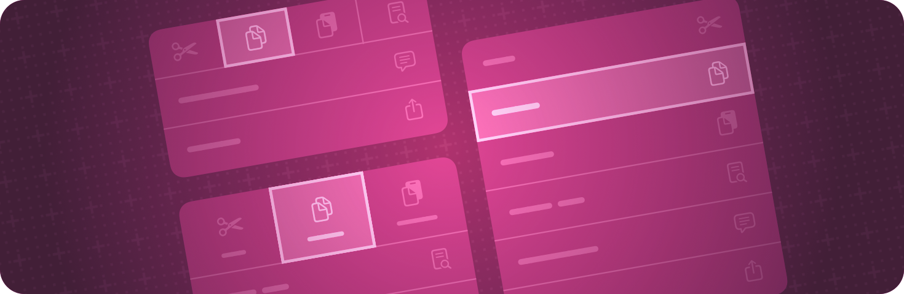

> 导航：[技术](../technologies.md) · [SwiftUI](../swiftui.md)

# 视图样式

API 集合

为不同类型的视图应用内置和自定的外观与行为。

## 概述

SwiftUI 为某些类型的视图定义了内置样式，并会针对特定的呈现上下文自动选择合适的样式。例如，[Label](label.md) 可能显示为图标、字符串标题，或两者兼有，具体取决于平台、视图是否出现在工具栏中等因素。

你可以使用某个样式视图修饰符来覆盖自动选择的样式。这些修饰符通常会在整个容器视图中传播，因此你可以将一个视图层级结构包裹在样式修饰符中，从而影响该层级结构内所有给定类型的视图。

任何定义了 `makeBody(configuration:)` 方法的样式协议（例如 [ToggleStyle](togglestyle.md)）也都允许你定义自定样式。创建一个符合对应样式协议的类型，并实现其 `makeBody(configuration:)` 方法。然后像使用内置样式一样，使用样式视图修饰符应用新样式。

## 主题

### 使用 Liquid Glass 设置视图样式

- [将 Liquid Glass 应用到自定视图](applying-liquid-glass-to-custom-views.md) — 使用 Liquid Glass 效果配置、组合和形变视图。
- [Landmarks：使用 Liquid Glass 构建 App](landmarks-building-an-app-with-liquid-glass.md) — 使用系统提供的和自定的 Liquid Glass 增强 App 体验。
- [glassEffect(_:in:)](<view/glasseffect(__in_).md>) — 将 Liquid Glass 效果应用到视图。
- [glassEffectID(_:in:)](<view/glasseffectid(__in_).md>) — 将一个身份值与此视图中定义的 Liquid Glass 效果关联。
- [glassEffectTransition(_:)](<view/glasseffecttransition(__).md>) — 将玻璃效果过渡与此视图中定义的任何玻璃效果关联。
- [glassEffectUnion(id:namespace:)](<view/glasseffectunion(id_namespace_).md>) — 将此视图中定义的任何 Liquid Glass 效果与提供的标识符关联为一个并集。
- [interactive(_:)](<glass/interactive(__).md>) — 返回配置为可交互的结构体副本。
- [GlassEffectContainer](glasseffectcontainer.md) — 一个将多个 Liquid Glass 形状合并为单一形状的视图，可以使各个形状之间相互形变。
- [GlassEffectTransition](glasseffecttransition.md) — 一个结构体，描述在视图层级结构中添加或移除玻璃效果时要应用的更改。
- [GlassButtonStyle](glassbuttonstyle.md) — 一种按钮样式，根据按钮的上下文应用玻璃边框外观。
- [GlassProminentButtonStyle](glassprominentbuttonstyle.md) — 一种按钮样式，根据按钮的上下文应用醒目的玻璃边框外观。
- [DefaultGlassEffectShape](defaultglasseffectshape.md) — 玻璃效果应用的默认形状，即胶囊。

### 设置按钮样式

- [buttonStyle(_:)](<view/buttonstyle(__).md>) — 将此视图内按钮的样式设置为具有自定外观和标准交互行为的按钮样式。
- [ButtonStyle](buttonstyle.md) — 一种类型，为视图层级结构中的所有按钮应用标准交互行为和自定外观。
- [ButtonStyleConfiguration](buttonstyleconfiguration.md) — 按钮的属性。
- [PrimitiveButtonStyle](primitivebuttonstyle.md) — 一种类型，为视图层级结构中的所有按钮应用自定交互行为和自定外观。
- [PrimitiveButtonStyleConfiguration](primitivebuttonstyleconfiguration.md) — 按钮的属性。
- [signInWithAppleButtonStyle(_:)](<view/signinwithapplebuttonstyle(__).md>) — 设置显示该控制时使用的样式（参见 `SignInWithAppleButton.Style`）。
- [buttonSizing(_:)](<view/buttonsizing(__).md>) — 视图层级结构中按钮的首选尺寸调整行为。
- [ButtonSizing](buttonsizing.md) — `Button` 和其他类按钮控制的尺寸调整行为。

### 设置选择器样式

- [pickerStyle(_:)](<view/pickerstyle(__).md>) — 设置此视图内选择器的样式。
- [PickerStyle](pickerstyle.md) — 一个指定视图层级结构中所有选择器外观和交互的类型。
- [datePickerStyle(_:)](<view/datepickerstyle(__).md>) — 设置此视图内日期选择器的样式。
- [DatePickerStyle](datepickerstyle.md) — 一个指定视图层级结构中所有日期选择器外观和交互的类型。

### 设置菜单样式

- [menuStyle(_:)](<view/menustyle(__).md>) — 设置此视图内菜单的样式。
- [MenuStyle](menustyle.md) — 一种类型，为视图层级结构中的所有菜单应用标准交互行为和自定外观。
- [MenuStyleConfiguration](menustyleconfiguration.md) — 菜单的一种配置。

### 设置开关样式

- [toggleStyle(_:)](<view/togglestyle(__).md>) — 设置视图层级结构中开关的样式。
- [ToggleStyle](togglestyle.md) — 开关的外观和行为。
- [ToggleStyleConfiguration](togglestyleconfiguration.md) — 开关实例的属性。

### 设置指示符样式

- [gaugeStyle(_:)](<view/gaugestyle(__).md>) — 设置此视图内仪表的样式。
- [GaugeStyle](gaugestyle.md) — 定义视图层级结构中所有仪表实例的实现。
- [GaugeStyleConfiguration](gaugestyleconfiguration.md) — 仪表实例的属性。
- [progressViewStyle(_:)](<view/progressviewstyle(__).md>) — 设置此视图内进度视图的样式。
- [ProgressViewStyle](progressviewstyle.md) — 一种类型，为视图层级结构中的所有进度视图应用标准交互行为。
- [ProgressViewStyleConfiguration](progressviewstyleconfiguration.md) — 进度视图实例的属性。

### 设置显示文本的视图样式

- [labelStyle(_:)](<view/labelstyle(__).md>) — 设置此视图内标签的样式。
- [LabelStyle](labelstyle.md) — 一种类型，为视图中的所有标签应用自定外观。
- [LabelStyleConfiguration](labelstyleconfiguration.md) — 标签的属性。
- [textFieldStyle(_:)](<view/textfieldstyle(__).md>) — 设置此视图内文本栏的样式。
- [TextFieldStyle](textfieldstyle.md) — 文本栏外观和交互的一种规范。
- [textEditorStyle(_:)](<view/texteditorstyle(__).md>) — 设置此视图内文本编辑器的样式。
- [TextEditorStyle](texteditorstyle.md) — 文本编辑器外观和交互的一种规范。
- [TextEditorStyleConfiguration](texteditorstyleconfiguration.md) — 文本编辑器的属性。

### 设置集合视图样式

- [listStyle(_:)](<view/liststyle(__).md>) — 设置此视图内列表的样式。
- [ListStyle](liststyle.md) — 一个描述列表行为和外观的协议。
- [tableStyle(_:)](<view/tablestyle(__).md>) — 设置此视图内表格的样式。
- [TableStyle](tablestyle.md) — 一种类型，为视图中的所有表格应用自定外观。
- [TableStyleConfiguration](tablestyleconfiguration.md) — 表格的属性。
- [disclosureGroupStyle(_:)](<view/disclosuregroupstyle(__).md>) — 设置此视图内显示组的样式。
- [DisclosureGroupStyle](disclosuregroupstyle.md) — 一个指定视图层级结构中显示组外观和交互的类型。

### 设置导览视图样式

- [navigationSplitViewStyle(_:)](<view/navigationsplitviewstyle(__).md>) — 设置此视图内导览拆分视图的样式。
- [NavigationSplitViewStyle](navigationsplitviewstyle.md) — 一个指定视图层级结构中导览拆分视图外观和交互的类型。
- [tabViewStyle(_:)](<view/tabviewstyle(__).md>) — 在当前环境中设置标签页视图的样式。
- [TabViewStyle](tabviewstyle.md) — 标签页视图外观和交互的一种规范。

### 设置分组样式

- [controlGroupStyle(_:)](<view/controlgroupstyle(__).md>) — 设置此视图内控制组的样式。
- [ControlGroupStyle](controlgroupstyle.md) — 定义视图层级结构中所有控制组的实现。
- [ControlGroupStyleConfiguration](controlgroupstyleconfiguration.md) — 控制组的属性。
- [formStyle(_:)](<view/formstyle(__).md>) — 设置视图层级结构中表单的样式。
- [FormStyle](formstyle.md) — 表单的外观和行为。
- [FormStyleConfiguration](formstyleconfiguration.md) — 表单实例的属性。
- [groupBoxStyle(_:)](<view/groupboxstyle(__).md>) — 设置此视图内分组框的样式。
- [GroupBoxStyle](groupboxstyle.md) — 一个指定视图层级结构中所有分组框外观和交互的类型。
- [GroupBoxStyleConfiguration](groupboxstyleconfiguration.md) — 分组框实例的属性。
- [indexViewStyle(_:)](<view/indexviewstyle(__).md>) — 在当前环境中设置索引视图的样式。
- [IndexViewStyle](indexviewstyle.md) — 定义视图层级结构中所有 `IndexView` 实例的实现。
- [labeledContentStyle(_:)](<view/labeledcontentstyle(__).md>) — 为带标签内容设置样式。
- [LabeledContentStyle](labeledcontentstyle.md) — 带标签内容实例的外观和行为。
- [LabeledContentStyleConfiguration](labeledcontentstyleconfiguration.md) — 带标签内容实例的属性。

### 从窗口内的视图设置窗口样式

- [presentedWindowStyle(_:)](<view/presentedwindowstyle(__).md>) — 为通过与此视图交互而创建的窗口设置样式。
- [presentedWindowToolbarStyle(_:)](<view/presentedwindowtoolbarstyle(__).md>) — 为通过与此视图交互而创建的窗口中的工具栏设置样式。

### 在 visionOS 中为视图添加玻璃背景

- [glassBackgroundEffect(displayMode:)](<view/glassbackgroundeffect(displaymode_).md>) — 用自动玻璃背景效果和相对于容器的圆角矩形形状填充视图背景。
- [glassBackgroundEffect(in:displayMode:)](<view/glassbackgroundeffect(in_displaymode_).md>) — 用自动玻璃背景效果和你指定的形状填充视图背景。
- [GlassBackgroundDisplayMode](glassbackgrounddisplaymode.md) — 玻璃背景的显示模式。
- [GlassBackgroundEffect](glassbackgroundeffect.md) — 玻璃背景外观的一种规范。
- [AutomaticGlassBackgroundEffect](automaticglassbackgroundeffect.md) — 自动的玻璃背景效果。
- [GlassBackgroundEffectConfiguration](glassbackgroundeffectconfiguration.md) — 用于构建自定效果的一种配置。
- [FeatheredGlassBackgroundEffect](featheredglassbackgroundeffect.md) — 羽化的玻璃背景效果。
- [PlateGlassBackgroundEffect](plateglassbackgroundeffect.md) — 平板玻璃背景效果。

## 另请参阅

### 视图

- [视图基础](view-fundamentals.md) — 使用视图层级结构定义 App 的视觉元素。
- [视图配置](view-configuration.md) — 调整层级结构中视图的特性。
- [动画](animations.md) — 创建平滑的视觉更新以响应状态变化。
- [文本输入与输出](text-input-and-output.md) — 显示格式化的文本并获取用户的文本输入。
- [图像](images.md) — 向 App 的用户界面添加图像和符号。
- [控制与指示符](controls-and-indicators.md) — 显示值并获取用户的选择。
- [菜单与命令](menus-and-commands.md) — 以节省空间、依赖上下文的方式提供对命令和控制的访问。
- [形状](shapes.md) — 用颜色、渐变或其他图案描绘并填充内置和自定形状。
- [绘图与图形](drawing-and-graphics.md) — 用图形效果和自定绘图增强你的视图。
