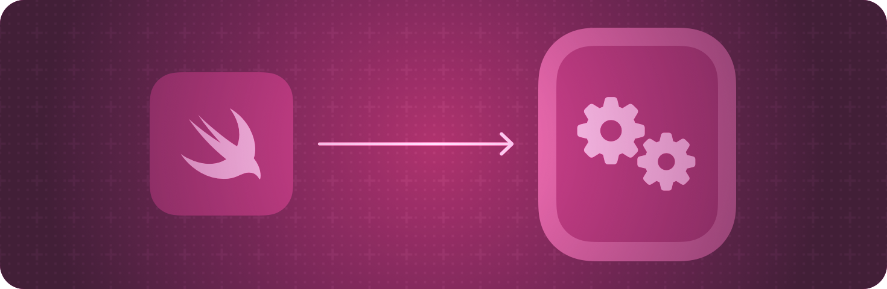

> 导航：[技术](../technologies.md) · [SwiftUI](../swiftui.md)

# WatchKit 集成

API 集合

将 WatchKit 视图添加到你的 SwiftUI App 中，或在你的 WatchKit App 中使用 SwiftUI 视图。

## 概述

使用托管控制器（hosting controller）将 SwiftUI 与你的 App 的现有内容集成，把 SwiftUI 视图添加到 WatchKit 界面中。托管控制器将一组 SwiftUI 视图包装成一种形式，然后你可以将其添加到基于 Storyboard 的 App 中。

你还可以将 WatchKit 视图和视图控制器添加到你的 SwiftUI 界面中。可表示（representable）对象会包装指定的视图或视图控制器，并促进被包装对象与你的 SwiftUI 视图之间的通信。

有关设计指引，请参阅《人机界面指南》中的[为 watchOS 而设计](../design/human-interface-guidelines/designing-for-watchos.md)。

## 主题

### 在 WatchKit 中显示 SwiftUI 视图

- [WKHostingController](wkhostingcontroller.md) — 一种托管 SwiftUI 视图层级结构的 WatchKit 界面控制器。
- [WKUserNotificationHostingController](wkusernotificationhostingcontroller.md) — 一种托管 SwiftUI 视图层级结构的 WatchKit 用户通知界面控制器。

### 将 WatchKit 视图添加到 SwiftUI 视图层级结构

- [WKInterfaceObjectRepresentable](wkinterfaceobjectrepresentable.md) — 表示 WatchKit 界面对象的视图。
- [WKInterfaceObjectRepresentableContext](wkinterfaceobjectrepresentablecontext.md) — 关于系统状态的上下文信息，用于创建和更新你的 WatchKit 界面对象。

## 另请参阅

### 框架集成

- [AppKit 集成](appkit-integration.md) — 将 AppKit 视图添加到你的 SwiftUI App 中，或在你的 AppKit App 中使用 SwiftUI 视图。
- [UIKit 集成](uikit-integration.md) — 将 UIKit 视图添加到你的 SwiftUI App 中，或在你的 UIKit App 中使用 SwiftUI 视图。
- [特定框架的视图](technology-specific-views.md) — 使用其他 Apple 框架提供的 SwiftUI 视图。
