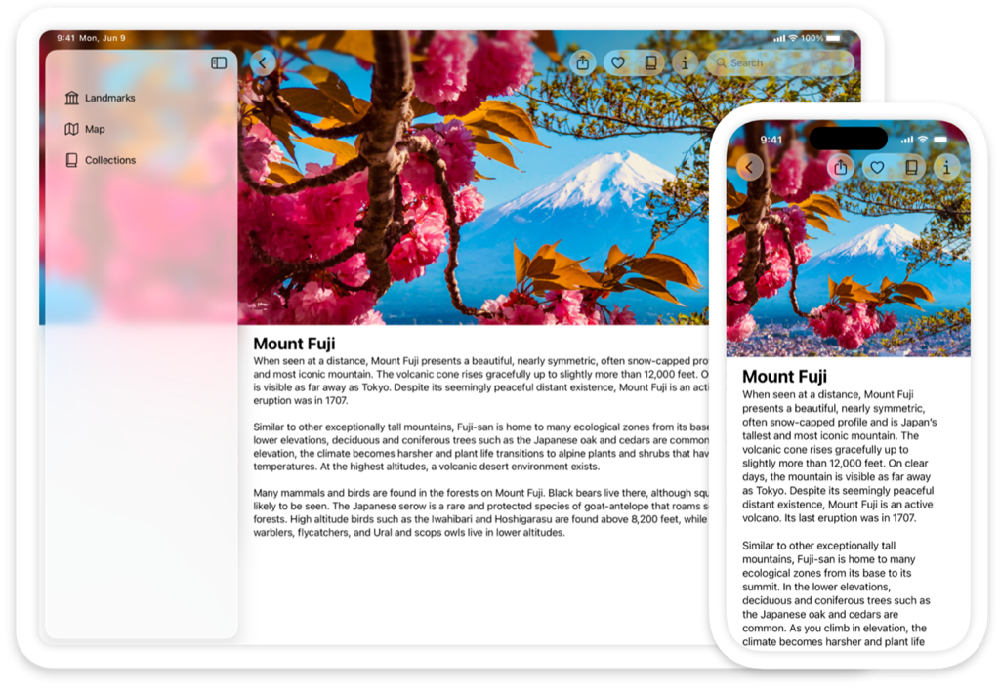

> 导航： [Technologies](technologies.md)

# UIKit

框架

构建并管理你的 iOS、iPadOS 或 tvOS App 的图形化、事件驱动用户界面。

## 概述

UIKit 提供了丰富的功能来构建 App，包括可用于搭建 iOS、iPadOS 或 tvOS App 核心基础设施的组件。该框架提供了实现 UI 的窗口与视图架构、向 App 传递多点触控及其他类型输入的事件处理基础设施，以及管理用户、系统与 App 之间交互的主运行循环。

UIKit 还支持动画、文稿、绘制与打印、文本管理与显示、搜索、App 扩展、资源管理，以及获取当前设备的信息。你还可以自定辅助功能支持，并将 App 界面本地化为不同的语言、国家/地区或文化区域。

UIKit 与 [SwiftUI](swiftui.md) 框架无缝协作，因此你可以用 SwiftUI 实现 UIKit App 的部分功能，或在两个框架之间混合界面元素。例如，你可以把 UIKit 的视图与视图控制器放在 SwiftUI 视图中，反之亦然。

要构建 macOS App，你可以用 [SwiftUI](swiftui.md) 创建可在 Apple 所有平台上运行的 App，或用 [AppKit](appkit.md) 创建仅面向 Mac 的 App。或者，你可以借助 [Mac Catalyst](uikit/mac-catalyst.md) 把 UIKit iPad App 带到 Mac。

> [!important] 重要
> 除非文档另有说明，否则只能从 App 的主线程或主派发队列使用 UIKit 类。这一限制尤其适用于派生自 [UIResponder](uikit/uiresponder.md) 或以任何方式涉及操纵 App 用户界面的类。

## 主题

### 基础

- [Adopting Liquid Glass](technologyoverviews/adopting-liquid-glass.md) — 了解如何将这种新材质引入你的 App。
- [UIKit updates](updates/uikit.md) — 了解 UIKit 的重要变化。
- [About app development with UIKit](uikit/about-app-development-with-uikit.md) — 了解 UIKit 和 Xcode 为你的 iOS 与 tvOS App 提供的基础支持。
- [Protecting the User’s Privacy](uikit/protecting-the-user-s-privacy.md) — 保护个人数据，并尊重用户对数据使用方式的偏好。

### App 结构

- [App and environment](uikit/app-and-environment.md) — 管理生命周期事件与 App 的 UI 场景，并获取运行环境与特性相关信息。
- [Documents, data, and pasteboard](uikit/documents-data-and-pasteboard.md) — 组织 App 的数据，并在粘贴板上共享这些数据。
- [Resource management](uikit/resource-management.md) — 管理实现 App 界面所用的图像、字符串、storyboard 与 nib 文件。
- [App extensions](uikit/app-extensions.md) — 将 App 的基础功能扩展到系统的其他部分。
- [Interprocess communication](uikit/interprocess-communication.md) — 向用户展示基于活动的服务。
- [Mac Catalyst](uikit/mac-catalyst.md) — 创建 iPad App 的版本，供用户在 Mac 设备上运行。

### 用户界面

- [Views and controls](uikit/views-and-controls.md) — 在屏幕上呈现内容，并定义与该内容允许的交互。
- [View controllers](uikit/view-controllers.md) — 使用视图控制器管理界面，并便于在 App 内容间导航。
- [View layout](uikit/view-layout.md) — 使用叠放视图自动布局界面中的视图；在需要精确放置视图时使用 Auto Layout。
- [Appearance customization](uikit/appearance-customization.md) — 将 Liquid Glass 应用于视图，支持 App 的深色模式，自定栏的外观，并使用外观代理修改 UI。
- [Animation and haptics](uikit/animation-and-haptics.md) — 使用基于视图的动画与触感反馈向用户传递反馈。
- [Windows and screens](uikit/windows-and-screens.md) — 为视图层级结构及其他内容提供容器。

### 用户交互

- [Touches, presses, and gestures](uikit/touches-presses-and-gestures.md) — 将 App 的事件处理逻辑封装在手势识别器中，以便在整个 App 中复用该代码。
- [Menus and shortcuts](uikit/menus-and-shortcuts.md) — 使用菜单系统、上下文菜单、主屏幕快速操作与键盘快捷键简化与 App 的交互。
- [Drag and drop](uikit/drag-and-drop.md) — 使用视图的交互 API 为 App 带来拖放功能。
- [Pointer interactions](uikit/pointer-interactions.md) — 在自定控制与视图中支持指针交互。
- [Apple Pencil interactions](uikit/apple-pencil-interactions.md) — 处理 Apple Pencil 上的双击与挤压等用户交互。
- [Focus-based navigation](uikit/focus-based-navigation.md) — 使用遥控器、游戏控制器或键盘导航 UIKit App 的界面。
- [Accessibility for UIKit](uikit/accessibility-for-uikit.md) — 让所有使用 iOS 与 tvOS 的人都能使用你的 UIKit App。

### 图形、绘制与打印

- [Images and PDF](uikit/images-and-pdf.md) — 创建并管理图像，包括使用位图与 PDF 格式的图像。
- [Drawing](uikit/drawing.md) — 使用颜色、渲染器、绘制路径、字符串与阴影配置 App 的绘制环境。
- [Printing](uikit/printing.md) — 显示系统打印面板并管理打印过程。

### 文本

- [Text display and fonts](uikit/text-display-and-fonts.md) — 显示文本、管理字体并检查拼写。
- [TextKit](uikit/textkit.md) — 管理文本存储，并对 App 视图中的文本内容执行自定布局。
- [Keyboards and input](uikit/keyboards-and-input.md) — 配置系统键盘、创建你自己的键盘来处理输入，或检测物理键盘上的按键。
- [Writing Tools](uikit/writing-tools.md) — 为 App 的文本视图添加写作工具支持。
- [Handwriting recognition](uikit/handwriting-recognition.md) — 配置接受文本的文本栏与自定视图，以处理来自 Apple Pencil 的输入。

### 已废弃

- [Deprecated symbols](uikit/deprecated-symbols.md) — 查看不再支持的符号及其替代品。

### 参考

- [UIKit Enumerations](uikit/uikit-enumerations.md)
- [UIKit Constants](uikit/uikit-constants.md) — 本文档描述整个 UIKit 框架中使用的常量。
- [UIKit Data Types](uikit/uikit-data-types.md) — UIKit 框架定义了在框架多处使用的数据类型。
- [UIKit Functions](uikit/uikit-functions.md) — UIKit 框架定义了许多函数，其中许多用于图形与绘制操作。

### 结构体

- [UITraitSystemPrefersReducedResourceUsage](uikit/uitraitsystemprefersreducedresourceusage-swift.struct.md)

### 宏

- [Preview(_:traits:arguments:body:)](<uikit/preview(__traits_arguments_body_)-6gm4c.md>)
- [Preview(_:traits:arguments:body:)](<uikit/preview(__traits_arguments_body_)-7cbjv.md>)

### 枚举

- [UITextGrammarCheckingType](uikit/uitextgrammarcheckingtype.md) _(beta)_
