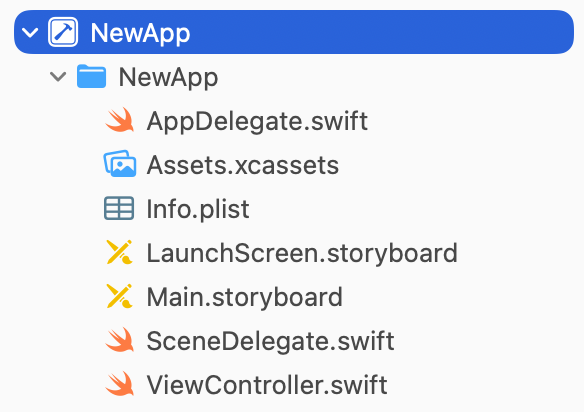
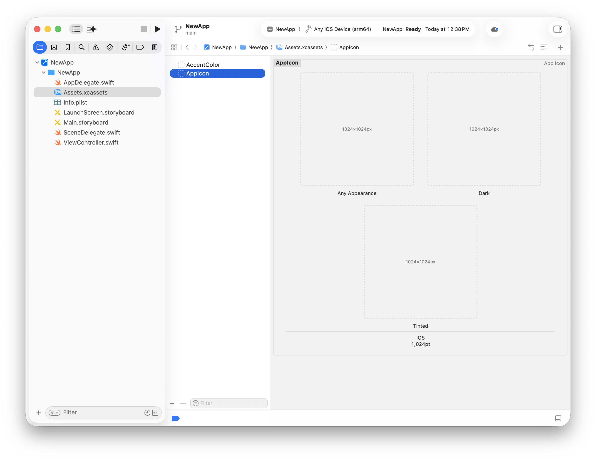
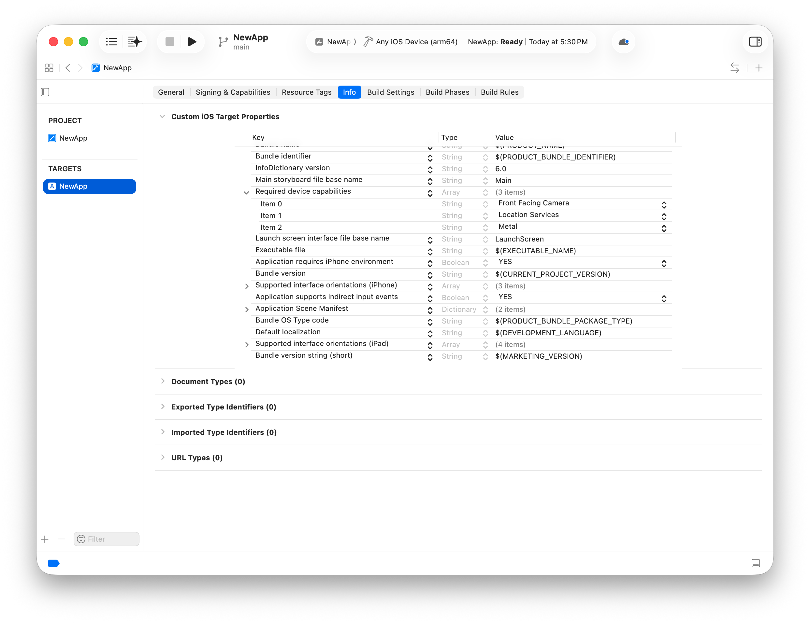

> 导航： [Technologies](../technologies.md) · [UIKit](../uikit.md)

# 关于使用 UIKit 进行 App 开发

文章

了解 UIKit 和 Xcode 为你的 iOS 和 tvOS App 提供的基本支持。

## 概述

UIKit 框架提供了构建 iOS 和 tvOS App 所需的核心对象。你使用这些对象在屏幕上显示内容、与该内容交互以及管理与系统的交互。App 依赖 UIKit 获得基本行为，UIKit 提供了许多方式来定制该行为，以匹配你的特定需求。

> [!important] 重要
> 通过在 Xcode（Apple 的集成开发环境）中创建项目来开始开发 iOS 或 tvOS App。如果你没有 Xcode，可以从 App Store 下载。你也可以从 [developer.apple.com/downloads](https://developer.apple.com/downloads) 下载最新版本。

Xcode 提供模板项目作为你创建的每个 App 的起点。例如，以下图像显示了使用 Xcode 中的 iOS app 模板创建的 App 的结构。模板项目提供最小的用户界面，以便你可以立即构建并运行项目，并在设备或模拟器上看到结果。

Xcode 中 Project navigator 的部分截图，显示新单视图 App 的模板。App 包含 App delegate、scene delegate 和视图控制器的源文件。它还包含 storyboard、asset catalog 和 Info.plist 文件。

当你构建 App 时，Xcode 会编译你的源文件并为你的项目创建 App bundle。App bundle 是一个结构化目录，包含与 App 关联的代码和资源。资源包括支持你的代码的图像资源、storyboard 文件、strings 文件和 App 元数据。

### 添加必需的资源

每个 UIKit App 都需要以下资源：

- App 图标
- 启动屏幕 storyboard

系统在主屏幕、设置中以及任何需要将你的 App 与其他 App 区分的地方显示你的 App 图标。因为它可能在深色或浅色外观中显示，或某人可能选择着色显示选项，所以你在 Xcode 项目的 AppIcon 图像资源中提供 App 图标的多个版本。创建一个独特的 App 图标，帮助人们在主屏幕上快速识别你的 App。测试不同的外观和显示选项，以确定是否需要改变图标的细节。更多信息，参见 [Creating your app icon using Icon Composer](../xcode/creating-your-app-icon-using-icon-composer.md) 和 [Configuring your app icon using an asset catalog](../xcode/configuring-your-app-icon.md)。

`LaunchScreen.storyboard` 文件包含你的 App 的初始界面，它可以是启动画面或你实际界面的简化版本。当某人轻点 App 图标时，系统会立即显示你的启动屏幕，让用户知道你的 App 正在启动。启动屏幕还为 App 在初始化自身时提供遮盖。当 App 准备就绪时，系统会隐藏启动屏幕并显示 App 的实际界面。更多信息，参见 [Specifying your app’s launch screen](../xcode/specifying-your-apps-launch-screen.md)。

### 更新必需的 App 元数据

系统从信息属性列表中推导关于你的 App 配置和能力的信息。Xcode 为每个新项目模板提供此列表的预配置版本，你根据 App 的需求修改它。例如，如果你的 App 依赖特定硬件或使用特定系统框架，你可以向列表添加与这些功能相关的信息。

你可以对信息属性列表进行的一种常见修改是声明 App 的硬件和软件要求。这些要求是你向系统传达 App 运行所需条件的方式。例如，导航 App 可能需要 GPS 硬件的存在以提供逐步导航。App Store 会阻止某人在不满足 App 要求的设备上安装你的 App。

Xcode 中 Info 选项卡的截图，显示自定义 iOS 目标属性。设备能力包括 App 是否需要相机、位置服务或特定技术等信息。

有关可以在信息属性列表中包含的键的信息，参见 [Information Property List](../bundleresources/information-property-list.md)。

### 审查 UIKit App 的代码结构

UIKit 提供 App 的许多核心对象，包括与系统交互、运行 App 主事件循环以及在屏幕上显示内容的对象。你大部分时间按原样使用这些对象，或只做少量修改。知道要修改哪些对象，以及何时修改它们，对于实现 App 至关重要。

你的 App 使用 [UIApplication](uiapplication.md) 和 [UIApplicationDelegate](uiapplicationdelegate.md) 子类与应用级服务和信息交互。你配置并定制一个或多个 [Scenes](scenes.md) 以在屏幕上呈现你的 App。使用多个场景来表示 App 的多个实例，或处理在非交互式外部显示器上显示 App。

UIKit App 的结构基于 Model-View-Controller（MVC）设计模式，你创建的对象各司其职。模型对象管理 App 的数据和业务逻辑。视图对象提供数据的可视化表示。控制器对象作为模型和视图对象之间的桥梁，在适当的时候在它们之间移动数据。

### 使用 UIKit 对象构建和组织你的 App

UIKit 和 Foundation 框架提供了许多你用于定义 App 模型对象的基本类型。UIKit 提供 [UIDocument](uidocument.md) 对象，用于组织属于基于磁盘文件的数据结构。Foundation 框架定义表示字符串、数字、数组和其他数据类型的基本对象。[Swift Standard Library](../swift/swift-standard-library.md) 提供 Foundation 框架中可用的许多相同类型。

UIKit 提供控制器对象来帮助你组织视图并从中导航。[UIViewController](uiviewcontroller.md) 是你子类化以管理并显示视图的基本控制器对象。使用 [UINavigationController](uinavigationcontroller.md)、[UISplitViewController](uisplitviewcontroller.md) 和 [UITabBarController](uitabbarcontroller.md) 等控制器实现常见的用户界面设计。更多信息，参见 [View controllers](view-controllers.md)。

使用 [UIView](uiview.md) 构建视图，它在屏幕上显示你的内容。使用 [UIStackView](uistackview.md) 布局视图，或对更复杂的布局使用 Auto Layout。使用 [View layout](view-layout.md) 中的详细信息使 App 响应大小更改。使用 [UIScrollView](uiscrollview.md)、[UITableView](uitableview.md) 和 [UICollectionView](uicollectionview.md) 等对象高效布局多个视图，或显示一次无法在屏幕上容纳的数据的视图。

使用 [UIControl](uicontrol.md) 对象（如 [UIButton](uibutton.md)、[UISlider](uislider.md) 和 [UISegmentedControl](uisegmentedcontrol.md)）管理并响应交互。使用 [UICalendarView](uicalendarview.md)、[UIImageView](uiimageview.md) 和 [UIPickerView](uipickerview.md) 等视图来显示和交互特定类型的数据。使用 [UIGestureRecognizer](uigesturerecognizer.md) 和相关子类，更新视图以响应长按、pan、swipe、pinch 和其他手势。

使用 [UILabel](uilabel.md)、[UITextField](uitextfield.md) 和 [UITextView](uitextview.md) 显示和交互文本。更多信息，参见 [Views and controls](views-and-controls.md)。

## 另请参阅

### 基础

- [Adopting Liquid Glass](../technologyoverviews/adopting-liquid-glass.md) — 了解如何将新材质带到你的 App 中。
- [UIKit updates](../updates/uikit.md) — 了解 UIKit 的重要更改。
- [Protecting the User’s Privacy](protecting-the-user-s-privacy.md) — 保护个人数据，并尊重用户关于数据使用方式的偏好。
