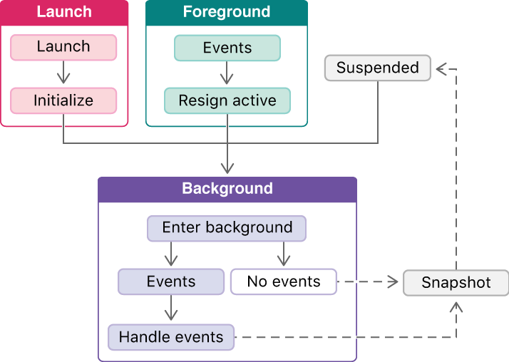
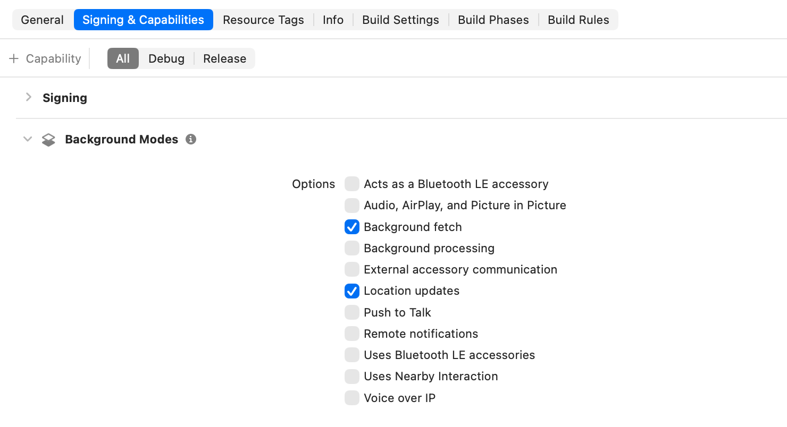

> 导航：[Technologies](../technologies.md) · [UIKit](../uikit.md) · [App and environment](app-and-environment.md) · [Scenes](scenes.md) · [Preparing your UI to run in the background](preparing-your-ui-to-run-in-the-background.md)

# 关于后台执行序列

文章

了解当你的 App 进入后台时，自定代码按什么顺序执行。

## 概述

App 可能从多种不同的起点进入后台。系统事件可能使被挂起的 App 返回后台，或使未运行的 App 直接启动进入后台。前台 App 在另一个 App 启动或用户返回主屏幕时过渡到后台。

App 可能启动进入后台，或从前台过渡到后台。当它在后台完成事件处理后，系统会截取 App UI 的快照，然后将其移至挂起状态。

### 处理后台事件

对于支持某种后台模式能力的 App，系统会在后台启动或恢复该 App，以处理与这些能力关联的事件。例如，系统可能启动或恢复 App 以响应位置更新或执行后台获取。

如果事件到达时你的 App 未运行，系统会启动 App 并将其直接移至后台，遵循以下序列：

1. 系统启动 App，并遵循[关于 App 启动序列](about-the-app-launch-sequence.md)中描述的初始化序列。
2. UIKit 调用 App 委托的 [- applicationDidEnterBackground:](<uiapplicationdelegate/applicationdidenterbackground(__).md>) 方法。
3. UIKit 传递导致启动的事件。
4. 获取 App 的快照。
5. App 可能再次被挂起。

如果事件到达时你的 App 在内存中且处于挂起状态，系统会在后台恢复 App，遵循以下序列：

1. 系统恢复 App。
2. UIKit 调用 App 委托的 [- applicationDidEnterBackground:](<uiapplicationdelegate/applicationdidenterbackground(__).md>) 方法。
3. UIKit 传递导致启动的事件。
4. 获取 App 的快照。
5. App 可能再次被挂起。

### 从前台过渡

当另一个 App 启动或用户返回主屏幕时，前台 App 移动到后台，遵循以下序列：

1. 用户退出正在运行的 App。
2. UIKit 调用 App 委托的 [- applicationWillResignActive:](<uiapplicationdelegate/applicationwillresignactive(__).md>) 方法。
3. UIKit 调用 App 委托的 [- applicationDidEnterBackground:](<uiapplicationdelegate/applicationdidenterbackground(__).md>) 方法。
4. 获取 App 的快照。
5. App 可能再次被挂起。

## 另请参阅

### 后台执行

- [Using background tasks to update your app](using-background-tasks-to-update-your-app.md) — 配置你的 App 在后台执行任务，以高效利用处理时间与电力。
- [Extending your app’s background execution time](extending-your-app-s-background-execution-time.md) — 确保在 App 进入后台时关键任务能够完成。
