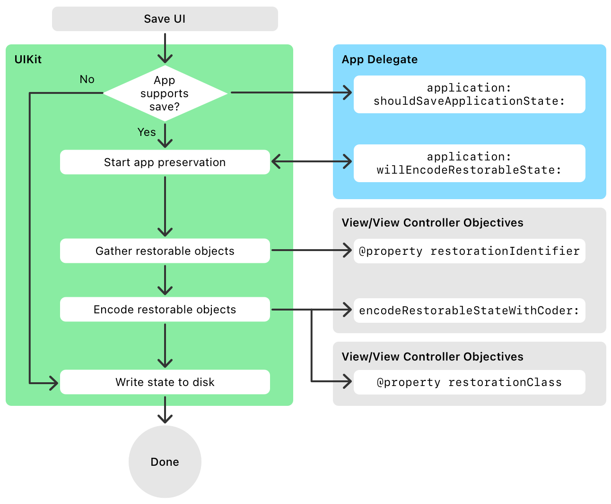

> 导航：[Technologies](../technologies.md) · [UIKit](../uikit.md) · [View controllers](view-controllers.md) · [Preserving your app’s UI across launches](preserving-your-app-s-ui-across-launches.md)

# 关于 UI 保留过程

文章

了解如何自定 UIKit 状态保留过程。

## 概述

下图显示了在界面保留过程中发生的调用序列。在询问你的 App 委托是否希望保留 App 状态之后，UIKit 对当前在你的 App 视图控制器层级中的对象进行编码。只有具有有效 [restorationIdentifier](uiviewcontroller/restorationidentifier.md) 的视图控制器才会被保留。

保留过程遍历你的视图控制器层级，并递归编码它找到的对象。过程从你 App 窗口的根视图控制器开始，根视图控制器把它们的数据写入提供的归档。如果根视图控制器的数据包含对其他视图控制器的引用，UIKit 会要求每个新的视图控制器在归档的单独部分编码其数据。这些子视图控制器随后可以编码它们自己的子视图控制器，依此类推。

UIKit 视图控制器会根据需要自动编码其子视图控制器。如果你定义了自定容器视图控制器，你的视图控制器的 [- encodeRestorableStateWithCoder:](<uistaterestoring/encoderestorablestate(with_).md>) 方法必须类似地把任何子视图控制器写入提供的归档。

### 从保留中排除视图控制器

有两种方式可以从状态恢复过程中排除视图控制器（及其视图）：

- 把其 [restorationIdentifier](uiviewcontroller/restorationidentifier.md) 属性设为 `nil`。
- 提供一个恢复类，并从 [+ viewControllerWithRestorationIdentifierPath:coder:](<uiviewcontrollerrestoration/viewcontroller(withrestorationidentifierpath_coder_).md>) 方法返回 `nil`。

排除视图控制器会阻止该视图控制器被保存到归档中。它还会把该视图控制器的所有子视图控制器排除在保留之外。

### 编码你的 App 中的任何对象

状态恢复并不局限于你的 App 的视图和视图控制器。任何采用 [UIStateRestoring](uistaterestoring.md) 协议的对象也可以包含在恢复归档中。例如，你可能在存储 App 全局配置数据的对象中采用此协议。要像这样把对象添加到归档中：

1. 在你的 App 运行时通过调用 [UIApplication](uiapplication.md) 的 [+ registerObjectForStateRestoration:restorationIdentifier:](<uiapplication/registerobject(forstaterestoration_restorationidentifier_).md>) 方法注册该对象。例如，你可能在创建配置对象后立即注册它。
2. 在你的某个 [- encodeRestorableStateWithCoder:](<uistaterestoring/encoderestorablestate(with_).md>) 方法中，把该对象编码到恢复归档中。你也可以在 App 委托的 [- application:willEncodeRestorableStateWithCoder:](<uiapplicationdelegate/application(__willencoderestorablestatewith_).md>) 方法中编码它。

你可以为自定对象编码任何数据，只要它足以在下一个启动周期把该对象恢复到其之前的状态。编码对 App 行为不至关重要的数据，永远不要编码应以其他方式持久化的数据。例如，不要编码 App 的设置或必须在启动周期之间持久化的用户数据。

## 另请参阅

### 过程详情

- [About the UI restoration process](about-the-ui-restoration-process.md) — 了解如何自定 UIKit 状态恢复过程。
