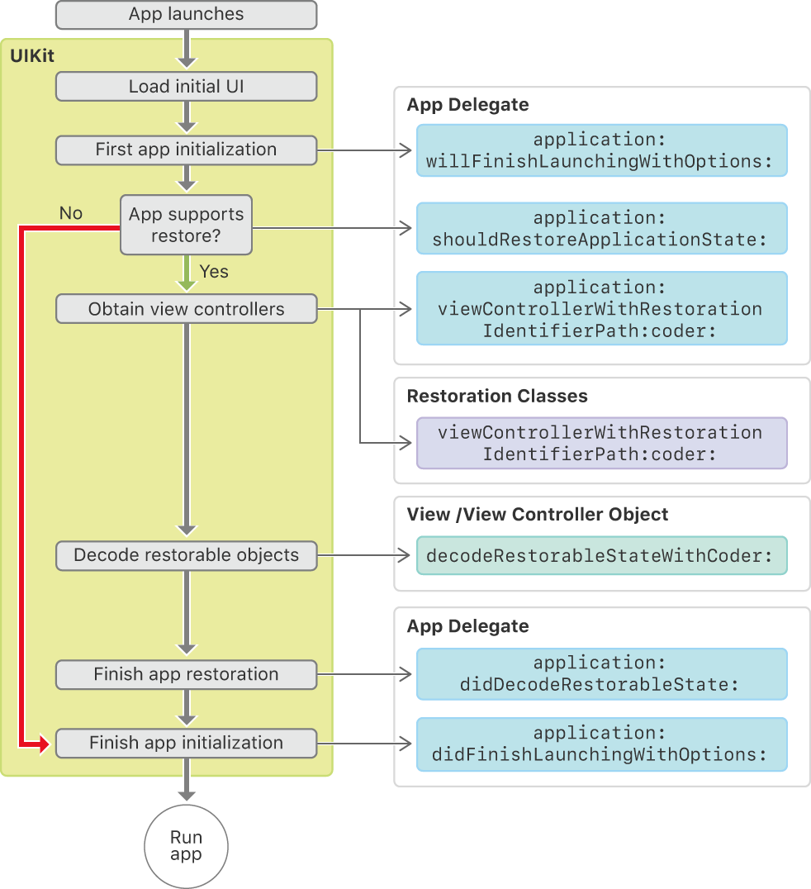

> 导航：[Technologies](../technologies.md) · [UIKit](../uikit.md) · [View controllers](view-controllers.md) · [Preserving your app’s UI across launches](preserving-your-app-s-ui-across-launches.md)

# 关于 UI 恢复过程

<sub>文章</sub>

了解如何自定 UIKit 状态恢复过程。

## 概述

下图显示了从你的 App 启动到完成恢复期间发生的调用序列。恢复发生在你的 App 初始化过程的中段，并且仅在状态恢复归档可用且你的 App 委托的 [- application:shouldRestoreApplicationState:](<uiapplicationdelegate/application(__shouldrestoreapplicationstate_).md>) 方法返回 [true](../swift/true.md) 时才会继续。



恢复过程的第一步是为你的界面创建视图控制器对象（显式或隐式）。第二步是解码并恢复这些对象的状态。这两步都是重建你的视图控制器层级所必需的。例如，在创建导览控制器及其子视图控制器之后，这些对象之间并没有立即建立连接。实际上是导览控制器的 [- decodeRestorableStateWithCoder:](<uistaterestoring/decoderestorablestate(with_).md>) 方法重新建立了与其子视图控制器的关系。

状态恢复完成后，UIKit 会调用 App 委托的 [- application:didFinishLaunchingWithOptions:](<uiapplicationdelegate/application(__didfinishlaunchingwithoptions_).md>) 方法。使用该方法对界面做任何最后一刻的更改或补充。例如，你可能向视图控制器层级中添加一个登录屏幕。

### 重新创建你的视图控制器

在恢复期间，UIKit 会尝试从你保留的界面中创建或定位视图控制器对象。UIKit 首先请求你提供视图控制器对象。如果你不提供该视图控制器，UIKit 会隐式查找它。以下是 UIKit 重新创建视图控制器时所遵循的步骤序列：

1. **询问视图控制器的恢复类。** 恢复类知道如何创建特定的视图控制器。你通过把某个类赋值给视图控制器的 [restorationClass](uiviewcontroller/restorationclass.md) 属性来指定恢复类。在恢复期间，UIKit 调用恢复类的 [+ viewControllerWithRestorationIdentifierPath:coder:](<uiviewcontrollerrestoration/viewcontroller(withrestorationidentifierpath_coder_).md>) 方法来请求视图控制器的新实例，然后由你的方法返回该实例。如果你返回 `nil`，UIKit 会停止尝试创建该视图控制器，并将其排除在恢复过程之外。
2. **询问 App 委托。** 如果视图控制器没有恢复类，UIKit 会调用 App 委托的 [- application:viewControllerWithRestorationIdentifierPath:coder:](<uiapplicationdelegate/application(__viewcontrollerwithrestorationidentifierpath_coder_).md>) 方法。如果你从该方法返回 `nil`，UIKit 会继续搜索。
3. **检查是否已有对象。** UIKit 查找是否已有具有完全相同恢复路径的视图控制器。
4. **从你的 Storyboard 实例化视图控制器。** 如果仍然没有该视图控制器，UIKit 会自动从你的 App 的 Storyboard 中实例化它。

在状态恢复甚至开始之前，UIKit 会从你的 Storyboard 加载 App 的默认视图控制器。因为 UIKit 会自动加载这些视图控制器，所以最好不要使用恢复类或你的 App 委托来创建它们。对于所有其他视图控制器，仅当视图控制器未在你的 Storyboard 中定义时才指定恢复类。你也可以指定恢复类，以便在特定情况下阻止创建你的视图控制器。例如，如果相关的恢复归档引用了过期或缺失的数据，你可能希望避免显示该视图控制器。

在代码中重新创建视图控制器时，除了任何其他初始化之外，始终重新为视图控制器的 [restorationIdentifier](uiviewcontroller/restorationidentifier.md) 属性赋值。也根据情况为 [restorationClass](uiviewcontroller/restorationclass.md) 属性赋值。在创建时赋值这些值可确保该视图控制器会在下一个周期中被保留。

```swift
func viewController(withRestorationIdentifierPath 
                    identifierComponents: [Any], 
                    coder: NSCoder) -> UIViewController? {
   let vc = MyViewController()
        
   vc.restorationIdentifier = identifierComponents.last as? String
   vc.restorationClass = MyViewController.self
        
   return vc
}
```

> [!note] 注意
> 你的恢复类应始终返回 UIKit 所期望的类。恢复归档包含每个被保留视图控制器的类。如果你的恢复类返回不同类的实例，UIKit 不会调用该视图控制器的 [- decodeRestorableStateWithCoder:](<uiviewcontroller/decoderestorablestate(with_).md>) 方法。

## 另请参阅

### 过程详情

- [关于 UI 保留过程](about-the-ui-preservation-process.md) — 了解如何自定 UIKit 状态保留过程。
