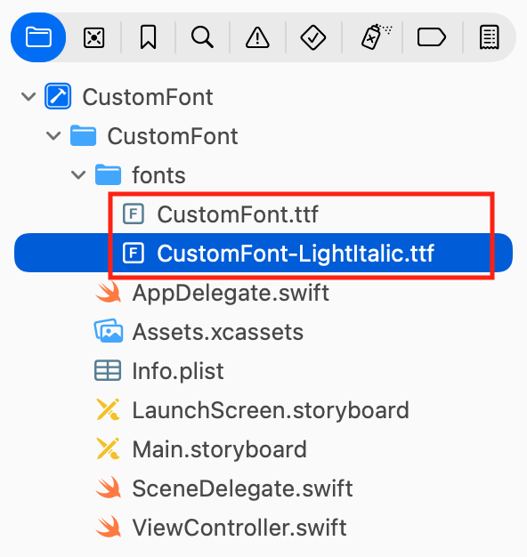
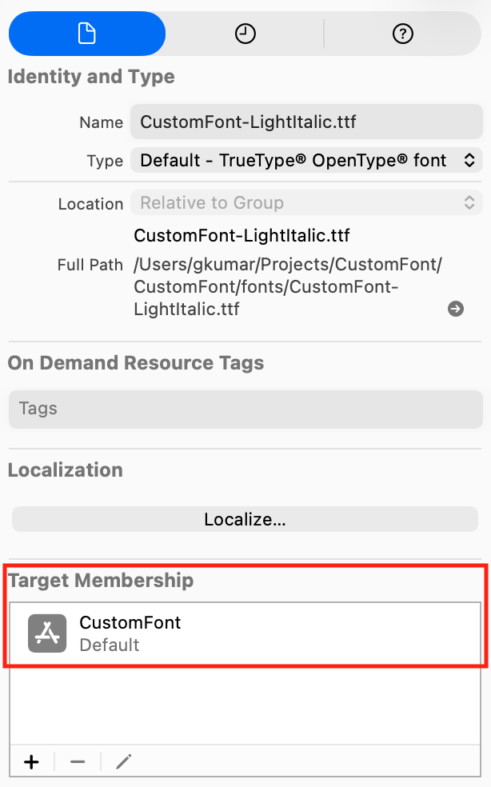
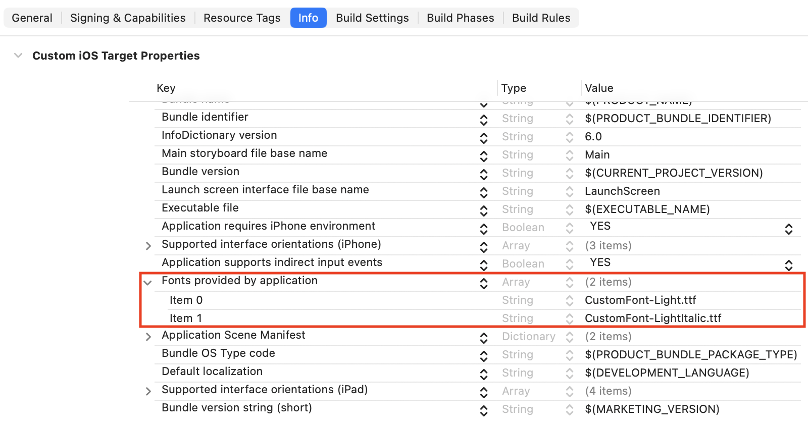
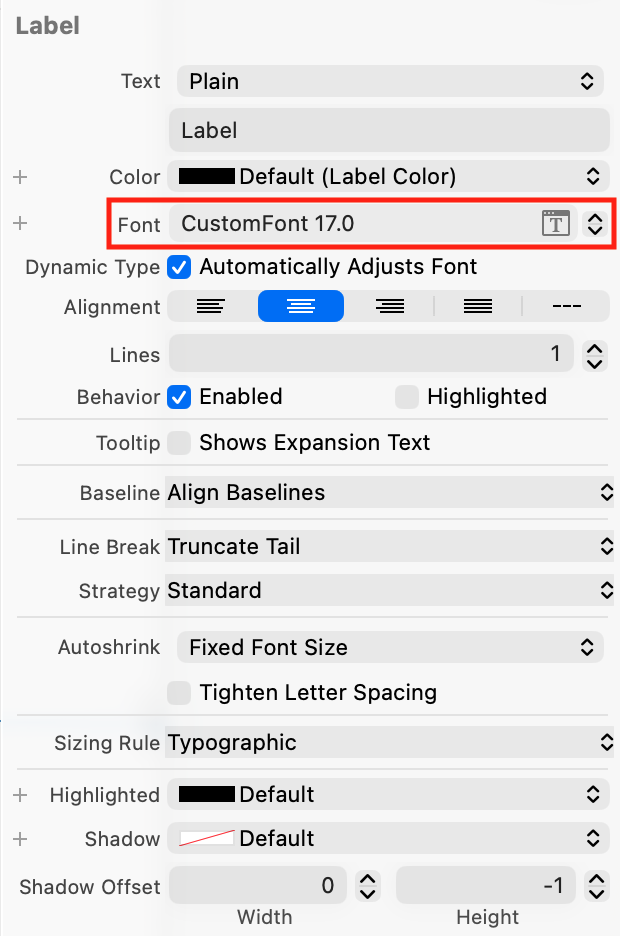

> 导航：[Technologies](../technologies.md) · [UIKit](../uikit.md) · [Text display and fonts](text-display-and-fonts.md)

# 为你的 App 添加自定字体

<sub>文章</sub>

把自定字体添加到你的 App，并在你的 App 的界面中使用它。

## 概述

你的 App 不局限于 iOS 提供的自定字体。例如，如果你的公司有自己的品牌字体，你可以在 App 中使用它。把包含你的字体的字体文件添加到你的 App bundle，然后像使用任何 iOS 提供的自定字体一样使用你的字体。

### 把字体文件添加到你的 Xcode 项目

要向 Xcode 项目添加字体文件，请从菜单栏选择 _File \> Add Files to “Your Project Name”_，或将文件从 Finder 拖动并拖放到 Xcode 项目中。你可以添加 True Type Font（.ttf）和 Open Type Font（.otf）文件。



另外，确保字体文件是你 App 的 target 成员；否则项目不会把字体文件作为你 App 的一部分分发。



### 向 iOS 注册你的字体文件

把字体文件添加到项目后，你需要让 iOS 知道这个字体。为此，把键 “Fonts provided by application” 添加到信息属性列表（原始键名为 `UIAppFonts`）。Xcode 会为该键创建数组值；把每个字体文件的名称作为数组的项添加。务必把文件扩展名包含在名称中。



<sub>Xcode 的截图，显示 Info.plist 文件的内容。'Fonts provided by application' 键包含两个字体文件的文件名。</sub>

把每个添加到项目的字体文件都包含在这个数组中；否则字体对你的 App 不可用。

### 在 Interface Builder 中使用你的自定字体

把字体文件添加到 Xcode 项目及其 _Info.plist_ 之后，你可以开始把字体分配给 UI 对象，如 [UILabel](uilabel.md) 和 [UITextField](uitextfield.md)。如果你使用 Interface Builder，使用 Attribute Inspector 把 UI 对象的 _Font_ 设置分配给你的自定字体。



### 在源代码中使用你的自定字体

你可以在源代码中创建自定字体的实例。为此，你需要知道字体名称。然而，字体名称并不总是显而易见的，且很少与字体文件名匹配。快速找到字体名称的方法是获取你的 App 可用的字体列表，你可以用以下代码做到：

```swift
for family in UIFont.familyNames.sorted() {
    let names = UIFont.fontNames(forFamilyName: family)
    print("Family: \(family) Font names: \(names)")
}
```

一旦知道字体名称，使用 [UIFont](uifont.md) 创建自定字体的实例。如果你的 App 支持 Dynamic Type，你还可以获取该字体的缩放实例，如下所示：

```swift
guard let customFont = UIFont(name: "CustomFont-Light", size: UIFont.labelFontSize) else {
    fatalError("""
        Failed to load the "CustomFont-Light" font.
        Make sure the font file is included in the project and the font name is spelled correctly.
        """
    )
}
label.font = UIFontMetrics.default.scaledFont(for: customFont)
label.adjustsFontForContentSizeCategory = true
```

有关使用缩放字体的更多信息，参见 [Scaling fonts automatically](scaling-fonts-automatically.md)。

## 另请参阅

### 字体

- [Scaling fonts automatically](scaling-fonts-automatically.md) — 使用 Dynamic Type 自动缩放你界面中的文本。
- [UIFont](uifont.md) — 提供对字体特性的访问的对象。
- [UIFontDescriptor](uifontdescriptor.md) — 描述字体的属性集合。
- [SymbolicTraits](uifontdescriptor/symbolictraits-swift.struct.md) — 描述字体风格方面的常量。
- [UIFontMetrics](uifontmetrics.md) — 用于获取支持 Dynamic Type 缩放的自定字体的工具对象。
