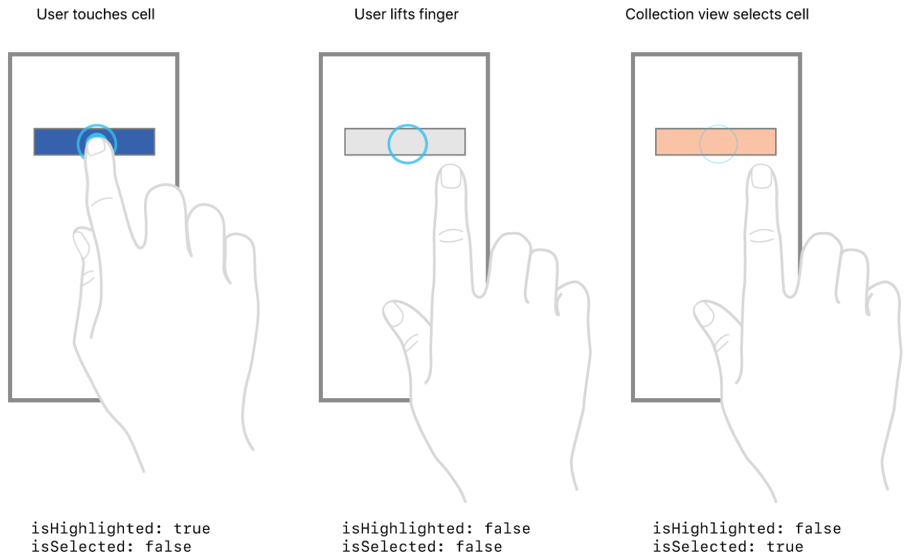

> 导航： [Technologies](../technologies.md) · [UIKit](../uikit.md) · [Views and controls](views-and-controls.md) · [Collection views](collection-views.md)

# 更改选中和高亮单元格的外观

<sub>示例代码</sub>

向用户直观反馈单元格的状态以及状态之间的过渡。

## 概述

此示例 App 展示如何在集合视图单元格在未选中、高亮和选中状态之间过渡时更改其外观。当用户轻点单元格时，App 会确定单元格的状态，并更改单元格的外观以指示状态之间的过渡。

此示例中的集合视图支持单选，这是集合视图的默认行为。你还可以配置集合视图以支持多选，或完全禁用选择。

### 确定单元格的状态

此示例中的集合视图通过检测其边界内的轻点来确定单元格的状态。然后它设置对应单元格的 [selected](uicollectionviewcell/isselected.md) 和 [highlighted](uicollectionviewcell/ishighlighted.md) 属性以指示当前状态。集合视图提供此行为是因为其 [allowsSelection](uicollectionview/allowsselection.md) 属性设置为 `true`。

当轻点未选中的单元格时，初始的 touch-down 事件会使集合视图将单元格的 [highlighted](uicollectionviewcell/ishighlighted.md) 属性更改为 `true`。最终的 touch-up 事件会使高亮状态恢复为 `false`。如果 touch-up 事件发生在单元格内部，集合视图会将单元格的 [selected](uicollectionviewcell/isselected.md) 属性设置为 `true`；否则，属性值保持不变。



<sub>描述轻点未选中单元格时发生步骤的图。第一张图显示用户右食指触摸手机屏幕上代表集合视图单元格的深色阴影矩形。图下方列出单元格的当前属性值，为 isHighlighted: true 和 isSelected: false。第二张图描绘用户抬起手指并将手移动到手机屏幕上矩形右侧，现在矩形显示为较浅颜色。下方列出的 isHighlighted 和 isSelected 属性都为 false。第三张图描绘用户手抬起在手机屏幕上矩形上方，集合视图以第三种不同阴影呈现矩形。下方 isHighlighted 为 false，isSelected 为 true。</sub>

### 更改单元格的视觉外观

单元格的 [backgroundView](uicollectionviewcell/backgroundview.md) 属性引用视图，该视图在单元格首次加载以及未高亮或未选中时显示为单元格的背景。当单元格的状态更改为高亮或选中时，集合视图会修改单元格的属性以指示新状态。然而，它不会自动更改单元格的视觉外观。也就是说，除非你将单元格的 [selectedBackgroundView](uicollectionviewcell/selectedbackgroundview.md) 属性设置为一个视图。

将 [selectedBackgroundView](uicollectionviewcell/selectedbackgroundview.md) 设置为一个视图会使集合视图在高亮或选中单元格时用选中背景替换默认背景。你的 App 不需要做其他任何事情。集合视图会随着单元格状态更改自动更改单元格的视觉外观。例如，示例 App 使用 [selectedBackgroundView](uicollectionviewcell/selectedbackgroundview.md) 属性在选中单元格时将单元格的背景颜色从红色更改为蓝色。

```swift
override func awakeFromNib() {
    super.awakeFromNib()
    
    let redView = UIView(frame: bounds)
    redView.backgroundColor = #colorLiteral(red: 1, green: 0, blue: 0, alpha: 1)
    self.backgroundView = redView

    let blueView = UIView(frame: bounds)
    blueView.backgroundColor = #colorLiteral(red: 0, green: 0, blue: 1, alpha: 1)
    self.selectedBackgroundView = blueView
}
```

### 提供状态更改的额外视觉指示

在单元格中提供选中背景视图是让集合视图根据其状态更改单元格外观的简单方式，但你可以做的不仅仅是更改背景。例如，你可以在选中单元格中显示复选标记图标，或在视觉上区分高亮和选中状态。

集合视图的 [delegate](uicollectionview/delegate.md) 有方法，为你提供许多机会来调整集合视图的选择和高亮外观。例如，如果你更喜欢自己绘制单元格的选择状态，可以将 [selectedBackgroundView](uicollectionviewcell/selectedbackgroundview.md) 属性保留为 `nil`。然后在 [- collectionView:didSelectItemAtIndexPath:](<uicollectionviewdelegate/collectionview(__didselectitemat_).md>) delegate 方法中应用对单元格的任何视觉更改。示例 App 使用此方法，连同选中背景，来在选中单元格中显示星形。App 在 [- collectionView:didDeselectItemAtIndexPath:](<uicollectionviewdelegate/collectionview(__diddeselectitemat_).md>) delegate 方法中移除星形。

```swift
func collectionView(_ collectionView: UICollectionView, didSelectItemAt indexPath: IndexPath) {
    if let cell = collectionView.cellForItem(at: indexPath) as? CustomCollectionViewCell {
        cell.showIcon()
    }
}

func collectionView(_ collectionView: UICollectionView, didDeselectItemAt indexPath: IndexPath) {
    if let cell = collectionView.cellForItem(at: indexPath) as? CustomCollectionViewCell {
        cell.hideIcon()
    }
}
```

如果你更喜欢绘制高亮状态，请使用 [- collectionView:didHighlightItemAtIndexPath:](<uicollectionviewdelegate/collectionview(__didhighlightitemat_).md>) 和 [- collectionView:didUnhighlightItemAtIndexPath:](<uicollectionviewdelegate/collectionview(__didunhighlightitemat_).md>) delegate 方法。示例 App 使用这两个方法在高亮背景颜色上显示不同阴影的红色。因为此 App 中的单元格使用蓝色视图作为其 [selectedBackgroundView](uicollectionviewcell/selectedbackgroundview.md)，delegate 必须对其内容视图应用更改以确保更改可见。

```swift
func collectionView(_ collectionView: UICollectionView, didHighlightItemAt indexPath: IndexPath) {
    if let cell = collectionView.cellForItem(at: indexPath) {
        cell.contentView.backgroundColor = #colorLiteral(red: 1, green: 0.4932718873, blue: 0.4739984274, alpha: 1)
    }
}

func collectionView(_ collectionView: UICollectionView, didUnhighlightItemAt indexPath: IndexPath) {
    if let cell = collectionView.cellForItem(at: indexPath) {
        cell.contentView.backgroundColor = nil
    }
}
```

## 另请参阅

### Selection management

- [Selecting multiple items with a two-finger pan gesture](selecting-multiple-items-with-a-two-finger-pan-gesture.md) — 使用表格和集合视图上的多选手势加速用户选择多个项。

## 下载

- [ChangingTheAppearanceOfSelectedAndHighlightedCells.zip](https://docs-assets.developer.apple.com/published/50a0506ab5ab/ChangingTheAppearanceOfSelectedAndHighlightedCells.zip)
