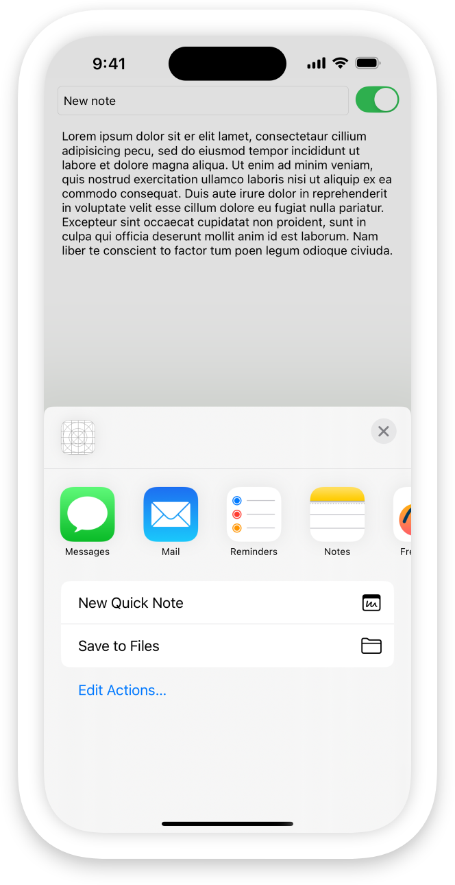
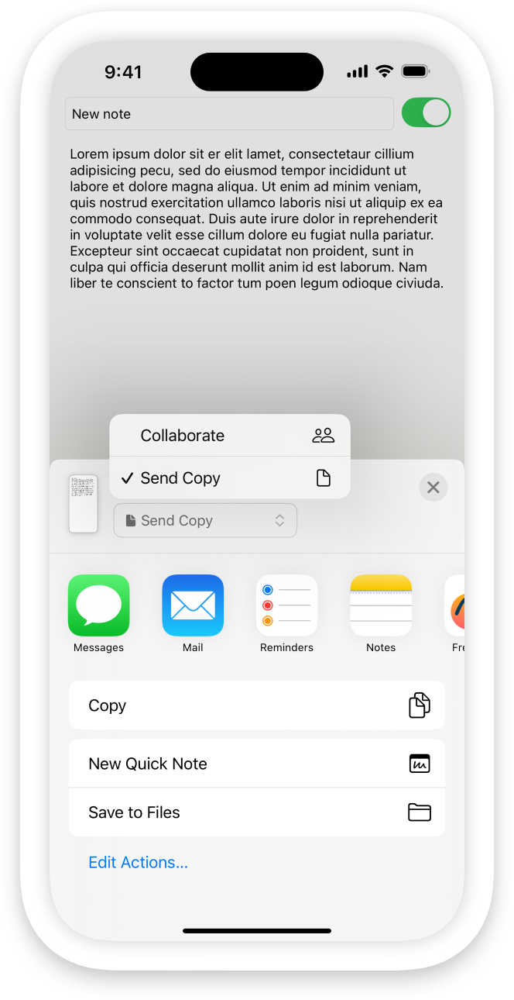
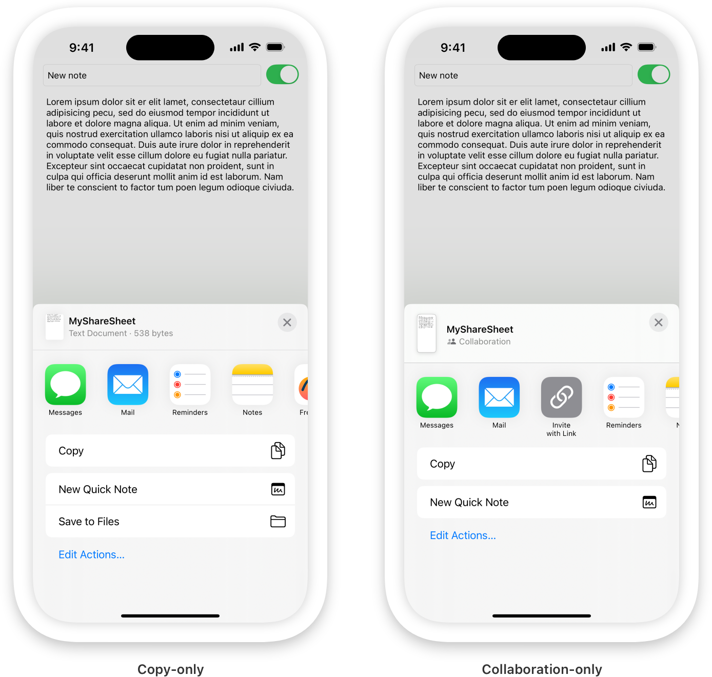
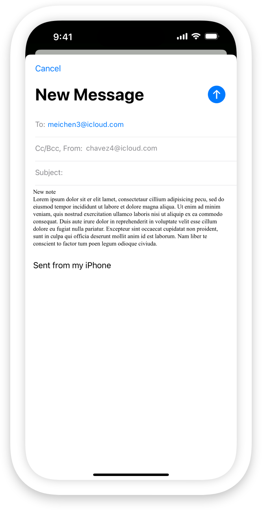

> 导航： [Technologies](../technologies.md) · [UIKit](../uikit.md) · [View controllers](view-controllers.md)

# 协作并分享你的数据副本

<sub>文章</sub>

从你的 App 中分享数据并与他人协作。

## 概述

你可以使用 [UIActivityViewController](uiactivityviewcontroller.md) 对象从你的 App 分享数据。打包数据和实例化 activity 视图控制器有多种选项。一种方法是为你想分享的数据创建一个或多个 [NSItemProvider](../foundation/nsitemprovider.md) 对象。使用这些 item provider 创建一个 [UIActivityItemsConfiguration](uiactivityitemsconfiguration.md)，然后使用该配置创建你的 activity 视图控制器。然后你可以呈现该视图控制器。

```swift
// Create an item provider for your data.
let itemProvider = NSItemProvider(item: noteText.text as NSString,
                                  typeIdentifier: "public.utf8-plain-text")

// Create an activity item configuration from the item provider.
let configuration =
UIActivityItemsConfiguration(itemProviders: [itemProvider])

// Create the activity view controller from the configuration.
let shareSheet = UIActivityViewController(activityItemsConfiguration: configuration)

// Present the share sheet.
present(shareSheet, animated: true) {}
```

这会显示分享表单，让某人将数据副本分享给设备上的其他 App。分享表单中出现的选项因你分享的数据类型而异。上面的示例分享一个 UTF-8 字符串，因此分享表单会显示可以接受文本的 App，如「信息」、「邮件」和「备忘录」。



### 为 iCloud 文稿启用协作

上面的示例分享的是你的 App 数据的副本。你也可以启用协作，以便接收者可以看到数据的更新视图，甚至根据你的 App 中的权限对它进行自己的更改。

要启用协作，你需要可共享的内容，例如：

- 指向 iCloud 文稿的 URL（参见 [url(forUbiquityContainerIdentifier:)](<../foundation/filemanager/url(forubiquitycontaineridentifier_).md>)）
- 存储在 [CloudKit](../cloudkit.md) 中的数据
- 支持 universal links 的自定义协作架构（参见 [Integrate your custom collaboration app in Messages](https://developer.apple.com/videos/play/wwdc2022/10093)）

例如，要为 iCloud 文稿启用协作，你需要你的 App 的 iCloud 容器中某个文件的 URL。创建一个 [NSItemProvider](../foundation/nsitemprovider.md) 对象，并调用其 [registerFileRepresentation(for:visibility:openInPlace:loadHandler:)](<../foundation/nsitemprovider/registerfilerepresentation(for_visibility_openinplace_loadhandler_).md>) 方法，将 URL 作为 `for:` 参数传递，并将 [true](../swift/true.md) 作为 `openInPlace:` 参数传递。

```swift
// Create an empty item provider.
let itemProvider = NSItemProvider()

// Add the URL to a file saved in the iCloud document container.
itemProvider
    .registerFileRepresentation(for: .utf8PlainText,
                                openInPlace: true) { completion in
    completion(url, true, nil)
    return nil
}
```

然后像第一个代码示例那样创建并显示 activity 视图控制器。这一次，分享表单有一个用于选择分享模式的弹出菜单。



### 启用 CloudKit 数据的复制和协作

因为 CloudKit 不将数据存储为文件，它在复制和协作方面需要不同的方法。要分享 CloudKit 数据的副本，你需要创建数据的可共享表示。然后将该数据注册到 [NSItemProvider](../foundation/nsitemprovider.md)。例如，如果你想将 App 的数据作为 UTF-8 文本分享，你可以使用前面的示例为你的文本创建 item provider。

要启用协作，当协作开始时创建一个 [CKShare](../cloudkit/ckshare.md)。你还需要你的 [CKContainer](../cloudkit/ckcontainer.md) 和定义你授予协作者权限的 [CKAllowedSharingOptions](../cloudkit/ckallowedsharingoptions.md)。

```swift
// Create an item provider.
let itemProvider = NSItemProvider()

// Create and save a new share.
itemProvider.registerCKShare(container: container,
                             allowedSharingOptions: CKAllowedSharingOptions.standard) {
    
    // Create your share.
    let newShare = CKShare(rootRecord: recordToShare)
    
    // Configure the share, save it, and handle any errors here.
    
    // Return the newly saved share.
    return newShare
    
}
```

要邀请新协作者加入现有共享，创建一个 item provider 并注册该共享。

```swift
// Create an item provider.
let itemProvider = NSItemProvider()

// Register an existing share.
itemProvider
    .registerCKShare(
        savedShare,
        container: container,
        allowedSharingOptions: CKAllowedSharingOptions.standard
    )
```

有关 CloudKit 中协作的更多信息，参见 [Sharing CloudKit Data with Other iCloud Users](../cloudkit/sharing-cloudkit-data-with-other-icloud-users.md)。

### 限制分享模式

默认情况下，如果你的 item provider 同时支持复制和协作，分享表单会显示一个弹出菜单，让人选择分享模式。在 iOS 18 及更高版本中，你可以将分享限制为仅两种模式之一。

要限制分享模式，创建一个 [CollaborationModeRestriction](uiactivityviewcontroller/collaborationmoderestriction.md) 并将其分配给配置的元数据。你可以使用配置的 [perItemMetadataProvider](uiactivityitemsconfiguration/peritemmetadataprovider.md) 属性访问元数据。

```swift
// Iterate through the metadata keys.
configuration.perItemMetadataProvider = { _, key in
    switch key {
    case .collaborationModeRestrictions:
        // If it's the collaboration mode restriction key, return an array
        // containing a collaboration mode restriction object.
        let modeRestriction = UIActivityViewController.CollaborationModeRestriction(
            disabledMode: .collaborate
        )
        return [modeRestriction]
    default:
        return nil
    }
}
```

然后，像之前一样创建并呈现分享表单。这会生成一个只显示允许的分享模式的分享表单。



或者，你可以显示两种分享选项，但在某人选择受限模式时显示提醒。此提醒还可以包含恢复建议，以帮助人们启用受限模式。

```swift
// Iterate through the metadata keys.
configuration.perItemMetadataProvider = { _, key in
    switch key {
    case .collaborationModeRestrictions:
        // Set the title and text for the alert. Optionally, you can set the title and provide
        // a launch URL for the recovery action.
        let modeRestriction = UIActivityViewController.CollaborationModeRestriction(
            disabledMode: .collaborate,
            alertTitle: "File Locked",
            alertMessage: "You need to unlock the file before you can share it for collaboration.",
            alertDismissButtonTitle: "Cancel",
            alertRecoverySuggestionButtonTitle: "Unlock",
            alertRecoverySuggestionButtonLaunch: unlockURL
        )
        return [modeRestriction]
    default:
        return nil
    }
}
```

在这种情况下，分享表单会显示弹出菜单，并已选中允许的分享模式。当某人尝试将分享模式更改为受限模式时，系统会显示提醒。如果他们随后点击恢复按钮，它会调用你的场景 delegate 的 [- scene:openURLContexts:](<uiscenedelegate/scene(__openurlcontexts_).md>) 方法，传入提供的 URL。有关使用启动 URL 的更多信息，参见 [Defining a custom URL scheme for your app](../xcode/defining-a-custom-url-scheme-for-your-app.md)。

### 指定要分享的对象

在 iOS 18 及更高版本中，你还可以为共享数据指定接收者。为每个接收者创建一个 [INPerson](../intents/inperson.md) 实例，并将其添加到你的 activity 配置的元数据中。

```swift
// Gather data about the recipient.
var name = PersonNameComponents()
name.givenName = myBFF.givenName
name.familyName = myBFF.familyName

let displayName = myBFF.givenName
let email = myBFF.email
let image = INImage(imageData: myBFF.image)

// Create an `INPerson` instance for the recipient.
let recipient = INPerson(
    personHandle: .init(value: email, type: .emailAddress),
    nameComponents: name,
    displayName: displayName,
    image: image,
    contactIdentifier: nil,
    customIdentifier: nil)

// Iterate through the metadata keys.
configuration.perItemMetadataProvider = { _, key in
    switch key {
        // Set the share recipients to an array of `INPerson` instances.
    case .shareRecipients:
        return [recipient]
    default:
        return nil
    }
}
```

然后分享表单会在接受接收者的 App（如「邮件」和「信息」）中填充接收者的数据。



如果某人从分享表单中选择不同的接收者，该选择会覆盖你指定的接收者。如果他们选择不接受接收者的 App，系统会忽略你的接收者。

你还可以通过将 activity 视图控制器的 [excludedActivitySectionTypes](uiactivityviewcontroller/excludedactivitysectiontypes.md) 属性设置为 [UIActivitySectionTypesPeopleSuggestions](uiactivitysectiontypes/peoplesuggestions.md) 来隐藏分享表单中的其他接收者。

```swift
// Hide the suggested recipients.
shareSheet.excludedActivitySectionTypes = .peopleSuggestions
```

## 另请参阅

### Activities interface

- [UIActivityViewController](uiactivityviewcontroller.md) — 用于提供 App 标准服务的视图控制器。
- [UIActivityItemProvider](uiactivityitemprovider.md) — 传递给 activity 视图控制器的数据代理。
- [UIActivityItemSource](uiactivityitemsource.md) — activity 视图控制器用于检索要操作的数据项的一组方法。
- [UIActivity](uiactivity.md) — 你子类化以实现 App 特定服务的抽象类。
- [UIActivityItemsConfigurationProviding](uiactivityitemsconfigurationproviding.md) — 为满足用户分享当前内容的请求提供可共享内容来源的接口。
