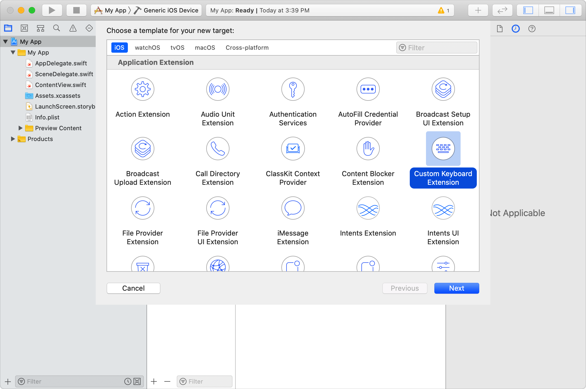
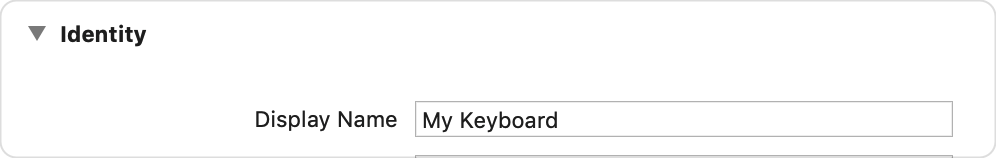
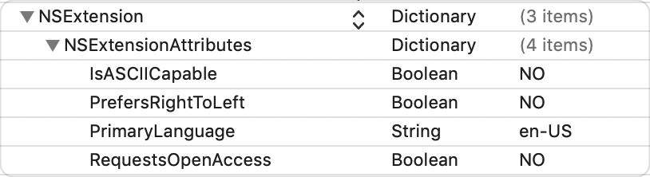
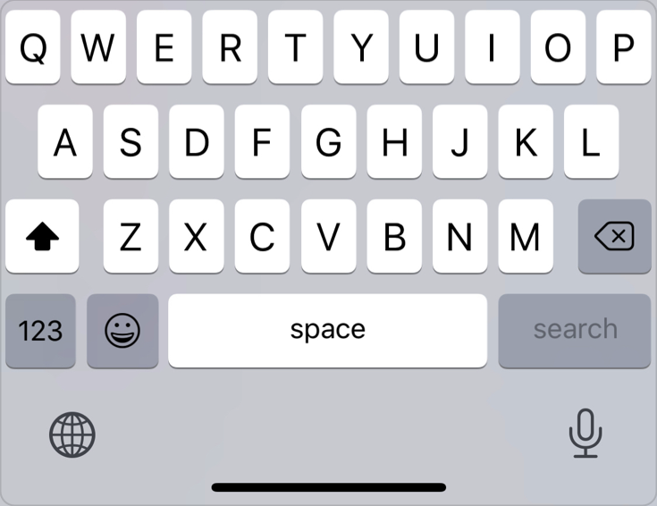
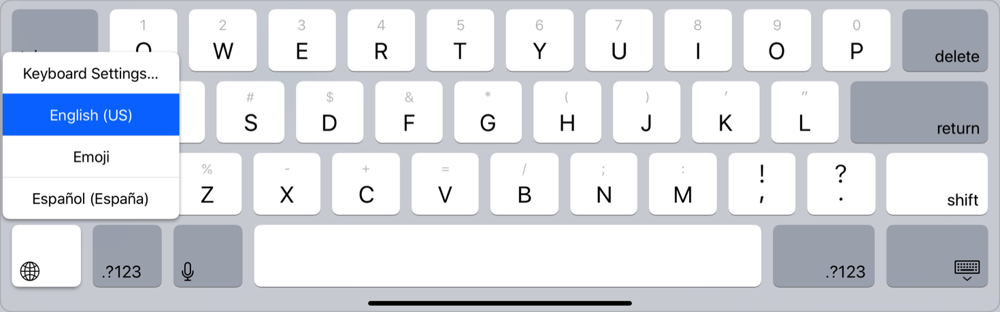
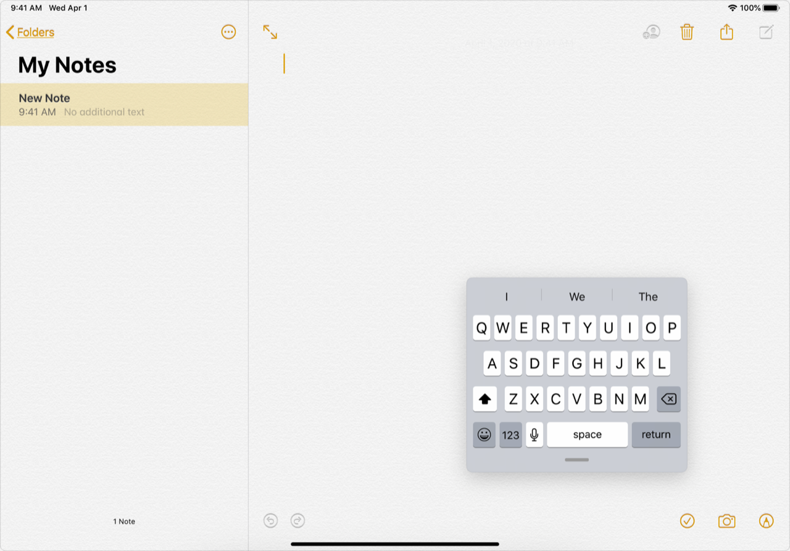

> 导航： [Technologies](../technologies.md) · [UIKit](../uikit.md) · [Keyboards and input](keyboards-and-input.md)

# 创建自定义键盘

为你的 Xcode 项目添加扩展，以提供系统范围的自定义文本输入。

## 概述

自定义键盘会替换系统键盘，供希望获得诸如新颖文本输入方法或输入其他方式不支持的语言文本等能力的用户使用。用户在「设置」中启用你的自定义键盘，这允许他们在任何支持第三方键盘的地方系统范围内访问你的键盘。

> [!note] 注意
> 如果你的键盘仅适用于你的 App，请使用 [UIInputView](uiinputview.md) 而不是创建自定义键盘。将文本栏或文本视图的 [inputView](uitextfield/inputview.md) 属性设置为应替换系统键盘的视图。

创建自定义键盘需要几个步骤。除了向项目添加自定义键盘扩展目标外，你还要配置选项、实现自定义界面，并决定支持哪些文本交互。用户期望各种常见的键盘交互，例如自动更正、自动大写、智能引号等。

### 为你的 App 添加自定义键盘目标

自定义键盘扩展模板为你构建键盘扩展提供了起点。Xcode 会配置你的项目以构建该扩展，并将其包含在你的 App 的 bundle 中。

1. 在 Xcode 中打开你的 App 项目。
2. 选择 File \> New \> Target。
3. 从 Application Extension 组中选择 Custom Keyboard Extension。
4. 点击 Next。
5. 指定扩展的名称并配置语言和其他选项。
6. 点击 Finish。



确保你的键盘目标 General 选项卡中的 Display Name 字段准确描述你的键盘。Settings App 会在第三方键盘列表中使用此值。



如果你支持多种需要不同键盘布局或功能的语言，请重复上述步骤，为每种语言添加额外的自定义键盘目标。在每个目标的 `Info.plist` 文件中相应设置 `PrimaryLanguage` 值。

### 配置信息属性列表选项

如果适用于你的自定义键盘，请编辑键盘扩展的 `Info.plist` 以配置以下选项：

| **IsASCIICapable** | 如果你的键盘能够生成标准 ASCII 字符，请将此设置为 [true](../swift/true.md)。 |
|---|---|
| **PrefersRightToLeft** | 如果你的键盘主要支持从右到左的语言，或者在文本栏中编辑时插入光标应默认在右侧，请将此设置为 [true](../swift/true.md)。 |
| **PrimaryLanguage** | 将此设置为表示你的键盘支持的主要语言的字符串。使用两位字符代码，如 `nl` 表示荷兰语，或语言和国家代码，如 `nl-BE` 表示比利时的荷兰语。Settings App 会在键盘列表中显示主要语言。 |
| **RequestsOpenAccess** | 如果你的键盘需要访问网络资源、写入共享组容器或其他能力，请将此设置为 [true](../swift/true.md)。更多信息，参见 [Configuring open access for a custom keyboard](configuring-open-access-for-a-custom-keyboard.md)。 |

在 `Info.plist` 文件的 [NSExtension](../bundleresources/information-property-list/nsextension.md) \> [NSExtensionAttributes](../bundleresources/information-property-list/nsextension/nsextensionattributes.md) 字典中设置这些键：



### 添加自定义用户界面

当用户激活你的键盘时，它会替换系统键盘。你的自定义键盘扩展的主类提供所显示的视图。默认情况下，Xcode 的自定义键盘模板会将名为 `KeyboardViewController` 的类配置为主类。此控制器的视图是你定义用户界面的地方。

> [!tip] 提示
> 有关设计指导，参见 [Human Interface Guidelines](https://developer.apple.com/design/human-interface-guidelines/components/selection-and-input/onscreen-keyboards)。

在设计键盘的用户界面时，加入一个切换键盘的按钮。系统键盘使用带有地球图标的按钮，如下图所示。



使用 [UIInputViewController](uiinputviewcontroller.md) 上的 [needsInputModeSwitchKey](uiinputviewcontroller/needsinputmodeswitchkey.md) 属性来确定是否应显示切换键盘的按钮。如果用户只启用了键盘，就没有必要显示键盘切换界面。在带 Face ID 的 iPhone 上，iOS 会自动在你的键盘视图下方显示地球图标，并将此属性设置为 [false](../swift/false.md)，表示你不应显示你的按钮。

使用针对你的输入视图控制器子类的 [- handleInputModeListFromView:withEvent:](<uiinputviewcontroller/handleinputmodelist(from_with_).md>) 方法配置你的键盘切换按钮的操作。默认的自定义键盘模板通过向按钮添加操作来完成此操作：

```swift
nextKeyboardButton.addTarget(self, action: #selector(handleInputModeList(from:with:)), for: .allTouchEvents)
```

使用 [UIControlEventAllTouchEvents](uicontrol/event/alltouchevents.md) 允许系统在用户长按按钮时自动显示键盘列表选择器。



<sub>用户长按地球图标后系统键盘的截图。地球按钮显示一个弹出菜单，允许用户在已启用的键盘之间选择，或打开键盘设置。</sub>

你的键盘还应该在布局上保持灵活，因为键盘的宽度可能会变化，即使它当前在屏幕上也是如此。所有键盘都应支持紧凑和常规宽度，并允许在这两者之间过渡。在竖屏和横屏方向下测试你的键盘，在 iPadOS 上务必在浮动视图中测试你的键盘。



更多详情，参见 [Configuring a custom keyboard interface](configuring-a-custom-keyboard-interface.md)。

### 处理文本交互

自定义键盘运行在一个隔离的进程中，无法直接访问文本输入视图。[UIInputViewController](uiinputviewcontroller.md) 提供 [textDocumentProxy](uiinputviewcontroller/textdocumentproxy.md) 属性，允许你的键盘访问文本输入视图。你可以使用此代理来获取选中的文本、插入或删除文本、操作文本插入位置，并获取周围的文本上下文，以支持自动更正或自动完成等功能。

```swift
// Insert a string into the text input view.
textDocumentProxy.insertText("Hello world.")

// Get the currently selected text
let selectedText = textDocumentProxy.selectedText
```

更多信息，参见 [Handling text interactions in custom keyboards](handling-text-interactions-in-custom-keyboards.md)。

### 调试你的自定义键盘

调试自定义键盘类似于调试任何 App 扩展。Xcode 会提示你选择一个宿主 App 来启动，然后你开始在该宿主 App 中编辑文本，以调用你的自定义键盘。宿主 App 可以是运行目标中可用的任何 App，包括包含键盘扩展的你的 App。

1. 选择你的键盘扩展目标的构建 scheme 和运行目标（模拟器或设备）。
2. 选择 Product \> Run 以开始调试会话。
3. Xcode 会提示你选择一个宿主 App。选择允许文本输入的 App，如 Notes。Xcode 会构建并安装你的 App 及其键盘扩展，然后启动你选择的 App。
4. 宿主 App 启动后，开始编辑文本栏。最近使用的键盘会显示。
5. 触摸并按住地球按钮以显示可用键盘列表。选择你的 App 的键盘。

iOS 会在其自己的进程中启动你的键盘扩展，Xcode 会向其附加调试会话。你现在可以在扩展代码中设置断点并执行正常的调试任务。

> [!important] 重要
> 如果你的键盘在活动键盘列表中不可用，你必须启用它。在「设置」中，导航到 General \> Keyboard \> Keyboards，然后选择 Add New Keyboard。从第三方键盘列表中选择你的键盘。

### 限制内存使用

你的自定义键盘代码在单独的进程中执行，该进程对可使用的内存量有限制。如果你的键盘扩展超过了内存限制，系统会终止它。以下是一些高效管理内存的提示：

- 在各种设备型号上测试你的键盘。内存限制因型号而异。
- 务必处理低内存通知。释放任何非严格必要的资源。
- 请记住，关闭键盘并不一定会终止键盘扩展进程。不要假设系统在键盘不再在屏幕上可见时会释放你的键盘使用的内存。

有关与内存使用限制相关的崩溃日志的更多信息，参见 [Diagnosing issues using crash reports and device logs](../xcode/diagnosing-issues-using-crash-reports-and-device-logs.md) 和 `EXC_CRASH (SIGQUIT)`。

## 主题

### Keyboard configuration

- [Configuring a custom keyboard interface](configuring-a-custom-keyboard-interface.md) — 为编辑文本设计灵活、功能齐全且响应迅速的界面。
- [Configuring open access for a custom keyboard](configuring-open-access-for-a-custom-keyboard.md) — 启用网络访问和对共享组容器的写入访问。

### Text interactions

- [Handling text interactions in custom keyboards](handling-text-interactions-in-custom-keyboards.md) — 使用文本输入视图的代理插入、删除和操作文本。

## 另请参阅

### Custom keyboards

- [UIInputViewController](uiinputviewcontroller.md) — 自定义键盘 App 扩展的主视图控制器。
- [UIInputView](uiinputview.md) — 当视图成为第一响应者时，显示并管理视图的自定义输入的对象。
- [UILexicon](uilexicon.md) — 一个只读的术语对数组，每个术语对位于词典条目对象中，用于自定义键盘。
- [UILexiconEntry](uilexiconentry.md) — 词典对象中可用的只读术语对，用于自定义键盘。
- [UITextDocumentProxy](uitextdocumentproxy.md) — 为自定义键盘提供文本上下文的对象。
