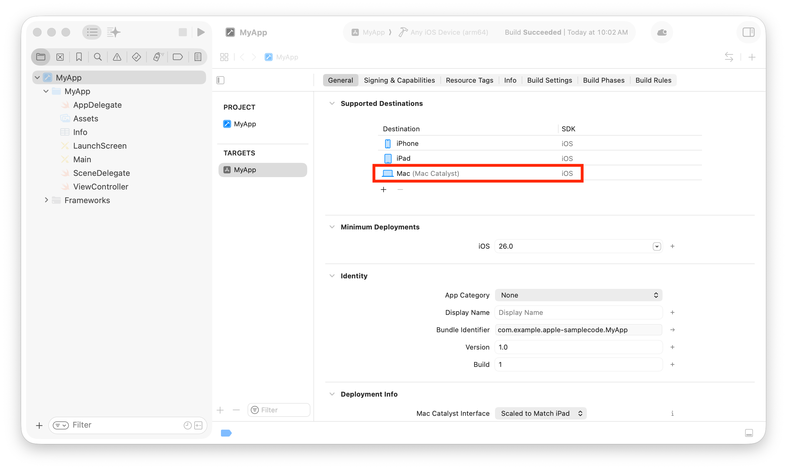
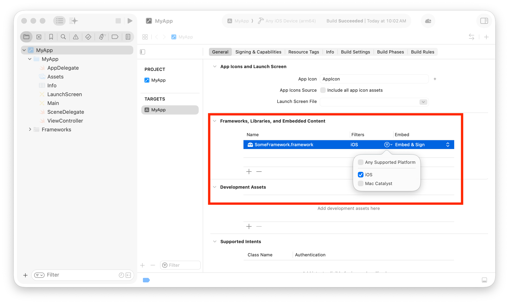

> 导航： [Technologies](../technologies.md) · [UIKit](../uikit.md) · [Mac Catalyst](mac-catalyst.md)

# 为你的 iPad App 创建 Mac 版本

<sub>文章</sub>

使用 Mac Catalyst 将你的 iPad App 带到 macOS。

## 概述

为 Mac 配置你的 iPad App 可以简单到在 Xcode 中向目标支持的目标列表添加一个条目。根据你的 App 使用的功能和框架，配置过程可能需要一些额外步骤，例如手动排除其他框架或内容。

> [!note] 注意
> 有关设计 iPad App 的 Mac 版本的信息，参见 [Human Interface Guidelines \> Mac Catalyst](https://developer.apple.com/design/human-interface-guidelines/technologies/mac-catalyst/introduction)。

### 为 Mac 配置你的 App

要添加对 Mac 的支持，请打开你的 Xcode 项目并选择要配置的 iOS 目标。在 General 选项卡的 Supported Destinations 下，点击 Add 按钮 (+) 以添加目标。选择 Mac，然后选择 Mac Catalyst 以添加该目标。



启用 Mac 支持后，Xcode 会向你的项目添加 [App Sandbox Entitlement](../bundleresources/entitlements/com.apple.security.app-sandbox.md)。Xcode 只会将此 entitlement 包含在 App 的 Mac 版本中，不包含在 iOS 版本中。Xcode 还会将 My Mac 添加到目标列表中。选择此目标以从 Xcode 运行你的 Mac App。

此时，你可能已经可以构建并运行 App 的 Mac 版本。要试一试，选择 My Mac 作为目标并运行你的项目。

### 超越勾选框

你可能会发现 App 的 Mac 版本仍然无法构建，因为：

- 你的项目包含不兼容的框架、库或嵌入内容。
- 你的源代码引用了不支持的 API。

启用 Mac 支持后，Xcode 会在可能的情况下自动为项目的 Mac 构建排除不兼容的框架和嵌入内容。不过，你可能仍需要手动排除其他框架或内容。

要手动排除某个项，请打开 iOS 目标 General 选项卡下的 Frameworks, Libraries, and Embedded Content。然后为该项仅选择 iOS 作为 Filters。此设置会将该项从 App 的 Mac 版本中排除。



如果你的源代码引用了 Mac 版本 App 不可用的 API，请将代码封装在使用 `targetEnvironment()`（Swift）或 `TARGET_OS_MACCATALYST`（Objective-C）平台条件的编译条件块中。

**Swift**

```swift
#if !targetEnvironment(macCatalyst)
// Code to exclude from Mac.
#endif
```

**Objective-C**

```objc
#if !TARGET_OS_MACCATALYST
// Code to exclude from Mac.
#endif
```

你可以使用相同的方法来包含仅在 macOS 中可用的框架和代码。对于框架，请选择 macOS 作为平台设置，并将代码封装在 `#if targetEnvironment(macCatalyst)`（Swift）或 `#if TARGET_OS_MACCATALYST`（Objective-C）语句中。

### 使你的 App 更像 Mac App

按照这些步骤之后，你应该能够运行你的 iPad App on Mac。但在将新 App 发送给客户之前，它需要进行一些额外的更改以使其更像 Mac App。要了解更多信息，参见 [Optimizing your iPad app for Mac](optimizing-your-ipad-app-for-mac.md)。
