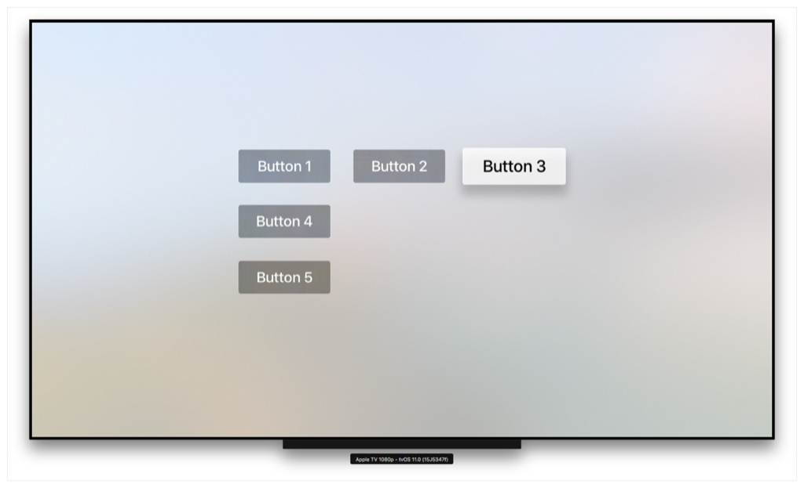
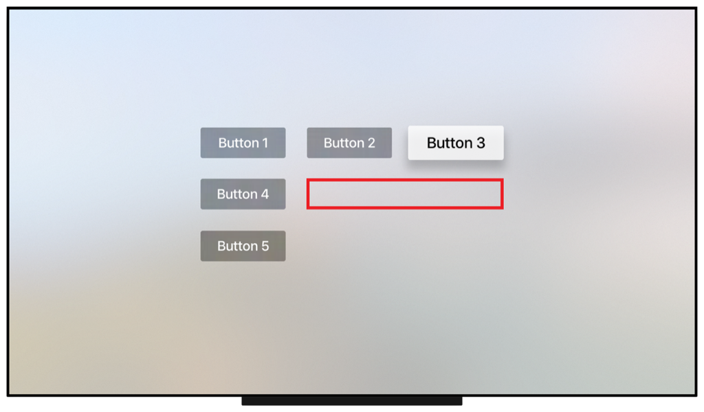
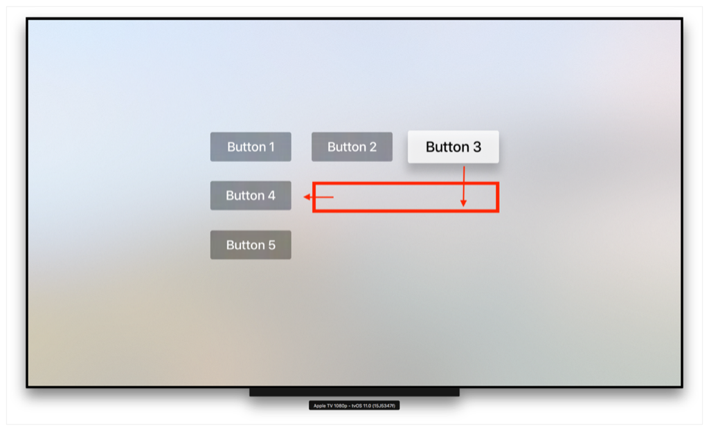

> 导航：[Technologies](../technologies.md) · [UIKit](../uikit.md) · [Focus-based navigation](focus-based-navigation.md)

# 创建自定导览交互

<sub>文章</sub>

构建将焦点移动到所需位置的非标准导览交互。

## 概述

对于大多数 App，简单的布局就足以让用户与 App 交互。然而，有时焦点引擎不会将焦点移动到期望的位置，或者根本不移动焦点。对于这些情况，使用 [UIFocusGuide](uifocusguide.md) 类创建将焦点重定向的不可见区域。

### 放置可聚焦项

将可聚焦项放置在 App 中并按期望排列。在可能的情况下，利用焦点引擎的内置行为。仅在绝对必要时才使用焦点引导。下图显示了一行三个按钮和一列三个按钮。焦点会在同一行或同一列的按钮之间自动移动，但当用户从按钮 2 或按钮 3 向下滑动时，焦点引擎不会移动焦点。然而，对于此布局，目标是当用户向下滑动时让按钮 4 获得焦点。



### 添加焦点引导

要使焦点在用户从按钮 2 或按钮 3 向下滑动时移动到按钮 4，需要焦点引导。创建一个焦点引导并将其添加到当前视图。焦点引擎可以检测到该焦点引导，并按指示重定向焦点。

```swift
let myFocusGuide = UIFocusGuide()
self.view.addLayoutGuide(myFocusGuide)
```

### 为焦点引导添加约束

当用户从按钮 2 或按钮 3 向下滑动时，焦点应移动到按钮 4。为实现这一点，你需要以编程方式为焦点引导添加约束。焦点引导的宽度需要等于按钮 2 和按钮 3 合并的宽度。将焦点引导的左约束设为按钮 2 的左约束，右约束设为按钮 3 的右约束。为方便起见，本示例将焦点引导的顶部和底部约束设为按钮 4 的顶部和底部约束。最后，设置 [preferredFocusEnvironments](uifocusguide/preferredfocusenvironments.md) 属性为按钮 4。下图显示了使用以下代码中的约束创建的焦点引导的位置与大小。

```swift
myFocusGuide.leftAnchor.constraint(equalTo: button_2.leftAnchor).isActive = true
myFocusGuide.rightAnchor.constraint(equalTo: button_3.rightAnchor).isActive = true
myFocusGuide.topAnchor.constraint(equalTo: button_4.topAnchor).isActive = true
myFocusGuide.bottomAnchor.constraint(equalTo: button_4.bottomAnchor).isActive = true
myFocusGuide.preferredFocusEnvironments = [button_4]
```

> [!note] 注意
> 仅当约束被设为 Active 时，焦点引导才会生效。



当用户从按钮 2 或按钮 3 向下滑动时，焦点会正确重定向到按钮 4。



## 另请参阅

### 焦点引导

- [UIFocusGuide](uifocusguide.md) — 暴露非视图区域作为可聚焦区域的对象。
