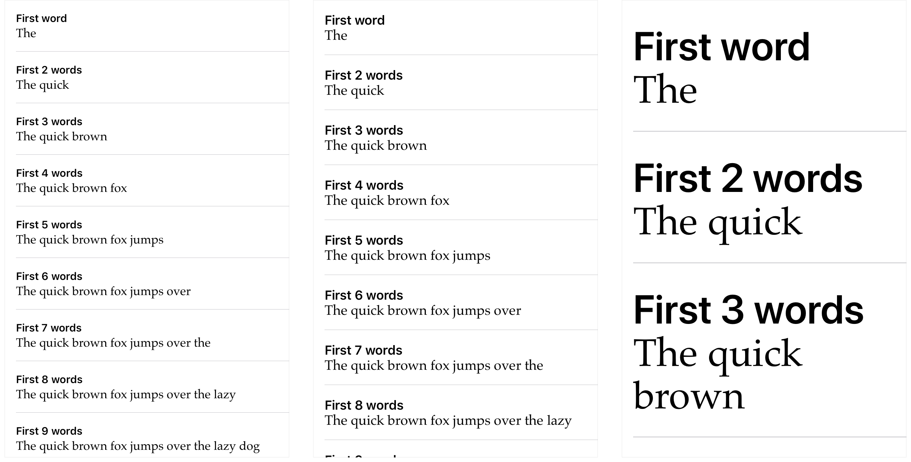

> 导航： [Technologies](../technologies.md) · [UIKit](../uikit.md) · [Text display and fonts](text-display-and-fonts.md) · [UIFont](uifont.md)

# 创建自适应大小的表格视图单元格

<sub>示例代码</sub>

创建支持 Dynamic Type 的表格视图单元格，并使用系统间距约束来调整文本标签周围的间距。

## 概述

此示例代码项目展示如何创建支持 Dynamic Type 的自适应大小表格视图单元格。因为 Dynamic Type 让用户控制单元格中显示的文本大小，所以单元格根据文本大小调整自身大小非常重要。

项目还展示如何使用 Auto Layout 约束，根据文本大小自动调整文本标签周围的间距。为了演示自动间距，单元格显示两个 [UILabel](uilabel.md) 对象：一个标题标签和一个正文标签。

### 添加 Dynamic Type 支持

要添加对 Dynamic Type 的支持，单元格为每个标签分配一个缩放字体。对于标题标签，使用带有 [UIFontTextStyleHeadline](uifont/textstyle/headline.md) 文本样式的首选字体。首选字体是系统字体，可以缩放到不同大小。其初始文本大小由 `headline` 文本样式的字体度量决定。

```swift
headlineLabel.font = UIFont.preferredFont(forTextStyle: .headline)
headlineLabel.adjustsFontForContentSizeCategory = true
```

对于正文标签，使用自定义字体。然而，为了支持 Dynamic Type 的自定义字体，必须创建一个采用特定文本样式字体度量的字体版本。在正文标签的情况下，Palatino 自定义字体与 [UIFontTextStyleBody](uifont/textstyle/body.md) 文本样式一起使用。

```swift
guard let palatino = UIFont(name: "Palatino", size: 18) else {
    fatalError("""
        Failed to load the "Palatino" font.
        Since this font is included with all versions of iOS that support Dynamic Type, verify that the spelling and casing is correct.
        """
    )
}
bodyLabel.font = UIFontMetrics(forTextStyle: .body).scaledFont(for: palatino)
bodyLabel.adjustsFontForContentSizeCategory = true
```

在看到 Dynamic Type 的效果之前，必须在每个标签上将 [adjustsFontForContentSizeCategory](uicontentsizecategoryadjusting/adjustsfontforcontentsizecategory.md) 属性设置为 `true`。此属性告诉标签在用户更改首选文本大小时自动调整其字体的文本大小。更多信息，参见 [Scaling fonts automatically](scaling-fonts-automatically.md)。

### 使用 Auto Layout 约束调整单元格大小和间距

此时，两个标签能够自动调整其文本大小。然而，单元格无法调整其大小。需要 Auto Layout 约束来调整单元格 [contentView](uitableviewcell/contentview.md) 的大小和间距，以及它包含的标签。

### 为每个标签设置水平位置

两个标签的宽度都应扩展以填充单元格内容视图的宽度，标题标签应出现在正文标签上方。为了实现这一点，Auto Layout 约束被添加到每个标签，从定义标签宽度的约束开始。对于标题标签，添加的约束告诉标签填充内容视图 leading 和 trailing margin 之间的空间。对于正文标签，添加的约束将其 leading 和 trailing anchors 设置为等于标题标签的 leading 和 trailing anchors。

```swift
headlineLabel.leadingAnchor.constraint(equalTo: contentView.layoutMarginsGuide.leadingAnchor).isActive = true
headlineLabel.trailingAnchor.constraint(equalTo: contentView.layoutMarginsGuide.trailingAnchor).isActive = true

bodyLabel.leadingAnchor.constraint(equalTo: headlineLabel.leadingAnchor).isActive = true
bodyLabel.trailingAnchor.constraint(equalTo: headlineLabel.trailingAnchor).isActive = true
```

将正文标签的 leading 和 trailing anchors 设置为等于标题标签的 leading 和 trailing anchors，可确保每个标签的左右边缘始终位于相同位置。这种方法还有一个额外的好处：调整标题标签上的左边缘或右边缘会自动将更改应用到正文标签。虽然当只有两个标签时这可能看起来微不足道，但将一个标签的 leading 和 trailing anchors 设置为与另一个标签的相同 anchors 相等，可以在有很多标签必须对齐边缘时节省时间。

### 为每个标签设置垂直位置

水平定位就位后，是时候为每个标签设置垂直位置了。再次使用 Auto Layout 约束来定位垂直对齐，将标题文本放置在正文文本上方。

设置垂直位置的一种方式是添加一个约束，基于某个常量值定义两个标签之间的距离。然而，依赖常量值的问题在于，每次文本大小更改时你都必须调整该值；否则，文本可能看起来分散或拥挤，难以阅读。在 iOS 11 及更高版本中，你可以通过使用系统间距约束来避免依赖和设置常量值。

系统间距约束根据创建约束时使用的 anchors 提供的信息，将两个 UI 元素之间的距离设置为一个值。例如，系统间距约束可以将一个标签的 [firstBaselineAnchor](uiview/firstbaselineanchor.md)（标签中最顶部文本的基线）定位在另一个标签的 [lastBaselineAnchor](uiview/lastbaselineanchor.md)（该标签中最底部文本的基线）下方，距离由系统定义。该约束确保无论文本大小如何，两个标签之间始终应用足够的间距，而无需调整约束的常量值。

对于示例代码项目，单元格使用系统间距约束来：

1. 设置单元格内容视图顶部与标题标签之间的间距。
2. 设置正文标签与单元格内容视图底部之间的间距。
3. 设置标题和正文标签之间的间距。

```swift
headlineLabel.firstBaselineAnchor.constraint(equalToSystemSpacingBelow: contentView.layoutMarginsGuide.topAnchor, multiplier: 1).isActive = true

contentView.layoutMarginsGuide.bottomAnchor.constraint(equalToSystemSpacingBelow: bodyLabel.lastBaselineAnchor, multiplier: 1).isActive = true

bodyLabel.firstBaselineAnchor.constraint(equalToSystemSpacingBelow: headlineLabel.lastBaselineAnchor, multiplier: 1).isActive = true
```

系统间距约束就位后，系统会根据文本大小自动调整两个标签周围的间距。



<sub>左侧是示例 App 显示最小文本大小的截图。中间是显示默认文本大小的截图。右侧是显示最大文本大小的截图。</sub>

### 使用 Accessibility Inspector 测试

为了测试示例 App 对不同文本大小的反应，请在模拟器中运行 App，并使用 Accessibility Inspector 更改文本大小。检查器让你可以在不切换 App 和「设置」App 的情况下，用不同的文本大小测试 App 的界面。

要使用 Accessibility Inspector，请按照以下步骤：

1. 启动 Xcode，然后运行你的 App。
2. 从 Xcode 菜单栏中，选择 **Xcode \> Open Developer Tool \> Accessibility Inspector** 以启动检查器。
3. 在 Accessibility Inspector 的左上角，选择 **Simulator** 作为目标。
4. 点击 _Settings_ 图标（形状像齿轮）。
5. 移动 _Font size_ 滑块以更改 App 中显示的文本大小。

## 另请参阅

### Creating Fonts

- [Scaling fonts automatically](scaling-fonts-automatically.md) — 使用 Dynamic Type 自动缩放界面中的文本。
- [+ preferredFontForTextStyle:](<uifont/preferredfont(fortextstyle_).md>) — 返回指定文本样式的系统字体实例，并按用户选择的内容大小类别进行缩放。
- [+ preferredFontForTextStyle:compatibleWithTraitCollection:](<uifont/preferredfont(fortextstyle_compatiblewith_).md>) — 返回适合文本样式和 trait 的系统字体实例。
- [TextStyle](uifont/textstyle.md) — 描述字体首选样式的常量。
- [+ fontWithName:size:](<uifont/init(name_size_).md>) — 为指定字体名称和大小创建并返回字体对象。
- [+ fontWithDescriptor:size:](<uifont/init(descriptor_size_).md>) — 返回与指定字体描述符匹配的字体。
- [- fontWithSize:](<uifont/withsize(__).md>) — 返回与字体相同但具有指定大小的字体对象。

## 下载

- [CreatingSelfSizingTableViewCells.zip](https://docs-assets.developer.apple.com/published/097e9c9dad75/CreatingSelfSizingTableViewCells.zip)
