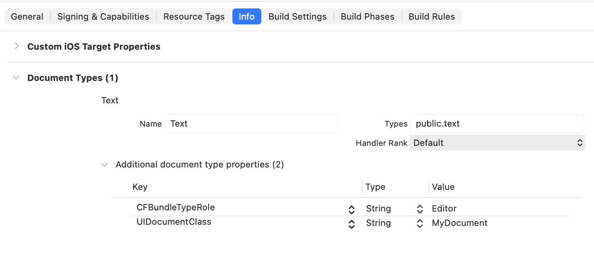
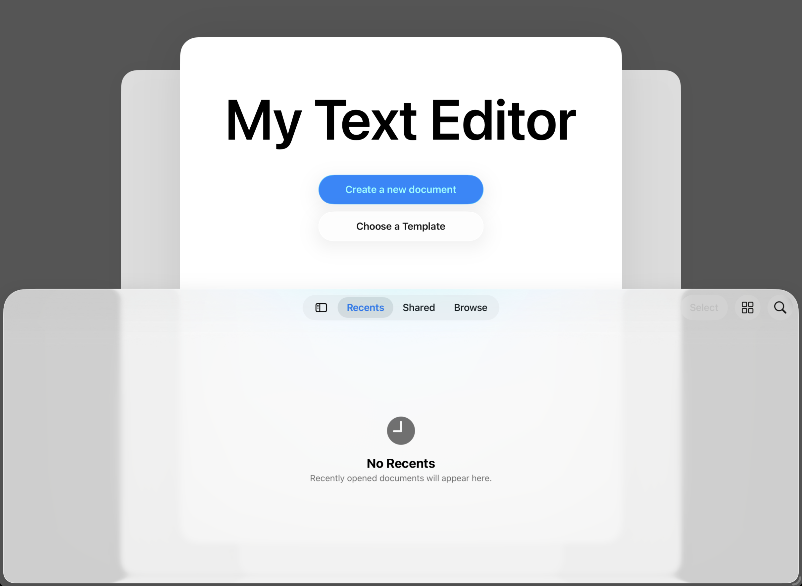

> 导航： [Technologies](../technologies.md) · [UIKit](../uikit.md) · [View controllers](view-controllers.md)

# 自定义基于文稿的 App 的启动体验

<sub>文章</sub>

为你的 App 的文稿启动场景添加独特的元素。

## 概述

在 iOS 18 及更高版本中，你可以自定义 App 的文稿浏览体验，例如设置标题和操作按钮、配置背景，以及向场景添加自定义资源。

> [!note] SwiftUI 等效
> 有关在 SwiftUI 中采用基于文稿的启动体验的信息，阅读 [Building a document-based app with SwiftUI](../swiftui/building-a-document-based-app-with-swiftui.md)。

### 设置基于文稿的 App

要创建自定义的文稿启动体验，请按照以下步骤：

- 在 App 目标 Info 选项卡的 Document Types 部分声明你支持的文稿类型。
- 在 Info 选项卡的 Custom iOS Target Properties 部分设置 Supports Document Browser 键（`UISupportsDocumentBrowser`）。
- 为你的 App 支持的每种文稿类型创建一个 [UIDocument](uidocument.md) 子类。
- 为你的 App 创建一个 [UIDocumentViewController](uidocumentviewcontroller.md) 子类，并让该子类采用 [UIDocumentBrowserViewControllerDelegate](uidocumentbrowserviewcontrollerdelegate.md) 协议。
- 将你的文稿视图子类设置为 App 的根视图控制器。或者，你可以将 [UIDocumentViewController](uidocumentviewcontroller.md) 子类嵌入到导航控制器中，并将其设置为根视图控制器。
- 实现 delegate 的 [- documentDidOpen](<uidocumentviewcontroller/documentdidopen().md>) 方法以配置你的文稿视图。
- 使用文稿视图控制器的 [launchOptions](uidocumentviewcontroller/launchoptions-swift.property.md) 属性配置启动场景。

设置文稿类型时，为你的文稿提供名称和统一类型标识符。添加 [CFBundleTypeRole](../bundleresources/information-property-list/cfbundledocumenttypes/cfbundletyperole.md) 键，其值为 `Viewer`（只读）或 `Editor`（如果你的 App 既读取又写入该文稿类型）。最后，添加 `UIDocumentClass` 键，并将其值设置为该文稿类型对应的 [UIDocument](uidocument.md) 子类的名称。



在实现 [- documentDidOpen](<uidocumentviewcontroller/documentdidopen().md>) 方法时，验证你有有效的文稿和有效的视图，然后再更新视图。更多信息，参见 [UIDocumentViewController](uidocumentviewcontroller.md)。

```swift
override func viewDidLoad() {
    super.viewDidLoad()
    // Configure your launch options.
    mySetupTextView()
}

override func documentDidOpen() {
    mySetupTextView()
}

func mySetupTextView() {
    
    // Make sure you have a valid document.
    guard let document = document as? MyDocument else { return }
            
    // Make sure you have a valid view.
    guard let view else { return }
    
    // Make sure the document is open.
    guard !document.documentState.contains(.closed) else { return }

    // Configure the view.
    textView.text = document.text
}
```

### 创建新文稿

文稿查看器使用 App intents 来创建新文稿。它还使用 [CreationIntent](uidocument/creationintent.md) 结构来指定你的 App 可以创建文稿的不同方式。[UIDocument](uidocument.md) 已提供默认的 intent 及对应的 `.default` 枚举值。

要添加你自己的 intent，请先扩展 [CreationIntent](uidocument/creationintent.md) 并为你的 intent 添加值。

```swift
// Extend the creation intent enumeration to add custom options for document creation.
extension UIDocument.CreationIntent {
    static let template = UIDocument.CreationIntent("template")
}
```

然后调用 [UIDocument](uidocument.md) 类的 [+ createDocumentActionWithIntent:](<uidocumentviewcontroller/launchoptions-swift.class/createdocumentaction(withintent_).md>) 方法来创建该 intent。设置 intent 的 title，并将其分配给你的 [LaunchOptions](uidocumentviewcontroller/launchoptions-swift.class.md) 实例的 [primaryAction](uidocumentviewcontroller/launchoptions-swift.class/primaryaction.md) 或 [secondaryAction](uidocumentviewcontroller/launchoptions-swift.class/secondaryaction.md) 属性。默认情况下，系统会自动将文稿视图控制器的 [primaryAction](uidocumentviewcontroller/launchoptions-swift.class/primaryaction.md) 设置为默认的创建文稿操作。

```swift
// Provide an action for the secondary action.
let templateAction = LaunchOptions.createDocumentAction(withIntent: .template)

// Set the intent's title.
templateAction.title = "Choose a Template"

// Add the intent to an action.
launchOptions.secondaryAction = templateAction
```

最后，实现 [UIDocumentBrowserViewControllerDelegate](uidocumentbrowserviewcontrollerdelegate.md) 协议的 [- documentBrowser:didRequestDocumentCreationWithHandler:](<uidocumentbrowserviewcontrollerdelegate/documentbrowser(__didrequestdocumentcreationwithhandler_).md>) 方法。当某事触发其中一个创建文稿 intent 时，系统会调用此方法。在你的实现中，使用控制器的 [activeDocumentCreationIntent](uidocumentbrowserviewcontroller/activedocumentcreationintent.md) 来确定 intent。创建文稿，然后将 URL 和 [ImportMode](uidocumentbrowserviewcontroller/importmode.md) 传递给 `intentHandler`。

```swift
override func documentBrowser(_ controller: UIDocumentBrowserViewController, didRequestDocumentCreationWithHandler importHandler: @escaping (URL?, UIDocumentBrowserViewController.ImportMode) -> Void) {

    switch controller.activeDocumentCreationIntent {
    case .template:
        
        // Let someone select a template, and return
        // a URL to that template.
        let templateURL = myPresentTemplateSelection()
        
        // Pass the URL to the import handler.
        importHandler(templateURL, .copy)
        
    default:
        
        // Create the default document.
        let newDocumentURL = myCreateEmptyDocument()
        
        // Pass the URL to the import handler.
        importHandler(newDocumentURL, .move )
    }
}
```

### 自定义文稿浏览体验

在 iPad、iPhone 和 Vision Pro（对于兼容的 iPad App）上，系统会显示一个包含标题和任何文稿创建按钮的启动场景。它还会将文稿浏览器作为 sheet 显示在此视图之上。使用你的文稿视图控制器的 [launchOptions](uidocumentviewcontroller/launchoptions-swift.property.md) 属性按如下方式自定义此场景：

- 设置 [title](uidocumentviewcontroller/launchoptions-swift.class/title.md) 属性以更改标题视图中显示的名称。默认情况下，控制器使用你的 App 的名称。
- 修改 [background](uidocumentviewcontrollerlaunchoptions/background.md) 属性以配置场景的背景。
- 使用 [foregroundAccessoryView](uidocumentviewcontroller/launchoptions-swift.class/foregroundaccessoryview.md) 或 [backgroundAccessoryView](uidocumentviewcontroller/launchoptions-swift.class/backgroundaccessoryview.md) 将 [UIView](uiview.md) 对象放置在标题视图的前面或后面。
- 设置 [primaryAction](uidocumentviewcontroller/launchoptions-swift.class/primaryaction.md) 或 [secondaryAction](uidocumentviewcontroller/launchoptions-swift.class/secondaryaction.md) 属性，以向标题视图添加按钮。如果你不修改 [primaryAction](uidocumentviewcontroller/launchoptions-swift.class/primaryaction.md) 属性，控制器会添加一个 Create Document 按钮作为默认的主要操作。
- 使用 [browserViewController](uidocumentviewcontroller/launchoptions-swift.class/browserviewcontroller.md) 访问并配置文稿浏览器控制器。

通常，你在视图控制器的 [- viewDidLoad](<uiviewcontroller/viewdidload().md>) 方法中配置启动选项。

```swift
override func viewDidLoad() {
    super.viewDidLoad()
    
    // Assign the view controller as the browser delegate.
    launchOptions.browserViewController.delegate = self
    
    // Customize launch options.
    launchOptions.title = "My Text Editor"
    launchOptions.background.backgroundColor = .darkGray
    
    // Provide an action for the secondary action.
    let templateAction = LaunchOptions.createDocumentAction(withIntent: .template)
    templateAction.title = "Choose a Template"
    launchOptions.secondaryAction = templateAction
    
    mySetupTextView()
}
```



<sub>文稿启动场景的截图，标题设置为 “My Text Editor”。它具有默认的主要操作和自定义的次要操作。</sub>

## 另请参阅

### Documents and directories

- [Adding a document browser to your app](adding-a-document-browser-to-your-app.md) — 通过向你的 App 添加文稿浏览器，让人访问其本地或远程文稿。
- [Providing access to directories](providing-access-to-directories.md) — 使用文稿选择器访问 App 容器外部的目录内容。
- [Building an app with a document browser](building-an-app-with-a-document-browser.md) — 通过向你的 App 添加文稿浏览器，提供对设备上和云端文件的访问。
- [Building a document browser app for custom file formats](building-a-document-browser-app-for-custom-file-formats.md) — 实现自定义文稿文件格式，以管理用户与不同云存储提供商上文件的交互。
- [UIDocumentViewController](uidocumentviewcontroller.md) — 管理并呈现存储在本地或云端的文稿的视图控制器。
- [UIDocumentBrowserViewController](uidocumentbrowserviewcontroller.md) — 用于浏览和对本地及云端存储的文稿执行操作的视图控制器。
- [UIDocumentPickerViewController](uidocumentpickerviewcontroller.md) — 提供对 App 沙盒外部文稿或目标的访问的视图控制器。
- [UIDocumentInteractionController](uidocumentinteractioncontroller.md) — 预览、打开或打印 App 无法直接处理的文件格式的文件的视图控制器。
