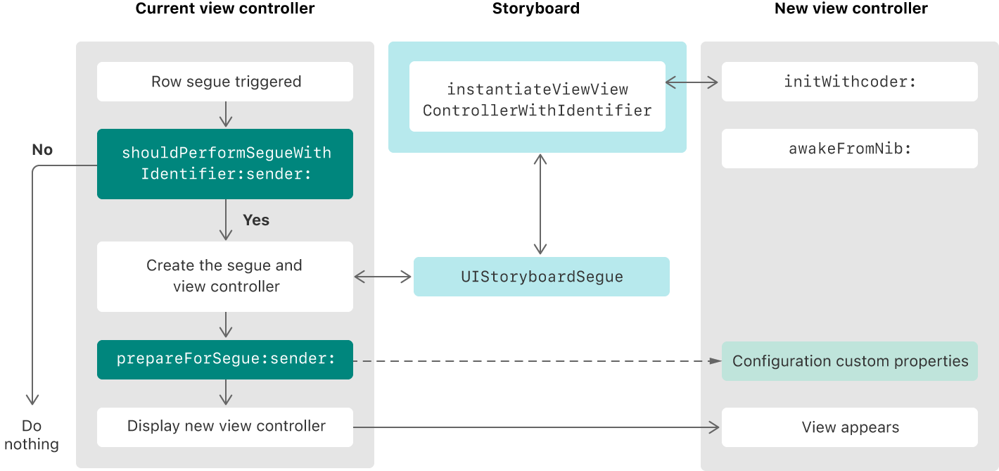

> 导航：[Technologies](../technologies.md) · [UIKit](../uikit.md) · [资源管理](resource-management.md)

# 自定基于 segue 的呈现的行为

<sub>文章</sub>

在 segue 期间在视图控制器之间传递数据，并以编程方式控制 segue 何时发生。

## 概述

当用户触发 segue 时，UIKit 使用在你的 storyboard 中找到的选项来呈现视图控制器。UIKit 还为你提供了动态修改 segue 过程的机会，既可以阻止 segue 发生，也可以在 segue 发生时执行额外的工作。

关于如何创建 segue 的信息，参见[在 storyboard 文件中以视觉方式指定呈现](showing-and-hiding-view-controllers.md#Specify-presentations-visually-in-your-storyboard-file)。

### 配置过渡的呈现样式

Segue 的类型决定 UIKit 在呈现和关闭 segue 时使用哪种动画，如下表所示。你在创建 segue 时指定类型，但之后也可以在属性检查器中更改它。

| Segue 类型 | 行为 |
|---|---|
| 显示（Show，推送） | 以模态方式显示视图控制器，除非父视图控制器实现了 [- showViewController:sender:](<uiviewcontroller/show(__sender_).md>) 动作方法，此时由该视图控制器定义呈现行为。例如，[UINavigationController](uinavigationcontroller.md) 会把新的视图控制器推入其导览叠放（navigation stack）。 |
| 显示详细信息（Show Detail，替换） | 以模态方式显示视图控制器，除非父视图控制器实现了 [- showDetailViewController:sender:](<uiviewcontroller/showdetailviewcontroller(__sender_).md>) 动作方法，此时由该视图控制器定义呈现行为。例如，[UISplitViewController](uisplitviewcontroller.md) 会用新的视图控制器替换其第二个子视图控制器（详细信息控制器）。 |
| 模态呈现（Present Modally） | 使用指定的呈现样式和过渡样式，以模态方式显示视图控制器。 |
| 以弹出窗口呈现（Present as Popover） | 在水平常规环境中，UIKit 在弹出窗口中呈现视图控制器。在水平紧凑环境中，UIKit 以模态方式呈现视图控制器。 |

关于 UIKit 如何执行涉及显示和显示详细信息呈现样式的 segue 的更多信息，参见[让当前上下文定义呈现技术](showing-and-hiding-view-controllers.md#Let-the-current-context-define-the-presentation-technique)。

### 根据动态条件阻止 segue

当你不想让用户离开当前视图控制器时，从源视图控制器的 [- shouldPerformSegueWithIdentifier:sender:](<uiviewcontroller/shouldperformsegue(withidentifier_sender_).md>) 方法返回 false，告诉 UIKit 不要执行 segue。使用该方法执行你确定 segue 能否继续所需的任何检查。例如，如果视图控制器的内容无效且需要用户采取纠正操作，就返回 [false](../swift/false.md)。返回 true 会让 segue 继续，而返回 [false](../swift/false.md) 会让 segue 静默失败。

### 把数据传递给呈现的视图控制器

由于 UIKit 在 segue 期间自动创建并呈现视图控制器，因此使用 [- prepareForSegue:sender:](<uiviewcontroller/prepare(for_sender_).md>) 方法在 segue 发生之前把任何数据传递给该视图控制器。在包含发起 segue 的对象的视图控制器上实现该方法。从提供的 [UIStoryboardSegue](uistoryboardsegue.md) 对象获取新的视图控制器，以及关于触发了哪个 segue 的信息。

在以下代码示例中，当前视图控制器获取与所选表格行关联的图像，并把该图像传递给新的视图控制器。

```swift
override func prepare(for segue: UIStoryboardSegue, sender: Any?) {
  // 获取新的视图控制器。
   if let imageVC = segue.destination as? ImageViewController {

      // 获取所选行对应的图像。
      let image = getImageForSelectedRow()
      imageVC.currentImage = image
   }
}
```

使用委托设计模式，把数据从呈现的视图控制器传回发起它的视图控制器。在你的 [- prepareForSegue:sender:](<uiviewcontroller/prepare(for_sender_).md>) 方法中配置该委托关系。

### 理解 segue 期间的事件顺序

虽然 UIKit 自动处理 segue，但你可以在许多地方执行与显示新视图控制器相关的工作。下图显示了从用户触发 segue 到过程完成期间发生的事件流程。执行 segue 相关动作的主要位置是当前视图控制器的 [- prepareForSegue:sender:](<uiviewcontroller/prepare(for_sender_).md>) 方法，但你也可以在创建新视图控制器期间执行任务。



<sub>一张插图，展示用户触发 segue 时发生的事件流程。UIKit 调用当前视图控制器的方法来修改 segue 的行为。</sub>

## 另请参阅

### Storyboard

- [使用 unwind segue 关闭视图控制器](dismissing-a-view-controller-with-an-unwind-segue.md) — 在你的 storyboard 文件中配置 unwind segue，动态选择下一个要显示的最合适视图控制器。
- [UIStoryboard](uistoryboard.md) — 对 Interface Builder storyboard 资源文件中表示的设计时视图控制器图的封装。
- [UIStoryboardSegue](uistoryboardsegue.md) — 一个为两个视图控制器之间的视觉过渡做准备并执行该过渡的对象。
- [UIStoryboardUnwindSegueSource](uistoryboardunwindseguesource.md) — 对 unwind segue 信息的封装。
